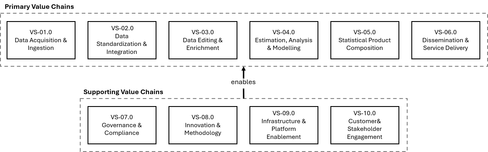
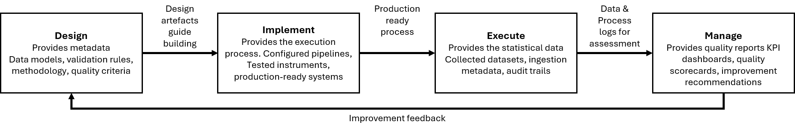

SAF Architecture Framework
============================

Created on: 07-07-2025
Workgroup SAF: Trygve Falch (Statistics Norway, SSB), Jakob Engdahl (Statistics Sweden, SCB), Cedric Couralet (Statistics France, Insee), Pascal Fransen (Statistics Netherlands, CBS) and Daan Swinkels (Statistics Netherlands, CBS)

Current version: 0.9

| Version | Date | Change |
|---|---|---|
|0.1|2025-07-07|Initial version|
|0.2|2026-06-01|Review processed|
|0.3|2026-07-31|Restructuring, Start with Business Architecture|
|0.4|2026-09-01|Merging Business Architecture content|
|0.5|2026-10-10|Restructured motivation section, TOGAF and ArchiMate context added|
|0.6|2026-10-11|Restructured strategy section|
|0.7|2026-10-12|Restructured business section, added business actors, roles and collaborations|
|0.8|2026-10-31|Consolidated and structured Steady State detail content|
|0.9|2026-11-08|Updated Value stream 1|

## Content
[Preface](#preface)

-   [Acknowledgements](#acknowledgements)

[Introduction](#introduction)

-   [Purpose](#purpose)
-   [Definition of Scope](#definition-of-scope)
-   [Target Audience](#target-audience)
-   [Expected value](#expected-value)
-   [Constraints & Assumptions](#constraints-assumptions)
    -   [Use of TOGAF and ArchiMate in SAF](#use-of-togaf-and-archimate-in-saf)
-   [Reading guide](#reading-guide)

[Motivation](#motivation)

-   [Purpose of this chapter](#purpose-of-this-chapter)
-   [Position in the framework](#position-in-the-framework)
-   [How NSIs use this chapter](#how-nsis-use-this-chapter)
-   [Motivation concepts in the SAF](#motivation-concepts-in-the-saf)
-   [Drivers](#drivers)
-   [Goals](#goals)
-   [Meaning](#meaning)
-   [Outcomes](#outcomes)
-   [Architecture Principles](#architecture-principles)
-   [Value](#value)
-   [Assessment](#assessment)
-   [Requirements](#requirements)
-   [Constraints](#constraints)
-   [Stakeholders](#stakeholders)

[Strategy](#strategy)

-   [Purpose of this chapter](#purpose-of-this-chapter-1)
-   [Position in the framework](#position-in-the-framework-1)
-   [How NSIs use this chapter](#how-nsis-use-this-chapter-1)
-   [Strategy concepts in the SAF](#strategy-concepts-in-the-saf)
-   [Capability Model](#capability-model)
-   [Value Streams](#value-streams)
-   [Resources](#resources)
-   [Courses of Action](#courses-of-action)

[Business Architecture](#business-architecture)

-   [Purpose of this chapter](#purpose-of-this-chapter-2)
-   [Position in the framework](#position-in-the-framework-2)
-   [How NSIs use this chapter](#how-nsis-use-this-chapter-2)
-   [Relationship with the statistical standards](#relationship-with-the-statistical-standards)
-   [Business architecture concepts in the SAF](#business-architecture-concepts-in-the-saf)
-   [How the business architecture is built up](#how-the-business-architecture-is-built-up)
-   [Structure of this chapter](#structure-of-this-chapter)
-   [Business Actors, Business Roles and Business Collaborations](#business-actors-business-roles-and-business-collaborations)
-   [Business Processes](#business-processes)
    -   [A. Statistical production processes](#a.-statistical-production-processes)
    -   [B. Overarching processes](#b.-overarching-processes)
    -   [C. Data management and lifecycle processes](#c.-data-management-and-lifecycle-processes)
    -   [D. Microdata services processes](#d.-microdata-services-processes)
    -   [E. Data space processes](#e.-data-space-processes)
-   [Business Functions](#business-functions)
    -   [Process and function mapping](#process-and-function-mapping)
    -   [Mapping to value stream stages](#mapping-to-value-stream-stages)
-   [Business Services and Business Interfaces](#business-services-and-business-interfaces)
-   [Business Events](#business-events)
-   [Business Objects, Contracts, Representations and Products](#business-objects-contracts-representations-and-products)
-   [Reference Models for the Statistical Data Value Chain](#reference-models-for-the-statistical-data-value-chain)
    -   [Comparison](#comparison)
    -   [Selection criteria](#selection-criteria)
    -   [Combining the models](#combining-the-models)

[Steady-State Architecture](#steady-state-architecture)

-   [Overview](#overview)
    -   [Business domains](#business-domains)
    -   [The four process types](#the-four-process-types)
    -   [Design rules of the steady-state model](#design-rules-of-the-steady-state-model)
    -   [Steady states at a glance](#steady-states-at-a-glance)
    -   [State lifecycle](#state-lifecycle)
    -   [How each state is described](#how-each-state-is-described)
-   [Boundary Position #0: Source Data](#boundary-position-0-source-data)
-   [State #1: Raw Data](#state-1-raw-data)
-   [State #2: Standardized Data](#state-2-standardized-data)
-   [State #3: Processed Data](#state-3-processed-data)
-   [State #4: Output Data (Statistics)](#state-4-output-data-statistics)
-   [State #5: Published Output Data (Released Data)](#state-5-published-output-data-released-data)
-   [State #6: Consumed Data](#state-6-consumed-data)

# Preface

The Statistical Architecture Framework (SAF) was developed to support the modernisation of official statistics. This framework responds to the need of national statistical institutes and their partners for shared guidelines and standards. Producing statistics must remain credible, secure, and efficient. At the same time, organisations must adapt quickly to new data sources, higher user expectations, and tighter regulations and budgets. The SAF provides a solid foundation for this and help organisations guide these changes in a controlled and structured way.

This new framework replaces the older CSPA and CSDA standards, but it reuses the elements that are still current and valuable. The SAF combines the core ideas from these previous framework into a single, logical, and coherent model. While the framework continues to focus on cooperation, reuse, and standards, the focus has shifted heavily toward a practical application of the framework in an organization. It is specifically designed to be used directly within ongoing programmes and projects. This helps teams make concrete choices when designing and implementing new processes and solutions.

The fundamental principle of the framework is that data and its descriptions are the most important assets of a statistical organisation. Information is not just a tool to run processes, but the core of the organisation. The SAF therefore treats this information as an NSIs most valuable asset that must be professionally managed throughout its entire lifecycle. It must support systems that can work with both traditional and modern, new data sources and information flows. In addition, it offers a practical guide for collecting, combining, and publishing data.

The SAF builds on a modular approach where systems are constructed from loose, flexible components. It promotes the reuse of these digital building blocks, both within an organisation and between different organisations. This prevents projects from independently building the same tools, which reduces duplication and lowers costs. Furthermore, it ensures a clear separation between business methods, data, and the underlying technology. This separation is essential for keeping complex IT landscapes manageable and successfully scaling them up. The framework is designed to be used at multiple levels at the same time. It helps with strategic planning, designing specific IT solutions, and monitoring how different projects align with one another. 

The SAF does not replace existing statistical models, but rather works closely alongside them. It forms the connecting link between organisational strategy, business processes, and technology. This connection helps organisations make consistent decisions and makes sure that organization policy is translated into practice. To improve communication between teams, the SAF uses different visual models. By using a standard notation style, organisations can easily compare and reuse each other's designs. Finally, the SAF is a living framework that will continuously evolve based on practical experience, community feedback, and new technological developments.

## Acknowledgements

TODO

# Introduction

The Statistical Architecture Framework (SAF) provides a common architectural basis for the design, delivery, and evolution of statistical production in National Statistical Institutes (NSIs) and related organisations. It brings together architectural concepts, reference structures, and practical guidance that support consistent decision-making across portfolios and programmes. SAF aims to help statistical organisations modernise with control, while preserving the institutional qualities that make official statistics credible: transparency, quality, impartiality, reproducibility, and public trust.

Statistical organisations are facing a period of accelerated change. Data ecosystems are evolving and increasingly depend on partnerships and shared infrastructures. Artificial intelligence and rapid technological advances are changing how data can be collected, processed, and interpreted, while also introducing new risks and new expectations. At the same time, trust, scientific rigor, and data protection requirements are becoming more prominent and more demanding. These changes occur in an uncertain and fragmented global environment, where information integrity and societal confidence cannot be taken for granted. All of this is happening under sustained resource constraints, requiring organisations to be more agile and deliberate in how they prioritise, reuse, and industrialise capabilities. SAF is intended to support organisations in quickly responding to these drivers without fragmenting their architecture, governance, and implementation landscape in the process.

SAF replaces earlier reference documentation by consolidating core architectural ideas into a single framework that is more usable in practice. It is not designed as a theoretical reference alone. It is designed to be applied. SAF supports the translation of strategy into capabilities, services, and implementation choices. It supports alignment across business, methodology, data, applications, and technology. It also supports collaboration between organisations by promoting common patterns, shared viewpoints, and comparable architectural descriptions.

## Purpose

The purpose of SAF is to provide an authoritative, consistent, and actionable framework for developing and governing statistical architectures. It aims to support coherent modernisation across NSIs by providing shared structures for describing needs, designing solutions, and managing change. SAF helps ensure that investments in platforms, data management, methods, and delivery practices strengthen each other instead of competing. It also helps organisations to demonstrate traceability from policy and strategy to implemented solutions, including the controls required for confidentiality, integrity, accountability, and lawful processing.

SAF is intended to enable better outcomes in three areas. First, interoperability and reuse, both within an organisation and across organisational boundaries.

 Second, quality and robustness, by making architectural choices explicit and reviewable, and by promoting consistent handling of data, metadata, and methodological assets. Third, overall statistical production  effectiveness, by providing a common language and set of expectations that connects architects, methodologists, engineers, managers, and oversight functions.

## Definition of Scope

SAF covers the enterprise architecture concerns that are most relevant to statistical production and dissemination, including the supporting functions that enable them. It addresses the design and evolution of capabilities, information assets, applications and services, and underlying infrastructure and deployment arrangements. It also considers the cross-cutting concerns that are essential for official statistics, such as governance, security, privacy, auditability, reproducibility and the responsible use of data and advanced analytics.

To ensure consistency and practical applicability, SAF is organised according to a TOGAF-aligned structure. It addresses motivation and principles, strategic direction and target outcomes, and the architecture domains that connect intent to implementation. This includes business architecture, data architecture, application architecture, and technology and infrastructure considerations, as well as deployment and operationalisation aspects. SAF also includes viewpoints that are tailored to distinct roles and activities within an NSI, enabling the same underlying architecture to be communicated and assessed from multiple perspectives without losing coherence.

SAF does not prescribe a single operating model, a single technology stack, or a single organisational design. It recognises that NSIs differ in mandate, maturity, and context. Instead, it provides a shared architectural foundation that can be adapted to local realities while remaining comparable across organisations. It also assumes that terminology and detailed definitions are managed through a dedicated glossary, which is maintained alongside the framework.

## Target Audience

This documentation is primarily written for enterprise and data architects, IT architects, methodologists, and IT delivery teams. It is also intended for senior decision-makers such as CIOs and CTOs, and for privacy officers, policy makers, and managers who carry responsibility for compliance, traceability, and responsible data use.

These groups and individuals can use this framework as a reference and as a working instrument. It can be applied when shaping strategy and roadmaps, when designing new capabilities and platforms, and when assessing initiatives for alignment and risk. It can be used to structure architectural work in programmes and projects, and to support governance decisions by making assumptions, dependencies, and trade-offs explicit. It can also be used to support communication across disciplines by establishing shared architectural concepts and consistent viewpoints.

Different roles will use SAF in different ways, while relying on the same underlying content. Enterprise and data architects will use it to define target states, standards, patterns, and architecture decisions across the organisation. IT architects and delivery teams will use it to translate those decisions into solution designs, implementation plans, and operational controls. Methodologists will use it to connect methods and process design to the enabling data and technology arrangements, and to support repeatability and scientific rigor. CIOs, CTOs, managers, and policy makers will use it to understand the implications of strategic choices, to prioritise investment, and to oversee risk and compliance. Privacy officers and assurance functions will use it to assess whether designs incorporate adequate safeguards, traceability, and accountability.

SAF is most effective when it is used consistently across the lifecycle of change. It supports early-stage framing by clarifying drivers, objectives, and constraints. It supports design by providing reference structures and viewpoints that guide architecture development. It supports delivery by improving alignment between architecture and implementation decisions. It supports operation and evolution by making dependencies and responsibilities explicit, enabling controlled change and measurable improvement.

## Expected value

The expected value of SAF is a stronger and more coherent statistical architecture practice across NSIs. It supports faster and safer modernisation by reducing ambiguity and rework. It supports reuse by encouraging common building blocks and comparable solution descriptions. It supports trust by embedding governance and assurance concerns into architecture, rather than treating them as afterthoughts. It also supports collaboration across organisations, where shared approaches to interoperability, data governance, and service orientation reduce the effort required to work together.
In providing a common framework with practical orientation, SAF aims to help statistical organisations remain resilient and responsive. It supports them in delivering high-quality statistics under changing conditions, while maintaining the safeguards and institutional discipline that official statistics require.

## Constraints & Assumptions

### Use of TOGAF and ArchiMate in SAF

The SAF builds on two open standards of The Open Group, a global, vendor-neutral consortium that develops technology and architecture standards: the TOGAF® Standard and the ArchiMate® Specification. This section explains what these standards are, why the SAF uses them, and how they relate to each other and to the statistical standards of the UNECE community.

#### What TOGAF is

The TOGAF Standard is a framework for developing and governing enterprise architecture. It provides:

- **A method.** The Architecture Development Method (ADM) is an iterative cycle of phases. It runs from establishing the architecture capability and an architecture vision, through business, information systems, and technology architecture, to migration planning, implementation governance, and change management.
- **A content framework.** A common structure for the artefacts that architecture work produces, such as principles, stakeholder maps, capability models, and architecture building blocks.
- **Guidance for an architecture capability.** Advice on governance, roles, and maturity, so that architecture becomes a lasting practice rather than a one-off project.

The SAF refers to the TOGAF Standard, 10th Edition. More information is available at [The Open Group: TOGAF Standard](https://www.opengroup.org/togaf).

#### Why the SAF uses TOGAF

The SAF uses TOGAF for three reasons.

- **A shared structure:** Many NSIs already use TOGAF, or a framework derived from it, in their own architecture practice. Aligning the SAF with TOGAF lets NSIs map SAF content onto their existing repositories, governance processes, and training without translation.

- **A proven method:** TOGAF describes how to move from motivation to implementation in controlled steps. The SAF follows the same order: motivation, strategy, business architecture, data, application, and technology architecture, and implementation. This gives NSIs a recognisable path from intent to solution.

- **A common language across organisations:** TOGAF terminology is widely understood by architects, IT suppliers, and international partners. Using it reduces ambiguity when NSIs compare architectures or collaborate on shared solutions.

The SAF uses TOGAF as a **structuring reference, not as a prescription**. It tailors the TOGAF structure to official statistics and does not require NSIs to follow every ADM phase or to hold TOGAF certification. The SAF does not reproduce TOGAF content; readers are referred to the standard for its full description.

#### What ArchiMate is and how it relates to TOGAF

ArchiMate is a modelling language for enterprise architecture. Where TOGAF describes *how* to develop an architecture and *which* content to produce, ArchiMate describes *how to express* that content in consistent, unambiguous models and views. The two standards are maintained by The Open Group and are designed to work together:

| Aspect | TOGAF | ArchiMate |
|---|---|---|
| Nature | Framework and method | Modelling language and notation |
| Answers | How is architecture developed and governed? | How is architecture described and visualised? |
| Main content | ADM phases, content framework, architecture capability | Elements, relationships, viewpoints |
| Role in the SAF | Structures the chapters and the order of the framework | Notation for the models and diagrams in the SAF |

The structures of the two standards correspond. The TOGAF Preliminary Phase, Phase A, and Requirements Management correspond to the ArchiMate motivation and strategy elements. TOGAF Phases B, C, and D correspond to the ArchiMate business, application, and technology layers. TOGAF Phases E to H correspond to the ArchiMate implementation and migration elements. This correspondence is the basis for the position of each SAF chapter (see *Position in the framework* in the Motivation chapter).

More information is available at [The Open Group: ArchiMate](https://www.opengroup.org/archimate-forum).

#### Relationship with statistical standards

TOGAF and ArchiMate are generic standards. The SAF complements them with the standards of the statistical community: GSBPM for statistical business processes, GAMSO for the activities of statistical organisations, GSIM for statistical information objects, and SDMX for the exchange of statistical data and metadata. TOGAF and ArchiMate provide the architectural structure and notation; the statistical standards provide the domain content. The SAF connects the two.

#### Assumptions and constraints

| ID | Type | Statement |
|---|---|---|
| SAF-A1 | Assumption | The SAF is structured according to the TOGAF Standard, 10th Edition, tailored to official statistics. |
| SAF-A2 | Assumption | Models and diagrams in the SAF use the ArchiMate 3.2 Specification. Alignment with the ArchiMate 4 Specification will be assessed in a later version of the SAF. |
| SAF-A3 | Assumption | NSIs can apply the SAF without TOGAF or ArchiMate certification. Basic familiarity with both standards helps but is not required. |
| SAF-A4 | Assumption | Terminology and definitions are maintained in a separate SAF glossary, which takes precedence over definitions in this document. |
| SAF-C1 | Constraint | The SAF refers to TOGAF and ArchiMate but does not reproduce their content. Use of the standards is subject to the licence terms of The Open Group. |
| SAF-C2 | Constraint | The SAF does not prescribe a technology stack, tool, or organisational design (see *Definition of Scope*). |

TOGAF and ArchiMate are registered trademarks of The Open Group.

## Reading guide

This reading guide explains how the SAF is built, in which order to read it, and how an NSI can start using it. It also explains how the SAF fits into an NSI's own architecture, how it combines with other reference models, and how legislation enters the architecture.

### 1. How the SAF is structured

The SAF follows the layers of TOGAF and ArchiMate (see *Constraints & Assumptions*). Each layer answers one question. Each layer is justified by the layer above it, and each layer gives direction to the layer below it.

|**PLACEHOLDER: Overview of the SAF layers and chapters**|
|---|

| Chapter | Question it answers | Main content | Status **[RG4]** |
|---|---|---|---|
| Motivation | *Why* does the NSI change, and what does it want to achieve? | Stakeholders, drivers, assessments, goals, outcomes, principles, requirements, constraints, meaning, value | Developed |
| Strategy | *What* must the NSI be able to do, and how does it get there? | Capability model, value streams, resources, courses of action and strategies | Developed |
| Business Architecture | *How* is the statistical work organised? | Business domains, reference models for the data value chain (Steady-State, Medallion), steady states, value stream detail, roles | In development |
| Data Architecture | *Which* data and metadata are needed, and how are they structured? | To be developed | Planned |
| Application Architecture | *Which* applications and services support the work? | To be developed | Planned |
| Technology Architecture | *On which* platforms and infrastructure does it run? | To be developed | Planned |
| Implementation and Tooling | *How* is the architecture realised and governed? | To be developed | Planned |

Every section that describes an architecture concept follows the same pattern:

1. **The concept.** What the concept means, based on ArchiMate and TOGAF.
2. **How the SAF applies it.** Why the SAF uses the concept, and how it fits into an NSI's own architecture.
3. **Relationships with other concepts.** How the concept connects to the rest of the framework.
4. **SAF elements or examples.** The reference content of the SAF, or illustrative examples where the content is specific to each NSI.
5. **Toolkit.** A reference to templates and instruments in the SAF toolkit.

This pattern makes it possible to read a single section without reading the whole document, and still see how it connects to the rest.

The SAF contains two kinds of content. **Reference content** is shared by most NSIs and can be adopted directly, such as the drivers, goals, principles, capability model and value streams. **Illustrative content** shows the form of elements that each NSI defines for itself, such as assessments, requirements, constraints, resources and courses of action. Illustrative content is never a requirement.

### 2. Reading order

The SAF is best read top-down, at least once: from Motivation, through Strategy, to the architecture domains. This order follows the logic of the framework. A business architecture choice only makes sense once the goals and capabilities behind it are clear.

Applying the SAF is different from reading it. Application is iterative. An NSI does not complete the Motivation layer before it starts on its business architecture. It works in cycles, like the TOGAF Architecture Development Method: each cycle refines the motivation, strategy and architecture a little further, and each change in a driver or goal can start a new cycle.

Different readers can follow different routes through the document (see *Target Audience* for the roles).

| Reader | Start with | Then read | Focus |
|---|---|---|---|
| CIO, CTO, board member | Introduction, Motivation | Strategy: capability model, courses of action | Why change is needed, what it delivers, how to prioritise |
| Enterprise or data architect | Introduction, Motivation | Strategy, Business Architecture, later domains | The full chain, and how to adopt it in the NSI architecture |
| IT architect, delivery team | Motivation: principles | Business Architecture, later domains | Design rules and reference models for solutions |
| Methodologist | Strategy: value streams | Business Architecture: steady states | Where methods are applied, and how quality and lineage are secured |
| Privacy officer, auditor | Motivation: principles, constraints | Business Architecture: steady states; VS-07 | Where protection and compliance are built into the chain |
| Policy maker, manager | Introduction, Motivation: goals, value | Strategy: courses of action | What the framework means for the organisation |

### 3. Positioning the SAF in your own architecture

TOGAF describes a range of architectures, from generic to specific, called the *Enterprise Continuum* **[RG2]**. It runs from foundation architectures, which apply to any organisation, through common systems and industry architectures, to the architecture of one specific organisation.

| Level in the Enterprise Continuum | Example | Who owns it |
|---|---|---|
| Foundation architecture | TOGAF, ArchiMate | The Open Group |
| Common systems architecture | Generic reference architectures for, for example, data platforms or identity management | Industry and standards bodies |
| Industry architecture | **The SAF**, for official statistics | UNECE statistical community |
| Organisation-specific architecture | The enterprise architecture of an NSI | The NSI |

The SAF is an industry architecture. It is not the architecture of any single NSI. Each NSI builds its own organisation-specific architecture, using the SAF as its reference. In practice, this works as follows:

1. **Adopt, adapt or extend.** For each SAF element, the NSI decides whether to adopt it as it is, adapt it to the national context, or add NSI-specific elements (see *How NSIs use this chapter* in the Motivation chapter).
2. **Keep the SAF identifiers.** When an NSI adapts an SAF element, it keeps a reference to the SAF identifier, for example SAF-P07 or capability 2.1.2. This keeps the NSI architecture comparable with the SAF and with other NSIs, and makes it easier to adopt future SAF versions.
3. **Layer the architecture.** The NSI enterprise architecture sets the direction for solution architectures in programmes and projects. Solution architectures do not refer to the SAF directly, but to the NSI architecture that applies it.

|**PLACEHOLDER: From SAF reference architecture to NSI enterprise architecture to solution architecture**|
|---|

### 4. Combining the SAF with other reference models

The SAF rarely stands alone. NSIs also work with statistical standards, with reference models of their own government, and with generic frameworks. These models complement each other, but they can also overlap or conflict.

| Family | Examples | Role next to the SAF |
|---|---|---|
| Statistical standards and models | GSBPM, GAMSO, GSIM, SDMX; the ESS Enterprise Architecture Reference Framework (ESS EARF) | Provide the statistical domain content. The SAF connects them in one architecture |
| Government reference models | The European Interoperability Framework (EIF) and Reference Architecture (EIRA); national reference models such as those listed below | Often mandatory or leading for public organisations. The SAF fits within them |
| Generic frameworks and bodies of knowledge | TOGAF, ArchiMate, DAMA-DMBOK | Provide structure, notation and professional practice |

Examples of national government reference models **[RG3]**:

| Country | Reference model | Owner |
|---|---|---|
| Netherlands | NORA, Netherlands Government Reference Architecture | Dutch government (ICTU) |
| United Kingdom | GovS 005 Digital, Government Functional Standard | Cabinet Office, Government Digital and Data |
| Canada | Government of Canada Enterprise Architecture Framework | Treasury Board of Canada Secretariat |
| Australia | Australian Government Architecture (AGA) | Digital Transformation Agency |
| New Zealand | Government Enterprise Architecture for New Zealand (GEA-NZ) | Government Chief Digital Officer |
| Norway | National architecture principles for digitalisation of the public sector | Norwegian Digitalisation Agency (Digdir) |
| United States | Federal Enterprise Architecture Framework (FEAF) | Office of Management and Budget |

The SAF works best when the NSI combines models at the level of elements, not documents:

- **Principles.** Map the SAF principles to the principles of the national reference model. Many will be equivalent. Where both exist, the NSI uses one set and records the mapping.
- **Capabilities and functions.** Map the SAF capability model to the capability or function model of the national framework, where one exists. This makes the NSI comparable with other government organisations as well as with other NSIs.
- **Standards.** Check which standards the national model prescribes, for example for exchange formats, identity or security. These standards become requirements or constraints in the NSI architecture.

When models conflict, a simple order of precedence helps:

1. Legislation comes first.
2. Mandatory government standards and reference models come next.
3. Within the statistical domain, the SAF and the statistical standards apply.
4. Generic frameworks and practices fill the remaining gaps.

A deviation from a higher level is a decision for the NSI's architecture governance, and is documented.

|**PLACEHOLDER: Mapping templates for SAF and national reference models to be added to the toolkit**|
|---|

### 5. Legislation and regulation

Official statistics operate under strict legal frameworks. Legislation shapes what an NSI may collect, how it must protect data, and how it must publish. The SAF does not describe legislation, because it differs per country. It does describe where legislation enters the architecture.

Legislation enters the architecture through the motivation elements:

| A legal provision that… | Is recorded as… | Example |
|---|---|---|
| Creates pressure to change | Driver | A new regulation that requires access to privately held data for statistics |
| Sets a limit on the design | Constraint | Statistical microdata may only be processed within the NSI's controlled environment |
| Imposes an obligation on a solution | Requirement | Personal data in a data acquisition process is minimised to what is needed |
| Expresses a lasting rule for all decisions | Principle | Privacy by design (SAF-P11) |

This approach makes legislation traceable. From a legal provision, the NSI can follow the path to the requirements and constraints it creates, to the solutions that meet them, and to the evidence that shows compliance. In the other direction, every design decision that is driven by law can be traced back to its legal basis.

Three levels of legislation are relevant for most NSIs:

| Level | Examples |
|---|---|
| International statistical frameworks | UN Fundamental Principles of Official Statistics; European Statistics Code of Practice; Regulation (EC) No 223/2009 on European statistics |
| Horizontal EU legislation | GDPR; Data Governance Act; Data Act; AI Act; NIS2 Directive; Interoperable Europe Act (Regulation (EU) 2024/903) |
| National legislation | National statistics act; archives legislation; national rules on government information security and open government |

For NSIs outside the EU, the horizontal level consists of the corresponding national or regional legislation.

Compliance is not a separate layer. It is built into the architecture: legal requirements are part of the quality gates of the steady states, of the principles, and of the governance in value stream VS-07 *Governance and Compliance*. A legal register helps to keep the overview: a list of applicable legal provisions, with the drivers, constraints, requirements and principles they lead to.

|**PLACEHOLDER: Legal register template to be added to the toolkit**|
|---|

### 6. Conventions used in this document

| Convention | Meaning |
|---|---|
| SAF-ST, SAF-D, SAF-G, SAF-O, SAF-P, SAF-M, SAF-V | Identifiers of reference elements in the Motivation layer |
| 1.2.1, 2.1.2, … | Capability numbers in the capability model |
| VS-01 to VS-10, VS-01.1, … | Value streams and their stages |
| #0 to #6 | Steady states of data and their boundary positions |
| SAF-A, SAF-C | Assumptions and constraints of the SAF itself (see *Constraints & Assumptions*) |
| *Illustrative* | Examples that show the form of an element. They are not requirements |
| PLACEHOLDER | Content that will be added, such as an ArchiMate view or a toolkit reference |
| Toolkit | The SAF toolkit, a separate set of templates and instruments for applying the framework |

Terms are defined in the SAF glossary, which takes precedence over definitions in this document (SAF-A4). The SAF uses British English spelling.

# Motivation

## Purpose of this chapter

The Motivation chapter explains why the SAF exists. It also explains why architecture decisions in an NSI are taken the way they are. It records the forces that act on statistical organisations, the results they want to achieve, the rules that guide their decisions, and the parties whose concerns must be addressed.

Without an explicit motivation, architecture is a set of models without a reason. With it, every capability, process, data state, application or platform choice can be traced back to a need and a result. That traceability makes architecture defensible, whether in a governance board, a budget discussion or an international review.

## Position in the framework

Motivation is the first layer of the SAF and the foundation for the other layers. The Strategy layer translates motivation into capabilities and value streams. The architecture domains (business, data, application and technology) then translate strategy into design.

The SAF is structured according to TOGAF and modelled in ArchiMate. The figure below shows how the phases of the TOGAF Architecture Development Method (ADM) relate to the ArchiMate layers. The figure has three areas:

- **Strategy & Motivation:** the Preliminary Phase, Phase A (Architecture Vision), and Requirements Management.
- **Core layers:** Phases B, C, and D, which produce the Business, Application (Information Systems), and Technology architectures.
- **Implementation & Migration:** Phases E to H, which plan, govern, and change the realisation of the architecture.

|**PLACEHOLDER: Logical model of the different layers to be added**|
|---|

The Motivation layer sits in the Strategy & Motivation area, at the start of the ADM cycle. It holds the content that TOGAF produces before any architecture domain is designed. That content keeps steering the architecture in all later phases.

| ADM phase | Role of motivation in this phase | SAF sections |
|---|---|---|
| Preliminary | Establish the architecture capability: who the architecture serves and which rules guide decisions | Stakeholders, Architecture Principles |
| A. Architecture Vision | Explain why change is needed, what must be achieved and what value it brings | Drivers, Goals, Outcomes, Meaning, Value |
| Requirements Management | Turn goals into requirements and constraints, and keep them traceable through every phase | Requirements, Constraints |
| B, C, D. Core architectures | Justify design choices in business, application and technology architecture | Traceability from each design decision back to a goal and a driver |
| E to H. Implementation & Migration | Prioritise solutions and work packages; reassess when drivers change | Drivers and goals as criteria for prioritisation and change requests |

Three consequences follow from this position.

- **Motivation comes first.** In TOGAF, no architecture domain is designed until stakeholders, drivers, goals and principles are agreed. The SAF follows the same order. Every later element must be traceable to the motivation.
- **Motivation stays active throughout the cycle.** Requirements Management sits at the centre of the ADM. Goals are refined into requirements there, and those requirements are checked in every phase. Motivation is the reference against which each architecture decision is tested, not a one-off introduction.
- **Motivation closes the loop.** In Phase H (Architecture Change Management), a new or changed driver triggers a change request. Examples are a new regulation or a new data source. The cycle then returns to the Preliminary Phase or Phase A, and the motivation elements become the starting point of the next iteration.

The Strategy layer shares the Strategy & Motivation area with the Motivation layer. Motivation explains *why*. Strategy describes *what* the NSI must be able to do (capabilities) and *how* it creates value (value streams). Strategy is the bridge to Phase B, Business Architecture.

## How NSIs use this chapter

The motivation elements in this chapter are a reference set. They describe internal and external forces and intentions that most NSIs share. Modelling the motivation layer is not mandatory, but the SAF strongly recommends it.

Most NSIs have a motivation, but it is implicit. It lives in strategy documents, board decisions and the experience of staff. It is rarely written down in a way that connects it to architecture decisions. Making it explicit, in SAF terms, helps an NSI in four ways.

First, it justifies investment. If every programme can be traced to a driver and a goal, an investment proposal rests on shared reasoning, not on individual preference. Boards and ministries can see what a proposal responds to, and what is at stake if it is not funded. The same links help to set priorities. Work that addresses several drivers, or contributes to a key outcome, comes before work that addresses none.

Second, it makes decisions consistent. Principles are derived from the motivation and turn intentions into decision rules. Similar questions then get similar answers, whichever team or architect is involved. When circumstances change, for example through new legislation, the documented links show which goals, principles and capabilities are affected. The NSI can review those specific decisions instead of starting over.

Third, it preserves knowledge. Staff move on and projects end. A documented motivation keeps the reasoning behind past decisions available. New statisticians and IT specialists can see why the architecture looks the way it does.

Fourth, it supports collaboration between NSIs. When NSIs use the same concepts and identifiers, they can quickly see where their interests overlap. That makes it easier to start joint projects, share components and compare approaches. A documented motivation is also useful evidence in external assessments, such as peer reviews.

An NSI can use each SAF motivation element in one of three ways:
1. **Adopt.** Use an SAF element as is, when it matches the national situation.
2. **Adapt.** Refine an SAF element with national specifics, such as a national statistics act or a government-wide digital strategy.
3. **Extend.** Add elements that are specific to the NSI, while keeping a reference to the closest SAF element where one exists.

|**PLACEHOLDER: Maturity Assessement to be added to the toolkit**|
|---|

## Motivation concepts in the SAF

| SAF section | ArchiMate element | Question it answers | Identifier |
|---|---|---|---|
| Drivers | Driver | Which forces make change necessary? | SAF-D |
| Goals | Goal | What does the NSI intend to achieve? | SAF-G |
| Meaning | Meaning | What does the framework signify to its users? | SAF-M |
| Outcomes | Outcome | Which concrete results show that a goal is achieved? | SAF-O |
| Architecture Principles | Principle | Which rules guide architecture decisions? | SAF-P |
| Value | Value | What is the framework worth, and to whom? | SAF-V |
| Assessment | Assessment | What does a driver mean for this NSI? | *TBD by NSI* |
| Requirements | Requirement | What must a solution do or provide to realise a goal? | *TBD by NSI* |
| Constraints | Constraint | Which limits apply to the design or its realisation? | *TBD by NSI* |
| Stakeholders | Stakeholder | Whose concerns must the architecture address? | SAF-ST |

The concepts form a chain. Stakeholders have concerns about drivers. An assessment records what a driver means for one NSI. Drivers motivate goals. Outcomes make goals measurable. Principles guide how goals are pursued, and requirements and constraints make them concrete for a solution. Meaning and value express why the result matters to stakeholders.

## Drivers

### The concept

A **driver** is an external or internal condition that motivates an organisation to set goals and to change. A driver is a force, not a problem and not a solution. "Rapid technological change" is a driver. "Our methods cannot use administrative data" is an assessment of that driver for one NSI. "Integrate new data sources into production" is a goal.

Three characteristics set drivers apart from other motivation elements:

- **They exist independently of the NSI.** An NSI can respond to a driver, but cannot decide whether it exists.
- **They are external or internal.** External drivers come from the environment: technology, legislation, society, politics or the economy. Internal drivers come from within: legacy systems, skills or organisational structure.
- **They are relatively stable.** A driver usually stays relevant for several years. Short-lived events, such as an incident or a budget round, are better recorded as assessments.

### How the SAF applies drivers

**Why the SAF records drivers**

Drivers make the SAF a response to real pressures instead of an abstract ideal. With them, an NSI can explain to its board, its ministry or a peer review why change is needed, and what happens without it. Drivers also help to set priorities. An investment that responds to several drivers deserves more attention than one that responds to none.

**How drivers fit into an NSI's own architecture**

The SAF drivers are common to the UNECE statistical community. An NSI applies them in four steps:

1. **Recognise.** Decide which SAF drivers apply to the national situation, and add national drivers where needed.
2. **Assess.** Analyse what each driver means for the NSI: strengths, weaknesses, risks and opportunities.
3. **Respond.** Derive or confirm the goals that answer the assessed drivers.
4. **Trace.** Link capabilities, programmes and architecture decisions to the drivers they address.

**Relationships with other concepts**

| Related concept | Relationship | Example in the SAF |
|---|---|---|
| Stakeholders (SAF-ST) | Stakeholders have concerns about drivers and often raise them | CIOs and CTOs (SAF-ST01) raise resource constraints (SAF-D5) |
| Assessment | An assessment records what a driver means for one NSI | "Two thirds of our processing runs on platforms out of vendor support" assesses SAF-D5 |
| Goals (SAF-G) | Drivers motivate goals | Resource constraints (SAF-D5) motivate cost efficiency (SAF-G1) |
| Principles (SAF-P) | Drivers explain why a principle exists | Trust and data protection (SAF-D3) explain privacy by design (SAF-P11) |
| Capabilities (Strategy) | Capabilities are developed in response to drivers, through goals | AI and technological acceleration (SAF-D2) drives investment in methodology (capability 2.2.3) |
| Value streams (Strategy) | Value streams show where a driver affects the production chain | Evolving data ecosystems (SAF-D1) affect data acquisition (VS-01) |

### SAF drivers

| ID | Driver | Type | Description | Architectural response in the SAF |
|---|---|---|---|---|
| **SAF-D1** | Evolving data ecosystems and partnerships | External | Statistics no longer rely on surveys alone. They draw on administrative, commercial, platform and community data. This creates opportunities, but also dependencies on actors outside the NSI's control. | Secure data sharing, standard interfaces, open-source collaboration and transparent governance, so that NSIs can take part in national data platforms and European data spaces. |
| **SAF-D2** | Artificial intelligence and technological acceleration | External | AI, automation and fast technological change alter how data is created, processed and used. NSIs must adopt these technologies and make their own outputs AI-ready. | A risk-based approach: tight control of methodologically critical processes, more automation where risk is lower. Modular, standards-based design to adopt new technology at a controlled pace. |
| **SAF-D3** | Trust, scientific rigour and data protection | External | Misinformation, privacy concerns and unregulated data providers put public confidence under pressure. Trust needs more than compliance. It needs rigour, transparency and accountability. | Protection built into the design: confidentiality controls, methodological integrity, traceability, and oversight in proportion to sensitivity. |
| **SAF-D4** | Uncertain and polarised global environment | External | Global tensions and political polarisation affect how official statistics are demanded and perceived. Cross-border data flows require openness and interoperability. | Interoperable architectures based on shared standards. Design principles that protect independence, comparability and credibility. |
| **SAF-D5** | Resource constraints and organisational agility | Internal and external | Budgets are tight, systems are ageing and specialist skills are scarce. Demand for timely and detailed output keeps growing. | Modular design, shared services, reuse and step-by-step modernisation, so that capacity can be shifted without large reinvestment. |

### Driver details

**SAF-D1 Evolving data ecosystems and partnerships**

Official statistics are moving from isolated data collection to a wider data ecosystem. Surveys used to be the main source. Now they sit next to administrative, commercial, platform and community data. This opens up new forms of collaboration. It also makes NSIs dependent on actors, technologies and infrastructures they do not control.

Open source is part of this ecosystem. It gives NSIs a shared base for innovation, transparency and lower costs. NSIs can develop tools and methods together with peers, academia and private partners.

The SAF responds with architectures for secure data sharing, standard interfaces and transparent governance. These let NSIs take part in national data platforms and European data spaces, where production may span several environments and jurisdictions. Openness is combined with strong governance and clear accountability, so that collaboration does not compromise the integrity of official statistics.

**SAF-D2 Artificial intelligence and technological acceleration**

AI, automation and rapid technological progress are changing how data is created, processed and used. New tools can automate routine tasks, improve analysis and strengthen quality assurance. They also raise the question of what relevant and trusted statistics mean when users rely on intelligent systems.

NSIs must both use AI and make their outputs usable by AI. Internally, that requires architectures and skills for automation, machine learning and advanced analytics, within secure and transparent limits. Externally, statistics must be machine-readable, machine-understandable and interoperable with the platforms that policy makers, researchers and citizens use.

The SAF takes a risk-based approach. Processes that demand methodological rigour and control stay tightly governed. Less sensitive areas can be automated further. Modular, standards-based design lets an NSI adopt new technology at its own pace, while it stays fully accountable for quality, data protection and independence.

**SAF-D3 Trust, scientific rigour and data protection**

Trust is the basis of official statistics. Misinformation, privacy concerns and unregulated data providers put it under pressure. Compliance alone does not maintain public confidence. Scientific rigour, transparency and clear accountability for the handling of data are also needed.

The SAF builds trust and protection into the architecture. It promotes governance and technical controls that protect confidentiality, keep methods sound and make processes traceable. Oversight is strict where sensitivity and quality demands are high. Where risks are lower, more automation and shared solutions are possible.

**SAF-D4 Uncertain and polarised global environment**

Global tensions, political polarisation and shifting power relations affect how official statistics are demanded and perceived. At the same time, cross-border data flows require statistical systems to stay open and interoperable, without giving up national and institutional integrity.

The SAF offers a stable base for cooperation. Interoperable architectures based on shared standards let NSIs exchange data and methods securely. Design principles that protect independence and transparency help NSIs stay credible and comparable, even when facts themselves are contested.

**SAF-D5 Resource constraints and organisational agility**

Many NSIs must do more with limited budgets, ageing systems and a shortage of specialist staff. Demand for timely, detailed and cross-domain output keeps growing. Meeting that demand requires efficiency and the ability to adapt quickly.

The SAF makes flexibility and reuse core principles. It supports modular design, shared services and scalable solutions that reduce duplication. Clear governance of priorities lets NSIs shift capacity, modernise step by step and keep delivering quality output under financial and staffing pressure.

|**PLACEHOLDER: Drivers Template and Application of Drivers to be added to the toolkit**|
|---|

## Goals

### The concept

A goal is a statement of intent. It is the direction or end state an organisation wants to achieve. A goal says *what* the organisation wants to achieve. It does not say *how*, or *how much*.

Three characteristics set goals apart:

- **They are qualitative and directional.** "Modernise statistical systems" sets a direction. A measurable result, such as "retire all platforms out of vendor support by 2029", is an outcome.
- **They are long-term.** A goal usually spans several planning cycles and outlives individual programmes and projects.
- **They are owned by stakeholders.** A goal only has meaning if a stakeholder recognises it as their intention.

The SAF goals cover operational and strategic needs. Some focus on efficiency, modernisation and compliance, which keep an NSI sustainable. Others support innovation and collaboration, such as the use of new data sources or advanced analytics. Together these goals make sure that modernisation does not weaken the core values of official statistics: neutrality, accuracy and reliability.

### How the SAF applies goals

**Why the SAF records goals**

Goals define what success looks like, for the SAF and for the NSIs that apply it. They give direction to the Strategy layer: capabilities and value streams are developed because they contribute to a goal. Without explicit goals, modernisation can turn into a series of technical upgrades that nobody can explain.

**How goals fit into an NSI's own architecture**

The SAF goals are shared by the UNECE statistical community. An NSI relates them to its own strategic plan. It then translates each relevant goal into measurable outcomes and, where needed, into objectives for programmes and projects. Goals that matter nationally but have no SAF counterpart are added as national goals. Each NSI can follow this path at its own pace, while working towards the same shared direction.

**Relationships with other concepts**

| Related concept | Relationship | Example in the SAF |
|---|---|---|
| Drivers (SAF-D) | Drivers motivate goals | Resource constraints (SAF-D5) motivate cost efficiency (SAF-G1) |
| Outcomes (SAF-O) | Outcomes make goals measurable | Increased efficiency (SAF-O5) shows progress on cost efficiency (SAF-G1) |
| Principles (SAF-P) | Principles guide how goals are pursued | Open-source participation (SAF-P01) guides how cost efficiency is achieved |
| Stakeholders (SAF-ST) | Stakeholders own goals | CIOs and CTOs (SAF-ST01) own modernisation (SAF-G3) |
| Capabilities (Strategy) | Capabilities are developed to realise goals | Methodology (capability 2.2.3) supports data innovation (SAF-G4) |
| Value streams (Strategy) | Value streams show where a goal changes the production chain | Sustainable compliance (SAF-G5) is put into practice in VS-07 |

### SAF goals

| ID | Goal | Description | Architectural direction in the SAF |
|---|---|---|---|
| **SAF-G1** | Cost efficiency and resource sharing | Work as efficiently as possible with limited budgets and growing demand, by sharing services, reusing solutions and pooling resources. | Shared services, reusable and open-source components, modular architectures and step-by-step modernisation. |
| **SAF-G2** | Harmonised reference framework | Provide shared standards, patterns and practices that NSIs adapt locally while staying interoperable. | Common reference models, consistent design principles, and harmonisation as a condition for shared infrastructures and data spaces. |
| **SAF-G3** | Modernisation of statistical systems | Move from fragmented legacy environments to modular, service-based architectures that are secure, scalable and maintainable. | Service-based design, risk-based automation, and principles for access control, data protection and accountability where several parties work together. |
| **SAF-G4** | Support for data innovation | Bring new data sources, methods and products into production without loss of quality or consistency. | Controlled integration (versioning, validation, automated testing), shared platforms that link innovation and production, and safe reuse of open components. |
| **SAF-G5** | Sustainable compliance | Align modernisation with legal, security, quality and ethical frameworks, inside and outside the statistical domain. | Statistical standards (GSBPM, GSIM, SDMX) combined with standards for data management, AI and cloud. Compliance is designed in from the start. |

### Goal details

**SAF-G1 Cost efficiency and resource sharing**

Budgets are limited and demand keeps growing. NSIs must therefore work as efficiently as possible. The SAF promotes shared services, reuse of solutions and better interoperability. By pooling resources and using common components, NSIs gain capabilities they could not build alone, and they avoid duplicate work.

The SAF also encourages open-source components and community platforms where they improve transparency, collaboration and cost. Modular architectures and clear governance let NSIs adapt to new needs, shift capacity and modernise step by step, without large reinvestments. Efficiency then supports quality and long-term sustainability instead of competing with them.

**SAF-G2 Harmonised reference framework**

Without a shared architectural reference, NSIs build isolated solutions. These reduce comparability and raise long-term costs. The SAF offers a common base of standards, patterns and practices. NSIs adapt it to their own context and stay interoperable across borders and domains.

More and more collaboration takes place on shared infrastructures, such as national data platforms and international data spaces. Harmonisation is a condition for taking part. Consistent design principles help NSIs protect the integrity of official statistics, and reuse shared and open solutions safely.

**SAF-G3 Modernisation of statistical systems**

Many NSIs still depend on fragmented legacy IT that slows down innovation and response. The SAF guides the move to modular, service-based architectures that are secure, scalable and easier to maintain. Modernisation reduces technical debt, improves reliability and speeds up the delivery of new and better statistics.

Modernisation more often happens in settings with several parties, from national infrastructures to cross-border data spaces. The SAF sets principles for access control, data protection and accountability in those settings. It also takes a risk-based approach to automation and new technology. Critical processes stay tightly governed to protect methodological rigour. Less sensitive steps can be automated or shared.

**SAF-G4 Support for data innovation**

New data and methods are central to the future of official statistics. Yet many NSIs struggle to introduce a new data source or product. Their production systems are built for predictability and stability. Those qualities are necessary, but they slow down change.

The SAF supports architectures that combine robustness with flexibility. New components, data and workflows can then enter production faster, while quality and compliance stay under control. Versioning, validation and automated testing keep production reliable as it changes. Shared platforms and processes help prototypes move into operational use.

Open source matters here too. NSIs can build on each other's work, which increases transparency and the collective capacity of the community. The SAF supports this with patterns for the safe reuse of open components.

**SAF-G5 Sustainable compliance**

Compliance with laws, standards and ethical principles underpins the trust in and legitimacy of official statistics. Within the statistical domain, GSBPM, GSIM and SDMX remain the basis for consistent processes, metadata management and data exchange.

Statistical production is now part of a wider data and technology ecosystem. Compliance must therefore extend beyond statistical standards. The SAF encourages the use of relevant standards from data management, artificial intelligence and cloud computing. NSIs then stay interoperable with modern platforms and benefit from progress made elsewhere.

With consistent governance and open, verifiable technology, compliance becomes an enabler instead of a brake. Innovation, data sharing and collaboration take place in controlled and auditable environments. Transparency, scientific rigour and privacy by design are part of every process.

|**PLACEHOLDER: Goals Template and Application of Goals to be added to the toolkit**|
|---|

## Meaning

### The concept

Meaning is the knowledge or interpretation that a concept has in a given context. Meaning answers the question *what does this signify?* Value answers a different question: *what is it worth, and to whom?*

The SAF uses meaning at the level of the framework itself. The meaning elements describe how the statistical community should understand the SAF. Two interpretations matter most. First, the SAF connects strategy and technology. Every technology decision, from a new platform to a redesigned process, can be traced to a strategic objective. Next, the SAF is a common language for the UNECE statistical community. Shared models, practices and principles reduce duplicate work and make collaboration easier. This makes the SAF relevant beyond IT, to statisticians, policy makers and the citizens who depend on reliable statistics and information.

### How the SAF applies meaning

**Why the SAF records meaning**

Architecture frameworks are easily misread. IT staff may see a technical blueprint. Managers may see administrative overhead. Explicit meaning elements set the intended interpretation, so that all stakeholders read the framework in the same way.

**How meaning fits into an NSI's own architecture**

An NSI uses the meaning elements when it introduces the SAF internally, for example in an architecture charter, an onboarding programme or a management briefing. An NSI may also record what its own core concepts mean, such as "statistical product" or "steady state". That use belongs in the glossary.

**Relationships with other concepts**

| Related concept | Relationship | Example in the SAF |
|---|---|---|
| Value (SAF-V) | Meaning explains how value is interpreted | The SAF as common language (SAF-M4) explains why cross-border comparability (SAF-V1) is achievable |
| Stakeholders (SAF-ST) | Meaning is shaped for and by stakeholders | IT and data professionals (SAF-ST04) read the SAF through its notation (SAF-M4) |
| Goals (SAF-G) | Meaning frames how goals are understood | The SAF as a foundation for transformation (SAF-M3) frames modernisation (SAF-G3) |
| Glossary | The meaning of individual terms is recorded in the glossary | The definition of "steady state" |

### SAF meaning elements

| ID | Meaning | Description |
|---|---|---|
| **SAF-M1** | Bridge between strategy and technology | The SAF links strategic objectives, such as relevance and efficiency, to technology choices. IT investments are justified by what they contribute to the mission. |
| **SAF-M2** | Catalyst for collaboration | The SAF is a common framework for the statistical community. It makes joint platforms, interoperable systems and harmonised standards possible, and strengthens what UNECE members can do together. |
| **SAF-M3** | Foundation for digital transformation | The SAF is more than a set of technical models. It is the basis for digital transformation in official statistics, without loss of methodological rigour or institutional trust. |
| **SAF-M4** | Common language and notation | Through TOGAF and ArchiMate, stakeholders share one language and notation. This reduces misunderstanding and raises architectural maturity across the community. |

|**PLACEHOLDER: Meaning Template and Application of Meaning to be added to the toolkit**|
|---|

## Outcomes

### The concept

An outcome is an end result that has been, or is intended to be, achieved. Outcomes are more concrete than goals. A goal sets a direction. An outcome describes what will be different once that direction has been followed.

Three characteristics set outcomes apart:

- **They are results, not activities.** "Introduce a metadata catalogue" is an activity. "Every registered dataset has complete metadata and lineage" is an outcome.
- **They are measurable, or at least observable.** An outcome without an indicator cannot be used to steer.
- **They are realised by the strategy and architecture layers.** Capabilities, value streams and solutions exist to produce outcomes.

SAF outcomes are technical as well as societal. On the technical side, NSIs gain simpler processes, better metadata management and faster system development. On the societal side, the SAF supports trust, transparency and comparability, which informed policy and public accountability depend on. Outcomes also change over time. As an NSI matures, it sets new targets and adjusts its course.

### How the SAF applies outcomes

**Why the SAF records outcomes**

Outcomes show stakeholders what adopting the framework returns. They connect long-term goals to concrete changes in capabilities, processes and systems. They also make progress measurable, for one NSI and across the community.

**How outcomes fit into an NSI's own architecture**

An NSI selects the SAF outcomes that match its goals. It defines indicators and target values for its own context, and monitors them in its planning and control cycle. The indicative measures below are examples. The SAF toolkit will offer them as a starting point in SAF-TK-M05.

**Relationships with other concepts**

| Related concept | Relationship | Example in the SAF |
|---|---|---|
| Goals (SAF-G) | Outcomes make goals measurable | Improved interoperability (SAF-O3) shows progress on the harmonised reference framework (SAF-G2) |
| Value (SAF-V) | Outcomes deliver value to stakeholders | Enhanced data quality (SAF-O2) delivers trust and legitimacy (SAF-V6) |
| Capabilities (Strategy) | Capabilities realise outcomes | Metadata management (capability 2.1.2) realises enhanced data quality (SAF-O2) |
| Value streams (Strategy) | Value streams produce outcomes in the production chain | The steady-state handovers in VS-01 to VS-06 contribute to improved interoperability (SAF-O3) |
| Steady states (Business Architecture) | Quality gates make outcomes observable per state | Lineage and metadata requirements per state provide evidence for SAF-O2 |

### SAF outcomes

| ID | Outcome | Description | Indicative measures (illustrative) |
|---|---|---|---|
| **SAF-O1** | Accelerated modernisation | NSIs modernise faster and with less rework, because they start from shared reference models, patterns and building blocks instead of designing from scratch. | Lead time from decision to production for a new statistical product; share of solution designs that reuse SAF building blocks |
| **SAF-O2** | Enhanced data quality | Governance, metadata and lineage are part of the architecture. Statistical output therefore meets high standards of quality and reliability. Quality is designed in, not checked afterwards. | Share of datasets with complete metadata and lineage; revision rate of published figures |
| **SAF-O3** | Improved interoperability | NSIs reach higher interoperability across systems, domains and borders. This makes international collaboration easier, improves comparability and simplifies the use of external data sources. | Share of data exchanges using standard interfaces (e.g. SDMX); number of components shared between NSIs |
| **SAF-O4** | Improved trust and transparency | Openness, security and transparency in the architecture help to build and keep public trust. This strengthens the reputation of NSIs and the legitimacy of their output. | Results of public trust surveys; number of confidentiality or security incidents |
| **SAF-O5** | Increased efficiency | Reuse, harmonisation and standardisation reduce duplicate work. The result is lower IT costs, shorter development cycles and more efficient processing. | Number of redundant systems retired; processing time per production cycle; IT cost per statistical product |
| **SAF-O6** | Shared knowledge base | A community of practice across UNECE members exchanges lessons learned, reusable components and knowledge. This leads to continuous improvement at lower cost. | Number of reusable components and patterns published; number of NSIs contributing |

|**PLACEHOLDER: Outcome Template and the application of Outcomes to be added to the toolkit**|
|---|

## Architecture Principles

### The concept

An **architecture principle** is a general rule that guides how an organisation designs, builds and changes its information provision. Principles are durable and rarely change. They apply to all architecture decisions within their scope, not to one project only.

Principles matter in official statistics because production runs in a closely connected environment. A choice in one place affects many others. Principles keep such choices consistent. They also prevent short-term convenience from undermining long-term sustainability, a real risk for NSIs with legacy systems and tight budgets. Finally, principles create accountability. When stakeholders know the principles behind a decision, investments and trade-offs are easier to explain.

TOGAF recommends describing each principle in four parts:

- **Name**: a short, memorable label.
- **Statement**: the rule itself, in one or two sentences.
- **Rationale**: why the rule exists and what it brings.
- **Implications**: what following the rule requires in cost, resources and activities.

The SAF follows this template. A principle is only useful if it is applied. A principle that never changes a decision is a slogan.

### How the SAF applies principles

**Why the SAF records principles**

Principles turn goals into decision rules. When an NSI chooses between technologies, solutions or designs, principles make the choice consistent and explainable. They also give an architecture board a shared basis for reviewing projects.

**How principles fit into an NSI's own architecture**

An NSI takes the SAF principles into its own principle set, adapts the wording to national policy where needed, and adds national principles. Principles only take effect when they are part of governance. Architecture reviews test compliance, and deviations follow a documented dispensation process. The business layer of the SAF shows how each value stream applies the principles.

**Relationships with other concepts**

| Related concept | Relationship | Example in the SAF |
|---|---|---|
| Goals (SAF-G) | Principles guide how goals are pursued | Loose coupling (SAF-P07) guides modernisation (SAF-G3) |
| Drivers (SAF-D) | Drivers explain why a principle exists | Trust and data protection (SAF-D3) explain privacy by design (SAF-P11) |
| Requirements (SAF-REQ) **[R5]** | Principles are refined into concrete requirements | SAF-P09 becomes the minimum metadata set of each steady state |
| Steady states (Business Architecture) | Principles shape the design rules of the steady-state model | SAF-P07, P08, P09 and P11 underpin the six design rules |
| Value streams (Business Architecture) | Each value stream applies a subset of the principles | VS-07 enforces SAF-P09, P10 and P11 across the chain |

### SAF architecture principles

| ID | Principle | Statement |
|---|---|---|
| **SAF-P01** | Actively participate in open-source communities to maintain collective control over statistical processes | Statistical organisations build statistical capabilities on shared open-source software, contribute to its communities, and release software they develop for statistical production as open source by default. Non-statistical processes use standard applications. |
| **SAF-P02** | Active support | Systems have an active user community or vendor support. As a rule of thumb, the latest or second-to-last major version is used. |
| **SAF-P03** | Active life cycle management | Systems and components are kept up to date according to an agreed life cycle management policy. |
| **SAF-P04** | Maximise the benefits for the organisation | IT decisions maximise the benefit for the organisation as a whole. |
| **SAF-P05** | IT and technology is everyone's business | All parts of the organisation take part in the IT decisions needed to reach organisational goals. |
| **SAF-P06** | Business continuity | Work continues despite system or staff outages. |
| **SAF-P07** | Implement loosely coupled processes and systems | Processes and systems are built as independently as possible and share functionality through standard interfaces. |
| **SAF-P08** | Data is shared property | Statistical data that adds value for internal or external users is shared. |
| **SAF-P09** | No data without metadata and classification | All shared data has metadata describing its content and meaning. |
| **SAF-P10** | Security by design | Security is an integral part of solutions across all layers of the architecture. |
| **SAF-P11** | Privacy by design | Privacy is an integral part of system architecture and business processes. |

### Principle details

**SAF-P01 Actively participate in open-source communities to maintain collective control over statistical processes**

- *Statement.* Statistical organisations build statistical capabilities on shared open-source software, contribute to its communities, and release software they develop for statistical production as open source by default. Non-statistical processes use standard applications.
- *Rationale.* Critical statistical methods stay under the collective control of the official-statistics community rather than vendors, and open methods are transparent and reproducible. Sharing costs and contributing, not only consuming, keeps common components alive.
- *Implications.* Contribution is planned and funded, improvements go back to the community project, and choices follow the order reuse, open source, buy, build, with building justified. Own components are released under an open licence unless security or confidentiality prevents it, and purchased software must support open standards, APIs and data export.

**SAF-P02 Active support**

- *Statement.* Hardware and software have an active user community or vendor support. As a rule of thumb, the latest or second-to-last major version is used.
- *Rationale.* Business continuity requires fast and competent support when something breaks. Security requires that known vulnerabilities are fixed in time.
- *Implications.* Support status is a selection criterion for every component. Components that approach end of support are flagged in the life cycle plan.

**SAF-P03 Active life cycle management**

- *Statement.* Systems and components are kept up to date according to an agreed life cycle management (LCM) policy.
- *Rationale.* Without LCM, systems become outdated and vulnerable, and technical debt builds up. Paying off that debt later takes disproportionate effort and creates continuity risks.
- *Implications.* Every component has an owner and a life cycle plan. LCM has a structural budget, not only when problems arise.

**SAF-P04 Maximise the benefits for the organisation**

- *Statement.* IT decisions maximise the benefit for the organisation as a whole.
- *Rationale.* Decisions taken from an organisation-wide view have more long-term value than decisions taken from a departmental view. The principle stands for "service above self".
- *Implications.* Local optimisations need justification against organisation-wide priorities. Shared solutions are preferred over departmental ones, even when they fit one department less well.

**SAF-P05 IT and technology is everyone's business**

- *Statement.* All parts of the organisation take part in the IT decisions needed to reach organisational goals.
- *Rationale.* The users of IT are its main stakeholders. IT only fits the business when business experts and technical staff set goals and objectives together.
- *Implications.* Business ownership of each information system is assigned explicitly. Architecture and change decisions are taken in joint business and IT forums.

**SAF-P06 Business continuity**

- *Statement.* Work continues despite system or staff outages.
- *Rationale.* The more an NSI depends on its systems, the more their reliability matters. Hardware failures, disasters and data corruption must not stop statistical production or release.
- *Implications.* Continuity requirements are part of every design. Critical processes have fallback arrangements, and recovery is tested regularly.

**SAF-P07 Implement loosely coupled processes and systems**

- *Statement.* Processes and systems are built as independently as possible. They share functionality and logic through standard interfaces.
- *Rationale.* Loose coupling makes it easier to change or replace a single process or system. It also improves scalability and robustness, and it makes different security and privacy requirements easier to enforce.
- *Implications.* Domains exchange data through defined interfaces, such as the steady-state handovers in the business architecture. Direct dependencies on another domain's internal data or logic are avoided.

**SAF-P08 Data is shared property**

- *Statement.* Statistical data that adds value for internal or external users is shared.
- *Rationale.* Sharing enables reuse. In data collection, reuse reduces response burden. In processing, it avoids duplicate work on cleaning and analysing data.
- *Implications.* Data is registered and findable in a catalogue. Before new data is collected, reuse of existing data is checked. Access is governed, not withheld by default.

**SAF-P09 No data without metadata and classification**

- *Statement.* All shared data has metadata that describes its content and meaning as well as possible, and an AIC classification (availability, integrity, confidentiality).
- *Rationale.* Metadata makes data FAIR. An AIC classification sets the technical and organisational measures that laws, regulations and security standards require.
- *Implications.* Metadata and classification are recorded when data is registered, not afterwards. Data without the required metadata is not handed over.

**SAF-P10 Security by design**

- *Statement.* Security is an integral part of every solution. Security mechanisms are consistent across all layers of the architecture and scale from small to large objects.
- *Rationale.* Security added afterwards costs more, works less well and leaves gaps between layers.
- *Implications.* Security requirements are set in the design phase of every solution and tested before production.

**SAF-P11 Privacy by design**

- *Statement.* Privacy is an integral part of system architecture and business processes.
- *Rationale.* Privacy added afterwards conflicts with functionality and leaves risks. Built in from the start, it becomes part of the core functionality without limiting it.
- *Implications.* Privacy impact is assessed in the design phase. Measures such as pseudonymisation, data minimisation and disclosure control are placed at defined points in the value chain.

|**PLACEHOLDER: Principles Template and the application of Principles to be added to the toolkit**|
|---|

## Value

### The concept

**Value** is the worth, usefulness or importance of something to a stakeholder. Value is always value *for someone*. The same outcome can be worth a lot to one stakeholder and little to another.

Value differs from the other motivation elements:

- An outcome is a result. Value is what that result is worth to a stakeholder.
- A goal is an intention of the organisation. Value is the reason a stakeholder cares whether the goal is reached.
- Meaning is how something is interpreted. Value is how much it is worth.

The SAF creates value at several levels. For NSIs, it means lower risk, more agility and better alignment between IT and business. For international organisations, it means harmonisation and comparability. For citizens and policy makers, it means statistics they can rely on. Value also has a time dimension. Without a framework, modernisation tends to be fragmented, costly and short-lived. The SAF gives a stable base that reduces technical debt and makes investments last.

### How the SAF applies value

**Why the SAF records value**

Value makes the case for architecture in terms that stakeholders recognise. Architecture competes with other priorities for money and attention. It only gets support when its long-term worth is clear.

**How value fits into an NSI's own architecture**

An NSI uses the SAF value elements to build the business case for architecture work: in investment proposals, annual reports and briefings for its ministry or board. It selects the values that matter to its key stakeholders and links them to the outcomes it measures.

**Relationships with other concepts**

| Related concept | Relationship | Example in the SAF |
|---|---|---|
| Stakeholders (SAF-ST) | Stakeholders perceive value | Policy makers (SAF-ST03) value trust and legitimacy (SAF-V6) |
| Outcomes (SAF-O) | Outcomes deliver value | Improved interoperability (SAF-O3) delivers cross-border comparability (SAF-V1) |
| Meaning (SAF-M) | Meaning explains how value is interpreted | The SAF as bridge between strategy and technology (SAF-M1) underpins strategic alignment (SAF-V4) |
| Value streams (Strategy) | Value streams create value for stakeholders, stage by stage | VS-06 delivers released statistics to users and society |

### SAF value elements

| ID | Value | Description |
|---|---|---|
| **SAF-V1** | Cross-border comparability | Statistics are worth more when they can be compared across borders. Common standards, models and processes make that comparison meaningful. |
| **SAF-V2** | Innovation enablement | The SAF lowers the barriers for AI, machine learning, real-time analytics and big data. NSIs can experiment safely and keep their methods sound. |
| **SAF-V3** | Risk reduction | Compliance, security and governance are built into the architecture. This reduces the risk of system failures, data breaches and regulatory non-compliance, and protects the trust of citizens and stakeholders. |
| **SAF-V4** | Strategic alignment | IT initiatives contribute directly to the mission of producing official statistics. This improves governance, prioritisation and the impact of IT investments. |
| **SAF-V5** | Sustainability | Efficient, modern architectures with less technical debt give NSIs a clear path forward, without repeated and costly overhauls. |
| **SAF-V6** | Trust and legitimacy | Transparency, ethical practice and robust security strengthen the position of NSIs as authoritative providers of public data. |

|**PLACEHOLDER: Value Template and the application of Values to be added to the toolkit**|
|---|

## Assessment

### The concept

An assessment is the result of analysing a driver for one specific organisation. It records what the driver means for that organisation: a strength, a weakness, an opportunity or a threat. A driver describes a force. An assessment describes how that force affects this NSI, today.

Three characteristics set assessments apart:

- **They are specific to one organisation.** "Resource constraints" is a driver for many NSIs. "Two thirds of our processing runs on platforms out of vendor support" is an assessment for one NSI.
- **They are based on evidence.** An assessment rests on facts, such as an application portfolio scan, an audit finding, a maturity assessment or a staff survey. An opinion without evidence is not an assessment.
- **They change over time.** A driver often stays the same for years. An assessment changes as the NSI acts on it. It is therefore reviewed regularly, for example once a year.

The SAF does not define assessments. A generic assessment would contradict the concept itself. This section explains how assessments are used, and the toolkit provides a template to record them.

### How the SAF applies assessments

**Why the SAF uses assessments**

Assessments are the link between the generic SAF drivers and the goals of an NSI. Without them, an NSI jumps from "the world is changing" straight to "we must modernise", and nobody can see why this particular goal has priority. An assessment makes that step explicit. It also gives a baseline: if the next assessment of the same driver is better, the NSI can show progress.

**How assessments fit into an NSI's own architecture**

An NSI writes one or more assessments for each driver it recognises. The second step of applying drivers, *Assess*, produces them (see *Drivers*). A SWOT analysis is a common format: each finding is recorded as a strength, weakness, opportunity or threat. Assessments then feed the third step, *Respond*, in which the NSI derives or confirms its goals. In TOGAF terms, assessments are part of Phase A, Architecture Vision, and of the baseline description of each architecture domain.

**Relationships with other concepts**

| Related concept | Relationship | Example |
|---|---|---|
| Drivers (SAF-D) | An assessment analyses a driver for one NSI | An assessment of SAF-D5 records the share of platforms out of vendor support |
| Stakeholders (SAF-ST) | Stakeholders contribute evidence and recognise the findings | CIOs and CTOs (SAF-ST01) own the assessment of the application portfolio |
| Goals (SAF-G) | Assessments influence which goals an NSI sets and how it prioritises them | A weakness on SAF-D5 makes modernisation (SAF-G3) a priority |
| Outcomes (SAF-O) | A new assessment shows whether outcomes have been reached | The share of unsupported platforms falls after a modernisation programme (SAF-O1) |
| Capability Model (Strategy) | A capability maturity assessment is a structured form of assessment | A low score on metadata management (capability 2.1.2) |

### Examples (illustrative)

The examples show the form of an assessment and its links. They are not SAF assessments and do not apply to every NSI.

| Driver | Assessment | Type | Evidence | Leads to |
|---|---|---|---|---|
| SAF-D5 Resource constraints and organisational agility | Two thirds of our processing runs on platforms that are out of vendor support | Weakness | Application portfolio scan | Priority for SAF-G3 Modernisation of statistical systems |
| SAF-D1 Evolving data ecosystems and partnerships | A national data space is being set up, and our NSI is invited to join as a participant | Opportunity | Government programme plan | Priority for SAF-G2 Harmonised reference framework |
| SAF-D3 Trust, scientific rigour and data protection | We cannot show, for each published figure, which source data version it is based on | Weakness | Internal audit finding | Priority for SAF-O2 Enhanced data quality (lineage) |

|**PLACEHOLDER: Assessment Template and the application of Assessments to be added to the toolkit**|
|---|

## Requirements

### The concept

A requirement is a statement of need that a solution must meet. A goal says what the NSI wants to achieve. A requirement says what a specific solution, process or platform must do or provide to contribute to that goal.

Three characteristics set requirements apart:

- **They apply to a specific solution.** "Modernise statistical systems" is a goal. "The new processing platform records the lineage of every registered dataset" is a requirement.
- **They are testable.** It must be possible to check whether a solution meets the requirement, for example in an architecture review or an acceptance test.
- **They are derived, not invented.** A good requirement can be traced to a goal, an outcome or a principle. A requirement without that trace needs a justification.

The SAF does not define requirements for NSIs. Requirements depend on the solution, the context and the maturity of each NSI. This section explains how requirements relate to the other motivation elements. The toolkit provides a template to derive and record them.

### How the SAF applies requirements

**Why the SAF uses requirements**

Principles and goals are deliberately general. They only change a design when they are made concrete. Requirements are that concrete form. They connect the motivation layer to the architecture domains, and they let an architecture board test whether a solution really contributes to the goals it claims to serve.

**How requirements fit into an NSI's own architecture**

In TOGAF, requirements are managed in Requirements Management, at the centre of the ADM. They are identified in every phase and checked against each architecture decision. An NSI derives its requirements from three sources:

1. **Goals and outcomes.** What must the solution provide to contribute to a goal, and how will the outcome be measured?
2. **Principles.** What does each relevant SAF principle mean for this solution?
3. **SAF reference content.** Which SAF building blocks apply, and what do they require?

The SAF already contains content that works as a set of requirements. The steady states in the business architecture each have quality criteria and a minimum metadata set. An NSI that adopts the steady-state model can use these directly as requirements for the processes and platforms that produce and store each state. The same applies to the principle tables in each value stream. They show which principles apply at which stage of the production chain.

**Relationships with other concepts**

| Related concept | Relationship | Example |
|---|---|---|
| Goals (SAF-G) | Requirements make goals concrete for a solution | SAF-G4 Support for data innovation leads to a requirement for automated testing in the production pipeline |
| Outcomes (SAF-O) | Requirements contribute to outcomes and make them measurable in a solution | Lineage recording contributes to SAF-O2 Enhanced data quality |
| Principles (SAF-P) | Requirements apply principles to a specific solution | SAF-P09 becomes the requirement that no dataset is handed over without its minimum metadata |
| Constraints | Requirements describe what a solution must do; constraints limit how it may be done | A requirement for scalable processing within the constraint that data stays on premises |
| Steady states (Business Architecture) | Quality criteria and minimum metadata per state work as reusable requirements | The criteria for registering data in State #1 Raw Data |

### Examples (illustrative)

The examples show how a requirement is derived and traced. They are not SAF requirements.

| Source | Requirement | Applies to | How to verify |
|---|---|---|---|
| SAF-P09 No data without metadata and classification | No dataset is registered in a steady state without its minimum metadata set and an AIC classification | Data catalogue and registration process | Registration is refused when mandatory metadata is missing |
| SAF-G4 Support for data innovation | A new method can move from the innovation environment to production without manual re-implementation | Analytical platform and deployment pipeline | Time and effort for one pilot method to reach production |
| SAF-P07 Implement loosely coupled processes and systems | Business domains exchange data only through registered steady states, not through each other's internal data | All production processes | Architecture review of data flows between domains |

|**PLACEHOLDER: Requirements Template and the application of Requirements to be added to the toolkit**|
|---|

## Constraints

### The concept

A constraint is a factor that limits how goals can be realised. A requirement describes what a solution must do. A constraint describes the boundaries within which it must be done. Constraints are usually not chosen by the architect. They are given by law, policy, budget, existing contracts or the current landscape.

Three characteristics set constraints apart:

- **They limit the solution space.** A constraint rules out options. "Personal data may not be processed outside the EU" excludes certain cloud services, whatever their other merits.
- **They come from outside the design.** Typical sources are legislation, government policy, budget, staffing, existing contracts and technical dependencies.
- **They differ in how fixed they are.** A legal constraint cannot be negotiated. A budget or policy constraint may change. Recording the source of a constraint shows which ones can be challenged.

This section is about constraints on an NSI's own architecture. It is different from the *Constraints & Assumptions* in the Introduction, which describe the boundaries of the SAF itself (for example SAF-C1 and SAF-C2).

The SAF does not define constraints for NSIs, because legal and organisational contexts differ. Some constraints, however, apply to almost every NSI, such as data protection law and the statistical confidentiality required by national statistical law. They are used below as examples.

### How the SAF applies constraints

**Why the SAF uses constraints**

Constraints that stay implicit cause late surprises. A design that looks right fails in a procurement, a privacy assessment or a security review, because a limit was not known in time. Recording constraints early, and linking them to the goals they affect, keeps the architecture realistic. It also makes trade-offs visible: when a constraint blocks a goal, the board can decide whether to accept that or to challenge the constraint.

**How constraints fit into an NSI's own architecture**

In TOGAF, constraints are identified in Phase A, Architecture Vision, and managed together with requirements in Requirements Management. An NSI records its constraints with their source and whether they are fixed or negotiable. Each constraint is linked to the goals, requirements or solutions it affects. Constraints are reviewed when their source changes, for example after new legislation or a new government policy on cloud use.

Several parts of the SAF help to identify constraints. *Definition of Scope* states that the SAF does not prescribe a technology stack or organisational design, so those choices are left to the NSI and its constraints. The principles on security and privacy by design (SAF-P10 and SAF-P11) point to the legal and security frameworks that usually impose constraints.

**Relationships with other concepts**

| Related concept | Relationship | Example |
|---|---|---|
| Drivers (SAF-D) | Some drivers are the origin of constraints | SAF-D3 Trust, scientific rigour and data protection is the origin of data protection constraints |
| Goals (SAF-G) | Constraints limit how goals can be realised | A ban on public cloud for statistical microdata limits how SAF-G3 Modernisation is realised |
| Requirements | Constraints bound the solutions that can meet a requirement | A scalability requirement must be met within on-premises infrastructure |
| Principles (SAF-P) | Principles are applied within the limits that constraints set | SAF-P01's reuse–open source–buy–build order applies within public procurement rules |
| Stakeholders (SAF-ST) | Stakeholders often own or impose constraints | A privacy officer applies data protection law; a ministry sets the budget |

### Examples (illustrative)

The examples show the form of a constraint. They are not SAF constraints, and their content differs per country.

| Constraint | Source | Fixed or negotiable | Affects |
|---|---|---|---|
| Statistical microdata is processed only within the NSI's own controlled environment | National statistical law and confidentiality policy | Fixed | Platform and hosting choices for SAF-G3; data sharing under SAF-G2 |
| Personal data is processed in line with the GDPR, including data minimisation and purpose limitation | EU legislation | Fixed | Design of data acquisition and standardisation; SAF-P11 Privacy by design |
| Public cloud services are used only for business support functions, not for statistical production | Government or NSI cloud policy | Negotiable | Technology choices for SAF-G3 and SAF-G4 |

|**PLACEHOLDER: Constraints Template and the application of Constraints to be added to the toolkit**|
|---|

## Stakeholders

### The concept

A **stakeholder** is an individual, group or organisation with an interest in the effects of the architecture **[R8]**. Stakeholders have *concerns*: questions or interests they want the architecture to address, such as cost, risk, quality or compliance.

A stakeholder is not the same as a business actor or role. An actor or role performs work in the architecture, for example a data steward who registers datasets. A stakeholder has an interest in the architecture, whether or not it performs work in it. The same person or organisation can be both.

SAF stakeholders range from CIOs and technical experts within NSIs to international organisations, policy makers, researchers and society as a whole. Their interests differ, and the framework has to balance them. IT professionals turn SAF principles into systems. Policy makers care about the results those systems make possible. UNECE keeps the SAF harmonised and relevant across countries.

### How the SAF applies stakeholders

**Why the SAF records stakeholders**

Architecture is never developed in isolation. Knowing the stakeholders makes clear whose concerns the architecture must address, who should take part in governance and decisions, and which views each audience needs. Involvement also builds support. People who take part in architecture decisions are more likely to back them.

**How stakeholders fit into an NSI's own architecture**

An NSI maps the SAF stakeholders onto its own stakeholder landscape. It identifies who represents each stakeholder and records their concerns. The concerns determine which views the NSI produces. A CIO needs a capability and investment view. A privacy officer needs a view of data flows and protection measures. The stakeholder map is reviewed at the start of each architecture cycle.

**Relationships with other concepts**

| Related concept | Relationship | Example in the SAF |
|---|---|---|
| Drivers (SAF-D) | Stakeholders have concerns about drivers and raise them | CIOs and CTOs (SAF-ST01) raise resource constraints (SAF-D5) |
| Goals (SAF-G) | Stakeholders own goals | NSIs (SAF-ST05) own modernisation (SAF-G3) |
| Value (SAF-V) | Stakeholders perceive value | Researchers and academia (SAF-ST06) value innovation enablement (SAF-V2) |
| Viewpoints | Stakeholder concerns determine which views are produced | Privacy officers need data-flow and protection views |
| Business actors and roles (Business Architecture) | A stakeholder may also act in the architecture | Data providers are stakeholders and actors in VS-01 |

### SAF stakeholders

| ID | Stakeholder | Category | Key concerns | What the SAF offers |
|---|---|---|---|---|
| **SAF-ST01** | CIOs and CTOs of NSIs | Within the NSI | Strategic IT investment, alignment of IT with business goals, compliance | A framework to compare options, align IT with business goals and show compliance with international standards |
| **SAF-ST02** | Citizens and society | Society | Trustworthy, transparent and modern statistics | Statistics that support democratic accountability and informed public debate |
| **SAF-ST03** | Government policy makers | Society | Timely, accurate and comparable data in accessible formats | Better statistical production and dissemination (indirect benefit) |
| **SAF-ST04** | IT and data professionals | Within the NSI | Common patterns, tools and practices; collaboration across institutions | Shared patterns and practices that save effort and shorten the learning curve |
| **SAF-ST05** | National Statistical Institutes (NSIs) | Statistical community | Structured guidance for enterprise architecture; efficiency; quality | Guidance tailored to official statistics and aligned with international practice |
| **SAF-ST06** | Researchers and academia | Society | Access to high-quality data and metadata for research | Systems designed for openness, data sharing and rich metadata |
| **SAF-ST07** | UNECE and other international bodies | Statistical community | Relevance, coherence and adoption of the framework | A custodial role for UNECE; alignment with the modernisation work of Eurostat and the UN Statistics Division |

# Strategy

## Purpose of this chapter

The Strategy chapter translates motivation into what an NSI must be able to do and how it creates value. Motivation explains *why* change is needed. Strategy describes *what* the organisation needs: its capabilities, the resources behind them, the value streams they support and the courses of action that develop them.

These elements are deliberately independent of organisation structure, processes and systems. Departments, processes and applications change often. Capabilities and value streams change slowly. Anchoring architecture work in this layer lets an NSI compare itself with peers, plan investments over several years, and reorganise or replace technology without losing sight of what it must deliver.

## Position in the framework

The Strategy layer shares the Strategy & Motivation area of the TOGAF ADM with the Motivation layer (see *Position in the framework* in the Motivation chapter). It receives direction from goals and outcomes. It gives direction to the business architecture: value stream stages are realised by business processes, and capabilities are realised by people, processes, information and technology in the lower layers.

|**PLACEHOLDER: Position of the Strategy layer between Motivation and the architecture domains**|
|---|

In TOGAF terms, the Strategy chapter supports capability-based planning. Capabilities and value streams are part of the Architecture Vision (Phase A) and of the baseline and target Business Architecture (Phase B). Courses of action and resources return in Phases E and F, where the NSI decides how and in which order capabilities are developed.

## How NSIs use this chapter

The capability model and the value streams in this chapter are a reference. Most NSIs perform the same core activities, so these elements are largely shared across the community. An NSI uses them in the same three ways as the motivation elements: adopt, adapt or extend.

The capability model is the most practical starting point. An NSI can assess the maturity of each capability, mark where its goals require improvement, and use the result to prioritise investment. Value streams show where in the production chain a capability creates value, and which stakeholders notice a weak capability first.

Resources and courses of action are specific to each NSI. The SAF explains these concepts and gives examples. The toolkit provides templates to record them.

|**PLACEHOLDER: Capability maturity assessment and capability heatmap to be added to the toolkit**|
|---|

## Strategy concepts in the SAF

| SAF section | ArchiMate element | Question it answers | Identifier |
|---|---|---|---|
| Capability Model | Capability | What must the NSI be able to do? | Capability number (e.g. 1.2.1) |
| Value Streams | Value Stream | Which sequence of stages creates value for a stakeholder? | VS-01 to VS-10 |
| Resources | Resource | Which assets does the NSI have or need to perform its capabilities? | Defined by the NSI |
| Courses of Action | Course of Action | Which approach will the NSI take to develop its capabilities and reach its goals? | Defined by the NSI |

The concepts form a chain. Capabilities are what the NSI can do. Resources are what it uses to do it: people, data, knowledge, technology and money. Value streams show where capabilities create value for a stakeholder. Courses of action describe how the NSI will strengthen its capabilities and resources to reach its goals.

## Capability Model

### The concept

Within the Statistical Architecture Framework (SAF), business capabilities define the fundamental abilities of a statistical organization to perform its mission , independent of processes, organizational structures, or technologies. A business capability represents what the organization must be able to do to deliver value and achieve its objectives, providing a stable and long-term view of the enterprise’s functional landscape.

Capabilities serve as the enabling building blocks of the statistical organization. They do not change frequently, even when the underlying processes, applications, or organizational units evolve. For example, the capability “Manage Statistical Data Quality” remains essential regardless of whether data validation is manual, automated, or AI-driven. This stability makes capabilities the preferred unit of analysis for strategic planning, transformation roadmaps, and architecture alignment within the SAF.

Three characteristics set capabilities apart:

- **They are stable.** Statistical quality management (2.1.3) remains essential whether quality checks are manual, automated or AI-supported. Processes and applications change; the capability stays.
- **They are independent of organisation.** A capability can be spread over several departments, or one department can hold several capabilities. The capability model does not follow the organisation chart.
- **They are hierarchical.** High-level capabilities are decomposed into more detailed ones. In the SAF, *Data management* (2.1) is decomposed into, among others, *Metadata management* (2.1.2).

Each capability describes a specific business purpose and outcome, which is realized through one or more business functions and operationalized by business processes. Capabilities therefore serve as the conceptual bridge between strategy and execution. They translate strategic goals into operational competence. Within the SAF, capabilities are often organized hierarchically, showing decomposition from high-level domains (such as Data Governance or Statistical Production) into more granular sub-capabilities (such as Metadata Management or Sampling Design).

### How the SAF applies capabilities

**Why the SAF uses a capability model**

Capabilities are the preferred unit for strategic planning in the SAF. Because they are stable, they make a reliable basis for multi-annual roadmaps. Because they are independent of organisation and technology, they let NSIs compare themselves with each other. A capability view also makes gaps visible: where a goal requires a capability that is weak or missing, investment is needed.

**How capabilities fit into an NSI's own architecture**

An NSI maps the SAF capability model onto its own organisation. It checks which capabilities it has, which it lacks and which are specific to its mandate. It then assesses the maturity of each relevant capability and links capabilities to its goals and outcomes. Capabilities with a low maturity and a high contribution to goals become candidates for investment. Each capability can then be traced to the processes, applications and platforms that realise it.

**Relationships with other concepts**

| Related concept | Relationship | Example in the SAF |
|---|---|---|
| Goals and outcomes (Motivation) | Capabilities realise goals and outcomes | Metadata management (2.1.2) realises enhanced data quality (SAF-O2) |
| Assessment (Motivation) | A capability maturity assessment is a structured form of assessment | A low maturity score for Statistical quality management (2.1.3) |
| Value Streams | Capabilities enable value stream stages | Primary data collection (1.2.1) enables stage *Collect or Receive Data* of VS-01 |
| Resources | Capabilities are performed with resources | Methodology (2.2.3) depends on staff with methodological expertise |
| Courses of Action | Courses of action develop capabilities | A shared platform with partner NSIs develops IT infrastructure (3.2.5) |
| Business functions and processes (Business Architecture) | Business functions and processes realise capabilities | Business function *Classify Data* realises Data standardisation (1.3.1) |
| Steady states (Business Architecture) | Capabilities produce or govern steady states | Data standardisation (1.3.1) produces State #2 Standardized Data |

### Capability map

The SAF capability model has four main levels.

|**PLACEHOLDER: SAF capability map (ArchiMate)**|
|---|

| ID | Main level | Description | Reference |
|---|---|---|---|
| **1** | Primary statistical capabilities | The ability to perform the statutory statistical tasks of an NSI. | GAMSO |
| **2** | Supporting data capabilities | The ability to manage statistical data and to carry out statistical research. | |
| **3** | Supporting business capabilities | The ability to make sure that the right people, information and resources are available to support the statistical and governance capabilities. | |
| **4** | Governance capabilities | The ability to give direction to the organisation, by setting its strategy and the framework within which change takes place. | GAMSO 1.2, Strategy and Leadership |

### Capability catalogue

#### 1. Primary statistical capabilities

| ID | Capability | Description | Reference |
|---|---|---|---|
| **1.1** | **Statistical design and build** | The ability to identify information needs and set up statistical processes to meet them. | [GSBPM 5.2, Design](https://unece.github.io/GSBPM-5.2/#design-phase) |
| 1.1.1 | Needs inventory | The ability to identify the demand for statistical information and translate it into the societal questions the NSI will respond to. Needs are often identified through strategic relationships with users and stakeholders. The result is usually laid down in the NSI's multi-annual programme and the process that prepares it. | GSBPM |
| 1.1.2 | Design statistics product | The ability to translate information needs into concrete designs of datasets, process and workflow models, and rule sets and methodology, for the datasets that are released. This covers both the statistical product and the process that produces it. The process consists of process steps, rule sets for each step, the methodology, the process flow, the designs of the required datasets and the designs of shared connection points for reuse. If a required dataset is not available, a data collection assignment can follow. For primary data collection, designs then follow for sampling, questionnaires and similar instruments. | GSBPM, Design phase |
| 1.1.3 | Build statistics product | The ability to build, test and manage a statistical product until the end of its life cycle. The outputs of the design are assembled and configured into a complete operational environment in which the process can run. | GSBPM |
| **1.2** | **Data collection** | The ability to collect data for official statistics. | [GSBPM 5.2, Collect](https://unece.github.io/GSBPM-5.2/#collect-phase) |
| 1.2.1 | Primary data collection | The ability to set up and manage surveys up to completion, and to transfer the collected data and metadata for processing and analysis. Primary data collection uses one or more collection modes. The target population and sample size are set together with the client, based on the information need. Person surveys and business surveys are distinguished. A survey consists of, among other things, a sample, a questionnaire and an approach strategy. | ESS capability model |
| 1.2.2 | Secondary data collection | The ability to collect data and metadata from third parties for the production of statistics. Data that third parties have already collected is used as much as possible. | ESS capability model |
| **1.3** | **Processing** | The ability to process raw data into statistical microdata and statistics. | GSBPM, Process phase |
| 1.3.1 | Data standardisation | The ability to standardise data without loss of content. Standardisation covers data formats, category codes, linkage keys and units of measurement, such as weight, distance and time. It takes place directly after the raw data is received. Standardising as early as possible makes the rest of the process more efficient. | |
| 1.3.2 | Deriving variables and units | The ability to create new units, and values of new variables, from existing units and values of existing variables. New variables are usually derived to describe reality better. The data source was often not designed for that purpose. | |
| 1.3.3 | Check content | The ability to check datasets for irregularities, such as missing data, possible errors and outliers. Detected errors can lead to adjustment (see 1.3.4). They can also lead to a quality indicator that is used in quality reporting. Detected outliers lead to an outlier indicator, which matters for a good estimation method (see 1.3.5). | GSBPM |
| 1.3.4 | Adjusting and imputing | The ability to adjust incorrect values and to fill in missing values. Together with *Check content* (1.3.3), this capability is often called editing. Checks use editing rules, and adjustment is often based on imputation. Imputed values do not yet have to meet the editing rules. A final adjustment therefore often follows, with the editing rules as constraints. | GSBPM, ESS capability model |
| 1.3.5 | Estimating population parameters | The ability to estimate population parameters from microdata. Estimated population parameters often appear as observations, the cells, in a dimensional dataset such as a table. There are several estimation methods, including the traditional "weight and aggregate". Weights can be derived with several techniques. Sometimes weights are adjusted to give detected outliers less influence. | |
| 1.3.6 | Integrate statistics | The ability to integrate separate statistics into one consistent whole. Examples are integration systems such as the national accounts, sector accounts and labour accounts. | |
| 1.3.7 | Statistical disclosure | The ability to check datasets for privacy sensitivity and to adjust them where confidentiality would be violated. | GSBPM 6.4 |
| **1.4** | **Analysis** | The ability to examine and understand data before it is disseminated. In NSIs, statistical analysis is also called statistical research. It draws connections or conclusions from relationships in the data, such as correlations. | [GSBPM 5.2, Analyse](https://unece.github.io/GSBPM-5.2/#analyse-phase) |
| 1.4.1 | Statistical (output) analysis | The ability to validate, interpret and explain statistical output, and to finalise it for dissemination using shared methods and processes. | ESS capability model |
| **1.5** | **Dissemination** | The ability to manage the release of statistical products to internal and external users. | [GSBPM 5.2, Disseminate](https://unece.github.io/GSBPM-5.2/#disseminate-phase) |
| 1.5.1 | Publication management | The ability to manage the release of statistical output and related content according to release calendars, so that users have predictable and equal access. | ESS capability model |
| 1.5.2 | Promotion to use | The ability to promote statistical output to potential users, and to inform the press and other interested parties about it. | ESS capability model |
| 1.5.3 | Facilitate data access | The ability to make statistical data and metadata available to people and machines through multiple channels. | ESS capability model |
| 1.5.4 | Statistical information management | The ability to prepare and distribute publications about statistical output, such as press releases, interpretations and reports. | ESS capability model |

#### 2. Supporting data capabilities

| ID | Capability | Description | Reference |
|---|---|---|---|
| **2.1** | **Data management** | The ability to manage data and metadata. | |
| 2.1.1 | Data lifecycle management | The ability to manage data throughout its life cycle. | |
| 2.1.2 | Metadata management | The ability to manage metadata throughout its life cycle. | ESS capability model |
| 2.1.3 | Statistical quality management | The ability to assess quality, put control mechanisms in place and start quality improvements across the statistical value chain. | |
| 2.1.4 | Statistical register management | The ability to set up, maintain and provide register services for collecting and integrating data. This includes the management of master data. | ESS capability model |
| **2.2** | **Research** | The ability to build and record knowledge about statistical methods, products, sources and techniques. | |
| 2.2.1 | Data source exploration | The ability to explore new data sources. | ESS capability model |
| 2.2.2 | Product innovation | The ability to create new statistical products from existing data sources, and to explore new data sources that are useful and important to users. Product innovation can precede the design of a statistical product (see 1.1.2). | ESS capability model |
| 2.2.3 | Methodology | The ability to investigate new methods for the statistical process. | |
| 2.2.4 | Data services | The ability to provide data for statistical or scientific research. This applies to both internal and external datasets. These services are provided through, among other things, microdata services. | |
| 2.2.5 | User research | The ability to collect and assess user needs, and translate them into statistical output. | |

#### 3. Supporting business capabilities

| ID | Capability | Description | Reference |
|---|---|---|---|
| **3.1** | **Business operations** | The ability to manage personnel, purchasing and contracts, finance and housing, including the related systems and communication. | |
| 3.1.1 | Personnel management (HR) | The ability to make sure that enough qualified staff are available to carry out all business processes. | |
| 3.1.2 | Purchasing and contract management | The ability to acquire goods and services, and to monitor the agreements made with suppliers. | |
| 3.1.3 | Financial management | The ability to plan, organise, design, record and control the financial activities of the organisation. | |
| 3.1.4 | Communication management | The ability to communicate correctly with internal and external parties. | |
| 3.1.5 | Administrative support | The ability to support administrative tasks. | |
| 3.1.6 | Facility management | The ability to integrate people, place and process within the built environment. The description is based on ISO 41011. Facility management aims to improve the quality of life of people and the productivity of the core business. | ISO 41011 |
| 3.1.7 | Legal support | The ability to handle requests and applications, assess agreements and advise on relevant laws and regulations. | |
| 3.1.8 | Information management and archive management | The ability to keep the organisation's information sustainably accessible (FAIR). This concerns information created in supporting and management processes, not statistical information from the primary statistical process. | |
| **3.2** | **Computerisation and automation** | The ability to translate the organisation's information needs into functionality of the information provision, and to keep information systems available to support business processes. | |
| 3.2.1 | Application development | The ability to develop applications in-house. This capability is needed to fill gaps in functionality that the statistical process requires. | |
| 3.2.2 | Functional management | The ability to manage applications so that they support business processes as well as possible. An example is collecting user requirements and translating them into new application functionality. | |
| 3.2.3 | Technical management | The ability to manage system software and applications. This covers installing, configuring and managing hardware and software so that it keeps working correctly, including all measures to resolve disruptions in time. | |
| 3.2.4 | Digital workplace management | The ability to manage the resources and services that staff use in their digital workplace. Examples are laptops and desktops, mobile devices, virtual desktops, video and audio conferencing, printing, VPN and proxy services. | |
| 3.2.5 | IT infrastructure | The ability to develop, maintain and manage IT infrastructure. | |
| **3.3** | **Security and privacy** | The ability to carry out all security and privacy activities. | |
| 3.3.1 | Privacy management **[S7]** | The ability to develop, manage, apply and test the NSI's privacy policy, in order to comply with privacy laws and regulations. | |
| 3.3.2 | Security planning | The ability to identify, analyse and plan measures to secure systems, networks, the organisation and its facilities. | |
| 3.3.3 | Security incident management | The ability to identify, analyse, respond to and recover from security incidents. | |
| 3.3.4 | Logical identity and access control | The ability to make sure that a person, organisation or IT facility can only use the automated functions for which access rights have been granted. | |
| 3.3.5 | Physical security and access control | The ability to provide controlled and safe access to buildings and spaces, and to keep the people and goods in them safe. | |
| 3.3.6 | IT security services | The ability to provide IT services that support information security. Examples are endpoint protection, PKI and network security management. | |
| **3.4** | **Customer and chain interaction** | The ability to interact with customers and chain partners: providing them with the right data and information, and receiving notifications, requests and data. | |
| 3.4.1 | Services management | The ability to design, develop, implement and manage the services that the organisation provides to customers and chain partners. | |
| 3.4.2 | Contact management | The ability to maintain relationships with customers and chain partners. | [GAMSO 1.2, Manage Consumers](https://statswiki.unece.org/spaces/GAMSO/pages/247302304/Corporate+Support#CorporateSupport-GAMSOv1.2ManageConsumersManageConsumers) **[S9]** |
| 3.4.3 | Service agreement | The ability to draw up, manage and enforce service agreements with clients and chain partners. Service agreements apply to clients that receive services from the NSI, such as access for external researchers or additional statistical services. They also apply to parties that supply data for primary or secondary data collection. If a party does not comply, the NSI can take enforcement action. | |
| 3.4.4 | Self-service | The ability to let customers and chain partners answer questions about the services they use, or make justified changes to them, without help from staff. | |

#### 4. Governance capabilities

| ID | Capability | Description | Reference |
|---|---|---|---|
| **4.1** | **Strategy and leadership** | The ability to set the direction of the organisation and to manage change towards it. | GAMSO 1.2, Strategy and Leadership |
| 4.1.1 | Strategy and governance | The ability to develop a vision, and to set up and monitor the organisation and its management. | |
| 4.1.2 | Policy and planning | The ability to translate the strategy into concrete objectives, principles and plans. | |
| 4.1.3 | Change management | The ability to define and manage major changes, so that they contribute as much as possible to the objectives. | |
| 4.1.4 | Improvement management | The ability to manage daily operations, identify areas for improvement and implement improvements based on daily operations. | |
| 4.1.5 | Accountability | The ability to report to stakeholders inside and outside the organisation on how far obligations and agreements are met. | |
| 4.1.6 | Collaboration | The ability to maintain and strengthen strategic relationships with external stakeholders. Collaboration covers coordination with other statistical organisations and other external stakeholders. Within a statistical system, this coordination can follow a geographical hierarchy (local, regional, national, multinational) or a division of responsibilities between organisations. It includes identifying new opportunities for data exchange and integration. It also gives the statistical community opportunities to exchange knowledge, improve statistical infrastructure and practice, and influence statistical standards. | GAMSO 1.2, Manage Strategic Collaboration and Cooperation |
| 4.1.7 | Architecture Management | The ability to develop, maintain and govern the enterprise architecture of the NSI, and to use it in decisions on strategy, investment and change. | |

|**PLACEHOLDER: Capability Model Template and the application of Capabilities to be added to the toolkit**|
|---|

## Value Streams **[T1]**

### The concept

A value stream is a sequence of stages that together create an overall result for a stakeholder. Each stage adds a specific piece of value. The value stream ends when the stakeholder receives the result.

Three characteristics set value streams apart:

- **They are seen from the stakeholder.** A value stream starts with a need and ends with value for someone. It does not follow the organisation chart or the order of systems.
- **They describe value, not work.** A stage says *what value* is added. *How* the work is done is described by business processes in the Business Architecture.
- **They are enabled by capabilities.** Each stage needs one or more capabilities. A weak capability shows up as a weak stage.

Value streams and capabilities are two views on the same organisation. Capabilities show *what* the NSI can do. Value streams show *where* that ability turns into value.

### How the SAF applies value streams

**Why the SAF uses value streams**

Value streams connect the capability model to the stakeholders. They make clear which capabilities matter for which result, and which stakeholders notice a weak capability first. They also give the Business Architecture its structure: each stage is realised by business processes, and the primary value streams follow the steady states of data.

**How value streams fit into an NSI's own architecture**

Most NSIs produce statistics in a similar sequence, so the SAF value streams fit most of them. An NSI checks whether the stages match its own production chain, adapts names where needed, and links its own capabilities to each stage. It can then use the value streams to assess where in the chain improvements create the most value for users.

**Relationships with other concepts**

| Related concept | Relationship | Example in the SAF |
|---|---|---|
| Stakeholders (Motivation) | A value stream creates value for a stakeholder | VS-06 creates value for users of statistics (SAF-ST02, SAF-ST03, SAF-ST06) |
| Value (Motivation) | A value stream delivers value elements | VS-06 contributes to trust and legitimacy (SAF-V6) |
| Capability Model | Capabilities enable value stream stages | Primary data collection (1.2.1) enables VS-01.3 *Collect or Receive Data* |
| Courses of Action | Courses of action improve value streams by developing capabilities | A web-first collection strategy improves VS-01 |
| Steady states (Business Architecture) | Each primary value stream produces one steady state | VS-02 produces State #2 Standardized Data |
| Business processes (Business Architecture) | Business processes realise value stream stages | The execution processes of the Standardization domain realise the stages of VS-02 |

The processes that realise each stage, and the steady states between them, are described in the Business Architecture chapter.

### Value stream overview **[T2]** **[T3]**

The SAF has ten value streams. Six primary value streams form the statistical value chain. Four supporting value streams run across the chain.

| ID | Value stream | Type | Receives value | Value created | Steady state in → out |
|---|---|---|---|---|---|
| VS-01 | Data Acquisition and Ingestion | Primary | Statistical production; data providers | Trust and readiness: data acquired correctly and ready for use | #0 → #1 |
| VS-02 | Data Standardization and Integration | Primary | Statistical production; reusers of microdata | Coherence and comparability | #1 → #2 |
| VS-03 | Data Editing and Enrichment | Primary | Statistical production; methodologists | Reliability and analytical readiness | #2 → #3 |
| VS-04 | Estimation, Analysis and Statistical Modeling | Primary | Statistical product owners | Analytical insight and statistical credibility | #3 → #4 |
| VS-05 | Statistical Product Composition | Primary | Statistical product owners; users | Coherence and interpretability | #4 → #4 (approved) |
| VS-06 | Dissemination and Service Delivery | Primary | Users: policy makers, researchers, media, businesses, the public | Impact and accessibility | #4 → #5 |
| VS-07 | Governance and Compliance | Supporting | Management, supervisory bodies, society | Integrity and accountability | Across all states |
| VS-08 | Innovation and Methodological Development | Supporting | Statistical production | Continuous improvement | Across all states |
| VS-09 | Infrastructure and Platform Enablement | Supporting | All value streams | Operational capability and continuity | Across all states |
| VS-10 | Customer and Stakeholder Engagement | Supporting | Users, data providers, partners | Relevance and trust | #5 → (#6), feedback to VS-01 |

### Capabilities per value stream **[T4]**

|**PLACEHOLDER: ArchiMate view of capabilities serving value stream stages**|
|---|

### Primary Value Streams

**VS-01 Data Acquisition and Ingestion**

The Data Acquisition & Ingestion Value Stream is the first step in the statistical value chain. It focuses on bringing raw data into the statistical system in a secure, traceable, and compliant way. The purpose of this value stream is to make sure that data, no matter where the data comes from, enters the organization in a state that is authentic, well-documented, and ready for use. This value stream sets the foundation for everything that follows. It makes sure that the right data is collected, that legal requirements and ethical guidelines are observed, and that the data is safely stored and traceable from its source.

|**PLACEHOLDER: Add ArchiMate view of VS-01 **|
|---|

| Stage | Name | Value added |
|---|---|---|
| VS-01.1 | Identify Data Needs and Sources | The information need is clear, and suitable sources are known |
| VS-01.2 | Establish Data Agreements and Access Rights | Data can be obtained lawfully, under agreed conditions |
| VS-01.3 | Collect or Receive Data | Data and its metadata are in NSI custody |
| VS-01.4 | Validate and Log Data Intake | The delivery is complete, intact and traceable |
| VS-01.5 | Store and Register Raw Data Artefacts | Raw data is registered and available for reuse (State #1) |

The value created here lies in trust and readiness , trust that the data has been acquired correctly, and readiness for the data to move forward into later stages of the statistical process.

Once data has been safely acquired and registered, it is ready to move into the next phase - the Data Standardization & Integration Value Stream. Here, the focus shifts from collecting data to structuring it, ensuring that all incoming data can be compared, combined, and analyzed.

**VS-02 Data Standardization and Integration**

The Data Standardization & Integration Value Stream is the second step in the statistical value chain. After raw data has been collected and securely stored, it now needs to be standardized, harmonized, and prepared for further processing. In this value stream, the organization ensures that data from different sources - surveys, administrative registers, or external datasets - can work together seamlessly.
This is achieved through consistent structures, common formats, and shared definitions. The main goal is interoperability: data that looks different at the source must be aligned so it can be understood, compared, and reused across systems, domains, and time periods.

|**PLACEHOLDER: Add ArchiMate view of VS-02 **|
|---|

| Stage | Name | Value added |
|---|---|---|
| VS-02.1 | Profile and Assess Data Structure | Differences from the target model are known |
| VS-02.2 | Apply Standard Classifications and Formats | Data uses common codes, formats and identifiers |
| VS-02.3 | Align Metadata and Semantics | Definitions and descriptions are consistent |
| VS-02.4 | Validate Structural and Semantic Conformance | Conformance to standards is confirmed |
| VS-02.5 | Register Standardized Artefacts | Standardized data is registered and available for reuse (State #2) |

The value created here is coherence and comparability, transforming raw data into a structured and standardized asset that can flow smoothly into editing, analysis, and modeling.

Once data is standardized and validated, it can safely move to the Data Editing & Enrichment Value Stream. In that stage, attention shifts from structure and standards to quality and completeness. Here the organization begins improving data accuracy, filling gaps, and enriching datasets with derived or corrected information.

**VS-03 Data Editing and Enrichment**

The Data Editing & Enrichment Value Stream is the third step in the statistical value chain. After data has been standardized and aligned, the next task is to improve its quality, completeness, and usability. At this stage, the organization focuses on cleaning, correcting, and enriching data so that it becomes trustworthy and analytically sound. Errors are detected, inconsistencies are corrected, missing values are filled, and new variables are derived to add more meaning and analytical value. This is where raw, standardized data begins to transform into high-quality statistical input , ready for estimation, modeling, and analysis.

|**PLACEHOLDER: Add ArchiMate view of VS-03 **|
|---|

| Stage | Name | Value added |
|---|---|---|
| VS-03.1 | Conduct Error Detection and Quality Diagnostics | Errors, duplicates, gaps and outliers are known |
| VS-03.2 | Perform Data Editing and Correction | Incorrect values are corrected |
| VS-03.3 | Impute Missing or Non-Response Data | Missing values are filled with documented methods |
| VS-03.4 | Derive Additional Variables and Indicators | Data describes reality better than the source alone |
| VS-03.5 | Perform Quality Evaluation and Versioning | Quality is documented, and processed microdata is registered (State #3) |

The main value created here is data reliability and analytical readiness. By systematically improving data quality, the organization ensures that every subsequent result , every estimate, model, and publication, rests on a solid foundation.

**VS-04 Estimation, Analysis and Statistical Modeling**

The Estimation & Analysis Value Stream is the fourth stage of the statistical value chain. Here, the focus shifts from improving data quality to extracting insight and meaning. At this stage, the organization applies statistical methods, estimation techniques, and analytical models to transform edited and enriched data into representative results that describe real-world phenomena. This is where data becomes statistical information, summarized, interpreted, and validated to reflect populations, trends, and behaviors. Every decision taken in this stage must balance methodological detail with transparency and reproducibility.

|**PLACEHOLDER: Add ArchiMate view of VS-04 **|
|---|

| Stage | Name | Value added |
|---|---|---|
| VS-04.1 | Confirm Estimation and Analytical Approach | The method fits the design and the purpose |
| VS-04.2 | Apply Weighting and Calibration | Bias from sampling, non-response and coverage is reduced |
| VS-04.3 | Estimate and Aggregate Data | Statistics and indicators are available |
| VS-04.4 | Perform Model-Based Analysis | Model-based results complement direct estimates |
| VS-04.5 | Validate and Document Results | Results are sound and documented (State #4) |

The main value created here is analytical insight and statistical credibility. Through careful estimation and analysis, data is turned into knowledge that policymakers, researchers, and society can trust.

After estimation and analysis, the organization moves to the Statistical Product Composition Value Stream. Here, the focus shifts from individual analyses to building integrated and composite products. In that next stage, data from multiple sources and analyses are combined into coherent statistical publications, dashboards, and reports, turning analytical results into accessible products that provide a complete picture.

**VS-05 Statistical Product Composition**

The Statistical Product Composition Value Stream is the fifth stage in the statistical value chain. After estimation and analysis, the focus now shifts to bringing multiple analytical results together to create coherent, meaningful, and high-value statistical products. At this stage, data from different sources, domains, and analyses are combined, refined, and formatted into composite datasets, time series, and indicators that can be used for reporting, policymaking, and research. This value stream transforms intermediate analytical outputs into final statistical products , ready for validation, interpretation, and dissemination.

|**PLACEHOLDER: Add ArchiMate view of VS-05 **|
|---|

| Stage | Name | Value added |
|---|---|---|
| VS-05.1 | Select and Integrate Source Datasets | Relevant results are brought together |
| VS-05.2 | Construct Composite Indicators or Indices | Indices, ratios and aggregates are available |
| VS-05.3 | Perform Consistency and Coherence Checks | The product is internally consistent |
| VS-05.4 | Generate Analytical and Interpretive Outputs | Results are explained and visualised |
| VS-05.5 | Approve and Register Statistical Products | The product is approved for release (State #4, approved) |

The key value created here is coherence and interpretability. Through careful composition, integration, and quality control, statistical outputs become consistent, accessible, and ready to serve their intended purpose.

After products are approved and registered, they move into the Dissemination & Service Delivery Value Stream. Here, the focus shifts from producing statistics to sharing them, making them available through publications, APIs, dashboards, and data services. That next stage ensures that the work done throughout the entire value chain ultimately reaches users in a secure, accessible, and user-friendly way.

**VS-06 Dissemination and Service Delivery**

The Dissemination & Service Delivery Value Stream is the final stage in the statistical value chain. At this point, the statistical products created in the previous stages are published, distributed, and made accessible to users through trusted and secure channels. The main goal of this value stream is to ensure that information reaches users in a way that is accurate, timely, and easy to understand. This includes policymakers, researchers, journalists, businesses, and the general public. Dissemination is not only about releasing data, it is about providing services that help users access, interpret, and apply statistical information responsibly. This step transforms statistical outputs into societal value by enabling informed decision-making, evidence-based policy, and transparency.

|**PLACEHOLDER: Add ArchiMate view of VS-06 **|
|---|

| Stage | Name | Value added |
|---|---|---|
| VS-06.1 | Plan Dissemination and Access Strategy | Target users, channels and formats are set |
| VS-06.2 | Prepare Data for Dissemination | Output is disclosure-safe and in the right format |
| VS-06.3 | Publish and Provide Access Services | Users can find and access the output (State #5) |
| VS-06.4 | Support and Engage Users | Users understand and use the output correctly |
| VS-06.5 | Monitor Usage and Feedback | The NSI knows how its output is used |

The key value created here is impact and accessibility, ensuring that statistics and data services are usable, trusted, and beneficial to all. The Dissemination & Service Delivery Value Stream relies heavily on several cross-cutting value streams:

- Governance and Compliance ensures that all dissemination complies with data protection and confidentiality laws.
- Infrastructure and Platform Enablement provides the technical platforms for portals, Customer and Stakeholder Engagement ensures that dissemination services meet real user needs and expectations.

Together, these supporting streams ensure that dissemination is not just a technical process , but a strategic, user-centered activity that delivers societal value through trustworthy data.

### Supporting value streams

**VS-07 Governance and Compliance**

The Governance and Compliance Value Stream runs horizontally across all stages of the statistical value chain. Its purpose is to make sure that every process, dataset, and product within the organization operates under clear rules, standards, and accountability mechanisms. This value stream builds trust , both inside and outside the organization , by ensuring that all data activities are ethical, transparent, and compliant with legal, methodological, and quality requirements. It provides the framework of control and assurance that keeps the statistical system reliable, consistent, and aligned with national and international standards such as the European Statistics Code of Practice, GDPR, GSBPM, GAMSO and ISO data quality principles.

|**PLACEHOLDER: Add ArchiMate view of VS-07 **|
|---|

| Stage | Name | Value added |
|---|---|---|
| VS-07.1 | Define Governance Frameworks and Policies | Rules for data, metadata, ethics, confidentiality and quality are set |
| VS-07.2 | Establish Legal and Regulatory Compliance Mechanisms | Applicable rules are known and translated into procedures |
| VS-07.3 | Implement Data and Metadata Governance | Ownership, stewardship and lineage are assigned |
| VS-07.4 | Monitor Quality and Compliance Indicators | Quality and compliance status is visible |
| VS-07.5 | Audit, Certify and Report Compliance | Compliance is demonstrated |
| VS-07.6 | Update and Improve Governance Mechanisms | Governance keeps up with new rules and lessons learned |

The value created here is integrity and accountability making sure that the NSI acts responsibly, protects privacy, and delivers products users can trust.

The Governance and Compliance Value Stream supports all other value streams by acting as the foundation of trust and assurance. It ensures that Data Acquisition & Ingestion follows lawful and ethical standards. It guarantees that Editing, Estimation, and Dissemination meet quality benchmarks. It provides the governance structure for Infrastructure, Innovation, and Stakeholder Engagement. In short, it supports the entire SAF value chain, ensuring that every activity is compliant, transparent, and aligned with the mission of producing trustworthy statistics.

**VS-08 Innovation and Methodological Development**

The Innovation and Methodological Development Value Stream makes sure the statistical organization does not stand still. Its purpose is to discover, test, and introduce new ways of working , new data sources, new methods, new tools, and new technologies. This value stream helps the organization move from “we have always done it this way” to “we can do this better, faster, and smarter.”
It connects research, methodology, IT, and business users. It also makes sure that innovation is controlled , so that only methods that are sound, documented, and compliant end up in production.

|**PLACEHOLDER: Add ArchiMate view of VS-08 **|
|---|

| Stage | Name | Value added |
|---|---|---|
| VS-08.1 | Identify Innovation Needs and Opportunities | Promising developments are known |
| VS-08.2 | Conduct Research and Proof-of-Concepts | Ideas are tested in a limited scope |
| VS-08.3 | Evaluate Methodological Soundness and Feasibility | Only sound and feasible innovations proceed |
| VS-08.4 | Develop and Document New Methodologies or Tools | Innovations are ready for reuse |
| VS-08.5 | Integrate Innovation into Production Environments | Innovations run in production under governance |
| VS-08.6 | Promote Knowledge Sharing and Capability Building | Staff can apply the new methods |

The value created here is continuous improvement. Thanks to this stream, the SAF remains future-proof, able to work with new data (IoT, admin, data spaces), new techniques (ML, small-area estimation), and new operating models (secure processing environments, data sharing).
How This Supports the Other Value Streams.
- It gives Data Acquisition new ways to connect to data spaces and new sources.
- It gives Standardization & Integration new mapping or classification techniques.
- It gives Editing & Enrichment smarter imputation and outlier detection.
- It gives Estimation & Analysis new models and ML-based methods.
- It gives Dissemination new channels (APIs, linked data, interactive views).

So, this value stream keeps the entire SAF alive and evolving.

**VS-09 Infrastructure and Platform Enablement**

The Infrastructure and Platform Enablement Value Stream provides the technical and digital foundation that supports every part of the statistical organization. Where the other value streams focus on data, methods, or governance, this one ensures that all those activities can actually run safely, efficiently, and at scale. It delivers the IT environments, data platforms, tools, and integration services that make statistical production possible, from data collection to dissemination. It ensures that the systems are secure, resilient, and compliant, while also flexible enough to handle new technologies and data sources as the organization modernizes. This value stream enables the organization to work faster, smarter, and with confidence. It transforms infrastructure from a background function into an active enabler of the statistical mission, ensuring that every user, process, and dataset has the tools and environment it needs to perform reliably.

|**PLACEHOLDER: Add ArchiMate view of VS-09 **|
|---|

| Stage | Name | Value added |
|---|---|---|
| VS-09.1 | Define Digital and Technical Requirements | Infrastructure needs follow from business needs |
| VS-09.2 | Design Platform and Infrastructure Architecture | Platforms are designed for storage, processing, integration and secure access |
| VS-09.3 | Provision and Configure Platforms | Environments are available with the required controls |
| VS-09.4 | Enable Integration and Orchestration Services | Processes and services are connected |
| VS-09.5 | Ensure Performance, Security and Continuity | Platforms are reliable and protected |
| VS-09.6 | Evolve and Modernise the Technical Ecosystem | The technical landscape stays current |

The value created here is operational capability and continuity, a stable, modern, and adaptive foundation for the entire SAF ecosystem.

Connecting to Other Value Streams
The Infrastructure and Platform Enablement Value Stream supports every other part of the SAF. It underpins the business and data processes by providing the digital environment in which they operate.
- It gives Data Acquisition the secure pipelines and storage needed for data collection.
- It gives Standardization, Editing, and Analysis the computing and orchestration needed to process large datasets efficiently.
- It gives Dissemination the platforms, portals, and APIs through which users access results.
- It ensures Governance and Compliance have the tools to monitor security, quality, and data lineage, and
- It enables Innovation by offering scalable, modern platforms for experimentation and research.

**VS-10 Customer and Stakeholder Engagement**

The Customer and Stakeholder Engagement Value Stream ensures that the statistical organization remains connected, relevant, and responsive to the needs of those it serves. It focuses on building and maintaining mutual understanding and trust between the organization and its users, data providers, partners, and policy stakeholders. In the SAF, this value stream is essential because official statistics exist to create public value. To achieve that, the organization must understand what stakeholders need, communicate transparently, and ensure that products, data services, and policies remain aligned with real-world demands.

This value stream is not a one-way process. It is a continuous dialogue, listening to users, understanding their challenges, and translating those insights into better products, improved services, and stronger relationships.

|**PLACEHOLDER: Add ArchiMate view of VS-10 **|
|---|

| Stage | Name | Value added |
|---|---|---|
| VS-10.1 | Identify and Segment Stakeholders | The NSI knows its users, providers and partners |
| VS-10.2 | Collect and Analyse User Needs | Needs are translated into requirements |
| VS-10.3 | Define and Manage Service Portfolios | Services and products match the needs |
| VS-10.4 | Deliver Services and Manage Relationships | Users and partners are served |
| VS-10.5 | Engage and Communicate with Stakeholders | Stakeholders understand the output |
| VS-10.6 | Monitor Impact and Satisfaction | The NSI knows its impact and acts on it |

The value created here is relevance and trust, ensuring that the organization’s work is understood, used, and appreciated by its partners, users, and society at large.

Connecting to Other Value Streams
The Customer and Stakeholder Engagement Value Stream is the voice and mirror of the statistical organization.
- It connects external expectations with internal capabilities, closing the feedback loop across the SAF.
- It informs Data Acquisition by revealing what data sources or topics matter most to users.
- It influences Product Composition and Dissemination by identifying which outputs and formats users prefer.
- It strengthens Governance and Compliance through transparent communication about data ethics, confidentiality, and quality. It supports Innovation and Methodology by gathering ideas and feedback from real users and partners.

Through this value stream, the organization ensures that it doesn’t just produce data, it produces public value. It turns statistics into impact by aligning what the organization creates with what stakeholders need.

|**PLACEHOLDER: Value Stream Template and the application of Value Streams to be added to the toolkit**|
|---|

## Resources **[T6]**

### The concept

A **resource** is an asset that an organisation owns or controls. Resources are what the organisation uses to perform its capabilities. A capability without the right resources exists on paper only.

The SAF distinguishes six types of resources:

| Type | Examples in an NSI |
|---|---|
| People and skills | Methodologists, data engineers, subject-matter statisticians, architects |
| Data and information | Registers, survey data, administrative data deliveries, classifications, metadata |
| Knowledge | Statistical methods, process documentation, quality frameworks |
| Technology | Data platforms, processing tools, collection systems, secure processing environments |
| Financial | Structural budget, project funding, international grants |
| Relationships and agreements | Data sharing agreements, partnerships with other NSIs, supplier contracts |

Three characteristics set resources apart:

- **They are owned or controlled.** A resource is something the NSI has, or has secured through an agreement. Access to administrative data under a provision agreement is a resource.
- **They are limited.** People, money and data are scarce. Resources therefore force choices between capabilities.
- **They are shared.** The same resource often serves several capabilities. A data platform supports collection, processing and dissemination at the same time.

For an NSI, data is a resource in its own right. Registers, long time series and trusted relationships with data providers are often harder to replace than any system.

### How the SAF applies resources

**Why the SAF uses resources**

Resources make the capability model realistic. A maturity assessment that only looks at processes misses the most common bottleneck: not enough people with the right skills, or no access to a needed data source. Linking resources to capabilities shows where a capability depends on a single expert, an outdated platform or an agreement that expires.

**How resources fit into an NSI's own architecture**

Resources are specific to each NSI. The SAF does not list them. An NSI records the resources behind its key capabilities, notes where resources are missing or at risk, and uses this in its courses of action. Resources also link strategy to the lower layers: technology resources are described in more detail in the application and technology architecture, and data resources in the data architecture.

**Relationships with other concepts**

| Related concept | Relationship | Example |
|---|---|---|
| Capability Model | Resources are assigned to capabilities | Staff with methodological expertise are assigned to Methodology (2.2.3) |
| Courses of Action | Courses of action configure or develop resources | A workforce strategy trains data engineers |
| Assessment (Motivation) | An assessment can record a resource gap | "Two of our three methodologists for small area estimation retire within two years" |
| Constraints (Motivation) | Constraints limit which resources can be used | Public cloud may not be used for statistical microdata |
| Data and technology architecture | Data and technology resources are detailed there | The data platform as a technology resource |

### Examples (illustrative)

| Resource | Type | Supports capabilities | Note |
|---|---|---|---|
| Access to the national population register | Data and information; relationships and agreements | 1.2.2 Secondary data collection; 2.1.4 Statistical register management | Depends on a provision agreement that must be renewed |
| Team of methodologists for estimation | People and skills | 1.3.5 Estimating population parameters; 2.2.3 Methodology | Small team; knowledge concentrated in few people |
| Shared data processing platform | Technology | 1.3 Processing; 2.1.1 Data lifecycle management | Shared by several statistical domains |

|**PLACEHOLDER: Resource Template and the application of Resources to be added to the toolkit**|
|---|

## Courses of Action **[T6]** **[T7]**

### The concept

A **course of action** is an approach or plan for configuring capabilities and resources to reach a goal. It answers the question *how will we get there?*

Courses of action range from broad to specific. ArchiMate calls the broad, long-term ones **strategies** and the narrower, shorter-term ones **tactics**. There is no hard line between the two. A strategy is usually broken down into several tactics, and tactics are realised by developing capabilities and resources.

Three characteristics set courses of action apart:

- **They are choices.** A course of action chooses one approach over others. "Collect data web-first" rules out paper-first. A plan without a choice is not a course of action.
- **They serve goals.** Each course of action contributes to one or more goals and outcomes. A course of action that serves no goal needs a justification.
- **They change capabilities and resources.** A course of action builds, strengthens, shares or retires capabilities and resources.

Strategy, architecture and roadmap are related but different. A strategy sets the direction and the main choices. The architecture describes the structure that results. A roadmap sets the order and timing of the changes.

### How the SAF applies courses of action

**Why the SAF uses courses of action**

Goals say where the NSI wants to go. Capabilities say what it must be able to do. Courses of action connect the two: they describe the choices the NSI makes to close the gap. Recording them explicitly prevents a common problem: programmes that each make sense on their own, but pull the organisation in different directions.

**How courses of action fit into an NSI's own architecture**

Courses of action are specific to each NSI. The SAF does not define them. Most NSIs work with three levels:

1. **Organisation strategy.** The overall direction of the NSI, usually in a multi-annual plan approved by its board or ministry.
2. **Domain strategies.** Strategies for a specific area, such as data, metadata, IT, cloud, security or privacy. Each one refines the organisation strategy for its domain.
3. **Tactics and roadmaps.** Concrete approaches and their order in time, for example in a programme plan.

Each NSI names its own strategies. A small NSI may have one IT strategy that covers applications, infrastructure and cloud. A large NSI may have separate strategies for each. What matters is that the strategies are consistent with each other and traceable to the motivation.

The SAF elements help to make strategies consistent. A domain strategy can be described with the same building blocks used in this framework: the drivers and assessments that make it necessary, the goals and outcomes it serves, the principles it applies, the courses of action it chooses, the capabilities and resources it develops, and the roadmap that sets the order. When all strategies use these building blocks, overlaps and conflicts between them become visible. The toolkit offers templates for this.

Choosing a reference model for the data value chain, such as the Steady-State or the Medallion architecture (see Business Architecture), is itself a course of action.

**Relationships with other concepts**

| Related concept | Relationship | Example |
|---|---|---|
| Goals and outcomes (Motivation) | Courses of action serve goals and contribute to outcomes | A shared-platform strategy serves cost efficiency (SAF-G1) |
| Drivers and assessments (Motivation) | Assessments show why a course of action is needed | An assessment of SAF-D5 leads to a decision to retire legacy platforms |
| Principles (Motivation) | Courses of action apply principles | An application strategy applies SAF-P01 *Actively participate in open-source communities to maintain collective control over statistical processes* |
| Capability Model | Courses of action are realised by developing capabilities | A metadata strategy develops Metadata management (2.1.2) |
| Resources | Courses of action configure resources | A workforce strategy develops data engineering skills |
| Value Streams | Courses of action improve value streams | A web-first collection strategy improves VS-01 |
| Capability 4.1.2 *Policy and planning* | This capability produces the strategies | Translating the organisation strategy into domain strategies |

### Examples of strategies (illustrative)

The examples show which domain strategies NSIs often develop. They are not a required set. Each NSI decides which strategies it needs and how to combine them.

| Strategy | Typical question it answers | Mainly develops |
|---|---|---|
| Data strategy | How do we manage and use data as an asset? | 2.1 Data management; VS-01 to VS-06 |
| Metadata strategy | How do we make data findable, understandable and reusable? | 2.1.2 Metadata management |
| IT strategy | What do we reuse, buy or build, and on which platforms? | 3.2 Computerisation and automation; VS-09 |
| Cloud strategy | Which workloads may run where, and under which conditions? | 3.2.5 IT infrastructure; 3.3 Security and privacy |
| Information security strategy | How do we protect information and systems? | 3.3 Security and privacy; VS-07 |
| Privacy and confidentiality strategy | How do we protect respondents and keep statistical confidentiality? | 3.3.1 Privacy management; 1.3.7 Statistical disclosure |

Other strategies NSIs develop include strategies for data acquisition, dissemination and open data, artificial intelligence, innovation, workforce and skills, and sourcing and partnerships.

### Reference strategies

The following published strategies and guidance documents can serve as reference when an NSI develops its own strategies.

| Document | Organisation | Type | Relevant for |
|---|---|---|---|
| [Statistics Canada Data Strategy](https://www.statcan.gc.ca/en/about/datastrategy) | Statistics Canada | Data strategy of an NSI | Data strategy; shows links to IT, cloud, privacy and metadata strategies |
| [Data Strategy](https://www.ons.gov.uk/aboutus/transparencyandgovernance/datastrategy/ourdatastrategy) | Office for National Statistics (UK) | Data strategy of an NSI | Data strategy |
| [ABS Data Strategy 2025–2030](https://www.abs.gov.au/about/our-organisation/our-commitments/abs-data-strategy-2025-2030) | Australian Bureau of Statistics | Data strategy of an NSI | Data strategy |
| [Data Strategy of the Secretary-General](https://www.un.org/en/content/datastrategy/index.shtml) | United Nations | Data strategy of an international organisation | Data strategy |
| [Cloud for Official Statistics](https://un-ilibrary.org/content/books/9789213587256) (2024) | UNECE | Guidance | Cloud strategy |
| [Privacy-Enhancing Technologies Guide](https://unstats.un.org/bigdata/task-teams/privacy/guide/) | UN Committee of Experts on Big Data and Data Science | Guidance | Privacy and confidentiality strategy |

|**PLACEHOLDER: Strategy Template and the application of Courses of Action to be added to the toolkit**|
|---|

# Business Architecture

## Purpose of this chapter

The business architecture describes how a statistical organisation is organised to turn data into official statistics. It shows who is involved, which processes and functions they perform, which services they offer, what triggers their work, and which information they create and exchange.

The Strategy layer describes *what* the NSI must be able to do and *where* it creates value. The business architecture describes *how* that work is organised. It is the layer where capabilities and value streams become concrete: in roles that people take on, processes they carry out, and information they hand over to each other.

For official statistics, one question deserves special attention: where does responsibility for data pass from one part of the organisation to another? A statistical value chain is long. It involves many teams and often confidential data. An untraceable change or uncontrolled reuse at any point can undermine every statistic built on that data. The SAF business architecture therefore pays explicit attention to the points where data is stored, quality-assured and handed over. These handover points are the backbone of the reference models at the end of this chapter.

The business architecture is independent of technology. It does not describe applications or platforms. It does describe the business needs that applications and platforms must support, and it is the starting point for the data, application and technology architecture.

## Position in the framework

The business architecture is the first of the core layers in TOGAF and ArchiMate (see *Position in the framework* in the Motivation chapter). In the TOGAF Architecture Development Method, it is developed in Phase B, Business Architecture. It receives direction from the Strategy layer and gives direction to the layers below it.

|**PLACEHOLDER: Position of the Business Architecture between the Strategy layer and the data, application and technology layers**|
|---|

| Direction | Relationship | Example in the SAF |
|---|---|---|
| From Strategy | Business processes realise value stream stages | The execution processes of the Standardization domain realise the stages of VS-02 |
| From Strategy | Business functions and processes realise capabilities | The function *Classify Data* realises Data standardisation (1.3.1) |
| From Motivation | Principles and requirements shape the business design | SAF-P07 leads to loose coupling of domains through steady states |
| To Data Architecture | Business objects are realised by data objects | A registered *Raw Data* version is realised by a dataset in a data store |
| To Application Architecture | Business processes are served by application services | Data validation at intake is served by a validation service |
| To Technology Architecture | Business requirements drive platform requirements | Retention and versioning per steady state drive storage requirements |

In TOGAF, Phase B produces a baseline and a target business architecture, and the gap between them. The SAF provides a reference for the target. An NSI describes its own baseline and uses the SAF to define where it wants to go.

## How NSIs use this chapter

The SAF business architecture contains two kinds of content.

**Reference content.** Most NSIs perform the same statistical work and follow a comparable production process. The SAF therefore offers reference content for business processes, business functions, business services and business roles. NSIs use this content in the same three ways as the other SAF elements: adopt, adapt or extend.

**Concepts with examples.** Business events, business objects, contracts, representations and products are specific to each NSI. They depend on its products, its legal basis and its users. For these elements, the SAF explains the concept, how it is used, and gives examples. The toolkit provides templates.

The data value chain needs a separate choice. NSIs organise their chain in different ways, depending on their size, legal context and platforms. The SAF therefore offers more than one reference model for the chain: the Steady-State Architecture and the Medallion Architecture. An NSI chooses the model that fits, or combines them. This choice is a course of action in the sense of the Strategy chapter.

The business architecture is also the place where the NSI's own organisation meets the framework. An NSI maps its departments, teams and job profiles onto the SAF actors, roles and functions. The mapping shows which parts of the organisation carry which responsibilities, where they overlap, and where they are missing.

|**PLACEHOLDER: Business architecture templates and mapping instruments to be added to the toolkit**|
|---|

## Relationship with the statistical standards

The SAF business architecture builds on two models that the statistical community already uses.

**GSBPM**, the Generic Statistical Business Process Model, describes statistical production in phases and sub-processes, from *Specify Needs* to *Evaluate*. The SAF process model is based on GSBPM.

**GAMSO**, the Generic Activity Model for Statistical Organisations, describes the activities of a statistical organisation as a whole: strategy and leadership, capability development, production, and the activities that support them. GAMSO places GSBPM in a wider context: GSBPM describes the production activities of GAMSO in detail. The SAF uses GAMSO as the frame of reference for its business functions. The functions are described in SAF terms, so that NSIs can apply them together with their own national function models. An NSI that already works with GAMSO will recognise the main areas.

**GSIM**, the Generic Statistical Information Model, describes the information objects used in statistical production. It is the reference for the SAF business objects.

## Business architecture concepts in the SAF

The SAF uses the business layer elements of ArchiMate, and adds concepts that are specific to the statistical data value chain.

**ArchiMate business elements used in the SAF**

| Concept | ArchiMate element | Question it answers | Example | SAF content |
|---|---|---|---|---|
| Business actor | Business Actor | Who is involved: a person, team or organisation? | Data provider, NSI, research institute | Reference |
| Business role | Business Role | Which responsibility does an actor take on? | Data owner, data steward, methodologist | Reference |
| Business collaboration | Business Collaboration | Which actors or roles work together? | A data sharing partnership between an NSI and a register holder | Reference |
| Business process | Business Process | Which sequence of activities produces a defined result? | Collect, Process, Disseminate | Reference |
| Business function | Business Function | What does the organisation do continuously, grouped by required knowledge and skills? | Manage Quality | Reference |
| Business service | Business Service | Which behaviour does the organisation offer to others? | Microdata access for researchers | Reference |
| Business interface | Business Interface | Through which channel is a service offered? | A web portal, a secure data transfer channel, a helpdesk | Reference |
| Business event | Business Event | What triggers a process, or marks its result? | *Raw Data Registered*; start of a reference period | Concept and examples |
| Business object | Business Object | Which information does the business use and produce? | Raw Data, Statistical Product, Classification | Concept and examples |
| Contract | Contract | Which formal agreement governs a service or exchange? | A data provision agreement with a register holder | Concept and examples |
| Representation | Representation | In which perceptible form is information made available? | A press release, a statistical table, an API response | Concept and examples |
| Product | Product | Which coherent set of services and information is offered to users? | A statistical product with its publication and data services | Concept and examples |

**SAF-specific concepts for the data value chain**

| Concept | Definition |
|---|---|
| **Business domain** | A coherent part of the statistical process that adds one specific kind of statistical value to data and is governed as a unit. In ArchiMate, a business domain is modelled as a grouping. |
| **Data state** | A defined condition of data, characterised by the processing it has undergone and the quality criteria it meets. |
| **Steady state** | A data state that is stored, versioned, quality-assured and registered, so that it can be handed over and reused. |
| **Quality gate** | The set of criteria that data must meet before it may be registered in a state. |
| **Quality version** | An immutable, identified version of a dataset that has passed a quality gate. |
| **Handover interface** | The agreement between a producing and a consuming domain: the artefact, its required metadata, the triggering event and the transfer of responsibility. |
| **Reference model** | A generic arrangement of domains, states and handover points that an NSI can adopt and adapt, such as the Steady-State or Medallion Architecture. |

## How the business architecture is built up

ArchiMate describes each layer with three aspects: *who* acts (active structure), *what* happens (behaviour) and *what* is acted upon (passive structure). The SAF business architecture follows these aspects, and then brings them together in two integrating views.

|**PLACEHOLDER: Structure of the SAF business architecture: three ArchiMate aspects and two integrating views**|
|---|

| Part | Elements | Question |
|---|---|---|
| Active structure | Actors, roles, collaborations, interfaces | *Who* does the work, and through which channels? |
| Behaviour | Processes, functions, services, events | *What* happens, in which order, and what triggers it? |
| Passive structure | Business objects, contracts, representations, products | *Which* information is used, agreed and delivered? |
| Integrating view 1 | Process and function architecture and value chain | *How* do processes, functions and value streams fit together? |
| Integrating view 2 | Steady-State and Medallion Architectures | *Where* is data handed over, and with which quality? |

### Functions and processes

Functions and processes are easily confused, but they are different.

A **business function** groups behaviour by the knowledge, skills and resources it needs. Functions are stable. They have no start or end, and they do not depend on the order of work. *Manage Quality* is a function: it exists as long as the NSI exists.

A **business process** is a sequence of activities that leads to a defined result. A process has a trigger, a start and an end. *Collect* is a process: it starts when a collection period opens and ends when the data is stored and checked.

The two cross each other. One process uses several functions, and one function contributes to several processes. In ArchiMate, functions and processes are connected through realisation and assignment relationships. Statistical production is the clearest example: the production function is realised by the production process, which the SAF describes in detail.

### Processes and the data value chain

The process view and the data value chain look at the same production from two angles. The process follows the life cycle of one statistical product, from need to evaluation. The data value chain follows the data, from source to release, across products.

In the Steady-State Architecture, each business domain uses four process types. They connect the two angles:

| Process type in a business domain | Provides | Corresponding GSBPM phases |
|---|---|---|
| Design | Metadata: designs, rules, specifications | 2 Design |
| Implementation | The execution process: instruments, components, configured workflows | 3 Build |
| Execution | Statistical data, registered in a steady state | 4 Collect, 5 Process, 6 Analyse, 7 Disseminate |
| Management | Quality reports and improvements | 8 Evaluate, and the overarching quality and metadata management |

The GSBPM phases 4 to 7 run across several business domains. *Process* (phase 5), for example, spans standardization, editing and part of estimation. The steady states mark where, within that flow, data is handed over with a defined quality.

### Generic and model-specific content

Actors, roles, processes, functions, services, events and objects are generic. They apply to every NSI, whatever reference model it chooses for its data value chain.

The data value chain is model-specific. The business domains, steady states and quality gates differ between the Steady-State and the Medallion Architecture. That is why the SAF describes them per reference model, at the end of this chapter.

## Structure of this chapter

| Section | Content | SAF content |
|---|---|---|
| Business Actors, Business Roles and Business Collaborations | Who is involved in statistical production, and with which responsibilities | Reference |
| Business Processes | The SAF process model, based on GSBPM | Reference |
| Business Functions | The SAF function model | Reference |
| Business Services and Business Interfaces | The services an NSI offers, and the channels through which it offers them | Reference |
| Business Events | Triggering events: what they are, how they are used, examples | Concept and examples |
| Business Objects, Contracts, Representations and Products | Information objects, agreements, forms of output and products: what they are, how they are used, examples | Concept and examples |
| Process and Function Architecture and Value Chain | How processes, functions and value streams fit together, per value stream | Reference |
| Steady-State and Medallion Architectures | Reference models for the data value chain: comparison, selection criteria, combination, and each model in detail | Reference |

Readers who want to understand the statistical data value chain can go straight to the last section. Readers who want to map their own organisation onto the SAF start with actors and roles, and with the function model.

## Business Actors, Business Roles and Business Collaborations

### The concepts

A **business actor** is a person, team or organisation that can perform behaviour. An actor is a real entity. It exists whether or not it takes part in a specific process. Examples are a ministry that supplies a register, a research institute, or the NSI itself. In the SAF, actors are described as types, not as named organisations.

A **business role** is a responsibility for performing specific behaviour. A role says what someone is accountable for, not who that someone is. One actor can take on several roles, and one role can be filled by several actors. A methodologist in a small NSI may also act as statistical designer. A large NSI may have a whole team in the role of data steward.

A **business collaboration** is a group of actors or roles that work together for a shared purpose. A collaboration performs behaviour that none of its members can perform alone. It can be permanent, such as a data governance board, or temporary, such as a project team. Collaborations can also cross the boundaries of the NSI. A data sharing partnership between an NSI and a register holder is an example.

Actors, roles and collaborations are different from stakeholders (see *Stakeholders* in the Motivation chapter). A stakeholder has an interest in the architecture. An actor or role performs work in it. The same organisation can be both. A data provider is a stakeholder with concerns about burden, and an actor that delivers data in VS-01.

### How the SAF applies actors, roles and collaborations

**Why the SAF describes actors, roles and collaborations**

Roles make responsibilities explicit. A steady state needs a data owner. A quality gate needs someone who decides. A release needs someone who approves. Without defined roles, these decisions are taken by whoever happens to be involved. That makes accountability unclear and audits difficult. Defined roles also make NSIs comparable. When two NSIs both use the role *data steward*, they can compare practices and share solutions.

**How actors, roles and collaborations fit into an NSI's own architecture**

The SAF offers a reference set of actor types, roles and collaborations. An NSI maps its own organisation onto this set. It links its departments and teams to actor types, and its job profiles to roles. One job profile often covers several SAF roles, especially in small NSIs. The mapping shows which roles are filled, which are combined, and which are missing. An NSI can then assign roles to processes, for example with a RACI matrix (responsible, accountable, consulted, informed).

The SAF roles are deliberately generic. The value streams use more specific role names, such as *Estimation Methodologist* or *Imputation Specialist*. These are specialisations of the reference roles. The mapping table at the end of this section shows how they relate.

**Relationships with other concepts**

| Related concept | Relationship | Example in the SAF |
|---|---|---|
| Stakeholders (Motivation) | A stakeholder can also be an actor | A data provider is a stakeholder and an actor in VS-01 |
| Business processes | Roles are assigned to processes | The data steward is assigned to *Register Raw Data* |
| Business functions | Roles are assigned to functions | The quality manager is assigned to *Manage Quality* |
| Business services and interfaces | Actors and roles offer or use services through interfaces | A researcher uses the microdata access service through a secure portal |
| Steady states | Each steady state has an owner, a steward and a custodian | The data owner of State #3 decides on access to processed microdata |
| Capabilities (Strategy) | Roles are part of the resources that realise capabilities | Methodologists are a key resource for Methodology (2.2.3) |

|**PLACEHOLDER: ArchiMate view of SAF actors, roles and collaborations**|
|---|

### SAF business actors

The SAF distinguishes nine actor types. They are grouped by their position relative to the NSI.

| ID | Actor | Position | Description |
|---|---|---|---|
| **ACT-01** | National Statistical Institute | Internal | The NSI is the organisation that produces official statistics under a legal mandate. It is the central actor in the SAF. The NSI owns the statistical processes and is accountable for the quality and confidentiality of its output. It enters into agreements with data providers, users and partners. In the architecture, the NSI as a whole is the actor that offers business services to society. |
| **ACT-02** | Organisational unit | Internal | An organisational unit is a department, division or team within the NSI. Units are the actors that actually carry out the work. Each unit fills one or more roles, such as data collection, methodology or dissemination. The SAF does not prescribe an organisation structure. An NSI maps its own units onto the SAF roles, so that it can see which unit is responsible for which part of the chain. |
| **ACT-03** | Data provider | External, supplies data | A data provider is an organisation that supplies data it holds to the NSI. Examples are government agencies with administrative registers, businesses with transaction data, and platform operators. The data is collected for another purpose and reused for statistics. Delivery usually takes place under a legal obligation or a data provision agreement. The NSI cannot control the quality at the source, but it can influence it through agreements and feedback. |
| **ACT-04** | Respondent | External, supplies data | A respondent is a person, household or business that provides data directly to the NSI, usually through a survey. Respondents answer questionnaires on the web, by telephone, face to face or on paper. Their burden is a constant concern for the NSI. Respondents are protected by statistical confidentiality: the NSI may not disclose their individual data. The NSI also has a duty to explain why it needs the data and how it uses it. |
| **ACT-05** | Data user | External, uses output | A data user is a person or organisation that uses the output of the NSI. Users include policy makers, researchers, journalists, businesses and members of the public. Their needs differ widely. A minister needs a clear figure, a researcher needs microdata under strict conditions, and a developer needs a reliable API. The NSI groups users into segments, so that it can design services and channels for each segment. |
| **ACT-06** | Other producer of official statistics | Statistical system | Many countries have more than one producer of official statistics. Examples are central banks, ministries with statistical units and regional statistical offices. The NSI often coordinates this national statistical system. Producers exchange data, align methods and share infrastructure. In the architecture, they are partners in collaborations and sometimes providers or users of each other's data. |
| **ACT-07** | International statistical organisation | Statistical system | International statistical organisations set standards, coordinate statistics across countries and collect national data. Examples are UNECE, Eurostat, the OECD, the IMF and the UN Statistics Division. They require NSIs to deliver data in agreed formats and on agreed dates. They also develop the shared models that the SAF builds on, such as GSBPM and GSIM. For the NSI, they are users, standard setters and partners in collaboration. |
| **ACT-08** | Supervisory and legal authority | External, oversees | A supervisory or legal authority oversees whether the NSI acts within the law. Examples are the data protection authority, a national statistics council, the national audit office and the courts. Some authorities grant the legal basis for data collection. Others assess compliance after the fact. The NSI must be able to show these authorities how it handles data, which is one reason why traceability is a core concern of the SAF. |
| **ACT-09** | Supplier and service provider | External, supports | A supplier delivers goods or services that the NSI needs but does not produce itself. Examples are software vendors, cloud and hosting providers, field work agencies and trusted third parties for pseudonymisation. Suppliers work under contracts that set requirements for security, confidentiality and continuity. When a supplier processes statistical data, the NSI remains accountable for it. The choice of suppliers is guided by SAF-P01 and by the NSI's sourcing strategy. |

### SAF business roles

The SAF reference set contains 24 roles in seven groups. The column *Process type* shows in which of the four process types of a business domain (design, implementation, execution, management) the role mainly works.

#### Governance and accountability

| ID | Role | Process type | Description |
|---|---|---|---|
| **ROL-01** | Process owner | Management | The process owner is accountable for the end-to-end performance of a business domain or value stream. This role sets the objectives of the process and decides on changes to it. The process owner makes sure the process has the people, methods and systems it needs. The role receives the quality reports of the management process and acts on them. In the steady-state model, each business domain has one process owner. |
| **ROL-02** | Data owner | Management | The data owner is accountable for a dataset or a steady state. This role decides who may access the data, for which purpose and under which conditions. The data owner also approves the retention period and the classification of the data. The role is usually held by a manager in the domain that produces the data. Data ownership is a business role, not an IT role: the data owner answers for the content, not for the storage. |
| **ROL-03** | Data steward | Execution | The data steward takes care of data on behalf of the data owner. This role registers datasets in the catalogue and maintains their metadata. The data steward checks that data meets the quality gate before it is registered. The role also handles questions from users and resolves exceptions. Data stewards are the daily point of contact for anyone who wants to find or use a dataset. |
| **ROL-04** | Data custodian | Execution | The data custodian is responsible for the safe storage and technical management of data. This role runs storage, backup and access control according to the decisions of the data owner. The custodian carries out retention and disposal. The role does not decide on the use of the data, but makes sure that decisions are applied correctly. In many NSIs, the custodian role is held by an IT or platform team. |
| **ROL-05** | Chief data officer | Management | The chief data officer is accountable for data governance across the whole NSI. This role sets the data policy and the governance framework. It assigns the data owner, steward and custodian roles to people and units. The chief data officer chairs or supports the data governance board. The role is the escalation point for conflicts about data that cross domain boundaries. |

#### Design

| ID | Role | Process type | Description |
|---|---|---|---|
| **ROL-06** | Statistical designer | Design | The statistical designer translates information needs into the design of a statistical product. This role defines the outputs, the variables, the population and the required data. The designer specifies the processes that produce the product, in close cooperation with the methodologist. The role is the link between users and production. In some NSIs this role is called product manager. |
| **ROL-07** | Methodologist | Design | The methodologist designs and assesses the statistical methods. This role covers sampling, collection methods, editing and imputation, estimation and quality measurement. The methodologist makes sure methods are sound, documented and reproducible. The role also evaluates new methods before they enter production. Specialisations exist for each step of the chain, such as estimation or editing. |
| **ROL-08** | Metadata and data architect | Design | The metadata and data architect designs the structure of data and metadata. This role defines data models, metadata schemas and the minimum metadata set of each steady state. The architect makes sure that data from different sources can be combined and compared. The role works with standards such as GSIM and SDMX. It is the bridge between the business architecture and the data architecture. |
| **ROL-09** | Classification steward | Design | The classification steward manages the classifications and code lists that the NSI uses. This role maintains national versions of international classifications, such as NACE or ISCO. The steward manages correspondence tables between versions. The role makes sure that all domains use the same version at the same time. Changes to a classification are announced and documented before they take effect. |

#### Implementation

| ID | Role | Process type | Description |
|---|---|---|---|
| **ROL-10** | Data engineer | Implementation | The data engineer builds the technical processes that move and transform data. This role develops ingestion pipelines, collection channels and processing workflows. The data engineer implements the designs of the statistical designer and the methodologist. The role also builds the automated checks that support the quality gates. The data engineer works closely with the platform engineer, who provides the environment. |
| **ROL-11** | Platform engineer | Implementation | The platform engineer provides and runs the environments in which the processes operate. This role configures platforms, storage, connectors and access controls. The platform engineer keeps environments secure, available and up to date. The role supports all value streams but is anchored in VS-09. In many NSIs, the role is also called system configurator or DevOps engineer. |
| **ROL-12** | Test manager | Implementation | The test manager plans and coordinates the testing of new or changed processes. This role covers technical tests, integration tests and field tests. The test manager checks that a process produces the expected result before it goes into production. The role reports test results to the process owner. Testing is required before any change to a process that produces a steady state. |

#### Execution

| ID | Role | Process type | Description |
|---|---|---|---|
| **ROL-13** | Data collection manager | Execution | The data collection manager runs data collection campaigns. This role plans the collection period, coordinates field staff and monitors response. The manager follows up on non-response and late deliveries. The role also handles contacts with respondents and data providers during collection. The data collection manager reports on collection progress and quality to the process owner. |
| **ROL-14** | Data quality analyst | Execution | The data quality analyst checks data during processing. This role runs validation checks, assesses results against the quality gate and logs exceptions. The analyst investigates errors and outliers and proposes corrections. The role documents quality indicators for each version of a dataset. Data quality analysts are active at every handover point in the chain. |
| **ROL-15** | Subject-matter statistician | Execution | The subject-matter statistician has in-depth knowledge of a statistical domain, such as labour market or prices. This role interprets results, checks plausibility and explains developments. The statistician carries out or supervises editing, estimation and analysis in the domain. The role writes or reviews the texts that accompany a release. Subject-matter statisticians are the experts that users and journalists turn to. |
| **ROL-16** | Disclosure control specialist | Design, Execution | The disclosure control specialist protects the confidentiality of respondents in the output. This role designs and applies disclosure control methods, such as suppression, rounding and noise. The specialist assesses the disclosure risk of tables, microdata and services. The role works at State #4 and at the gate to State #5. No output is released without a disclosure check that this role has approved. |
| **ROL-17** | Release manager | Execution | The release manager controls the publication of statistical output. This role makes sure that releases follow the release calendar and the embargo rules. The release manager checks that the output has been approved and has passed disclosure control. The role coordinates the release across channels, such as the website, the API and press releases. Equal access for all users at the moment of release is a key responsibility. |

#### Assurance

| ID | Role | Process type | Description |
|---|---|---|---|
| **ROL-18** | Quality manager | Management | The quality manager is responsible for the quality framework of the NSI. This role defines quality indicators and monitors them across the chain. The quality manager produces quality reports and leads improvement actions. The role supports process owners in the management process of their domains. It also prepares the NSI for quality reviews, such as peer reviews against the European Statistics Code of Practice. |
| **ROL-19** | Compliance officer | Management | The compliance officer makes sure that the NSI complies with laws and regulations. This role covers statistical law, data protection law and other applicable rules. The officer checks new processes and methods against compliance criteria before they go into production. The role keeps the legal register up to date. In many NSIs the data protection officer is a specific form of this role. |
| **ROL-20** | Security officer | Management | The security officer is responsible for information security and continuity. This role defines security measures and monitors their application. The officer manages security incidents and leads recovery when something goes wrong. The role assesses the security of new solutions and suppliers. It works closely with the platform engineer and the compliance officer. |
| **ROL-21** | Auditor | Management | The auditor checks independently whether processes and controls work as intended. This role can be internal, such as an internal audit department, or external, such as the national audit office or a certification body. The auditor reviews evidence, such as logs, quality reports and lineage records. The role reports findings to management and to supervisory authorities. Its work depends on the traceability that the SAF builds into the chain. |

#### Users and partners

| ID | Role | Process type | Description |
|---|---|---|---|
| **ROL-22** | Dissemination and service manager | Design, Execution | The dissemination and service manager designs and manages the services through which users receive output. This role covers publications, open data, APIs and microdata access. The manager defines channels and formats for each user segment. The role manages the portfolio of services and their service levels. It works with the release manager on the timing and with the relationship manager on user needs. |
| **ROL-23** | Relationship manager | Execution | The relationship manager maintains the relationships with key external actors. These include data providers, major users, partners and international organisations. The manager collects needs, feedback and complaints, and passes them to the right roles. The role negotiates and maintains agreements, such as data provision agreements. Relationship managers make sure that the NSI speaks with one voice to each partner. |

#### Support

| ID | Role | Process type | Description |
|---|---|---|---|
| **ROL-24** | Enterprise architect | Design, Management | The enterprise architect develops and maintains the enterprise architecture of the NSI. This role translates strategy into architecture and uses the SAF as its reference. The architect advises on investments and reviews projects against the architecture principles. The role supports the architecture board and keeps the architecture repository up to date. It is the role that realises the capability *Architecture management*. |

### SAF business collaborations

| ID | Collaboration | Members | Type | Description |
|---|---|---|---|---|
| **COL-01** | Data provision partnership | NSI, data provider, relationship manager, data owner | External, permanent | A data provision partnership is the long-term cooperation between the NSI and a data provider. It goes beyond a single delivery. The partners agree on content, format, timing and quality of the data. They also agree on how to handle changes at the source, such as a new system or a new definition. A good partnership reduces the burden for the provider and improves the quality for the NSI. |
| **COL-02** | National statistical system | NSI, other producers of official statistics | External, permanent | The national statistical system is the cooperation between all producers of official statistics in one country. The NSI usually coordinates it. The members align methods, classifications and release practices, so that national statistics are consistent. They exchange data and sometimes share infrastructure. The cooperation is often based on the national statistics law. |
| **COL-03** | International statistical cooperation | NSI, international statistical organisations, other NSIs | External, permanent | International statistical cooperation is the collaboration between NSIs and international organisations. It covers the development of standards, the exchange of data and the joint development of tools. The SAF itself is a product of this cooperation. Members take part in working groups, such as those of UNECE and the European Statistical System. The cooperation helps NSIs avoid building the same solution many times. |
| **COL-04** | Research access partnership | NSI, research institutes, data owner, disclosure control specialist | External, permanent | A research access partnership gives researchers access to microdata under strict conditions. The NSI, research institutes and sometimes funding bodies take part. The partners agree on who may access which data, for which purpose and in which environment. Output is checked for disclosure risk before it leaves the secure environment. The partnership supports science while protecting the confidentiality of respondents. |
| **COL-05** | Statistical product team | Statistical designer, methodologist, data engineer, subject-matter statistician | Internal, permanent or temporary | A statistical product team brings together the roles needed to design, build and run a statistical product. It typically includes a statistical designer, a methodologist, a data engineer and a subject-matter statistician. The team can be permanent for a product or temporary for a redesign. Working as one team shortens the path from design to production. It also makes sure that methodological and technical choices are made together. |
| **COL-06** | Data governance board | Chief data officer, data owners, data stewards, compliance officer | Internal, permanent | The data governance board steers data management across the NSI. The chief data officer chairs it, and data owners, data stewards and the compliance officer take part. The board sets data policies, resolves conflicts between domains and monitors compliance. It decides on access requests that cross domain boundaries. The board makes sure that the steady-state model is applied consistently. |
| **COL-07** | Architecture board | Enterprise architect, process owners, CIO or CTO | Internal, permanent | The architecture board steers the enterprise architecture of the NSI. The enterprise architect, process owners and the CIO or CTO take part. The board reviews projects against the architecture principles and the target architecture. It decides on deviations through a documented dispensation process. The board keeps the architecture aligned with the strategy and with the SAF. |

### Role names in the value streams

The value streams use specific role names that fit their context. The table shows how they relate to the reference roles. A specialised role inherits the responsibilities of its reference role and adds those specific to its value stream.

| Role name in the value streams | Reference role |
|---|---|
| Process Owner; Process Owners (VS-01…VS-10) | ROL-01 Process owner |
| Data Owner / Steward / Custodian | ROL-02 Data owner; ROL-03 Data steward; ROL-04 Data custodian |
| Chief Data / Governance Officer | ROL-05 Chief data officer |
| Statistical Designer; Product Manager; Model Designer; Derivation Designer; Coherence Designer | ROL-06 Statistical designer |
| Methodologist; Estimation Methodologist; Editing Methodologist; Imputation Specialist; Indicator/Index Methodologist; Head of Methodology / Innovation | ROL-07 Methodologist |
| Metadata Architect; Data Architect | ROL-08 Metadata and data architect |
| Classification Steward; Coding Specialist | ROL-09 Classification steward |
| Data Engineer; Integration Specialist; Integration Engineer; Tool / Platform Engineer | ROL-10 Data engineer |
| System Configurator; DevOps / Platform Engineer; Platform / Cloud Architect; Service Desk / Operations | ROL-11 Platform engineer |
| Test Manager | ROL-12 Test manager |
| Data Collection Manager | ROL-13 Data collection manager |
| Data Quality Analyst | ROL-14 Data quality analyst |
| Subject-Matter Analyst; Subject-Matter Reviewer; Subject-Matter Author; Subject-Matter Expert; Survey Statistician; Analyst / Modeler; Researcher / Data Scientist | ROL-15 Subject-matter statistician |
| Disclosure-Control Designer | ROL-16 Disclosure control specialist |
| Release Manager; Approval Authority | ROL-17 Release manager |
| Quality Manager | ROL-18 Quality manager |
| Compliance Officer; Legal Counsel | ROL-19 Compliance officer |
| Security & Continuity Officer | ROL-20 Security officer |
| Internal / External Auditor | ROL-21 Auditor |
| Dissemination Manager; Channel/Service Designer; Open-Data / API Product Owner; Service / Product Portfolio Manager; User-Support Lead; Service Desk / User Support | ROL-22 Dissemination and service manager |
| Account / Relationship Manager; Engagement / Communications Officer; Communications / Outreach Officer; Head of Communication / Engagement; User Researcher; Impact Analyst | ROL-23 Relationship manager |
| Chief Technology / Infrastructure Officer | Actor: management of the NSI (ACT-01); member of COL-07 |
| Trainer / Knowledge Manager | Not included in the reference set |
| Data Provider; Survey Respondent; Data User; Legal Authority; Standards Body; Methodology Authority | Actors ACT-03, ACT-04, ACT-05, ACT-08, ACT-07 |

|**PLACEHOLDER: Role mapping and RACI templates to be added to the toolkit**|
|---|

## Business Processes

### The concept

A **business process** is a sequence of activities that produces a defined result for a customer, a stakeholder or another process. A process has a trigger, a start and an end. It has inputs and outputs, and it uses the knowledge and resources of one or more business functions. Processes describe *how* work flows, step by step. They are the part of the business architecture that people recognise most directly in their daily work.

Processes can be decomposed. A high-level process consists of sub-processes, which can in turn be broken down further. The SAF describes processes at two levels: process phases or process groups, and the sub-processes within them. More detailed levels, such as work instructions, are specific to each NSI and fall outside the SAF.

A process is not the same as a value stream stage. A value stream stage describes the value that is added. A process describes the work that adds it. One stage is usually realised by several processes, and one process can contribute to several stages.

### How the SAF applies business processes

**Why the SAF describes business processes**

Processes are where architecture meets daily operations. A shared process model lets NSIs compare how they work, reuse each other's solutions and discuss improvements in the same terms. It also links the strategic layer to the systems: value streams are realised by processes, and processes are supported by application services. Without a process model, it is hard to show which system supports which part of the work, or where a change in method affects other steps.

**How business processes fit into an NSI's own architecture**

The core of the SAF process model is GSBPM, which most NSIs already know. The SAF adds three process groups that GSBPM does not describe in detail: data management and lifecycle, microdata services and data spaces. An NSI adopts the process model as a reference, maps its own processes onto it and adds its own lower levels. A national process for, say, the monthly price index can then be traced to the SAF sub-processes it implements. The SAF does not prescribe the order of sub-processes. GSBPM is not a strict sequence: sub-processes can be skipped, repeated or run in parallel.

**Relationships with other concepts**

| Related concept | Relationship | Example in the SAF |
|---|---|---|
| Value streams (Strategy) | Processes realise value stream stages | PRD-4.3 *Run collection* realises VS-01.3 *Collect or Receive Data* |
| Capabilities (Strategy) | Processes realise capabilities | PRD-5.4 *Edit and impute* realises Adjusting and imputing (1.3.4) |
| Business functions | Processes realise functions; functions are assigned to processes | The production process realises the production function |
| Business roles | Roles are assigned to processes | ROL-14 *Data quality analyst* is assigned to PRD-5.3 *Review and validate* |
| Business events | Events trigger processes and mark their results | *Collection period opened* triggers PRD-4.3 |
| Business objects | Processes access business objects | PRD-5.8 *Finalise data files* writes the processed microdata |
| Steady states | Processes produce and consume steady states | DLM-3 *Register and catalogue data* registers a dataset in a steady state |
| Application services | Application services serve processes | A validation service serves PRD-5.3 |

**Process groups**

| Group | IDs | Basis | Scope |
|---|---|---|---|
| A. Statistical production | PRD-1 to PRD-8 | GSBPM phases and sub-processes | The production of a statistical product, from need to evaluation |
| B. Overarching processes | OVA-1 to OVA-6 | GSBPM overarching processes | Activities that run across all production phases |
| C. Data management and lifecycle | DLM-1 to DLM-11 | SAF | The management of data assets and steady states across products |
| D. Microdata services | MDS-1 to MDS-9 | SAF | Controlled access to microdata for research |
| E. Data spaces | DSP-1 to DSP-6 | SAF | Participation in data spaces, as data provider and data user |

|**PLACEHOLDER: ArchiMate view of the SAF process model**|
|---|

### A. Statistical production processes

The statistical production processes follow the eight phases of GSBPM. Each phase is described first, followed by its sub-processes. The descriptions are paraphrased from GSBPM, a model of UNECE published under the Creative Commons Attribution 4.0 licence (CC BY 4.0).

#### PRD-1 Specify Needs

| ID | Process | Description |
|---|---|---|
| **PRD-1** | **Specify Needs** | This phase starts when a new statistical need is identified, or when an existing product needs review. It establishes what users need and whether the NSI can meet that need. The phase explores options, including the use of data that already exists. It ends with a decision on whether to proceed, based on a business case. For existing products that run regularly, this phase is usually carried out only when a review is due. |
| PRD-1.1 | Identify needs | This sub-process investigates which statistics are needed and what they are needed for. The trigger can be a new policy question, a legal requirement or a user request. It also looks at changes in the needs for existing statistics. Input comes from users, stakeholders, legislation and earlier evaluations. The result is a first description of the need. |
| PRD-1.2 | Consult and confirm needs | This sub-process consults users and stakeholders to understand the need in detail. It checks what exactly they want to know, at which level of detail and how often. It also explores which constraints apply, such as timing or budget. The NSI and the users confirm the need together. The result is a confirmed and documented set of needs. |
| PRD-1.3 | Establish output objectives | This sub-process translates the confirmed needs into output objectives. It defines which statistics will be produced and which quality they must meet. Legal and confidentiality constraints are taken into account. The objectives are realistic for the data and resources that are available. The result is the basis for the design of the outputs. |
| PRD-1.4 | Identify concepts | This sub-process clarifies the concepts to be measured, from the point of view of the users. A concept such as "household income" or "unemployment" needs a clear meaning. The sub-process checks whether existing statistical concepts can be reused. Concepts may not yet match the definitions that data sources use. That mismatch is resolved later, in the design phase. |
| PRD-1.5 | Check data availability and suitability | This sub-process checks whether existing data sources can meet the need. It looks at internal data, administrative data, data spaces and other external sources. For each source, it assesses quality, coverage, timeliness and legal conditions. Reusing existing data comes before new collection, in line with SAF-P08. The result shows which gaps remain that new data must fill. |
| PRD-1.6 | Prepare and submit business case | This sub-process documents the findings of the phase in a business case. The business case describes the need, the proposed solution, the costs and the benefits. It also lists risks and alternatives. The business case is submitted to management for a decision. Approval starts the design phase. |

#### PRD-2 Design

| ID | Process | Description |
|---|---|---|
| **PRD-2** | **Design** | This phase designs the statistical product and the process that produces it. It covers outputs, variables, collection, sampling, processing, analysis and dissemination. It also defines the metadata and the quality criteria. Designs reuse existing standards, methods and components wherever possible. The results are the specifications for the build phase. |
| PRD-2.1 | Design outputs and dissemination | This sub-process designs the statistical outputs in detail. It defines tables, datasets, indicators and their metadata. It also designs how and through which channels the outputs will be disseminated. Disclosure control requirements are taken into account from the start. The design follows the output objectives from PRD-1.3. |
| PRD-2.2 | Design variables | This sub-process defines the variables to be collected and to be derived. It specifies their definitions, the types of statistical units and the classifications that apply. Existing variables and classifications are reused where possible. Each variable gets metadata that describes its meaning. The result is a variable list that all later phases use. |
| PRD-2.3 | Design collection | This sub-process determines how the data will be collected. It chooses the sources, the collection modes and the instruments, such as questionnaires or data interfaces. For administrative data and data spaces, it designs the agreements and delivery formats. Respondent burden is kept as low as possible. The design also covers the metadata and paradata to be captured. |
| PRD-2.4 | Design frame and sample | This sub-process defines the target population and the frame from which units are selected. It designs the sampling method and the sample size, where a sample is used. For register-based statistics, it defines how the population is derived from the registers. Coverage problems in the frame are identified and addressed. The result is the method used later in PRD-4.1. |
| PRD-2.5 | Design processing and analysis | This sub-process designs the methods for processing and analysis. It covers integration, coding, validation, editing, imputation, derivation, weighting and estimation. It also designs the methods for disclosure control. Methods are documented so that results can be reproduced. The designs are reviewed by methodologists before they are built. |
| PRD-2.6 | Design production systems and workflows | This sub-process designs the end-to-end workflow of the statistical process. It defines which systems and components are needed for each step. It avoids gaps and duplication between steps. Reuse of existing components and shared platforms comes first, in line with SAF-P01. The result is the blueprint for the build phase. |

#### PRD-3 Build

| ID | Process | Description |
|---|---|---|
| **PRD-3** | **Build** | This phase builds and tests the production solution. It assembles the components, configures the workflows and tests the whole process. Components are reused where possible and built only where needed. The phase ends when the process is ready for production. For regular products, this phase is only needed when something changes. |
| PRD-3.1 | Reuse or build collection instruments | This sub-process builds or reuses the instruments for data collection. Examples are electronic questionnaires, data delivery interfaces and connectors to data spaces. It follows the design from PRD-2.3. Instruments are tested for usability and correctness. The result is a set of instruments ready for collection. |
| PRD-3.2 | Reuse or build processing and analysis components | This sub-process builds or reuses the components for processing and analysis. Examples are validation rules, imputation routines and estimation programs. The components implement the methods designed in PRD-2.5. Shared components that other products already use are preferred. Each component is documented and version-controlled. |
| PRD-3.3 | Reuse or build dissemination components | This sub-process builds or reuses the components for dissemination. Examples are table templates, publication workflows and API endpoints. It follows the design from PRD-2.1. Shared dissemination platforms are used where possible. The components are tested together with the output systems. |
| PRD-3.4 | Configure workflows | This sub-process configures the workflows that connect the components. It sets up the order of steps, the data flows and the transformations. It also configures the registration of data in the steady states. Configuration is preferred over custom code. The result is an executable workflow. |
| PRD-3.5 | Test production systems | This sub-process tests the assembled systems and their interactions. It checks that components work together and handle errors correctly. It also tests performance and security. Test results are documented and reported to the process owner. Defects are fixed before the process goes live. |
| PRD-3.6 | Test statistical business process | This sub-process tests the whole statistical process in practice. It can take the form of a pilot or a field test with real data. It checks that the process produces results of the expected quality. Problems found in the test lead to changes in design or build. The process owner decides whether the process is ready. |
| PRD-3.7 | Finalise production systems | This sub-process puts the process and its systems into production. It completes the documentation and trains the staff involved. It transfers the systems to the teams that will run and maintain them. The metadata of the process is registered. From this moment, the process can run in the collect to disseminate phases. |

#### PRD-4 Collect

| ID | Process | Description |
|---|---|---|
| **PRD-4** | **Collect** | This phase collects or acquires the data, metadata and paradata needed for the product. It covers surveys, administrative data, data from data spaces and other sources. Data is received securely and checked for completeness. The phase ends when the data is stored and registered as raw data. In the steady-state model, this phase produces State #1. |
| PRD-4.1 | Create frame and select sample | This sub-process creates the frame for this iteration of the process. It applies the method designed in PRD-2.4 to the current population. Where a sample is used, it draws the sample. The quality of the frame and the sample is checked. The result is the list of units from which data will be collected. |
| PRD-4.2 | Set up collection | This sub-process makes sure that people, processes and systems are ready to collect. It prepares the instruments, trains interviewers and informs respondents or data providers. It checks that agreements and access rights are in place. Collection channels are tested before collection starts. The collection period is planned and communicated. |
| PRD-4.3 | Run collection | This sub-process carries out the collection. Respondents complete questionnaires, and data providers deliver their data. Progress and response are monitored continuously. Non-response is followed up within the agreed strategy. Paradata about the collection is recorded. |
| PRD-4.4 | Finalise collection | This sub-process loads the collected data and metadata into a secure environment. It checks integrity, completeness and structure at intake. It registers the data as a new version of raw data. Delivery problems are reported to the data provider. The collection is closed when all expected data has been received or written off. |

#### PRD-5 Process

| ID | Process | Description |
|---|---|---|
| **PRD-5** | **Process** | This phase turns the collected data into microdata that is ready for analysis. It integrates, classifies, checks, corrects and derives data. It also calculates weights and aggregates. The phase runs across several business domains of the steady-state model. It produces States #2 and #3, and the first aggregates of State #4. |
| PRD-5.1 | Integrate data | This sub-process combines data from one or more sources into a consistent dataset. It links records that describe the same unit, using agreed keys. It resolves overlaps and conflicts between sources. Linkage uses pseudonymised keys where personal data is involved. The result is an integrated dataset with documented linkage quality. |
| PRD-5.2 | Classify and code | This sub-process assigns codes from standard classifications to the data. Examples are codes for economic activity, occupation or region. Coding can be automatic, manual or a mix of both. The classification versions used are recorded in the metadata. Coding quality is checked and documented. |
| PRD-5.3 | Review and validate | This sub-process checks the data for errors, outliers and inconsistencies. It applies the validation rules designed in PRD-2.5. It flags records that need attention. Some checks run automatically, others need expert review. The result is a dataset with quality flags and a list of issues. |
| PRD-5.4 | Edit and impute | This sub-process corrects incorrect values and fills in missing values. Corrections follow editing rules, and missing values are imputed with documented methods. Every change is recorded, so that the original value can always be traced. The impact of editing and imputation on the results is measured. The result is a complete and consistent dataset. |
| PRD-5.5 | Derive new variables and units | This sub-process creates variables and units that were not collected directly. Examples are age groups, household composition or enterprise groups. Derivations follow the specifications from PRD-2.2. Derived variables get their own metadata. The derivation rules are documented and reusable. |
| PRD-5.6 | Calculate weights | This sub-process calculates weights for the records in the dataset. Weights correct for the sample design, non-response and coverage. They follow the method designed in PRD-2.5. The quality of the weights is checked. The weights are stored with the microdata. |
| PRD-5.7 | Calculate aggregates | This sub-process calculates totals and other aggregates from the microdata. It applies the weights and the estimation methods. It can also combine lower-level aggregates into higher levels. Accuracy measures are calculated alongside the estimates. The result is the first version of the statistics. |
| PRD-5.8 | Finalise data files | This sub-process combines the results of the phase into the files used for analysis. It checks that the files are complete and consistent. It registers the processed microdata as a new version in the steady state. The metadata of the files is completed. The files are now ready for the analysis phase. |

#### PRD-6 Analyse

| ID | Process | Description |
|---|---|---|
| **PRD-6** | **Analyse** | This phase turns the processed data into statistical outputs and checks that they are fit for release. It prepares draft outputs, validates them and explains them. It also applies disclosure control. The phase ends with the approval of the content for release. In the steady-state model, it completes State #4. |
| PRD-6.1 | Prepare draft outputs | This sub-process transforms the data files into draft statistical outputs. Examples are tables, indicators, time series and charts. It also prepares the methodological notes that go with them. Drafts follow the output design from PRD-2.1. They are the input for validation and interpretation. |
| PRD-6.2 | Validate outputs | This sub-process checks the draft outputs for quality and plausibility. It compares results with earlier periods, other sources and expectations. It checks them against the quality framework. Unexpected results are investigated before they are accepted. The result is a set of validated outputs with documented quality. |
| PRD-6.3 | Interpret and explain outputs | This sub-process interprets the outputs and explains what they mean. Subject-matter experts describe developments and their causes. Deeper analyses may be carried out to support the explanation. The interpretation must be neutral and based on the data. The result is the content for publications and press releases. |
| PRD-6.4 | Apply disclosure control | This sub-process makes sure that outputs do not reveal information about individual respondents. It applies the disclosure control methods designed in PRD-2.5. Examples are suppression of cells, rounding and adding noise. The disclosure risk is assessed and documented. No output is released without passing this check. |
| PRD-6.5 | Finalise outputs | This sub-process makes sure that the statistics are fit for use. It completes the outputs and their metadata. It checks that all quality and confidentiality requirements are met. The content is approved for release by the responsible role. The approved outputs are registered as statistics ready for dissemination. |

#### PRD-7 Disseminate

| ID | Process | Description |
|---|---|---|
| **PRD-7** | **Disseminate** | This phase publishes the statistical products and supports users. It updates the output systems, produces the products and releases them. It also promotes the products and answers user questions. Equal access for all users at the moment of release is a core rule. In the steady-state model, this phase produces State #5. |
| PRD-7.1 | Update output systems | This sub-process loads the approved data and metadata into the systems used for dissemination. Examples are databases behind the website, open data portals and APIs. It checks that the data is loaded correctly and remains embargoed until release. Format and structure follow the dissemination design. The result is output that is ready for release. |
| PRD-7.2 | Produce dissemination products | This sub-process produces the products that users receive. Examples are press releases, publications, tables, visualisations and datasets. It follows the design from PRD-2.1. Products are checked for correctness and consistency before release. The result is a set of products ready to publish. |
| PRD-7.3 | Release dissemination products | This sub-process releases the products to users. It follows the release calendar and the embargo rules. All channels are updated at the same moment, so that no user gets an advantage. Errors found after release are corrected openly. The release is logged for accountability. |
| PRD-7.4 | Promote dissemination products | This sub-process brings the products to the attention of users. It uses channels such as social media, newsletters and events. It targets the user segments that have an interest in the product. Promotion helps users find and understand the statistics. Its effect is monitored. |
| PRD-7.5 | Provide user support | This sub-process answers questions and requests from users. Questions are registered and answered within agreed times. Frequent questions lead to better documentation or products. Requests for tailor-made data are handled according to confidentiality rules. Feedback from users is passed on to the product owners. |

#### PRD-8 Evaluate

| ID | Process | Description |
|---|---|---|
| **PRD-8** | **Evaluate** | This phase evaluates a specific run of the statistical process. It collects evidence, assesses quality and performance, and agrees on improvements. Evaluation can take place after every run or at set intervals. Its results feed back into the next run or into a redesign. The phase is part of the management process type of each business domain. |
| PRD-8.1 | Gather evaluation inputs | This sub-process collects the material for the evaluation. Examples are quality indicators, paradata, process logs, user feedback and staff comments. The inputs come from all earlier phases. They are brought together in one place. The result is a complete evidence base for the evaluation. |
| PRD-8.2 | Conduct evaluation | This sub-process analyses the inputs and draws conclusions. It assesses the quality of the outputs and the efficiency of the process. It compares results with targets and with earlier runs. Strengths and weaknesses are identified. The result is an evaluation report or dashboard. |
| PRD-8.3 | Agree an action plan | This sub-process agrees on actions to improve the process. It sets priorities, owners and deadlines. Actions can lead to small changes or to a full redesign. Progress on the actions is monitored. The action plan is the input for the next cycle. |

### B. Overarching processes

Overarching processes run across all phases of statistical production. They are not steps in the sequence. They apply to every phase, and to every product. They are based on the overarching processes of GSBPM.

| ID | Process | Description |
|---|---|---|
| **OVA-1** | Quality Management | This process assesses and controls the quality of products and processes. It applies the quality framework of the NSI in every phase. It defines quality indicators, measures them and reports on them. Quality problems lead to corrective actions. The process supports the NSI-wide quality management function. |
| **OVA-2** | Metadata Management | This process creates, updates, uses and archives statistical metadata in all phases. Metadata describes concepts, variables, classifications, methods and processes. It is captured when it is created, not afterwards. Metadata is shared through a catalogue, so that others can find and understand the data. The process applies SAF-P09 *No data without metadata and classification*. |
| **OVA-3** | Data Management | This process manages data throughout its life cycle in production. It covers storage, security, versioning, retention and disposal. It makes sure that data is available to the right people at the right time. The SAF details this process in group C, *Data management and lifecycle processes*. The process applies the design rules of the steady-state model. |
| **OVA-4** | Process Data Management | This process records and uses data about the execution of the statistical process. Examples are paradata from collection, logs of processing steps and timings. Process data shows how the process actually ran. It is used for monitoring, evaluation and audit. It is also the basis for lineage: the trace from output back to source. |
| **OVA-5** | Knowledge Management | This process maintains the knowledge needed to run the production process. It keeps documentation, methods and procedures up to date. It makes sure that recurring processes can be repeated in the same way. It also captures lessons learned from evaluations. Knowledge management reduces the dependence on individual staff members. |
| **OVA-6** | Data Supplier Management | This process manages the technical and operational relationship with data suppliers during production. It covers delivery schedules, formats, quality feedback and problem resolution. It keeps track of the burden placed on suppliers. It works within the agreements made at corporate level. Good supplier management improves data quality and reduces delays. |

### C. Data management and lifecycle processes

These processes manage data as an asset, across products and over its whole life. They detail the overarching process OVA-3 *Data Management*. They follow the life cycle of a steady state: promotion, gate, registration, use, revision and retirement. They apply to every reference model for the data value chain.

| ID | Process | Description |
|---|---|---|
| **DLM-1** | Plan and design data assets | This process decides which data assets the NSI needs and how they are structured. It defines datasets, their owners, their classification and their place in the steady states. It is triggered by a new product, a new source or a change in the data architecture. Planning prevents duplicate datasets and unclear ownership. The result is a documented design for each data asset. |
| **DLM-2** | Promote data through a quality gate | This process submits a dataset to the quality gate of a steady state. It checks the dataset against the gate criteria, such as completeness, structure and required metadata. The outcome is acceptance, conditional acceptance with quality flags, or rejection. Rejected data returns to the producing domain or the data provider. The process makes sure that only data of known quality enters a steady state. |
| **DLM-3** | Register and catalogue data | This process registers an accepted dataset as a new, immutable version. It assigns a persistent identifier and records the metadata in the catalogue. It publishes an event that tells consuming domains a new version is available. Registration makes the data findable for authorised users. Without registration, data cannot be handed over. |
| **DLM-4** | Classify and protect data | This process assigns a security classification to each dataset, for availability, integrity and confidentiality. It applies the protection measures that follow from the classification. It also applies pseudonymisation or other privacy measures where required. Classification is reviewed when data moves to the next steady state. The process applies SAF-P09, SAF-P10 and SAF-P11. |
| **DLM-5** | Store and version data | This process stores each registered version of a dataset safely. Earlier versions are kept, not overwritten. Backups and recovery are arranged according to the availability requirements. Storage follows the retention policy of each steady state. The process makes it possible to reproduce any statistic from the data it was built on. |
| **DLM-6** | Provide data for reuse | This process gives authorised internal users access to registered data. A user requests access, and the data owner decides on the request. Access is granted for a stated purpose and a set period. Use is logged. The process applies SAF-P08 *Data is shared property*, within the limits of confidentiality. |
| **DLM-7** | Revise data | This process handles corrections and redeliveries of data that is already registered. A correction creates a new version that passes the same quality gate. Consumers of the earlier version are notified. They decide whether to reprocess their own data. The reason for each revision is recorded. |
| **DLM-8** | Monitor data quality, lineage and use | This process monitors registered data over time. It tracks quality indicators, the lineage from source to output, and how the data is used. It detects problems, such as declining quality or unauthorised use. It reports to data owners and the data governance board. The results feed into improvements and audits. |
| **DLM-9** | Manage reference and master data | This process manages the data that other data depends on. Examples are classifications, code lists, statistical registers and population frames. It controls versions and publishes changes in advance. It makes sure that all domains use the same version at the same time. Errors in reference data affect many products, so changes are tested carefully. |
| **DLM-10** | Archive and preserve data | This process transfers data that must be kept long-term to an archive. It selects what must be preserved, based on legal obligations and reproducibility needs. It makes sure that archived data remains readable and understandable, with its metadata. Access to archived data is controlled. The process follows national archives legislation. |
| **DLM-11** | Dispose of data | This process deletes data at the end of its retention period. It checks that no statistic or obligation still depends on the data. Deletion covers all copies, including backups and working copies. Keys used for pseudonymisation are destroyed when they are no longer needed. Each disposal is recorded, so that it can be shown in an audit. |

### D. Microdata services processes

Microdata services give researchers controlled access to microdata for statistical and scientific research. Access takes place under strict conditions, usually in a secure processing environment. The NSI remains responsible for confidentiality throughout. These processes realise part of VS-06 *Dissemination and Service Delivery* and work within the collaboration COL-04 *Research access partnership*.

| ID | Process | Description |
|---|---|---|
| **MDS-1** | Authorise institutions and researchers | This process decides which institutions and researchers may use microdata services. It checks the legal status of the institution and the qualifications of the researchers. Authorised institutions sign an agreement that sets the conditions of use. Researchers confirm that they will respect confidentiality. Authorisations are reviewed periodically and can be withdrawn. |
| **MDS-2** | Assess access applications | This process handles an application to use microdata for a specific research project. The applicant describes the purpose, the data needed and the expected outputs. The NSI checks the legal basis, the public interest and whether the data requested is necessary. It also checks for special categories of data that need extra approval. The result is an approval with conditions, or a reasoned refusal. |
| **MDS-3** | Prepare research datasets | This process prepares the datasets for an approved project. It selects only the data that the project needs. It replaces identifiers with project-specific pseudonyms, so that data cannot be linked across projects. Where the project brings its own data, the NSI links it under the same rules. The prepared dataset is registered with its metadata and lineage. |
| **MDS-4** | Provide a secure processing environment | This process sets up the environment in which researchers work with the data. The environment prevents data from leaving without control. Access is limited to the authorised researchers of the project. Tools and computing power are provided as agreed. All activity in the environment is logged. |
| **MDS-5** | Facilitate privacy-preserving analysis | This process supports analysis without moving the data into one place. Examples are federated analysis, where the algorithm goes to the data, and secure multi-party computation. These techniques are used when partners cannot or may not share their data. The NSI defines the trust model, the linkage method and the output rules for each setup. The process extends microdata services to data that the NSI does not hold itself. |
| **MDS-6** | Support researchers | This process helps researchers use the data and the environment correctly. It answers questions about content, metadata and methods. It explains the rules for confidentiality and output. It handles technical problems in the environment. Good support reduces errors and speeds up research. |
| **MDS-7** | Check and release output | This process checks every output before it leaves the secure environment. It applies disclosure control rules to tables, models and other results. It also checks for risks across outputs, such as differencing between similar results. Outputs that pass are released to the researcher. Outputs that fail are returned with an explanation. |
| **MDS-8** | Monitor use and compliance | This process monitors whether institutions and researchers follow the conditions of use. It reviews logs, outputs and incidents. It also tracks the use of query or disclosure budgets where these apply. Breaches lead to measures, up to withdrawal of the authorisation. The results are reported to the data owner and to supervisory authorities where required. |
| **MDS-9** | Close projects | This process ends a research project in a controlled way. It removes the project's data and workspace. It destroys the project-specific pseudonymisation keys. It archives what must be kept for reproducibility, such as the code and the approved outputs. The closure is recorded, so that it can be shown in an audit. |

### E. Data space processes

A data space is a shared environment in which organisations exchange data under common rules, while each keeps control over its own data. Examples are the European data spaces for health, mobility or public administration. An NSI can take part as a data provider, as a data user, or both. Some NSIs also act as an access body that grants access to data on behalf of other data holders. That role is not covered by the SAF reference processes. The data space processes realise parts of VS-01 *Data Acquisition and Ingestion* and VS-06 *Dissemination and Service Delivery*.

| ID | Process | Description |
|---|---|---|
| **DSP-1** | Join a data space | This process prepares the NSI to take part in a data space. It assesses the rules of the data space against the NSI's legal mandate and policies. It signs the participation agreement and obtains the required identity and trust credentials. It sets up the technical connection, for example through a connector. The NSI decides in advance whether it joins as provider, as user, or as both. |
| **DSP-2** | Publish data offerings | This process makes NSI data visible in the data space. It describes datasets in the data space catalogue, using agreed metadata standards. It states the conditions under which the data may be used. Only data that the NSI may share under its legal mandate is offered. The offering is kept up to date when the data or the conditions change. |
| **DSP-3** | Agree data use conditions | This process agrees on the terms of a specific data exchange. Provider and user agree on purpose, duration, permitted use and security measures. The terms are recorded in a contract or usage policy that machines can check where possible. The NSI checks that the terms fit its confidentiality rules. Without agreed terms, no data is exchanged. |
| **DSP-4** | Exchange data under usage control | This process carries out the agreed data exchange. Data is transferred securely, or analysed where it resides without transfer. Usage control enforces the agreed conditions where the technology allows it. Every exchange is logged. Incoming data enters the NSI through the data acquisition process and is registered as raw data. |
| **DSP-5** | Monitor compliance and report | This process monitors whether the NSI's own exchanges follow the rules of the data space. It checks agreements, logs, incidents and the use of data. It reports security incidents within the legal deadlines. It also checks whether partners respect the conditions agreed for NSI data. Breaches lead to measures, including suspension of the exchange. |
| **DSP-6** | Participate in data space governance | This process covers the NSI's role in steering the data space. The NSI takes part in governance bodies and contributes to the rules and standards. It brings in statistical expertise on metadata, classifications, quality and confidentiality. It also evaluates whether participation still serves its mandate. When the NSI leaves a data space, this process arranges a controlled exit. |

|**PLACEHOLDER: Process templates and process mapping instruments to be added to the toolkit**|
|---|

## Business Functions

### The concept

A **business function** is a grouping of behaviour based on the knowledge, skills and resources it needs. A function describes *what* the organisation does on a continuous basis. It has no start or end, and it does not depend on the order in which work is done. *Manage metadata* is a function: it exists as long as the NSI exists, whatever process happens to use it. Functions are stable, because the competences an organisation needs change much more slowly than its procedures.

Functions differ from processes. A process is a sequence of activities with a trigger and a result. A function is a lasting area of competence that processes draw on. One process uses several functions, and one function serves several processes. The mapping at the end of this section shows how they relate.

Functions also differ from capabilities. A capability, in the Strategy layer, describes an *ability* the NSI has or needs. A function, in the business layer, describes the *behaviour* that delivers that ability. Functions realise capabilities. In practice, the two often have similar names, but they serve different purposes: capabilities support planning and investment, functions support the design of the organisation and its processes.

### How the SAF applies business functions

**Why the SAF describes business functions**

Functions give a stable picture of the organisation that does not change with every reorganisation or new system. They are the natural basis for assigning responsibilities: each function has an owner who maintains the competence. They also help to compare NSIs. Two NSIs may have very different processes and departments, but they will recognise the same functions. Finally, functions make gaps visible. A function that no one owns is a competence that the organisation risks losing.

**How business functions fit into an NSI's own architecture**

An NSI maps its departments and teams onto the SAF functions. The mapping shows which unit carries which function, and where functions are spread over several units. An NSI can also map the SAF functions onto a national function model, such as a government-wide model for business support. Functions that are specific to the NSI's mandate are added as extensions. The SAF function areas for statistical production, data management, microdata services and data spaces are specific to official statistics. The business support area is generic and can be replaced by a national model where one exists.

**Relationships with other concepts**

| Related concept | Relationship | Example in the SAF |
|---|---|---|
| Capabilities (Strategy) | Functions realise capabilities | FUN-7.2 *Manage metadata* realises Metadata management (2.1.2) |
| Business processes | Processes realise functions; functions are assigned to processes | PRD-5.4 *Edit and impute* uses FUN-3.3 *Process statistical data* |
| Business roles | Roles are assigned to functions | ROL-03 *Data steward* is assigned to FUN-7.3 *Manage data lifecycle and storage* |
| Business actors | Organisational units carry functions | A methodology department carries FUN-4.1 |
| Business services | Functions realise business services | FUN-8.1 realises the microdata access service |
| Application services | Application services serve functions | A metadata catalogue serves FUN-7.2 |

**Function areas**

| Area | Name | Scope |
|---|---|---|
| FUN-1 | Strategy and Leadership | Direction, governance and strategic relations of the NSI |
| FUN-2 | Capability Development | Planning, developing and maintaining the abilities of the NSI, including architecture |
| FUN-3 | Statistical Production | Designing, producing and disseminating statistics |
| FUN-4 | Methodology and Research | Statistical methods, research and innovation |
| FUN-5 | Quality Management | The quality framework and quality assurance |
| FUN-6 | Data Supplier Management | Relations, agreements and burden for data providers and respondents |
| FUN-7 | Data Management | Data and metadata as managed assets across their life cycle |
| FUN-8 | Microdata Services | Controlled access to microdata for research |
| FUN-9 | Data Space Participation | Taking part in data spaces as provider and user |
| FUN-10 | Business Support | The generic support functions of the organisation |

|**PLACEHOLDER: ArchiMate view of the SAF function model**|
|---|

### FUN-1 Strategy and Leadership

| ID | Function | Description | Capabilities |
|---|---|---|---|
| **FUN-1** | **Strategy and Leadership** | This area gives direction to the NSI. It sets the vision, the strategy and the priorities. It governs the organisation and accounts for its results. It maintains relationships with the government, the statistical community and society. All other functions work within the direction this area sets. | 4.1 |
| FUN-1.1 | Define vision and strategy | This function defines the mission, vision, goals and values of the NSI. It analyses the national and international environment, including the drivers in the Motivation layer. It translates the vision into a strategy and domain strategies. It sets priorities for the product and service portfolio. The results guide investment and change for several years. | 4.1.1, 4.1.2 |
| FUN-1.2 | Govern and steer the organisation | This function makes sure the NSI is run according to its strategy and its legal mandate. It sets up governance bodies, decision rights and the planning and control cycle. It allocates resources to programmes and departments. It monitors performance and intervenes when needed. It also accounts to the ministry, supervisory bodies and the public. | 4.1.1, 4.1.5 |
| FUN-1.3 | Manage strategic collaboration | This function maintains the strategic relationships of the NSI with other organisations. It covers the national statistical system, international statistical organisations and other governments. It identifies opportunities for joint work, data exchange and shared solutions. It represents the NSI in working groups and governance bodies. It makes sure the NSI speaks with one voice. | 4.1.6 |
| FUN-1.4 | Build public confidence | This function builds and protects public trust in official statistics. It explains the role and independence of the NSI to the public. It promotes the value of statistics and of providing data to the NSI. It responds to misuse or misinterpretation of statistics. Trust is the basis for both response and use, so this function supports the whole chain. | 1.5.2, 4.1.5 |

### FUN-2 Capability Development

| ID | Function | Description | Capabilities |
|---|---|---|---|
| **FUN-2** | **Capability Development** | This area develops and improves the abilities of the NSI. It plans improvements, carries them out and checks whether they deliver. It covers methods, processes, data, systems and skills. It also maintains the enterprise architecture that keeps improvements coherent. This area turns the strategy into concrete change. | 4.1.3, 4.1.4 |
| FUN-2.1 | Plan capability improvements | This function identifies which capabilities need to improve and in which order. It uses capability assessments, evaluations and strategic priorities. It proposes programmes and projects with a business case. It coordinates the plans across the organisation to avoid overlap. The result is a prioritised portfolio of improvements. | 4.1.3 |
| FUN-2.2 | Develop capability improvements | This function carries out approved improvements. It specifies, designs, builds and tests the change. It follows the architecture principles and reuses existing solutions where possible. It involves the people who will use the result. The function ends when the improvement is ready to be taken into use. | 4.1.3, 3.2.1 |
| FUN-2.3 | Monitor capabilities | This function checks whether capabilities perform as intended. It measures maturity and the benefits of past investments. It identifies capabilities that are declining or no longer needed. It reports to management and feeds the next planning round. Without monitoring, investments cannot be shown to pay off. | 4.1.4 |
| FUN-2.4 | Transfer capability improvements to operations | This function hands over a finished improvement to the teams that will run and support it. It arranges documentation, training and support agreements. It checks that the operating teams are ready before the handover. It closes the project or programme. A clean transfer prevents improvements from falling back into project mode. | 3.2.2 |
| FUN-2.5 | Manage enterprise architecture | This function develops and maintains the enterprise architecture of the NSI. It uses the SAF as its reference. It advises on strategy, investments and projects, and reviews them against the architecture principles. It supports the architecture board and keeps the architecture repository up to date. It keeps the NSI architecture aligned with the SAF as both evolve. | |

### FUN-3 Statistical Production

| ID | Function | Description | Capabilities |
|---|---|---|---|
| **FUN-3** | **Statistical Production** | This area produces official statistics, from the first design to the release. It is the core of the NSI's mandate. The statistical production processes (PRD) realise this area. Its functions follow the main kinds of statistical work: design, collection, processing, estimation, confidentiality and dissemination. Each function brings together the specialist knowledge for that kind of work. | 1 |
| FUN-3.1 | Design and build statistical products | This function designs statistical products and the processes that produce them. It translates information needs into outputs, variables, methods and workflows. It also builds and tests the production solution. It works closely with methodology and with the users of the product. The function owns the design of each product over its life cycle. | 1.1 |
| FUN-3.2 | Collect and acquire data | This function obtains the data that statistical products need. It runs surveys, receives administrative data and acquires data from other sources, including data spaces. It makes sure that data arrives complete, on time and under the right agreements. It keeps respondent burden as low as possible. The function delivers data into the first steady state. | 1.2 |
| FUN-3.3 | Process statistical data | This function turns raw data into reliable microdata. It integrates, standardises, codes, validates, edits and imputes data. It also derives new variables and units. It applies the methods designed for each product. The function produces standardized and processed microdata. | 1.3.1, 1.3.2, 1.3.3, 1.3.4 |
| FUN-3.4 | Estimate and analyse | This function produces statistics from microdata and checks that they are sound. It calculates weights, estimates and aggregates. It integrates statistics into consistent wholes, such as the national accounts. It validates and interprets the results. The function produces the statistics that are ready for release. | 1.3.5, 1.3.6, 1.4 |
| FUN-3.5 | Protect statistical confidentiality | This function makes sure that no output reveals information about individual respondents. It sets the confidentiality rules and the methods for disclosure control. It applies them to tables, microdata files and services. It assesses disclosure risks in new types of output. The function works across all products and channels. | 1.3.7 |
| FUN-3.6 | Disseminate statistics | This function brings statistics to users. It manages the release calendar, the publication channels and the products. It makes sure that all users get access at the same moment. It also supports users in finding and understanding the statistics. The function produces released data. | 1.5 |

### FUN-4 Methodology and Research

| ID | Function | Description | Capabilities |
|---|---|---|---|
| **FUN-4** | **Methodology and Research** | This area provides the scientific basis for statistical production. It develops and maintains statistical methods. It explores new data sources, new techniques and new products. It makes sure that innovations are sound before they enter production. This area protects the methodological quality that makes official statistics credible. | 2.2 |
| FUN-4.1 | Manage statistical and analytical methodology | This function develops, documents and maintains the methods used in production. It covers sampling, collection, editing, imputation, estimation, disclosure control and analysis. It includes methods based on machine learning and AI. It advises production teams and reviews their methods. Methods are standardised and shared across products where possible. | 2.2.3 |
| FUN-4.2 | Research and innovate | This function explores new possibilities for statistics. It investigates new data sources and new ways to use existing data. It develops prototypes of new products and methods. It evaluates whether innovations are feasible and sound. Successful innovations are handed over to production through capability development. | 2.2.1, 2.2.2 |

### FUN-5 Quality Management

| ID | Function | Description | Capabilities |
|---|---|---|---|
| **FUN-5** | **Quality Management** | This area makes sure that the NSI delivers statistics of the required quality. It maintains the quality framework and the tools to apply it. It assures quality in products and processes. It prepares the NSI for reviews and audits. This area is the corporate counterpart of the quality management process in production. | 2.1.3 |
| FUN-5.1 | Manage the quality framework | This function sets the quality standards of the NSI. It defines quality dimensions, indicators and reporting requirements. It aligns the framework with international standards, such as the European Statistics Code of Practice. It provides tools and guidance to production teams. The framework is reviewed and improved regularly. | 2.1.3 |
| FUN-5.2 | Assure and review quality | This function checks whether products and processes meet the quality standards. It monitors quality indicators and reviews quality reports. It carries out quality reviews and self-assessments. It follows up on findings with improvement actions. It also supports external reviews, such as peer reviews. | 2.1.3, 4.1.5 |

### FUN-6 Data Supplier Management

| ID | Function | Description | Capabilities |
|---|---|---|---|
| **FUN-6** | **Data Supplier Management** | This area manages the relationships with everyone who supplies data to the NSI. It covers respondents, administrative data holders and other data providers. It sets up and maintains agreements. It monitors the burden that the NSI places on suppliers. Good supplier management improves both the quality of data and the willingness to provide it. | 3.4 |
| FUN-6.1 | Manage data supplier relationships | This function maintains contact with data providers and respondent groups. It explains why the NSI needs the data and how it is used. It handles questions, complaints and feedback on data quality. It coordinates all contacts, so that a supplier deals with one NSI and not with many departments. The function builds long-term cooperation. | 3.4.2 |
| FUN-6.2 | Manage data provision agreements | This function draws up, maintains and enforces agreements with data providers. Agreements cover content, format, timing, quality, security and legal basis. The function keeps a register of all agreements. It renews or adjusts agreements when sources or needs change. It also handles enforcement when obligations are not met. | 3.4.3 |
| FUN-6.3 | Manage response burden | This function measures and limits the burden of statistical data collection. It tracks how much time and effort respondents and data providers spend. It looks for ways to reduce burden, such as reusing existing data. It coordinates surveys so that the same units are not approached too often. It reports on burden to management and government. | 1.2, 2.2.5 |

### FUN-7 Data Management

| ID | Function | Description | Capabilities |
|---|---|---|---|
| **FUN-7** | **Data Management** | This area manages data and metadata as assets of the NSI. It covers governance, metadata, the data life cycle, reference data and data protection. It works across all statistical products and domains. It makes sure that data can be found, understood, trusted and reused. The data lifecycle management processes (DLM) realise this area. | 2.1 |
| FUN-7.1 | Govern data | This function sets the rules for data management in the NSI. It defines data policies, standards and responsibilities. It assigns data owners, data stewards and data custodians. It resolves issues that cross domain boundaries. It monitors compliance with the data policies. | 2.1.1, 4.1.2 |
| FUN-7.2 | Manage metadata | This function captures, maintains and publishes metadata. Metadata describes concepts, variables, classifications, datasets, methods and processes. The function maintains the catalogue in which data can be found. It makes sure that metadata is captured when data is created. It applies international standards, such as GSIM and SDMX. | 2.1.2 |
| FUN-7.3 | Manage data lifecycle and storage | This function manages data from creation to disposal. It covers quality gates, registration, versioning, storage, retention and disposal. It keeps track of lineage, from output back to source. It makes sure that earlier versions remain available when they are needed. The function applies the design rules of the steady-state model. | 2.1.1 |
| FUN-7.4 | Manage reference and master data | This function manages the data that other data depends on. Examples are classifications, code lists, statistical registers and population frames. It controls versions and announces changes in advance. It makes sure that all domains use the same version. The function is the single source of truth for reference data. | 2.1.4 |
| FUN-7.5 | Protect data | This function protects data according to its classification. It applies measures for availability, integrity and confidentiality. It manages pseudonymisation and the keys used for it. It keeps keys separate from the data they protect. The function works closely with information security and privacy management. | 3.3.1, 3.3.4 |

### FUN-8 Microdata Services

| ID | Function | Description | Capabilities |
|---|---|---|---|
| **FUN-8** | **Microdata Services** | This area gives researchers controlled access to microdata. It covers authorisation, data preparation, secure environments and output control. It also supports analysis without moving data, using privacy-preserving techniques. The NSI remains responsible for confidentiality throughout. The microdata services processes (MDS) realise this area. | 2.2.4 |
| FUN-8.1 | Manage research access | This function decides who may use microdata, for which purpose and under which conditions. It authorises institutions and researchers. It assesses applications for research projects. It monitors whether users keep to the conditions. It withdraws access when rules are broken. | 2.2.4, 3.4.3 |
| FUN-8.2 | Prepare research data | This function prepares the datasets for each approved project. It selects only the data that the project needs. It applies project-specific pseudonyms, so that data cannot be linked across projects. It links data that researchers bring in, under the same rules. It documents the prepared data with metadata and lineage. | 2.2.4, 3.3.1 |
| FUN-8.3 | Operate secure research environments | This function provides and runs the environments in which researchers work. It controls who may enter and what may leave. It provides tools and computing power. It logs all activity. It removes data and workspaces when projects end. | 2.2.4, 3.2.5 |
| FUN-8.4 | Control research output | This function checks all results before they leave the secure environment. It applies disclosure control rules to tables, models and other output. It checks for risks across outputs, such as differencing between similar results. It keeps a record of every release. The function protects respondents while allowing research to proceed. | 1.3.7 |
| FUN-8.5 | Enable privacy-preserving analysis | This function makes analysis possible without bringing all data together. It uses techniques such as federated analysis and secure multi-party computation. It defines the trust model, the linkage method and the output rules for each setup. It works with partners who cannot or may not share their data. The function extends microdata services beyond the data the NSI holds itself. | 2.2.4, 2.2.3 |

### FUN-9 Data Space Participation

| ID | Function | Description | Capabilities |
|---|---|---|---|
| **FUN-9** | **Data Space Participation** | This area enables the NSI to take part in data spaces. The NSI can act as a data provider, as a data user, or both. The area covers agreements, technical connection and governance. It makes sure that participation fits the NSI's legal mandate and confidentiality rules. The data space processes (DSP) realise this area. | 4.1.6, 3.4 |
| FUN-9.1 | Manage data space participation | This function decides in which data spaces the NSI takes part, and in which role. It assesses the rules of each data space against the NSI's mandate. It manages participation agreements, data offerings and usage conditions. It monitors whether exchanges follow the agreed rules. It reviews participation regularly. | 4.1.6, 3.4.3 |
| FUN-9.2 | Operate data space connectivity | This function provides the technical connection to data spaces. It runs the connectors, identity credentials and catalogue entries. It carries out data exchanges under the agreed usage conditions. It logs every exchange. Incoming data is passed on to data collection and enters the first steady state. | 3.4.1, 3.2.5 |
| FUN-9.3 | Contribute to data space governance | This function represents the NSI in the governance of data spaces. It contributes to rules, standards and rulebooks. It brings in statistical expertise on metadata, classifications, quality and confidentiality. It aligns positions with other NSIs where possible. It also arranges a controlled exit when participation ends. | 4.1.6 |

### FUN-10 Business Support

| ID | Function | Description | Capabilities |
|---|---|---|---|
| **FUN-10** | **Business Support** | This area provides the people, money, information, technology and facilities that the other functions need. Its functions are similar in every public organisation. The SAF describes them only at a high level. An NSI can replace this area with the function model of its own government. The functions are still part of the SAF, because statistical work depends on them. | 3 |
| FUN-10.1 | Manage human resources | This function makes sure the NSI has enough qualified staff. It covers recruitment, development, performance and the departure of staff. It plans the skills the NSI will need in the future. It supports managers in leading their teams. Skills such as data science and methodology are scarce, which makes this function critical. | 3.1.1 |
| FUN-10.2 | Manage finance and procurement | This function manages the budget, the accounts and the purchase of goods and services. It plans and controls spending. It runs procurement procedures and manages supplier contracts. It reports on the financial position to management and government. It makes sure that spending follows the rules for public money. | 3.1.2, 3.1.3 |
| FUN-10.3 | Manage information technology | This function provides and manages the IT the NSI needs. It covers applications, platforms, infrastructure and the digital workplace. It develops, configures and maintains systems. It runs IT services and resolves disruptions. It plans the evolution of the technical landscape. | 3.2 |
| FUN-10.4 | Manage information and records | This function manages the information created in management and support processes. It keeps records according to archives legislation. It makes information findable and accessible over time. It also manages the knowledge base of the organisation. Statistical data itself is managed by FUN-7 *Data Management*. | 3.1.8 |
| FUN-10.5 | Manage legal affairs | This function provides legal advice and support. It interprets the statistics law, data protection law and other rules. It assesses agreements and contracts. It handles legal procedures and objections. It keeps the overview of legal obligations, for example in a legal register. | 3.1.7 |
| FUN-10.6 | Manage communication | This function manages internal and external communication. It covers press relations, the website, social media and internal information. It makes sure the NSI communicates clearly and consistently. It supports the release of statistics with press releases and explanations. It also handles questions from the media. | 3.1.4 |
| FUN-10.7 | Manage facilities | This function provides the buildings, workplaces and physical services the NSI needs. It covers housing, maintenance, catering and physical access. It makes sure that buildings and spaces are safe. It supports field staff with the means they need. It plans facilities in line with ways of working, such as hybrid work. | 3.1.6, 3.3.5 |
| FUN-10.8 | Manage information security and privacy | This function protects the NSI's information and the privacy of the people it concerns. It sets security and privacy policies and monitors compliance. It manages incidents and leads recovery. It assesses risks in new solutions and suppliers. It includes the role of the data protection officer. | 3.3 |
| FUN-10.9 | Manage users and services | This function manages the relationship with the users of statistics. It identifies user groups and their needs. It manages the portfolio of products and services and their service levels. It handles questions, requests and complaints. It measures user satisfaction and passes feedback on to production. | 3.4.1, 3.4.2, 2.2.5 |

### Process and function mapping

The table shows which functions each process uses. The *main function* carries the knowledge the process mainly depends on. *Supporting functions* contribute specific expertise or resources. In ArchiMate, the process realises part of the main function, and the supporting functions are related through assignment or serving relationships.

|**PLACEHOLDER: ArchiMate view of the process and function mapping**|
|---|

#### A. Statistical production processes

| Process | Name | Main function | Supporting functions |
|---|---|---|---|
| **PRD-1** | **Specify Needs** | FUN-3.1 | FUN-10.9 |
| PRD-1.1 | Identify needs | FUN-3.1 | FUN-10.9 |
| PRD-1.2 | Consult and confirm needs | FUN-3.1 | FUN-10.9 |
| PRD-1.3 | Establish output objectives | FUN-3.1 | FUN-5.1 |
| PRD-1.4 | Identify concepts | FUN-3.1 | FUN-4.1 |
| PRD-1.5 | Check data availability and suitability | FUN-3.1 | FUN-6.1, FUN-7.2 |
| PRD-1.6 | Prepare and submit business case | FUN-3.1 | FUN-1.2, FUN-2.1 |
| **PRD-2** | **Design** | FUN-3.1 | FUN-4.1 |
| PRD-2.1 | Design outputs and dissemination | FUN-3.1 | FUN-3.5, FUN-3.6 |
| PRD-2.2 | Design variables | FUN-3.1 | FUN-7.2, FUN-7.4 |
| PRD-2.3 | Design collection | FUN-3.1 | FUN-3.2, FUN-6.1 |
| PRD-2.4 | Design frame and sample | FUN-3.1 | FUN-4.1, FUN-7.4 |
| PRD-2.5 | Design processing and analysis | FUN-4.1 | FUN-3.1, FUN-3.5 |
| PRD-2.6 | Design production systems and workflows | FUN-3.1 | FUN-2.5, FUN-10.3 |
| **PRD-3** | **Build** | FUN-3.1 | FUN-10.3 |
| PRD-3.1 | Reuse or build collection instruments | FUN-3.1 | FUN-3.2 |
| PRD-3.2 | Reuse or build processing and analysis components | FUN-3.1 | FUN-4.1, FUN-10.3 |
| PRD-3.3 | Reuse or build dissemination components | FUN-3.1 | FUN-3.6, FUN-10.3 |
| PRD-3.4 | Configure workflows | FUN-3.1 | FUN-7.3, FUN-10.3 |
| PRD-3.5 | Test production systems | FUN-3.1 | FUN-10.3 |
| PRD-3.6 | Test statistical business process | FUN-3.1 | FUN-5.2 |
| PRD-3.7 | Finalise production systems | FUN-3.1 | FUN-2.4, FUN-7.2 |
| **PRD-4** | **Collect** | FUN-3.2 | FUN-6.1 |
| PRD-4.1 | Create frame and select sample | FUN-3.2 | FUN-4.1, FUN-7.4 |
| PRD-4.2 | Set up collection | FUN-3.2 | FUN-6.2 |
| PRD-4.3 | Run collection | FUN-3.2 | FUN-6.1, FUN-6.3 |
| PRD-4.4 | Finalise collection | FUN-3.2 | FUN-7.3 |
| **PRD-5** | **Process** | FUN-3.3 | FUN-3.4 |
| PRD-5.1 | Integrate data | FUN-3.3 | FUN-7.4, FUN-7.5 |
| PRD-5.2 | Classify and code | FUN-3.3 | FUN-7.4 |
| PRD-5.3 | Review and validate | FUN-3.3 | FUN-5.2 |
| PRD-5.4 | Edit and impute | FUN-3.3 | FUN-4.1 |
| PRD-5.5 | Derive new variables and units | FUN-3.3 | FUN-7.2 |
| PRD-5.6 | Calculate weights | FUN-3.4 | FUN-4.1 |
| PRD-5.7 | Calculate aggregates | FUN-3.4 | FUN-4.1 |
| PRD-5.8 | Finalise data files | FUN-3.3 | FUN-7.3 |
| **PRD-6** | **Analyse** | FUN-3.4 | FUN-3.5 |
| PRD-6.1 | Prepare draft outputs | FUN-3.4 | FUN-3.6 |
| PRD-6.2 | Validate outputs | FUN-3.4 | FUN-5.2 |
| PRD-6.3 | Interpret and explain outputs | FUN-3.4 | FUN-10.6 |
| PRD-6.4 | Apply disclosure control | FUN-3.5 | FUN-4.1 |
| PRD-6.5 | Finalise outputs | FUN-3.4 | FUN-5.2 |
| **PRD-7** | **Disseminate** | FUN-3.6 | FUN-10.9 |
| PRD-7.1 | Update output systems | FUN-3.6 | FUN-10.3 |
| PRD-7.2 | Produce dissemination products | FUN-3.6 | FUN-10.6 |
| PRD-7.3 | Release dissemination products | FUN-3.6 | FUN-1.4 |
| PRD-7.4 | Promote dissemination products | FUN-3.6 | FUN-10.6, FUN-1.4 |
| PRD-7.5 | Provide user support | FUN-10.9 | FUN-3.6 |
| **PRD-8** | **Evaluate** | FUN-5.2 | FUN-2.3 |
| PRD-8.1 | Gather evaluation inputs | FUN-5.2 | FUN-7.3 |
| PRD-8.2 | Conduct evaluation | FUN-5.2 | FUN-2.3 |
| PRD-8.3 | Agree an action plan | FUN-2.1 | FUN-5.2 |

#### B. Overarching processes

| Process | Name | Main function | Supporting functions |
|---|---|---|---|
| OVA-1 | Quality Management | FUN-5.2 | FUN-5.1 |
| OVA-2 | Metadata Management | FUN-7.2 | FUN-7.4 |
| OVA-3 | Data Management | FUN-7.3 | FUN-7.1 |
| OVA-4 | Process Data Management | FUN-7.3 | FUN-5.2 |
| OVA-5 | Knowledge Management | FUN-10.4 | FUN-4.1 |
| OVA-6 | Data Supplier Management | FUN-6.1 | FUN-6.3 |

#### C. Data lifecycle management processes

| Process | Name | Main function | Supporting functions |
|---|---|---|---|
| DLM-1 | Plan and design data assets | FUN-7.1 | FUN-2.5 |
| DLM-2 | Promote data through a quality gate | FUN-7.3 | FUN-5.2 |
| DLM-3 | Register and catalogue data | FUN-7.2 | FUN-7.3 |
| DLM-4 | Classify and protect data | FUN-7.5 | FUN-10.8 |
| DLM-5 | Store and version data | FUN-7.3 | FUN-10.3 |
| DLM-6 | Provide data for reuse | FUN-7.1 | FUN-7.3 |
| DLM-7 | Revise data | FUN-7.3 | FUN-7.2 |
| DLM-8 | Monitor data quality, lineage and use | FUN-7.1 | FUN-5.2 |
| DLM-9 | Manage reference and master data | FUN-7.4 | FUN-7.2 |
| DLM-10 | Archive and preserve data | FUN-10.4 | FUN-7.3 |
| DLM-11 | Dispose of data | FUN-7.3 | FUN-7.5 |

#### D. Microdata services processes

| Process | Name | Main function | Supporting functions |
|---|---|---|---|
| MDS-1 | Authorise institutions and researchers | FUN-8.1 | FUN-10.5 |
| MDS-2 | Assess access applications | FUN-8.1 | FUN-10.5, FUN-7.1 |
| MDS-3 | Prepare research datasets | FUN-8.2 | FUN-7.5 |
| MDS-4 | Provide a secure processing environment | FUN-8.3 | FUN-10.3, FUN-10.8 |
| MDS-5 | Facilitate privacy-preserving analysis | FUN-8.5 | FUN-4.1, FUN-7.5 |
| MDS-6 | Support researchers | FUN-8.3 | FUN-10.9 |
| MDS-7 | Check and release output | FUN-8.4 | FUN-3.5 |
| MDS-8 | Monitor use and compliance | FUN-8.1 | FUN-10.8 |
| MDS-9 | Close projects | FUN-8.3 | FUN-7.3, FUN-7.5 |

#### E. Data space processes

| Process | Name | Main function | Supporting functions |
|---|---|---|---|
| DSP-1 | Join a data space | FUN-9.1 | FUN-10.5, FUN-10.8 |
| DSP-2 | Publish data offerings | FUN-9.1 | FUN-7.2 |
| DSP-3 | Agree data use conditions | FUN-9.1 | FUN-10.5 |
| DSP-4 | Exchange data under usage control | FUN-9.2 | FUN-3.2, FUN-7.3 |
| DSP-5 | Monitor compliance and report | FUN-9.1 | FUN-10.8 |
| DSP-6 | Participate in data space governance | FUN-9.3 | FUN-1.3 |

#### Functions without a reference process

Six functions are not used by any SAF reference process. They are carried out through management, change or support processes that are specific to each NSI. Many other functions appear only as supporting functions, which is normal for strategic and support functions.

| Function | Carried out through |
|---|---|
| FUN-1.1 Define vision and strategy | The strategic planning cycle of the NSI |
| FUN-2.2 Develop capability improvements | Change programmes and projects |
| FUN-4.2 Research and innovate | Innovation projects (see VS-08) |
| FUN-10.1 Manage human resources | Generic business support processes |
| FUN-10.2 Manage finance and procurement | Generic business support processes |
| FUN-10.7 Manage facilities | Generic business support processes |

### Mapping to value stream stages

The mapping connects the Strategy layer to the business layer. A value stream stage describes the value that is added. The processes describe the work that adds it. The functions describe the competences that the work depends on.

|**PLACEHOLDER: ArchiMate view of value stream stages, processes and functions**|
|---|

#### Primary value streams

| Stage | Name | Realised by processes | Main functions |
|---|---|---|---|
| VS-01.1 | Identify Data Needs and Sources | PRD-1.1, PRD-1.5, PRD-2.3 | FUN-3.1, FUN-6.1 |
| VS-01.2 | Establish Data Agreements and Access Rights | OVA-6, DSP-1, DSP-3 | FUN-6.2, FUN-9.1, FUN-10.5 |
| VS-01.3 | Collect or Receive Data | PRD-4.1, PRD-4.2, PRD-4.3, DSP-4 | FUN-3.2, FUN-9.2 |
| VS-01.4 | Validate and Log Data Intake | PRD-4.4, DLM-2 | FUN-3.2, FUN-7.3 |
| VS-01.5 | Store and Register Raw Data Artefacts | DLM-3, DLM-4, DLM-5 | FUN-7.2, FUN-7.3, FUN-7.5 |
| VS-02.1 | Profile and Assess Data Structure | PRD-5.3 | FUN-3.3 |
| VS-02.2 | Apply Standard Classifications and Formats | PRD-5.2, DLM-9 | FUN-3.3, FUN-7.4 |
| VS-02.3 | Align Metadata and Semantics | OVA-2 | FUN-7.2 |
| VS-02.4 | Validate Structural and Semantic Conformance | PRD-5.3, DLM-2 | FUN-3.3, FUN-7.3 |
| VS-02.5 | Register Standardized Artefacts | DLM-3, DLM-4, DLM-5 | FUN-7.2, FUN-7.3, FUN-7.5 |
| VS-03.1 | Conduct Error Detection and Quality Diagnostics | PRD-5.3 | FUN-3.3 |
| VS-03.2 | Perform Data Editing and Correction | PRD-5.2, PRD-5.4 | FUN-3.3 |
| VS-03.3 | Impute Missing or Non-Response Data | PRD-5.4 | FUN-3.3, FUN-4.1 |
| VS-03.4 | Derive Additional Variables and Indicators | PRD-5.1, PRD-5.5 | FUN-3.3 |
| VS-03.5 | Perform Quality Evaluation and Versioning | PRD-5.8, DLM-2, DLM-3 | FUN-3.3, FUN-5.2, FUN-7.3 |
| VS-04.1 | Confirm Estimation and Analytical Approach | PRD-2.4, PRD-2.5 | FUN-3.1, FUN-4.1 |
| VS-04.2 | Apply Weighting and Calibration | PRD-5.6 | FUN-3.4 |
| VS-04.3 | Estimate and Aggregate Data | PRD-5.7 | FUN-3.4 |
| VS-04.4 | Perform Model-Based Analysis | PRD-6.1, PRD-6.3 | FUN-3.4 |
| VS-04.5 | Validate and Document Results | PRD-6.2, PRD-6.4, OVA-2 | FUN-3.4, FUN-3.5, FUN-7.2 |
| VS-05.1 | Select and Integrate Source Datasets | PRD-5.1, PRD-6.1 | FUN-3.4 |
| VS-05.2 | Construct Composite Indicators or Indices | PRD-5.5, PRD-5.7 | FUN-3.3, FUN-3.4 |
| VS-05.3 | Perform Consistency and Coherence Checks | PRD-6.2 | FUN-3.4, FUN-5.2 |
| VS-05.4 | Generate Analytical and Interpretive Outputs | PRD-6.3, PRD-7.2 | FUN-3.4, FUN-3.6 |
| VS-05.5 | Approve and Register Statistical Products | PRD-6.4, PRD-6.5, DLM-3 | FUN-3.4, FUN-3.5, FUN-7.2 |
| VS-06.1 | Plan Dissemination and Access Strategy | PRD-2.1 | FUN-3.1, FUN-3.6 |
| VS-06.2 | Prepare Data for Dissemination | PRD-6.4, PRD-7.1 | FUN-3.5, FUN-3.6 |
| VS-06.3 | Publish and Provide Access Services | PRD-7.2, PRD-7.3, MDS-1 to MDS-5, MDS-7, DSP-2 | FUN-3.6, FUN-8.1 to FUN-8.5, FUN-9.1 |
| VS-06.4 | Support and Engage Users | PRD-7.4, PRD-7.5, MDS-6 | FUN-3.6, FUN-8.3, FUN-10.9 |
| VS-06.5 | Monitor Usage and Feedback | PRD-8.1, MDS-8, MDS-9 | FUN-8.1, FUN-8.3, FUN-10.9 |

#### Supporting value streams

| Stage | Name | Realised by processes | Main functions |
|---|---|---|---|
| VS-07.1 | Define Governance Frameworks and Policies | DLM-1 | FUN-1.2, FUN-5.1, FUN-7.1 |
| VS-07.2 | Establish Legal and Regulatory Compliance Mechanisms | DLM-4 | FUN-10.5, FUN-10.8 |
| VS-07.3 | Implement Data and Metadata Governance | OVA-2, OVA-3, DLM-1, DLM-6 | FUN-7.1, FUN-7.2 |
| VS-07.4 | Monitor Quality and Compliance Indicators | OVA-1, DLM-8, MDS-8, DSP-5 | FUN-5.2, FUN-7.1 |
| VS-07.5 | Audit, Certify and Report Compliance | OVA-1, PRD-8.2 | FUN-1.2, FUN-5.2 |
| VS-07.6 | Update and Improve Governance Mechanisms | PRD-8.3, DLM-10, DLM-11 | FUN-2.1, FUN-7.1 |
| VS-08.1 | Identify Innovation Needs and Opportunities | PRD-1.5 | FUN-4.2 |
| VS-08.2 | Conduct Research and Proof-of-Concepts | No reference process (NSI-specific) | FUN-4.2 |
| VS-08.3 | Evaluate Methodological Soundness and Feasibility | PRD-3.6 | FUN-4.1, FUN-5.2 |
| VS-08.4 | Develop and Document New Methodologies or Tools | PRD-3.2, OVA-5 | FUN-4.1, FUN-10.4 |
| VS-08.5 | Integrate Innovation into Production Environments | PRD-3.7 | FUN-2.4, FUN-3.1 |
| VS-08.6 | Promote Knowledge Sharing and Capability Building | OVA-5 | FUN-10.1, FUN-10.4 |
| VS-09.1 | Define Digital and Technical Requirements | PRD-2.6 | FUN-2.5, FUN-3.1 |
| VS-09.2 | Design Platform and Infrastructure Architecture | PRD-2.6 | FUN-2.5, FUN-10.3 |
| VS-09.3 | Provision and Configure Platforms | PRD-3.4, MDS-4 | FUN-8.3, FUN-10.3 |
| VS-09.4 | Enable Integration and Orchestration Services | PRD-3.4, DSP-4 | FUN-9.2, FUN-10.3 |
| VS-09.5 | Ensure Performance, Security and Continuity | PRD-3.5, DLM-5 | FUN-10.3, FUN-10.8 |
| VS-09.6 | Evolve and Modernise the Technical Ecosystem | No reference process (NSI-specific) | FUN-2.2, FUN-10.3 |
| VS-10.1 | Identify and Segment Stakeholders | PRD-1.2, DSP-6 | FUN-1.3, FUN-10.9 |
| VS-10.2 | Collect and Analyse User Needs | PRD-1.1, PRD-1.2 | FUN-3.1, FUN-10.9 |
| VS-10.3 | Define and Manage Service Portfolios | PRD-2.1 | FUN-10.9 |
| VS-10.4 | Deliver Services and Manage Relationships | PRD-7.5, MDS-6, OVA-6 | FUN-6.1, FUN-10.9 |
| VS-10.5 | Engage and Communicate with Stakeholders | PRD-7.4 | FUN-1.4, FUN-10.6 |
| VS-10.6 | Monitor Impact and Satisfaction | PRD-8.1, PRD-8.2 | FUN-5.2, FUN-10.9 |

|**PLACEHOLDER: Function templates and organisation-to-function mapping instruments to be added to the toolkit**|
|---|

## Business Services and Business Interfaces

## Business Events

## Business Objects, Contracts, Representations and Products

## Reference Models for the Statistical Data Value Chain
**Why the SAF offers more than one model**
NSIs differ in size, mandate, legal context, data volumes, and technology platform. A single prescribed arrangement would fit some offices well and others poorly. The SAF therefore describes reference models: alternative, internally consistent ways of organising the value chain. Each model answers the same four questions:

1. At which points is data persisted and made available for reuse?
2. Which quality criteria must data meet at each point?
3. Who is accountable for the data at each point?
4. How are confidentiality and traceability guaranteed along the chain?

The SAF currently describes two reference models. Both follow the same underlying idea, progressive improvement of data through defined layers, but they differ in granularity and in where they place governance.

**Model A: Steady-State Architecture**

The Steady-State Architecture organises the value chain into business domains that are loosely coupled through five numbered steady states (#1 Raw, #2 Standardized, #3 Processed, #4 Statistics, #5 Released). Each state represents a specific kind of statistical value and has its own quality gate, ownership, and handover interface. The model is derived from production practice in NSIs with many statistical domains and extensive microdata reuse. It is described in full in the remainder of this chapter.

**Model B: Medallion Architecture**

The Medallion Architecture organises data into three layers of increasing quality, usually called Bronze (raw), Silver (cleansed and conformed), and Gold (curated for consumption). The pattern originates from lakehouse platforms and is a logical design pattern rather than a product. Its strength lays in its simplicity. There are three layers, a clear direction of flow, and the ability to rebuild any layer from the one below it.

As a data-engineering pattern, Medallion does not by itself define statistical semantics, accountability, or confidentiality rules per layer.

### Comparison

| Characteristic | Steady-State Architecture | Medallion Architecture |
|---|---|---|
| Number of governed handover points | Five (#1 to #5) | Three (Bronze, Silver, Gold) |
| Origin | Statistical production practice | Lakehouse data engineering |
| Granularity of quality gates | Fine: one gate per kind of statistical value | Coarse: several kinds of value combined per layer |
| Separation of standardization and editing | Explicit (#2 vs. #3) | Combined in Silver |
| Separation of internal statistics and released data | Explicit (#4 vs. #5) | Combined in Gold unless subdivided |
| Governance overhead | Higher: more states to own, register, and audit | Lower |
| Fit with platform tooling | Platform-neutral; mapping required | Native in lakehouse platforms |
| Typical adopters | Larger NSIs, many domains, high microdata reuse | Smaller NSIs, platform-led modernisation |

### Selection criteria

The criteria below help an NSI decide which model fits best. They are indicative. No single criterion is decisive, and the SAF toolkit will provide a structured assessment.

| Criterion | Points towards Steady-State | Points towards Medallion |
|---|---|---|
| Organisational size and number of statistical domains | Many domains, many teams handing over data | Few domains, small central data team |
| Reuse of intermediate microdata across domains | High; standardized and processed microdata reused by several products | Limited; most data flows within one product chain |
| Legal requirements on pseudonymisation timing | Law or policy requires a separate, auditable pseudonymisation point | Pseudonymisation can be applied at the Silver boundary |
| Archival and reproducibility obligations | Specific states (e.g., processed microdata) must be retained long term | Retention can be defined per layer |
| Separation of internal statistics from released data | Required (embargo, different confidentiality thresholds per use) | Achievable by subdividing Gold |
| Metadata and governance maturity | Mature data ownership and catalogue practices in place | Governance capacity is limited and must stay lean |
| Technology platform | Heterogeneous landscape, on-premises and private cloud | Single lakehouse platform |
| Participation in international data exchange | Many handover points to external partners | Exchange concentrated on final outputs |

Practice within the SAF community indicates that smaller NSIs often adopt a Medallion arrangement, while larger NSIs with many domains tend towards finer-grained states. This observation is to be substantiated through the SAF toolkit assessments.

### Combining the models

The models are not mutually exclusive. The steady states can be mapped onto Medallion layers, which allows an NSI to use Medallion as its platform convention while governing data through steady states, or to start with Medallion and introduce finer states as it grows.

| Steady state | Medallion layer | Note |
|---|---|---|
| #1 Raw Data | Bronze | Direct correspondence |
| #2 Standardized Data | Silver (lower sub-layer) | In Medallion often merged with #3 |
| #3 Processed Data | Silver | Main reusable microdata layer |
| #4 Statistics | Gold (internal sub-layer) | Not yet released |
| #5 Released Data | Gold (published sub-layer) | Released after final disclosure control |
| #6 Data Products | Gold (consumption product sub-layer) | Packaged for consumption |

# Steady-State Architecture

## Overview

### Business domains

The statistical process is divided into three main business domains (Observation, Processing/Analysis, and Dissemination). Processing/Analysis is divided into four subdomains, which results in six business domains. Each domain adds one specific kind of statistical value and produces one steady state.

| # | Business domain | Value added | Business functions (ArchiMate view) | Value stream | GSBPM | State in → out |
|---|---|---|---|---|---|---|
| 1 | Observation/Collection | Data in NSI custody, authentic and traceable | Receive Data, Extract Data, Collect Survey | VS-01 | 4 | #0 → #1 |
| 2 | Standardization without loss of content | Common structure, format, and classifications | Transform Data, Anonymize Data, Classify Data | VS-02 | 5.1–5.2 | #1 → #2 |
| 3 | Editing, derivation, and non-response correction | Reliable, complete, enriched microdata | Imputate Data, Integrate Data | VS-03 | 5.3–5.5, 5.8 | #2 → #3 |
| 4 | Estimation and balancing | Representative statistics with accuracy | Estimate Data, Aggregate Data | VS-04 | 5.6–5.7, 6.1–6.4 | #3 → #4 |
| 5 | Statistically composed and composite products | Coherent, approved products | Compose Data | VS-05 | 6.5, 7.1–7.2 | #4 → #4 (approved) |
| 6 | Dissemination | Disclosure-safe, accessible released data | Data Delivery, Data Publication | VS-06 | 6.4, 7.3–7.5 | #4 → #5 |
| — | Consumption (external) | Use of statistics by society | Data Consumption, Consumption Optimization | VS-10 (feedback) | 8 | #5 → (#6) |

The execution processes between the business domains are loosely coupled. Each has its own design and implementation. For the mutual exchange of data, they are loosely linked via steady state interfaces. To this end, five steady state phases are recognized as handover points at the business-domain boundaries described above. This means that the business domain "Observation" produces "Raw Data", business domain "Standardization without loss of content" produces "standardized data" etc.
1. raw data,
2. standardized data,
3. processed data,
4. statistics,
5. released data, and
6. Consumable data products.

A steady state phase is therefore an environment where high-quality versions of data are brought together for exchange, but it also represents a value in the value chain of this data.

### The four process types

Each business domain uses the same four process types:

1. **Design** of the execution processes, which provides metadata.
2. **Implementation** of the execution processes, which provides the execution process.
3. **Execution** of the execution processes, which provides the statistical data.
4. **Management** of the execution processes, which provides quality reports.

How an execution process adds statistical value, and therefore how it is designed and implemented, falls outside the scope of the SAF business architecture. That design follows from, among other things, the NSI's methodology.

### Design rules of the steady-state model

The model rests on six design rules. They apply the SAF architecture principles to the data value chain.

1. **Loose coupling through states (SAF-P07).** Domains exchange data only through registered steady states, never through each other's internal working data. A domain can change its methods or systems without affecting its neighbours, as long as the state it produces meets its quality gate.
2. **One state, one kind of value.** Each state represents exactly one kind of added statistical value. This keeps quality gates testable and accountability unambiguous.
3. **Immutable quality versions.** Data registered in a state is never overwritten. Corrections and redeliveries create a new version, so every statistic can be traced to the exact data it was built on.
4. **No state without metadata (SAF-P09).** Registration requires the minimum metadata set of the state. Data without it does not enter the state.
5. **Progressive confidentiality (SAF-P11).** Protection increases along the chain: direct identifiers are removed or pseudonymised at #2, disclosure risk is assessed at #3, initial disclosure control is applied at #4, and final disclosure control gates #5.
6. **Reuse before reprocessing (SAF-P08).** An authorised consumer that needs data at a given level of value reuses the registered state rather than repeating the upstream processing.

### Steady states at a glance

| Position | Name | Produced by | Kind of value | Mandatory? |
|---|---|---|---|---|
| (#0) | Source Data | External provider | Outside NSI custody, boundary position | n/a |
| #1 | Raw Data | VS-01 | Authentic, traceable custody | When the product collects its own data |
| #2 | Standardized Data | VS-02 | Comparability, values unchanged | Optional |
| #3 | Processed Data | VS-03 | Reliability and completeness of microdata | Always |
| #4 | Statistics | VS-04, VS-05 | Representative, approved statistics | Always |
| #5 | Released Data | VS-06 | Disclosure-safe, accessible output | When output is released |
| (#6) | Consumed Data | External users | Outside NSI control, boundary position | n/a |

### State lifecycle

Every steady state follows the same lifecycle:

1. **Promotion.** The producing domain submits a dataset to the quality gate of the target state.
2. **Gate outcome.** The dataset is accepted, conditionally accepted with explicit quality flags, or rejected. Rejected data does not enter the state; it returns to the producing domain or, for #1, to the provider.
3. **Registration.** An accepted dataset receives a persistent identifier, its metadata is registered in the catalogue, and a registration event notifies consuming domains.
4. **Consumption.** Authorised consuming domains read the registered version. Responsibility for further processing transfers on receipt of the event; custody of the registered version stays with the producer.
5. **Revision.** A correction produces a new version that passes the same gate. Consumers are notified and decide whether to reprocess. Earlier versions remain available for as long as statistics depend on them.
6. **Retirement.** A version is disposed of according to the retention policy of the state, after its lineage obligations have been met.

### How each state is described

Each state below is described with the same ten attributes. NSIs can use this template to document their own implementation; the SAF toolkit will provide it as a fill-in form.

| # | Attribute | Question it answers |
|---|---|---|
| 1 | Definition and value added | What is this state and why does it exist? |
| 2 | Producing and consuming domains | Who creates it, and who may use it? |
| 3 | Quality gate | What must data satisfy to be registered? |
| 4 | Data and metadata characteristics | What does the data look like, and which metadata must accompany it? |
| 5 | Security, privacy, and access | How is the data protected, and who may see it? |
| 6 | Ownership and governance | Who is accountable? |
| 7 | Versioning, retention, and lineage | How are versions managed, how long are they kept, and how is the trace preserved? |
| 8 | Reuse and handover | How is the state made available to consumers? |
| 9 | Traceability to the framework | Which capabilities, value-stream stages, and GSBPM sub-processes relate to it? |
| 10 | Examples and anti-patterns | What does good practice look like, and what should be avoided? |

## Boundary Position #0: Source Data

**Description:** Source data is data as it exists at the data holder, before it enters the NSI: a register at a government agency, a company's accounting system, a respondent's answers before submission, or a web page. The NSI has no custody of source data and cannot guarantee its quality. It can influence it only through agreements, questionnaire design, and cooperation with the data holder.

**Why it is described:** The SAF describes #0 so that the boundary of the NSIs responsibility is explicit. Everything the NSI knows about source data is captured as metadata when the data crosses into #1: who provided it, under which agreement, through which channel, and in what condition.

## State #1: Raw Data

### 1. Definition and value added

Raw data is data received from an external data holder or respondent, placed under NSI custody in its original form, and verified for technical integrity and authenticity. It is the first point of possession. At this moment the NSI does not have access to the data at the source, so #1 is the earliest point at which the NSI can guarantee what it holds.

The value of #1 is **authentic custody**. It proves that the NSI holds exactly what the provider delivered, when it was delivered, under which legal basis, and through which channel. That proof is the foundation for all downstream traceability. If a statistic is ever questioned, the chain of evidence ends here.

### 2. Producing and consuming domains

| Role | Domain | Note |
|---|---|---|
| Producer | Observation/Collection (VS-01) | Functions: Receive Data, Extract Data, Collect Survey |
| Primary consumer | Standardization (VS-02) | Triggered by the *Raw Data Registered* event |
| Secondary consumer | Editing (VS-03) | Only where #2 is skipped for this product |
| Occasional consumer | Innovation and Methodology (VS-08) | Source exploration, under specific authorisation |
| Assurance | Governance and Compliance (VS-07) | Audit of provenance and legal basis |

### 3. Quality gate

The gate for #1 checks technical and legal conditions only. It does not assess content; content quality is the concern of #3.

| Criterion | Check | Typical outcome on failure |
|---|---|---|
| Legal basis | A valid agreement or statutory basis covers this delivery | Reject; escalate to legal |
| Sender authenticity | Sender verified (certificate, credentials, signed delivery) | Reject |
| Integrity | Checksum or digital signature matches | Reject; request redelivery |
| Security | Malware and security scan passed | Quarantine; reject |
| Structural conformance | Delivery matches the agreed technical specification (file format, schema, encoding) | Reject or conditionally accept with flag |
| Completeness against agreement | Record counts and delivery scope within agreed tolerance | Conditionally accept with flag, or reject |
| Timeliness | Delivered within the agreed window | Accept with flag; report to relationship management |
| Metadata | Minimum metadata set captured (see attribute 4) | Hold until complete |

Conditional acceptance is a deliberate option. A late or slightly incomplete delivery may still be the best available data. The flag ensures every downstream user knows this.

### 4. Data and metadata characteristics

**Data.** Raw data is stored in its original format, or in a lossless technical equivalent. Permitted technical operations are those that change representation without changing content and that can be reversed: decryption, decompression, character-encoding normalisation, and container conversion. Operations that change values, codes, or record selection are not permitted at #1. The original byte stream, or a verifiable hash of it, is retained.

**Minimum metadata set.**

| Metadata element | Description |
|---|---|
| Persistent identifier and version | Unique identifier of this delivery version |
| Provider | Organisation or respondent group that supplied the data |
| Agreement reference and legal basis | Agreement identifier and the applicable legal ground |
| Channel and method | Transfer channel (file transfer, API, data space connector, survey mode) and instrument version |
| Receipt timestamp | Moment of receipt into NSI custody |
| Integrity proof | Checksum or signature value and algorithm |
| Volume | Record count and size |
| Reference period | Period the data describes, as stated by the provider |
| Structural description | Schema or technical specification the delivery conforms to |
| Gate outcome | Accepted or conditionally accepted, with quality flags |
| Classification | Availability, integrity, and confidentiality rating |

In GSIM terms, #1 typically instantiates a *Data Set* received from an *Information Provider* through an *Exchange Channel* under a *Provision Agreement*.

### 5. Security, privacy, and access

Raw data usually contains direct identifiers and therefore carries the highest confidentiality rating in the chain. Access is limited to the roles that operate the intake and the standardization process. Analysts and subject-matter staff do not work on #1.

Pseudonymisation is normally applied at the transition to #2. Some NSIs pseudonymise at the intake boundary, or receive data already pseudonymised by a trusted third party. Both variants are compatible with the model, provided the choice is documented and the key management is separated from the data. Data minimisation starts before #1: the agreement and the collection design determine that only necessary data is received.

### 6. Ownership and governance

| Role | Responsibility for #1 |
|---|---|
| Data owner | Process owner of Observation/Collection; accountable for lawful acquisition and fitness of the intake |
| Data steward | Maintains metadata and catalogue entries; resolves gate exceptions |
| Data custodian | Operates storage, access control, and retention |
| Relationship manager | Handles provider follow-up on rejected or flagged deliveries (with VS-10) |

### 7. Versioning, retention, and lineage

Every delivery, including a redelivery or correction by the provider, is a new immutable version. A redelivery never overwrites an earlier version, because statistics may already be built on it.

Retention of #1 is governed by two needs that pull in opposite directions. Reproducibility and audit favour keeping raw data; data minimisation and storage cost favour disposal. A common arrangement is to keep #1 until the dependent #3 version is verified and the audit period has passed, while #3 is the state subject to long-term archival requirements. The exact period is set by national law and NSI policy.

Lineage at #1 is the provenance record: the link from the registered version to the provider, the agreement, and the delivery event. Every downstream state must be able to trace back to a #1 version or, where a product starts from another domain's data, to the state it consumed.

### 8. Reuse and handover

Registration of #1 publishes the *Raw Data Registered* event and a catalogue entry. Consumers discover the delivery through the catalogue and access it through the handover interface, never through direct access to the intake system.

One delivery can serve several statistical products. The register-based census and the labour market statistics may both draw on the same population register delivery. Under SAF-P08, products reuse the registered delivery rather than requesting the same data again from the provider. This also reduces response burden.

| Handover element | Content |
|---|---|
| Artefact | Registered Raw Data version |
| Required metadata | Minimum metadata set (attribute 4) |
| Trigger event | *Raw Data Registered* |
| Responsibility transfer | VS-01 keeps custody; the consumer takes responsibility for further processing on receipt of the event |

### 9. Traceability to the framework

| Framework element | References |
|---|---|
| Capabilities | 1.2.1 Primary data collection, 1.2.2 Secondary data collection, 2.1.1 Data lifecycle management, 2.1.2 Metadata management, 3.3.4 Logical identity and access control, 3.4.3 Service agreement |
| Value-stream stages | VS-01.3 Collect, Receive, or Extract Data; VS-01.4 Validate and Log Data Intake; VS-01.5 Store and Register Raw Data Artefacts |
| GSBPM | 4.3 Run collection, 4.4 Finalise collection |
| Principles | SAF-P07, SAF-P08, SAF-P09, SAF-P10, SAF-P11 |

### 10. Examples and anti-patterns

**Examples**

- *Survey.* Responses from a web questionnaire are received with paradata (mode, completion time, instrument version). The delivery is registered as one #1 version per collection batch.
- *Administrative register.* A quarterly tax file arrives by file transfer, with a manifest. Checksum, schema, and record count are checked against the agreement; 14 unknown business identifiers are not a #1 issue and pass through for handling downstream.
- *Web data.* Daily scraped price data is registered with the scraper version and page fingerprint per retailer, so a change in a website's structure can be traced to the affected deliveries.

**Anti-patterns**

- Correcting obvious errors "while the file is open" at intake. Any value change belongs in #3, where it is documented.
- Overwriting a delivery with the provider's corrected version. Statistics built on the first version lose their trace.
- Giving analysts direct access to raw data for convenience. This bypasses the pseudonymisation at #2.
- Keeping only a converted copy and discarding the original. The proof of authentic custody is lost.
- Registering a delivery without its agreement reference. The legal basis can no longer be demonstrated in an audit.

## State #2: Standardized Data

### 1. Definition and value added

Standardized data is raw data that has been brought into the common structure, format, and classifications of the NSI. Its values are unchanged. Only the representation changes: fields are renamed and restructured, types are cast, source codes are mapped one-to-one to standard codes, and descriptive metadata is attached. Direct identifiers are removed or replaced with pseudonymous keys. #2 is therefore the first state in which data from different sources can be compared and combined, and the first state without direct identifiers.

The value of #2 is **comparability without loss of content**. Data that looked different at the source now uses the same structure, the same codes, and documented definitions, units, and reference periods. Because no value has changed, the trace back to the authentic delivery in #1 stays simple and deterministic. Every interpretation, correction, or conversion is left to #3, where it is documented as an edit.

#2 is an optional state. A product can go directly from #1 to #3, for example when a source already arrives in the NSI's standard structure and coding. In that case the NSI records in the catalog that #2 was skipped, and why (see *Applying the steady states pragmatically*). **[SS1]**

### 2. Producing and consuming domains

| Role | Domain | Note |
|---|---|---|
| Producer | Standardization without loss of content (VS-02) | Functions: Transform Data, Anonymize Data, Classify Data |
| Primary consumer | Editing (VS-03) | Triggered by the *Standardized Data Registered* event |
| Secondary consumer | Other statistical products | Reuse of the same standardized source under SAF-P08, with authorization |
| Occasional consumer | Innovation and Methodology (VS-08) | Exploration of sources and methods, under specific authorization |
| Assurance | Governance and Compliance (VS-07) | Audit of mapping lineage and pseudonymization |

### 3. Quality gate

The gate for #2 checks conformance and preservation. It does not assess whether values are correct; that is the concern of #3. A value that cannot be mapped is not an error of standardization. It is a fact about the source, so it is flagged and handed to VS-03.

| Criterion | Check | Typical outcome on failure |
|---|---|---|
| Structural conformance | Fields, types, formats, and cardinalities match the target data model | Reject; re-map |
| Classification conformance | Every mapped code exists in the stated classification version; no orphan codes | Reject; correct the correspondence table |
| Mapping coverage | Share of source codes mapped one-to-one is above the agreed threshold | Conditionally accept with flag; unmapped values listed for VS-03 |
| Semantic metadata | Unit, currency, reference-period basis, and definition recorded for every variable | Hold until complete |
| No loss of content | Record counts and key measures identical to the #1 version; no value changed | Reject |
| Identifier protection | Direct identifiers removed or pseudonymized according to the privacy design | Reject; escalate to the privacy officer |
| Referential integrity | Linkage keys exist in the reference register (e.g., the statistical business register) | Conditionally accept with flag |
| Metadata and lineage | Minimum metadata set captured (see attribute 4); field-level lineage complete | Hold until complete |

Conditional acceptance is the normal outcome for many sources. Unmapped codes and unmatched keys are often caused by known lags, such as newly registered businesses. The flag ensures every downstream user knows exactly which values still need work.

### 4. Data and metadata characteristics

**Data.** Standardized data is stored in the canonical target data model. Standard codes are stored next to the original source values, so the original remains visible. Permitted operations are renaming, restructuring, type casting, reformatting (for example from CSV to a standard exchange format), key alignment, one-to-one code mapping through maintained correspondence tables, removal or pseudonymization of direct identifiers, and dropping variables that are not needed for the statistical purpose. Operations that change values are not permitted at #2: unit or currency conversion, reference-period alignment, reconciliation of differing definitions, derivation, interpretive coding of free text, editing, and imputation. These belong to #3. **[SS2]**

**Minimum metadata set.**

| Metadata element | Description |
|---|---|
| Persistent identifier and version | Unique identifier of this standardized version |
| Source reference | The #1 version or versions this dataset was produced from |
| Target model version | Version of the canonical data model applied |
| Mapping ruleset and engine version | Versions of the mapping rules and the tool that applied them |
| Classifications applied | Scheme and version per coded variable (e.g., NACE Rev. 2, ISCED 2011) |
| Mapping coverage and unmapped values | Coverage per variable and the list of values routed to VS-03 |
| Units, currency, and reference-period basis | Recorded per variable as received, not converted |
| Concept links and definition differences | Link to the canonical concept; recorded differences with other sources |
| Pseudonymization record | Identifiers removed or pseudonymized, method, key reference (never the key itself) |
| Conformance assessment | Structural, classification, and semantic results; no-loss-of-content confirmation |
| Gate outcome | Accepted or conditionally accepted, with quality flags |
| Classification | Availability, integrity, and confidentiality rating |

In GSIM terms, #2 typically instantiates a *Unit Data Set* that conforms to a *Data Structure*, whose *Represented Variables* take their values from *Statistical Classifications* and *Code Lists*.

### 5. Security, privacy, and access

#2 is the point where direct identifiers leave the working data. **Removal** deletes an identifier and ends the possibility to link on it. **Pseudonymization** replaces it with a key that still allows records to be linked. The privacy design decides per identifier which of the two applies, and the choice is recorded in the pseudonymization record.

Pseudonymization keys are managed by the data custodian, separately from the data and under separate access rights. Staff who work on #2 and later states never have access to the keys. Some NSIs pseudonymize at intake, or receive data already pseudonymized by a trusted third party. In that case #2 confirms and records the protection that is already in place.

Standardized data is still detailed microdata. Indirect identifiers, such as date of birth, place of residence, or occupation, remain, and combinations of them can identify a person or business. The confidentiality rating of #2 therefore stays high. Access is limited to the roles that standardize and edit the data, and to authorized reusers with a stated purpose. The formal assessment of disclosure risk starts at #3. **[SS3]**

### 6. Ownership and governance

| Role | Responsibility for #2 |
|---|---|
| Data owner | Process owner of Standardization; accountable for conformance and for applying the privacy design |
| Data steward | Registers versions, maintains catalog entries, and resolves gate exceptions |
| Data custodian | Operates storage, access control, and retention; manages pseudonymization keys separately from the data |
| Classification steward | Maintains the correspondence tables and the classification versions used in mapping |
| Metadata and data architect | Owns the target data model and the links to canonical concepts |

### 7. Versioning, retention, and lineage

Every standardization run produces a new immutable version. A new version also arises when the input stays the same but the rules change: a new correspondence table, a new classification version, or a revised target model. The earlier version is never overwritten, because #3 versions may already be built on it. Each #2 version records the exact #1 version and rule versions it was produced from.

Standardization is deterministic, so a #2 version can be regenerated from its #1 version and the recorded rule versions. Many NSIs therefore keep #2 only as long as the dependent #3 versions are produced and reviewed. This only works while #1 and the rule versions are themselves retained. If #1 is disposed of earlier, #2 must be kept for as long as reproducibility requires. The exact periods are set by national law and NSI policy.

Lineage at #2 is field-level. Each standardized value can be traced to the raw value it came from and to the mapping rule that was applied. The pseudonymization record shows which identifiers were replaced, without revealing the keys.

### 8. Reuse and handover

Registration of #2 publishes the *Standardized Data Registered* event and a catalog entry. Consumers discover the version through the catalog and access it through the handover interface, never through the standardization working environment.

One standardized source can serve many statistical products. A population register delivery is standardized once and is then used by the census, labour market statistics, and income statistics. Under SAF-P08, products reuse the registered version instead of standardizing the same source again. Repeating the work per product wastes effort and leads to inconsistent coding of the same source.

The list of unmapped values and the recorded units and periods travel with the handover. VS-03 then knows exactly which interpretive coding and conversions remain to be done.

| Handover element | Content |
|---|---|
| Artifact | Registered Standardized Data version |
| Required metadata | Minimum metadata set (attribute 4), including unmapped values and recorded units and periods |
| Trigger event | *Standardized Data Registered* |
| Responsibility transfer | VS-02 keeps custody; the consumer takes responsibility for editing, interpretive coding, and conversion on receipt of the event |

### 9. Traceability to the framework

| Framework element | References |
|---|---|
| Capabilities | 1.3.1 Data standardization, 2.1.1 Data lifecycle management, 2.1.2 Metadata management, 2.1.4 Statistical register management, 3.3.1 Privacy management, 3.3.4 Logical identity and access control |
| Value-stream stages | VS-02.1 Profile and Assess Data Structure; VS-02.2 Apply Standard Classifications and Formats; VS-02.3 Align Metadata and Semantics; VS-02.4 Validate Structural and Semantic Conformance; VS-02.5 Register Standardized Artifacts |
| SAF processes **[SS4]** | PRD-5.2 Classify and code (deterministic mapping only), PRD-5.3 Review and validate (structural checks only), DLM-2 Promote data through a quality gate, DLM-3 Register and catalog data, DLM-4 Classify and protect data, DLM-9 Manage reference and master data |
| GSBPM | 5.1 Integrate data (key alignment only; record linkage takes place in #3), 5.2 Classify and code |
| Principles | SAF-P07, SAF-P08, SAF-P09, SAF-P10, SAF-P11 |
| Medallion layer **[SS4]** | Silver, lower sub-layer; in a Medallion arrangement often merged with #3 |

### 10. Examples and anti-patterns

**Examples**

- *Survey.* Labour Force Survey returns are restructured into the canonical person and household model. Source education codes are mapped one-to-one to ISCED 2011, and region codes to NUTS-3. The 42,000 free-text occupation answers are not coded here; they are listed as unmapped and handed to VS-03. The personal identifier is replaced with a pseudonymous key.
- *Administrative register.* The tax authority's internal activity codes are mapped to NACE Rev. 2 through a maintained correspondence table; 0.6% of codes have no correspondence and are flagged. Turnover stays in thousands of euro on a fiscal-year basis, and this basis is recorded as metadata. Conversion to units on a calendar-year basis takes place in #3.
- *Web data.* Scraped price records are reshaped into the canonical price record. Currency, unit, and scrape timestamp are recorded as metadata, and prices are kept exactly as received. Most products only have a free-text name and are passed to VS-03 for classification to COICOP.

**Anti-patterns**

- Converting currencies or units at #2 "because the data is open anyway". The value changes without an edit record.
- Coding free text with a classifier at #2. Interpretive coding needs review and logging, which happens in #3.
- Silently dropping records with unknown codes. This breaks the no-loss-of-content guarantee.
- Overwriting a #2 version after a correspondence table update. Statistics built on the earlier version lose their trace.
- Storing pseudonymization keys together with the data. The protection of #2 is then only on paper.
- Skipping #2 without recording the reason. Auditors can no longer see why the state is missing.

## State #3: Processed Data

### 1. Definition and value added

Processed data is microdata whose content has been checked, corrected, completed, and enriched. Errors, duplicates, outliers, and inconsistencies have been detected and resolved. Missing values have been imputed, free text has been coded, and units, currencies, and reference periods have been converted to a common basis. Records from different sources have been linked, and new variables have been derived. Unlike in #2, values do change here, but every change is documented, attributable, and reversible.

The value of #3 is **reliability and analytical readiness**. Every estimate, model, and publication downstream rests on this microdata. The guarantee is not that values stay the same, but that no value changes without a record of the original value, the rule or decision applied, the reason, the actor, and the time. That record makes it possible to explain, reproduce, or reverse any change.

#3 is the only steady state that is mandatory for all statistical production. It is the microdata on which everything downstream is verifiably built. It is also the state that national archival requirements usually apply to: without it, the statistics built on it cannot be re-verified. **[SS5]**

Processing is primarily driven by the individual statistical domains. Depending on the type of data, it may also be performed by a central unit for efficiency and consistency. Either way, the result is registered as #3 under the same quality gate.

### 2. Producing and consuming domains

| Role | Domain | Note |
|---|---|---|
| Producer | Editing, derivation, and non-response correction (VS-03) | Functions: Imputate Data, Integrate Data |
| Primary consumer | Estimation and Analysis (VS-04) | Triggered by the *Processed Data Registered* event |
| Secondary consumer | Other statistical products | Reuse of processed microdata under SAF-P08, with authorization |
| Secondary consumer | Microdata services (VS-06) | Research datasets are prepared from #3 and released as #5 **[SS6]** |
| Occasional consumer | Innovation and Methodology (VS-08) | Testing of new editing, imputation, or coding methods, under specific authorization |
| Assurance | Governance and Compliance (VS-07) | Audit of edit lineage, methodology compliance, and disclosure risk |

### 3. Quality gate

The gate for #3 checks content quality and traceability. It is the first gate that judges whether values are plausible and complete. A dataset may pass with known remaining quality issues, as long as they are measured and documented.

| Criterion | Check | Typical outcome on failure |
|---|---|---|
| Rule conformance | No record violates the validation and editing rules after correction | Reject; re-edit |
| Edit lineage | Every changed value has its original value, rule or decision, reason, actor, and time recorded | Hold until complete |
| Imputation flags | Every imputed value carries a flag and a method code; no observed value is overwritten | Reject |
| Coding | Free-text values are coded or explicitly left uncoded with a reason; low-confidence codes are reviewed | Conditionally accept with flag |
| Conversion and reconciliation | Every unit, currency, or reference-period conversion and every reconciliation has its rule and original value recorded | Hold until complete |
| Linkage quality | Linkage rate and match quality are measured and within agreed limits | Conditionally accept with flag, or reject |
| Derived variables | Every derived variable has a formula, inputs, unit, and classification | Hold until complete |
| Quality improvement | Completeness and accuracy measured against the #2 baseline (or #1 where #2 was skipped) | Conditionally accept with flag |
| Disclosure risk | Re-identification risk of the enriched and linked data assessed against the privacy design | Reject; reduce detail or restrict access |
| Reproducibility | The version can be regenerated from its inputs plus the recorded rules and models | Reject |

Conditional acceptance is common for imputation and linkage. A linkage rate slightly below target may still give the best available data. The flag makes sure estimation in VS-04 takes the issue into account, for example in its variance estimation.

### 4. Data and metadata characteristics

**Data.** Processed data contains the processed value of every variable. The original value stays recoverable through the edit lineage, and imputed values carry a flag. Permitted operations are error detection, editing and correction, imputation, interpretive coding of free text, conversion of units, currencies, and reference periods, reconciliation of values between sources, record linkage, and derivation of new variables and units. These are the value-changing operations that #2 deliberately left open. Operations that turn microdata into statistics are not permitted at #3: weighting, calibration, estimation, and aggregation belong to #4. **[SS5]**

**Minimum metadata set.**

| Metadata element | Description |
|---|---|
| Persistent identifier and version | Unique identifier of this quality version |
| Source reference | The #2 version or versions (or #1, where #2 was skipped) this dataset was produced from |
| Rule and model versions | Versions of the editing rules, imputation models, coding service, and derivation specifications applied |
| Edit lineage | Per changed value: original value, new value, rule or decision, reason code, actor, and time |
| Imputation record | Per imputed value: flag, method code, and the predictors or donors used |
| Coding record | Per coded value: source text, assigned code, method, and confidence |
| Conversion and reconciliation record | Rule, factor or rate, and original value for every conversion or reconciliation |
| Linkage record | Keys used, matching method, linkage rate, and match quality |
| Derived variables | Formula, inputs, unit, and classification per derived variable |
| Quality assessment | Edit rate, imputation rate, coding completion, and improvement against the baseline |
| Disclosure-risk assessment | Outcome of the re-identification risk assessment and the resulting access conditions |
| Gate outcome | Accepted or conditionally accepted, with quality flags |
| Classification | Availability, integrity, and confidentiality rating |

In GSIM terms, #3 typically instantiates a *Unit Data Set*, extended with derived *Represented Variables*. The edits are described as *Rules* applied in *Process Steps*, which gives the edit lineage its formal structure.

### 5. Security, privacy, and access

Processed data is pseudonymized microdata, but it is richer than #2. Linking sources and deriving variables adds detail, and more detail means a higher risk that a person or business can be recognized. #3 is therefore the point where the disclosure risk of microdata is formally assessed. The outcome sets the conditions for access and reuse.

Linkage uses the pseudonymous keys created at #2. The keys themselves remain with the data custodian, separately from the data. Access to #3 is limited to the roles that edit, estimate, and analyze the data, and to authorized reusers with a stated purpose. External researchers never access #3 directly. Their access runs through the microdata services in VS-06, which prepare a project-specific dataset with its own pseudonyms and release it as #5.

The edit audit trail is itself sensitive and must be tamper-evident. It shows who changed which value and why, which is essential evidence in an audit.

### 6. Ownership and governance

| Role | Responsibility for #3 |
|---|---|
| Data owner | Process owner of Editing; accountable for the quality version and for the correct application of approved methods |
| Data steward | Registers quality versions, maintains catalog entries, and resolves gate exceptions |
| Data custodian | Operates storage, access control, retention, and archival; keeps pseudonymization keys separate from the data |
| Methodologist | Owns the editing rules, imputation methodology, and derivation specifications |
| Subject-matter statistician | Adjudicates flagged records and signs off domain-specific corrections |

### 7. Versioning, retention, and lineage

Every completed editing cycle produces a new immutable quality version. A new version also arises when a source is redelivered, when a correction comes in, or when a rule or model changes. The earlier version is never overwritten, because estimates may already be built on it. Many NSIs distinguish preliminary and final versions; both are registered as separate quality versions of #3.

#3 is usually the state with the longest retention. It is the microdata that must be preserved to re-verify published statistics, and archival legislation often applies to it. When #3 is archived, its edit lineage, imputation flags, and derived-variable definitions are archived with it. Without that metadata, the archived values cannot be interpreted.

Lineage at #3 is value-level. Each processed value can be traced back to its original value in #2 or #1, the rule or decision that changed it, and the inputs of any imputation, conversion, or derivation. Linked records keep a reference to the source records they were built from.

### 8. Reuse and handover

Registration of #3 publishes the *Processed Data Registered* event and a catalog entry. Consumers discover the version through the catalog and access it through the handover interface, never through the editing working environment.

Processed microdata is the most valuable reusable asset in the chain. An integrated person-level dataset, edited and enriched once, can serve many statistics on labor, income, education, and health. Under SAF-P08, products reuse the registered quality version rather than editing the same data again. Editing the same data twice leads to different corrections of the same record, and therefore to statistics that do not agree.

The imputation flags travel with the handover. VS-04 needs them to reflect the extra uncertainty of imputed values in its accuracy measures.

| Handover element | Content |
|---|---|
| Artifact | Registered Processed Data quality version |
| Required metadata | Minimum metadata set (attribute 4), including edit lineage, imputation flags, and derived-variable definitions |
| Trigger event | *Processed Data Registered* |
| Responsibility transfer | VS-03 keeps custody; the consumer takes responsibility for weighting, estimation, and analysis on receipt of the event |

### 9. Traceability to the framework

| Framework element | References |
|---|---|
| Capabilities | 1.3.2 Deriving variables and units, 1.3.3 Check content, 1.3.4 Adjusting and imputing, 2.1.1 Data lifecycle management, 2.1.2 Metadata management, 2.1.3 Statistical quality management, 2.1.4 Statistical register management |
| Value-stream stages | VS-03.1 Conduct Error Detection and Quality Diagnostics; VS-03.2 Perform Data Editing and Correction; VS-03.3 Impute Missing or Non-Response Data; VS-03.4 Derive Additional Variables and Indicators; VS-03.5 Perform Quality Evaluation and Versioning |
| SAF processes | PRD-5.1 Integrate data, PRD-5.2 Classify and code (interpretive coding), PRD-5.3 Review and validate, PRD-5.4 Edit and impute, PRD-5.5 Derive new variables and units, PRD-5.8 Finalize data files, DLM-2, DLM-3, DLM-7 Revise data, DLM-10 Archive and preserve data |
| GSBPM | 5.1 Integrate data, 5.2 Classify and code, 5.3 Review and validate, 5.4 Edit and impute, 5.5 Derive new variables and units, 5.8 Finalize data files |
| Principles | SAF-P07, SAF-P08, SAF-P09, SAF-P10, SAF-P11 |
| Medallion layer | Silver; the main reusable microdata layer |

### 10. Examples and anti-patterns

**Examples**

- *Survey.* The 42,000 free-text occupation answers handed over from #2 are coded to ISCO-08: 88% automatically, the rest computer-assisted or by experts. Item non-response on income (9%) is imputed by regression and flagged. Each coded and imputed value carries its method, so it can be reviewed or revised later.
- *Administrative register.* Turnover, received in thousands of euro on a fiscal-year basis, is converted to units on a calendar-year basis. The conversion factor and the original value are stored in the lineage. The tax data is then linked to the business survey on the statistical business register key, and a reconciliation rule resolves values where the two sources disagree.
- *Web data.* Products with only a free-text name are classified to COICOP with a machine-learning classifier; low-confidence cases are reviewed. Prices are converted to euro and standard units. Missing daily prices are filled by carry-forward and flagged with a staleness indicator.

**Anti-patterns**

- Overwriting the original value with the corrected one. The edit can no longer be explained or reversed.
- Imputing without a flag. Estimation then treats imputed values as observed and understates uncertainty.
- Correcting every outlier by hand. Over-editing costs effort, changes little in the results, and can introduce bias.
- Calculating weights or aggregates at #3. That work belongs to #4, where its method and accuracy are documented.
- Fixing values in a spreadsheet outside the editing pipeline. The change has no lineage and cannot be reproduced.
- Linking an extra source without reassessing disclosure risk. The richer dataset may identify people that #2 did not.
- Disposing of #3 once figures are published. The published statistics can then no longer be verified.

## State #4: Statistics

### 1. Definition and value added

Statistics are the results produced from processed microdata: estimates, aggregates, indices, time series, and model outputs. Each result carries the method that produced it and a measure of its accuracy, such as a standard error or confidence interval. State #4 can also hold output microdata with weights, prepared for a specific internal purpose. Initial disclosure control has been applied, so the results can potentially be released. They are not yet released: #4 may still contain detail that is confidential or not suitable for publication.

The value of #4 is **statistical credibility and coherence**. Data has become information about a population, and that information is accurate, transparent, and consistent with related statistics. Any figure in #4 can be regenerated from #3 and defended, because its method, parameters, weights, and accuracy are recorded.

#4 is produced by two domains and therefore has **two gate moments**. **[SS7]**

| Gate moment | Produced by | Status of the version | What it confirms |
|---|---|---|---|
| Analytical gate | Estimation and closed-loop (VS-04) | *Analytical* | Results are methodologically sound, accurate, coherent, and initially disclosure-controlled |
| Approval gate | Statistically composed and composite products (VS-05) | *Approved* | Results are composed into a coherent product, explained, checked against dissemination and confidentiality standards, and signed off |

Both are versions of the same state. Approval does not change an analytical version; it creates a new, immutable version with the status *approved* that refers to the analytical versions it was composed from. #4 is mandatory for all statistical production.

### 2. Producing and consuming domains

| Role | Domain | Note |
|---|---|---|
| Producer (analytical) | Estimation and closed-loop (VS-04) | Functions: Estimate Data, Aggregate Data |
| Producer (approved) | Statistically composed and composite products (VS-05) | Function: Compose Data |
| Primary consumer (analytical) | Product composition (VS-05) | Triggered by the *Output Data Registered* event |
| Primary consumer (approved) | Dissemination (VS-06) | Triggered by the *Statistical Product Registered* event |
| Secondary consumer | Other statistical processes | Internal input for macro statistics and integration systems, such as the national accounts |
| Assurance | Governance and Compliance (VS-07) | Audit of methodology, reproducibility, and approval |

### 3. Quality gate

The two gate moments check different things. The analytical gate tests the statistics; the approval gate tests the product.

**Analytical gate (VS-04)**

| Criterion | Check | Typical outcome on failure |
|---|---|---|
| Approved method | Estimation, weighting, and model methods are approved and documented for this output | Reject; return to design |
| Weights | Calibration converged; weights within the agreed bounds | Reject; re-weight |
| Accuracy | Every estimate has an accuracy measure; imputation uncertainty from #3 is reflected | Hold until complete |
| Model diagnostics | Diagnostics of model-based results are within the agreed limits | Reject, or conditionally accept with flag |
| Soundness and coherence | Results are plausible and coherent with prior periods and related statistics; large movements are explained | Conditionally accept with flag, or reject |
| Initial disclosure control | Disclosure risk assessed and initial protection applied | Reject |
| Reproducibility | Results regenerate from #3 plus the recorded methodology and parameters | Reject |
| Metadata | Minimum metadata set captured (see attribute 4) | Hold until complete |

**Approval gate (VS-05)**

| Criterion | Check | Typical outcome on failure |
|---|---|---|
| Component selection | The exact analytical versions used are pinned and recorded | Hold until complete |
| Composition | Composite indicators, indices, and time series follow their documented specifications | Reject; re-compose |
| Consistency and coherence | Totals reconcile to components; the product is coherent with related and prior products | Return to VS-04, or conditionally accept with explained flag |
| Interpretive content | Commentary and visualizations are reviewed and consistent with the data and its accuracy | Hold until complete |
| Dissemination and confidentiality standards | The product meets the standards, including the disclosure risk of combining outputs | Reject |
| Sign-off | The designated approval authority has approved the product | Hold until approved |

Coherence problems at the approval gate are never solved by adjusting a component estimate in VS-05. If a component is wrong, it goes back to VS-04 and returns as a new analytical version.

### 4. Data and metadata characteristics

**Data.** Statistics in #4 are mostly aggregated data: tables, data cubes, indicators, indices, and time series. They can also include weighted output microdata, prepared for a specific internal use. Permitted operations are weighting and calibration, estimation and aggregation, model-based analysis, seasonal adjustment, initial disclosure control, and, at the approval stage, composition of indicators, indices, and time series from analytical versions. Changing microdata values is not permitted at #4: corrections go back to #3. Final disclosure control for release is not part of #4 either; it belongs to the transition to #5. **[SS8]**

**Minimum metadata set.**

| Metadata element | Description |
|---|---|
| Persistent identifier and version | Unique identifier of this version |
| Status | *Analytical* or *approved* |
| Source reference | The #3 versions (for analytical versions) or the analytical #4 versions (for approved versions) used |
| Methodology | Estimation, weighting, and model methods, with their versions and parameters |
| Weights and calibration totals | Calibration method, auxiliary variables, and the source and version of the totals |
| Accuracy | Standard error, coefficient of variation, or confidence interval per estimate; whether imputation uncertainty is included |
| Model diagnostics | Fit and prediction intervals for model-based results |
| Disclosure control | Method applied and outcome of the risk assessment |
| Coherence results | Outcome of the coherence checks against related and prior statistics |
| Composition record | For approved versions: composition method and the component versions used |
| Interpretive content | For approved versions: reference to commentary, key messages, and visualizations |
| Approval record | For approved versions: approval authority, date, and confidentiality clearance |
| Classification | Availability, integrity, and confidentiality rating |

In GSIM terms, aggregated results in #4 typically instantiate a *Dimensional Data Set*, and weighted output microdata a *Unit Data Set*. Both conform to a *Data Structure* that SDMX can use for exchange.

### 5. Security, privacy, and access

Initial disclosure control is applied at the analytical gate, so the results could in principle be released. That does not make #4 public. It may still hold detailed cells, internal breakdowns, or output microdata that are only suitable for internal use. Different confidentiality thresholds can apply depending on the intended use, and the version records which threshold was applied.

Composition creates a specific risk. Two tables that are each safe on their own can together reveal a value through differencing. The approval gate therefore checks the disclosure risk of the product as a whole, not only of its components.

Approved products are usually market-sensitive or politically sensitive before their release. Access to approved versions is restricted to the people who need it to prepare the release. Every pre-release access is logged, so equal access at the moment of release can be demonstrated.

### 6. Ownership and governance

| Role | Responsibility for #4 |
|---|---|
| Data owner (analytical) | Process owner of Estimation; accountable for methodological soundness and accuracy |
| Data owner (approved) | Process owner of Product Composition; accountable for coherence and interpretability of the product |
| Approval authority | Signs off approved versions against dissemination and confidentiality standards |
| Data steward | Registers versions, maintains catalog entries, and resolves gate exceptions |
| Data custodian | Operates storage, access control, retention, and the pre-release access log |
| Methodologist | Owns estimation, weighting, and model methods |
| Disclosure control specialist | Owns the disclosure-control rules for internal and potential external use |

### 7. Versioning, retention, and lineage

Every estimation run produces a new immutable analytical version. Every approval produces a new immutable approved version that refers to the analytical versions it was built from. Revisions follow the revision policy: a preliminary figure, a revised figure, and a final figure are three separate versions. Nothing is overwritten, because published figures and other statistics may depend on any of them.

Approved versions that were released are kept for as long as the released figures exist, because they are the direct basis of #5. Analytical versions that never led to a release can be kept for a shorter period, as long as revisions and reproducibility are covered. The exact periods are set by national law and NSI policy.

Lineage at #4 has two steps. An estimate traces back to the #3 version, the method, the parameters, and the weights that produced it. An approved product traces back to the analytical versions it was composed from, and through them to #3.

### 8. Reuse and handover

#4 has two handovers, one for each gate moment. The analytical version goes to VS-05 for composition; the approved version goes to VS-06 for release. Consumers access versions through the catalog and the handover interface, never through the estimation or composition working environment.

Statistics in #4 are also reused internally. Integration systems, such as the national accounts or labor accounts, use statistics from many domains as input. Under SAF-P08 they reuse the registered version instead of estimating the same figure again. This keeps internal use and later publication consistent.

| Handover element | Analytical version (VS-04 → VS-05) | Approved version (VS-05 → VS-06) |
|---|---|---|
| Artifact | Registered analytical #4 version | Registered approved #4 version |
| Required metadata | Methodology, weights, accuracy, model diagnostics, disclosure control, coherence results | Composition record, propagated accuracy, coherence results, interpretive content, approval record |
| Trigger event | *Output Data Registered* | *Statistical Product Registered* |
| Responsibility transfer | VS-04 keeps custody; VS-05 takes responsibility for composition and approval | VS-05 keeps custody; VS-06 takes responsibility for final disclosure control, release, and user support |

### 9. Traceability to the framework

| Framework element | References |
|---|---|
| Capabilities | 1.3.5 Estimating population parameters, 1.3.6 Integrate statistics, 1.3.7 Statistical disclosure, 1.4.1 Statistical (output) analysis, 2.1.2 Metadata management, 2.1.3 Statistical quality management |
| Value-stream stages | VS-04.1 to VS-04.5 (analytical gate); VS-05.1 to VS-05.5 (approval gate) |
| SAF processes | PRD-5.6 Calculate weights, PRD-5.7 Calculate aggregates, PRD-6.1 Prepare draft outputs, PRD-6.2 Validate outputs, PRD-6.3 Interpret and explain outputs, PRD-6.4 Apply disclosure control (initial), PRD-6.5 Finalize outputs, PRD-7.2 Produce dissemination products (content), DLM-2, DLM-3, DLM-7 Revise data |
| GSBPM | 5.6 Calculate weights, 5.7 Calculate aggregates, 6.1 to 6.5 Analyze |
| Principles | SAF-P07, SAF-P08, SAF-P09, SAF-P10, SAF-P11 |
| Medallion layer | Gold, internal sub-layer; not yet released |

### 10. Examples and anti-patterns

**Examples**

- *Survey.* The Labor Force Survey estimates an employment rate of 71.4%, with a 95% confidence interval of ±0.5 percentage points at national level. The variance includes the uncertainty of imputed income from #3. This analytical version is then composed with unemployment and vacancy figures into the quarterly labor market product, which is approved and registered.
- *Administrative register.* Turnover is aggregated by industry and region. For small domains where the direct aggregate is unstable, a small-area model is used, and its results are flagged as model-based. In the approval gate, one domain fails the coherence check; it goes back to VS-04 instead of being adjusted in the product.
- *Web data.* A multilateral price index is calculated from the item prices in #3. The headline index and its main divisions are composed with the period weights, checked for coherence with the prior month and year, and approved.

**Anti-patterns**

- Approving a product by overwriting the analytical version. The difference between the tested figure and the approved figure disappears.
- Adjusting a component estimate in VS-05 to make the coherence check pass. The estimate no longer matches its documented method.
- Publishing an estimate without an accuracy measure. Users cannot judge whether a movement is meaningful.
- Treating initial disclosure control as final. Release requires the final check of the transition to #5.
- Sharing approved figures before release without logging the access. Equal access can no longer be demonstrated.
- Re-estimating a figure for internal use instead of reusing the registered version. Internal and published figures start to differ.

## State #5: Released Data

### 1. Definition and value added

Released data is statistical output that the NSI has made available outside its own organization. It is based on an approved #4 version that has passed final disclosure control, has been documented for correct interpretation, and has been released through a trusted channel. Released data includes published tables and datasets, open data, data available through an API, deliveries to international organizations, data offered in a data space, and de-identified microdata made available to accredited researchers. #5 is the last point at which the NSI controls the data. Once users have it, it becomes consumed data, outside the NSI's control.

The value of #5 is **accessibility and trust**. Users get accurate, documented statistics through channels they can rely on, at a moment that is the same for everyone. The final disclosure check ensures that no respondent can be identified. The documentation ensures that users can interpret the figures correctly, including their accuracy and limitations.

#5 is mandatory whenever output is released. If nothing changes between the approved #4 version and the release, the same artifact can be marked as released instead of being registered again. The release steps still take place and are recorded: release authorization, the final disclosure check, and the release itself (see *Applying the steady states pragmatically*).

### 2. Producing and consuming domains

| Role | Domain | Note |
|---|---|---|
| Producer | Dissemination (VS-06) | Functions: Data Delivery, Data Publication |
| Primary consumer | External users | Policy makers, researchers, media, businesses, and the public; use turns #5 into #6 |
| Primary consumer | International organizations | Deliveries under agreed transmission programs, such as to Eurostat or the OECD |
| Primary consumer | Accredited researchers | Access to de-identified research datasets in a secure processing environment **[SS9]** |
| Secondary consumer | Customer and Stakeholder Engagement (VS-10) | Usage and feedback data for needs analysis and impact measurement |
| Assurance | Governance and Compliance (VS-07) | Audit of disclosure control, equal access, and release authorization |

### 3. Quality gate

The gate for #5 is the release gate. Confidentiality is not negotiable at this boundary. Unlike the earlier gates, the disclosure criteria allow no conditional acceptance: a release that fails them is returned for further protection. **[SS10]**

| Criterion | Check | Typical outcome on failure |
|---|---|---|
| Approved source | The release is based on an approved #4 version | Reject |
| Final disclosure control | Final protection applied and disclosure-risk criteria met for every table, dataset, and dashboard | Reject; apply further protection |
| De-identification | Released microdata meets the de-identification standard for its channel | Reject |
| Documentation | Methodology notes, metadata, and user guidance are complete | Hold until complete |
| Format and accessibility | Each channel format is valid, machine-readable where required, and meets the accessibility standard | Hold until corrected |
| Release authorization | The release has been signed off | Hold until authorized |
| Timing and equal access | Release time follows the release calendar; embargo arrangements are in place and logged | Hold until the release slot |
| Metadata | Minimum metadata set captured (see attribute 4) | Hold until complete |

### 4. Data and metadata characteristics

**Data.** One released version can have several representations, one per channel: a published table, an SDMX dataset behind an API, a dashboard, or a research dataset. All representations come from the same released version, so a user always gets the same figure through every channel. Permitted operations are final disclosure control, de-identification of microdata, formatting per channel, packaging, and adding documentation. Changing the statistical content is not permitted at #5. A correction to a released figure goes back to #4 as a new approved version and is released again with an erratum. **[SS11]**

**Minimum metadata set.**

| Metadata element | Description |
|---|---|
| Persistent identifier and version | Unique identifier of this release version |
| Source reference | The approved #4 version this release is based on |
| Final disclosure control | Method applied, risk assessment outcome, and sign-off |
| De-identification | For microdata: the standard applied and the project or channel it applies to |
| Channels and formats | Every channel used, with format and access conditions |
| Release timestamp | Moment of release and reference to the release calendar |
| Embargo record | Who had pre-release access, when, and under which agreement |
| Documentation | References to methodology notes, reference metadata, and user guidance |
| Accessibility | Accessibility standard met per channel |
| Terms of use | Licence or terms under which the data may be used |
| Correction history | Errata issued and the versions they replace |
| Classification | Availability, integrity, and confidentiality rating |

In GSIM terms, #5 is the disseminated form of a *Data Set* together with its *Referential Metadata*. SDMX defines the structure in which it is exchanged with users and international organizations.

### 5. Security, privacy, and access

After final disclosure control, most released data is public and has a low confidentiality rating. Its integrity rating is high. Users must be able to trust that a figure on the website or in the API is exactly the figure the NSI released. Channels therefore protect released data against tampering, and the NSI can prove which version was released when.

Before the release moment, the same data is highly restricted. Embargoed copies go only to parties with a formal agreement, such as accredited media, and every pre-release access is logged. No user gets the data before the release time outside that policy.

Research microdata follows a different path. It is released only to accredited researchers and only inside a secure processing environment. Each project gets its own dataset with project-specific pseudonyms, so data cannot be linked across projects. Results leave the environment only after an output check.

### 6. Ownership and governance

| Role | Responsibility for #5 |
|---|---|
| Data owner | Process owner of Dissemination; accountable for confidentiality, equal access, and the quality of the release |
| Release manager | Controls release timing, embargo, and equal access across channels |
| Disclosure control specialist | Applies and signs off the final disclosure control |
| Dissemination and service manager | Manages channels, formats, service levels, and the research access service |
| Data steward | Registers release versions, maintains documentation, and handles errata |
| Data custodian | Operates channels, access control, integrity protection, and the embargo log |

### 7. Versioning, retention, and lineage

Every release is an immutable version. A correction never silently replaces a released figure. It produces a new approved #4 version, a new release version, and a public erratum that explains what changed and why. Earlier releases remain identifiable, so users can see which figure was available at which moment.

Released statistics are usually kept permanently, as part of the public record. National archival legislation often prescribes this. Research datasets are the exception: they are disposed of when the research project closes, together with their project-specific pseudonymization keys. The approved code and outputs of the project are kept for reproducibility.

Lineage at #5 closes the chain. Each released figure traces back to its approved #4 version, and from there through the analytical versions, #3, and #2 to the authentic delivery in #1. This makes it possible to answer any question about a published figure, from source to release.

### 8. Reuse and handover

Release publishes the *Statistics Released* event and makes the data available through the agreed channels. #5 has no downstream production stream. Its handover is to users outside the NSI, where the data becomes consumed data (#6). Usage and feedback flow back to VS-06 and VS-10, and through them into the design of the whole chain.

Released data is the most widely reused form of NSI output. Under SAF-P08 it is offered as openly as confidentiality allows, in standard formats and with clear terms of use. Open, documented release reduces the number of individual data requests and lets users combine NSI data with other sources.

| Handover element | Content |
|---|---|
| Artifact | Released data version, in its channel-specific representations |
| Required metadata | Minimum metadata set (attribute 4), including documentation, terms of use, and correction history |
| Trigger event | *Statistics Released* |
| Responsibility transfer | The NSI remains responsible for the correctness and documentation of the release and for issuing errata; users are responsible for how they use the data |

### 9. Traceability to the framework

| Framework element | References |
|---|---|
| Capabilities | 1.3.7 Statistical disclosure, 1.5.1 Publication management, 1.5.2 Promotion to use, 1.5.3 Facilitate data access, 1.5.4 Statistical information management, 2.2.4 Data services, 3.4.1 Services management |
| Value-stream stages | VS-06.1 Plan Dissemination and Access Strategy; VS-06.2 Prepare Data for Dissemination; VS-06.3 Publish and Provide Access Services; VS-06.4 Support and Engage Users; VS-06.5 Monitor Usage and Feedback |
| SAF processes | PRD-6.4 Apply disclosure control (final), PRD-7.1 to PRD-7.5 Disseminate, MDS-3 Prepare research datasets, MDS-4 Provide a secure processing environment, MDS-7 Check and release output, MDS-9 Close projects, DSP-2 Publish data offerings, DSP-4 Exchange data under usage control |
| GSBPM | 6.4 Apply disclosure control, 7.1 to 7.5 Disseminate |
| Principles | SAF-P07, SAF-P08, SAF-P09, SAF-P10, SAF-P11 |
| Medallion layer | Gold, published sub-layer |

### 10. Examples and anti-patterns

**Examples**

- *Survey.* The quarterly labor market figures are released at 09:00 on the calendar date, at the same moment on the website, the API, and the dashboard. Two small regional cells are suppressed in the final disclosure check. Accredited media received an embargoed copy and publish at the same moment.
- *Administrative register.* Aggregated business statistics are published as open data. De-identified business microdata is released to accredited researchers inside a secure processing environment, with project-specific pseudonyms and output checking.
- *Web data.* The monthly price index is market-sensitive. It is released at a fixed minute with strict equal access, and the documentation explains the main contributions to the monthly change.

**Anti-patterns**

- Publishing directly from #4 without a recorded final disclosure check. There is no evidence that the release was safe.
- Correcting a published figure silently. Users who already used the old figure cannot see that it changed.
- Giving a ministry or partner early access outside the embargo policy. The NSI's independence and equal access are compromised.
- Releasing figures without methodology notes or accuracy. Users draw conclusions the data cannot support.
- Sending research microdata by email or file transfer to a researcher's own environment. Control over the data is lost.
- Releasing different figures through different channels. Users lose trust when the website and the API disagree.

## Boundary Position #6: Consumed Data

**Description:** Consumed data is released data that users have taken into their own environment and use for their own purposes. Examples are a government departments using an unemployment rate in a policy note, a researcher combining released tables with other sources, a journalist quoting an inflation figure, or an application that pulls a series from the API every day. The NSI has no custody of consumed data and cannot control how it is used, combined, or presented. It can influence correct use only through the quality of its documentation, its terms of use, its user support, and its errata.

**Why it is described:** The SAF describes #6 so that the end of the NSI's responsibility is explicit, just as #0 marks where it begins. Everything the NSI can do for correct use has to be done at #5: documentation, accuracy measures, terms of use, and a clear correction history. What the NSI learns about consumed data comes back as usage and feedback, through VS-06.5 and VS-10. That feedback closes the loop: it shapes new information needs and, through them, the next cycle of the value chain from #0 onward.

# Statistical Data Value Chain

## Value Chains Introduction

### Purpose of this chapter

This chapter describes how the statistical value chain works in practice. The Strategy chapter introduced the ten value streams, their stages, and the value they create. The Steady-State Architecture describes the results the chain hands over: the states, their quality gates, and their metadata. This chapter describes the work between those results: the stages, the processes that realize them, the roles that carry them out, and the events that connect them. Every value stream is described with the same structure, so that NSIs can compare them and map their own organization onto them. **[VC1]**

### Where to find what

| Question | Answered in |
|---|---|
| Which value streams exist, and what value do they create? | Strategy, *Value Streams* |
| What must data satisfy at each handover point? | Steady-State Architecture, per state |
| How is the work in each value stream organized? | This chapter |
| Which actors, roles, processes, and functions exist? | Business Architecture, reference content |
| How mature is an NSI, and how does it apply a value stream? | SAF Toolkit |

The division of work between states and value streams is deliberate. A state describes the **result**: what the data looks like, which gate it passed, and how it is protected. A value stream describes the **work**: who does what, in which order, and with which controls. Gate criteria and minimum metadata sets are therefore not repeated in this chapter. Each value stream refers to the state it produces.

**Key concepts — if you are new to architecture documents**  
This documentation uses a handful of architecture terms. Here is what they mean in plain language:

- **Value stream** — a sequence of steps that together create a statistical output. Think of it as a production line: VS-01 to VS-06 each add a specific kind of value to the data.
- **Value stream stage vs. business process** — the stage (`VS-0x.y`) says *what value* is added; the business process describes *how* your office actually does it. The numbering maps one-to-one.[^archimate]
- **Steady state** — a fixed handover point: a versioned, quality-assured dataset that one stream produces and the next one consumes. The framework defines five numbered steady states, #1 to #5; data still at the external provider (#0) and data in users' hands (#6) sit outside the NSI's control and are boundary positions, not numbered states.
- **The four process types** — every domain is described through the same four groups: **Design** (decide how it should work), **Implementation** (build and test it), **Execution** (run it each production cycle), **Management** (check quality and feed improvements back).
- **Business service / object / event** — what a domain offers to others / the data artefacts it works on / the signals streams send each other (e.g. *"Raw Data Registered"* tells the next stream new data is ready).
- **NSI** — National Statistical Office.
- **GSBPM** — the *Generic Statistical Business Process Model*: the standard, internationally agreed description of the phases of statistical production (specify needs, design, build, collect, process, analyse, disseminate, evaluate).
- **GAMSO** — the *Generic Activity Model for Statistical Organizations*: the companion standard describing management and support activities (strategy, capability development, corporate support).
- **SAF-P01 … SAF-P11** — the eleven SAF architecture **p**rinciples, defined in the SAF Framework document and referenced throughout.

### The chain at a glance

Six primary value streams form the production chain. Each one consumes a registered state version and produces the next. They are loosely coupled (SAF-P07): a value stream needs no knowledge of the internal work of its neighbors, only of the state it receives and the state it delivers. The handover is triggered by a registration event. Four supporting value streams run continuously across the whole chain. They set the rules, develop new methods, provide the platforms, and keep the chain connected to its users and data providers.

| VS | Value stream | Type | State in → out | Event out |
|---|---|---|---|---|
| VS-01 | Data Acquisition and Ingestion | Primary | #0 → #1 | *Raw Data Registered* |
| VS-02 | Data Standardization and Integration | Primary | #1 → #2 | *Standardized Data Registered* |
| VS-03 | Data Editing and Enrichment | Primary | #2 → #3 | *Processed Data Registered* |
| VS-04 | Estimation, Analysis and Statistical Modeling | Primary | #3 → #4 (analytical) | *Output Data Registered* |
| VS-05 | Statistical Product Composition | Primary | #4 (analytical) → #4 (approved) | *Statistical Product Registered* |
| VS-06 | Dissemination and Service Delivery | Primary | #4 (approved) → #5 | *Statistics Released* |
| VS-07 | Governance and Compliance | Supporting | Across the chain | n/a |
| VS-08 | Innovation and Methodological Development | Supporting | Across the chain | n/a |
| VS-09 | Infrastructure and Platform Enablement | Supporting | Across the chain | n/a |
| VS-10 | Customer and Stakeholder Engagement | Supporting | Across the chain; feedback from #5 and #6 | n/a |

Not every statistical product passes through every primary value stream. A macro statistic, for example, often starts from statistics another domain has already registered. Such a product enters the chain downstream and its lineage points to the state it consumed (see *Applying the steady states pragmatically*). Data that comes from outside the NSI always enters through VS-01.

### The four process types

Every business domain, and therefore every primary value stream, runs the same four process types. **Design** decides how the work is done and delivers metadata: designs, rules, and specifications. **Implementation** builds and tests the solution and delivers the execution process. **Execution** runs the work in each production cycle and delivers the statistical data; the stages of a value stream describe this execution. **Management** monitors the work, assesses quality, and feeds improvements back to design. Design and implementation only run when something changes, execution runs every cycle, and management runs continuously.

The supporting value streams do not follow a production cycle. They run the same pattern as a continuous cycle of plan, build, operate, and improve.

| Process type | Provides | GSBPM phases | Equivalent in supporting streams |
|---|---|---|---|
| Design | Metadata: designs, rules, specifications | 1 Specify Needs, 2 Design | Plan |
| Implementation | The execution process: instruments, components, configured workflows | 3 Build | Build |
| Execution | Statistical data, registered in a state | 4 Collect, 5 Process, 6 Analyze, 7 Disseminate | Operate |
| Management | Quality reports and improvements | 8 Evaluate; overarching quality and metadata management | Improve |

### How each value stream is described

Each primary value stream is described with the same ten attributes. The supporting value streams use the same attributes, with two differences: attribute 2 describes the relation to the chain instead of a state transition, and attribute 4 follows the cycle of plan, build, operate, and improve.

| # | Attribute | Question it answers |
|---|---|---|
| 1 | Purpose and value created | Why does this value stream exist, and what value does it add? |
| 2 | Position and state transition | Which state does it consume, and which does it produce? |
| 3 | Stages | Which stages create the value, and what happens in each? |
| 4 | The four process types | How is the value stream designed, built, and managed? |
| 5 | Actors and roles | Who is involved, and with which responsibility? |
| 6 | Capabilities, processes, and functions | Which SAF capabilities, processes, and functions realize the stages? |
| 7 | Principles | Which architecture principles weigh most, and how are they applied? |
| 8 | Interfaces, services, and events | What does the value stream offer and exchange, and what triggers it? |
| 9 | Key performance indicators | How is the performance of the value stream measured? |
| 10 | Examples | What does the value stream look like in practice? |

Each value stream has three ArchiMate views: (a) the value stream with its stages and the capabilities that serve them, (b) the stages and the processes and functions that realize them, and (c) the state handover and its events. Maturity checklists and detailed end-to-end scenarios for each value stream are part of the SAF Toolkit. **[VC2]**

### Identifiers used in this chapter

| Identifier | Refers to | Defined in |
|---|---|---|
| VS-01 to VS-10, VS-01.1, … | Value streams and their stages | Strategy, *Value Streams* |
| 1.2.1, 2.1.2, … | Capabilities | Strategy, *Capability Model* |
| ACT, ROL, COL | Business actors, roles, and collaborations | Business Architecture |
| PRD, OVA, DLM, MDS, DSP | Business processes | Business Architecture, *Business Processes* |
| FUN | Business functions | Business Architecture, *Business Functions* |
| #0 to #6 | Steady states and boundary positions | Steady-State Architecture |
| SAF-P01 to SAF-P11 | Architecture principles | Motivation, *Architecture Principles* |

### Steady States of Data

The streams work independently of each other (in architecture terms: they are **loosely coupled**). They exchange data only at defined **steady states** — points where a high-quality, versioned dataset is handed over. In the usual case each primary stream consumes one steady state and produces the next, so a stream needs no knowledge of its neighbors' internals (SAF-P07). The handover works through events: when a stream registers a finished dataset, a notification tells the next stream that new data is ready. Not every process has to pass through every state; see [Applying the steady states pragmatically](#pragmatic-steady-states).

Of the five, **processed data (#3) is the only steady state mandatory for all production** — it is the microdata on which everything downstream is verifiably built. **Raw Data (#1)** is also mandatory when a product collects its own data, but not for a macro statistic that starts entirely from another domain's data. **Standardized data (#2)** is always optional, and **Statistics (#4)** may share its artefact with **Released data (#5)** when the two are identical.

### Applying the steady states pragmatically {#pragmatic-steady-states}

A steady state is an agreement about data: the quality it has reached, who owns it, how it is identified and what metadata comes with it. It does not require a separate physical copy at every state, and it does not require every process to pass through all six. An office may depart from the usual sequence in the three cases below, provided it records the choice (which state was shared or skipped, and why) in the catalogue entry. In other words, the rule is "comply or explain".

1. **Two states can share one artefact.** If nothing happens between State #4 and State #5 (no transformation and no further disclosure control), the #4 artefact does not have to be registered again as a new dataset; it is marked as released instead. The release steps still take place: release authorisation is obtained and the final disclosure check is carried out, and both are recorded even when the check changes nothing.
2. **A process can start downstream.** Not every production process begins at VS-01. Macro statistics, for example, are often built on Processed Data (#3) or Statistics (#4) that another team has already registered, and State #4 above can already be "shared internally for use as input data in other statistical processes". Such a process starts from the registered artefact and its lineage points to it; there is no need to create placeholder #1 or #2 artefacts. Data that comes from outside the office still enters through VS-01 and State #1.
3. **Lineage is about traceability, not duplication.** SAF-P09 requires that every value can be traced back to where it came from. When a stream uses an artefact without changing any values, a logged process event that refers to the existing artefact version meets this requirement, and no identical copy needs to be registered. As soon as a value changes, a new version is registered.

One limit applies to all three cases. States must not be merged where this would hide a change of values (for example, standardisation at #2 and editing at #3 carried out as a single undocumented step) or a disclosure-control step (for example, #4 and #5 when additional disclosure control is applied before release).

## Principles to Apply
The SAF defines eleven architecture principles, labeled SAF-P01 to SAF-P11. The six **primary** streams actively apply six of them (marked ★ below); the four **supporting** streams foreground the other five (marked †). The table shows each principle with practical guidance on how to apply it; VS-07 in particular **enforces** the data principles (P09/P10/P11) across the whole chain.

| Principle | Statement | How to apply across the value chain |
|---|---|---|
| **SAF-P01** ★ | Actively participate in open-source communities to maintain collective control over statistical processes | Build statistical capabilities on shared, open tooling; contribute back, so NSIs keep collective control of critical methods rather than depending on vendors. |
| **SAF-P07** ★ | Implement loosely coupled processes and systems | Exchange data only at steady-state interfaces; each stream consumes one state and produces the next without knowing the others' internals. |
| **SAF-P08** ★ | Data is shared property | Once an artefact is registered at a steady state, make it available to all authorized consumers; avoid duplicating collection, processing, or analysis. |
| **SAF-P09** ★ | No data without metadata and classification | Every artefact carries provenance (origin), methodology, accuracy, classification, and lineage (the trace back to its inputs) — captured at the point each value is created or changed. |
| **SAF-P10** ★ | Security By Design | Embed access control, integrity verification, and tamper-evident audit trails in every pipeline from the start. |
| **SAF-P11** ★ | Privacy By Design | Remove/pseudonymize identifiers during standardization; assess disclosure risk on enrichment and apply statistical disclosure control before release. |
| **SAF-P02** † | Active support | Operate and support capabilities as living services, not one-off builds (VS-09 platforms, VS-10 services). |
| **SAF-P03** † | Active Life Cycle management | Version and govern rules, methods, models, and products across their life cycle; retire what is obsolete (VS-07, VS-08). |
| **SAF-P04** † | Maximize the benefits for the organization | Prefer solutions that serve the whole organization and real user value over local optimizations (VS-10, VS-07). |
| **SAF-P05** † | IT and technology is everyone's business | Treat methodology, data, and technology as a shared responsibility across business and IT (VS-08, VS-09). |
| **SAF-P06** † | Business Continuity | Keep the chain running reliably and able to recover from disruption (VS-09). |
: SAF Principles {tbl-colwidths="[10,30,60]"}

★ = actively applied by the six primary value streams. † = foregrounded by the four supporting value streams (VS-07–VS-10).

**Metadata everywhere (SAF-P09):**  
value is only added once its context is captured — what was done, by which rule/method, with what accuracy, and traceable to its inputs.

**Confidentiality progressively applied (SAF-P11):**  
identifiers are removed/pseudonymized at standardization (#2) at the latest, or earlier where that suits the process; disclosure risk is assessed on enrichment (#3), disclosure control is applied to outputs (#4), and a final disclosure check gates release (#5).

## Primary value streams

### VS-01 Data Acquisition and Ingestion

#### 1. Purpose and value created

VS-01 is the entry point of the statistical value chain. It brings data from outside the NSI under NSI custody: survey responses, administrative registers, exchanges in data spaces, and new sources such as web or sensor data. It does not change the content of the data. It makes sure the data is obtained lawfully, received securely, checked for integrity, and registered with its provenance. The value created is **trust and readiness**: trust that the data was acquired correctly, and readiness for use in the rest of the chain. Everything downstream depends on this. If the acquisition of a source cannot be traced, no statistic built on it can be fully defended.

VS-01 corresponds to the business domain **Observation/Collection** (see *Steady-State Architecture, Business domains*). This section describes the business layer of that domain for all four process types: Design, Implementation, Execution, and Management.

- **Data collection manager or operations staff:** the stages in attribute 3, which describe what happens in each production cycle.
- **Methodologist or statistical designer:** the Design processes in attribute 4.
- **System builder or IT staff:** the Implementation processes in attribute 4.
- **Quality or compliance manager:** the Management processes in attribute 4.
- **Manager who wants the big picture:** attributes 1, 2, and 10. End-to-end scenarios are part of the SAF Toolkit.

|**PLACEHOLDER: ArchiMate view VS-01 (a) value stream and capabilities**|
|---|

#### 2. Position and state transition

VS-01 is the first primary value stream. All data from outside the NSI enters the statistical system through it, before any downstream processing takes place.

VS-01 takes data from boundary position #0 to State #1. Before VS-01, the data is held by a provider or respondent, outside the NSI's control. After VS-01, it is a registered, immutable version of raw data, in NSI custody, in its original form, with provenance metadata recorded and basic quality verification completed. The quality gate, the minimum metadata set, and the protection of State #1 are described in *State #1: Raw Data* and are not repeated here. **[VC10]** VS-01 is the only entrance for data from outside the NSI: there is no side door into the chain. A product that starts from data already registered by another domain does not pass VS-01; it enters the chain downstream.

| From | To | Gate | Event out |
|---|---|---|---|
| #0 Source Data | #1 Raw Data | Gate of State #1 (legal basis, authenticity, integrity, security, structure, completeness, timeliness, metadata) | *Raw Data Registered* |

|**PLACEHOLDER: ArchiMate view VS-01 (c) state handover and events: Source Data (#0) outside the NSI boundary, the ingestion service at the boundary (metadata addition, quality and schema check), Raw Data (#1) inside the NSI**|
|---|

#### 3. Stages

The stages describe the value that VS-01 adds in every production cycle. Together they form the execution process type of VS-01. In a mature steady state, most of the work has been designed and built in advance (see attribute 4). Execution then focuses on running the cycle, capturing data and metadata, and making sure the quality gate is passed.

| Stage | Name | Value added |
|---|---|---|
| VS-01.1 | Identify Data Needs and Sources | The information need is clear, and suitable sources are known |
| VS-01.2 | Establish Data Agreements and Access Rights | Data can be obtained lawfully, under agreed conditions |
| VS-01.3 | Collect or Receive Data | Data and its metadata are in NSI custody |
| VS-01.4 | Validate and Log Data Intake | The delivery is complete, intact, and traceable |
| VS-01.5 | Store and Register Raw Data Artifacts | Raw data is registered and available for reuse (State #1) |

Each stage below is described with its activities. The column *SAF process* shows the business process from *Business Processes* that the activity belongs to. The column *Other reference* shows the principles, capabilities, or external frameworks that the activity applies. **[VC9]**

##### VS-01.1 Identify Data Needs and Sources

**Value created:** *Clear understanding of what data is needed and where it can be obtained.*

This stage starts from the information need set in the design of the statistical product. In a mature steady state, the Design process *Design Data Requirements and Source Strategy* has already defined the data requirements and the source strategy. Execution in each cycle therefore focuses on confirmation rather than re-creation. The team confirms or updates the data requirements for the current production cycle. It verifies that the identified sources remain available and accessible, and checks that source metadata is current: contact persons, data formats, and delivery schedules. Before any new collection, it checks whether the data already exists as a registered state version, in line with SAF-P08. It also identifies new sources that may have become available since the last cycle. A significant change in requirements or source availability goes back to design instead of being solved during the cycle.

| Activity | Key outputs | SAF process | Other reference |
|---|---|---|---|
| Confirm or update data requirements for this production cycle | Confirmed requirements for the cycle | PRD-1.1 Identify needs | |
| Check whether the data already exists as a registered state version | Reuse decision | PRD-1.5 Check data availability and suitability | SAF-P08 |
| Verify data source availability and accessibility | Source availability confirmation | PRD-1.5 Check data availability and suitability | |
| Check that source metadata is current (contacts, formats, schedules) | Updated source metadata | PRD-1.5 Check data availability and suitability; OVA-6 Data Supplier Management | |
| Identify new sources available since the last cycle | New source assessment (if any) | PRD-1.5 Check data availability and suitability | |

##### VS-01.2 Establish Data Agreements and Access Rights

**Value created:** *Legal, ethical, and transparent access to data under controlled conditions.*

Before data flows, legal and operational access must be confirmed for the current production cycle. For each source, the legal basis is established: a statutory obligation, a data provision agreement, or a usage policy in a data space. The team activates or renews data sharing agreements. It verifies compliance with data protection law for the current data scope, for example by checking that the records of processing activities (GDPR Article 30) are up to date. It confirms that access credentials and security certificates are valid and have not expired. For sources that are new in this cycle, the full agreement process is carried out. The active agreement status is recorded and linked to the upcoming deliveries. This creates a traceable chain from legal authorization to received data, so the legal basis of each version can be shown in an audit.

| Activity | Key outputs | SAF process | Other reference |
|---|---|---|---|
| Activate or renew data sharing agreements for the current cycle | Active agreement record (per source) | OVA-6 Data Supplier Management; DSP-3 Agree data use conditions | 3.4.3 Service agreement |
| Verify data protection compliance: records of processing up to date | Compliance confirmation log | DLM-4 Classify and protect data | SAF-P11 |
| Confirm that access credentials and security certificates are valid | Verified access credentials | PRD-4.2 Set up collection | SAF-P10 |
| For new sources: carry out the full agreement process | New source agreement | OVA-6 Data Supplier Management; DSP-1 Join a data space; DSP-3 Agree data use conditions | SAF-P11 |
| Record the active agreement status, linked to upcoming deliveries | Agreement-delivery link | PRD-4.2 Set up collection | |

##### VS-01.3 Collect or Receive Data

**Value created:** *Secure and verifiable transfer of authentic data into the organization.*

This stage is the operational heart of the value stream, where data physically enters NSI custody. Primary data collection runs surveys through the designed and built instruments. Web questionnaires (CAWI) open, invitation links are sent, and response rates are monitored. Field interviewers (CAPI) are deployed with managed assignments, and telephone interview schedules (CATI) are carried out with callback management. Non-response is followed up within the agreed strategy. Secondary data collection receives administrative data through agreed channels. Secure file transfer (SFTP) accepts scheduled deliveries, APIs pull data on agreed schedules, and data space connectors support federated exchange. Emerging sources, such as web scraping, sensor data, and commercial feeds, are extracted according to their specification.

Equally critical is the metadata captured at the moment of receipt. For every dataset received, the ingestion process records the fields in the table below. This obligation follows from SAF-P09. It makes sure that no data enters the NSI without the context needed to understand its provenance and quality. At the end of this stage, the data is held by the NSI, but it has not yet been accepted.

| Activity | Key outputs | SAF process | Other reference |
|---|---|---|---|
| Create the frame and select the sample for this cycle (surveys) | Frame and sample | PRD-4.1 Create frame and select sample | 1.2.1 Primary data collection |
| Prepare instruments, field staff, and channels; plan the collection period | Collection ready to start | PRD-4.2 Set up collection | |
| Run survey collection and follow up non-response | Survey responses, paradata | PRD-4.3 Run collection | 1.2.1 Primary data collection |
| Receive administrative data and data space deliveries through agreed channels | Received deliveries | PRD-4.3 Run collection; DSP-4 Exchange data under usage control | 1.2.2 Secondary data collection |
| Extract data from emerging sources according to specification | Extracted data | PRD-4.3 Run collection | |
| Capture ingestion metadata and paradata at the point of receipt | Ingestion metadata record | PRD-4.3 Run collection; OVA-4 Process Data Management | SAF-P09 |

| Ingestion metadata field | Description |
|---|---|
| Source identifier and organization | Who provided the data |
| Timestamp of receipt | When it was received |
| Transfer method and channel | How it was delivered (SFTP, API, CAWI, and so on) |
| File hash (SHA-256) and format | Integrity verification and format record |
| Volume (record count, file size) | Scale of the delivery |
| Agreement reference | Legal basis for the data |
| Collection mode and instrument version | Survey-specific provenance |

|**PLACEHOLDER: VS-01 collection channel architecture: survey, administrative, and emerging-source channels arriving at one ingestion point, each adding its own metadata (source, timestamp, transfer method, file hash, volume, agreement reference), followed by VS-01.4**|
|---|

##### VS-01.4 Validate and Log Data Intake

**Value created:** *Confidence that received data is complete, structured, and fully traceable.*

Once data has been received, it must pass the quality gate of State #1 before it can be accepted. The validation checks completeness: expected record counts are present, required fields are populated, and the delivery matches the service level agreement. It checks structure and format against the raw data schema from *Design Data Model and Metadata Schema*. It checks security and integrity: virus scan, checksum verification (SHA-256), and digital signature validation, in line with SAF-P10. A quality assessment is carried out against the criteria from *Design Validation Rules and Quality Criteria*, producing a completeness rate, a timeliness score, and a conformance rating.

Every validation result, exception, and decision is logged in an audit trail. The trail captures data metadata (what was validated, what passed, what failed) and process metadata (who validated, when, which rules were applied, which tool version). The outcome is one of two business events. *Data Intake Validated* starts storage and registration. *Data Intake Rejected* starts exception handling according to the designed rules: notify the provider through the relationship manager, queue the delivery for manual review, or accept it conditionally with a quality flag.

| Activity | Key outputs | SAF process | Other reference |
|---|---|---|---|
| Verify completeness: record counts, required fields, conformance with the service level agreement | Completeness assessment | PRD-4.4 Finalize collection | |
| Validate structure and format against the raw data schema | Structural validation result | PRD-4.4 Finalize collection; DLM-2 Promote data through a quality gate | |
| Perform security and integrity checks: virus scan, checksum, signature | Security verification result | PRD-4.4 Finalize collection | SAF-P10 |
| Carry out the quality assessment against the designed criteria | Quality assessment scores | DLM-2 Promote data through a quality gate | |
| Create the audit trail: log all validation results, exceptions, and decisions | Audit trail record | OVA-4 Process Data Management | GAMSO Quality Management |

##### VS-01.5 Store and Register Raw Data Artifacts

**Value created:** *Secure, organized, and traceable storage of raw data.*

This stage persists validated data and makes it findable for the rest of the statistical system. Each dataset version receives a unique persistent identifier (URI or UUID). It is stored in the raw data repository in its original format, in line with the loose coupling of SAF-P07. Its metadata is registered in the data catalog, in line with SAF-P09. Each dataset is linked to its provenance record (source, method, timing), its quality assessment from VS-01.4, the governing data sharing agreement, and the classification and coding schemes it uses. Lineage from Source Data (#0) to Raw Data (#1) is recorded. Access permissions are applied according to the access control and privacy design and the decisions of the data owner. A redelivery or correction by the provider always creates a new version; it never overwrites an earlier one. The stage ends by publishing the *Raw Data Registered* event, which tells VS-02 that new raw data is available for standardization.

**Output:** **Raw Data (State #1)**, the official handover artifact to the rest of the statistical value chain. Its structure and minimum metadata set are described in *State #1: Raw Data*. **[VC10]**

| Activity | Key outputs | SAF process | Other reference |
|---|---|---|---|
| Assign a unique persistent identifier (URI or UUID) to the dataset version | Dataset ID | DLM-3 Register and catalog data | |
| Store the data in the raw data repository in its original format | Stored raw data artifact | DLM-5 Store and version data | SAF-P07 |
| Register metadata in the data catalog: provenance, quality, agreement, classification, lineage | Catalog registration | DLM-3 Register and catalog data; OVA-2 Metadata Management | SAF-P09 |
| Apply access permissions according to the designed framework | Access-controlled dataset | DLM-4 Classify and protect data | SAF-P10, SAF-P11 |
| Publish the *Raw Data Registered* event to notify VS-02 | Event notification | DLM-3 Register and catalog data | SAF-P07 |

#### 4. The four process types

VS-01 runs through four process types. They do not form a linear sequence but a governance cycle: each process type produces its own output, and that output feeds the others. Design produces metadata, Implementation produces the execution process, Execution produces the statistical data, and Management produces quality reports that feed back into Design. The generic pattern is described in the Overview of this chapter.

The sub-processes below are specific to VS-01. Their names describe the work in the context of data acquisition. Each sub-process refines one or more SAF business processes, which are listed under its heading as *Refines*. This keeps every VS-01 sub-process traceable to the reference process model in *Business Processes*.

##### Design: provides metadata

The design process type produces the **metadata artifacts** that govern all other process types. Without a well-designed acquisition process, execution becomes ad hoc, implementation becomes inconsistent, and management has nothing to measure against. Design runs when a new product or source is introduced, or when Management feeds back an improvement.

| Design sub-process | Refines | Main outputs |
|---|---|---|
| Design Data Requirements and Source Strategy | PRD-1.1 Identify needs; PRD-1.2 Consult and confirm needs; PRD-1.3 Establish output objectives; PRD-1.5 Check data availability and suitability; PRD-1.6 Prepare and submit business case; PRD-2.3 Design collection | Data requirements specification, source assessment, collection strategy |
| Design Collection Methodology and Instruments | PRD-2.2 Design variables; PRD-2.3 Design collection; PRD-2.4 Design frame and sample | Collection methodology, questionnaire design, sample design, communication plan |
| Design Data Model and Metadata Schema | PRD-2.2 Design variables; DLM-1 Plan and design data assets; OVA-2 Metadata Management | Raw data schema, ingestion metadata model, catalog template |
| Design Validation Rules and Quality Criteria | PRD-2.5 Design processing and analysis; DLM-2 Promote data through a quality gate; OVA-1 Quality Management | Validation rule set, quality criteria, exception handling policy |
| Design Access Control and Privacy Framework | DLM-1 Plan and design data assets; DLM-4 Classify and protect data | Data classification, access control design, privacy impact assessment |

###### Design Data Requirements and Source Strategy

*Refines:* PRD-1.1 Identify needs; PRD-1.2 Consult and confirm needs; PRD-1.3 Establish output objectives; PRD-1.5 Check data availability and suitability; PRD-1.6 Prepare and submit business case; PRD-2.3 Design collection.

The starting point of any data acquisition effort is understanding what data is needed and where it can be obtained. This sub-process translates statistical objectives into a concrete source strategy: target populations, required variables, reference periods, and quality expectations. The team inventories and evaluates potential sources across the full spectrum: surveys, administrative registers, APIs, web sources, sensors, data spaces, and commercial data. Each source is assessed for relevance, quality, accessibility, cost, timeliness, and legal availability. Reuse of existing data comes before new collection, in line with SAF-P08. The outcome is a decision on the collection approach: primary collection (run a survey), secondary collection (reuse administrative data), or a combination of sources. The trade-offs behind that decision are documented.

| Activity | Key outputs | SAF process | Other reference |
|---|---|---|---|
| Define statistical needs: target population, variables, reference period, quality expectations | Data requirements specification | PRD-1.1 Identify needs; PRD-1.2 Consult and confirm needs; PRD-1.3 Establish output objectives | 1.1.1 Needs inventory |
| Inventory and evaluate potential data sources of all types | Source assessment report | PRD-1.5 Check data availability and suitability | SAF-P08 |
| Assess each source for relevance, quality, accessibility, cost, timeliness, legal availability | Source assessment report | PRD-1.5 Check data availability and suitability | |
| Decide the collection strategy: primary, secondary, or multi-source | Collection strategy decision record | PRD-2.3 Design collection | |
| Document the trade-offs between source options | Collection strategy decision record; business case | PRD-1.6 Prepare and submit business case | |

###### Design Collection Methodology and Instruments

*Refines:* PRD-2.2 Design variables; PRD-2.3 Design collection; PRD-2.4 Design frame and sample.

Once the source strategy is set, the methodology team designs how data will actually be collected. This involves selecting collection modes and defining how each mode works within the overall design. Examples are web, face-to-face, or telephone interviewing (CAWI, CAPI, CATI), secure file transfer (SFTP), automated machine-to-machine interfaces (API), data space connectors, and web scraping. For survey-based collection, the design includes the questionnaire: variable definitions, question wording, skip logic, and code lists. The sampling frame and sample selection method are designed to make the sample statistically representative. Where several modes are used, the team specifies which respondents receive which mode and the fallback sequence for non-response. A respondent communication strategy completes the design: invitation letters, reminders, and help desk scripts. Respondent burden is kept as low as possible.

| Activity | Key outputs | SAF process | Other reference |
|---|---|---|---|
| Design collection modes (CAWI, CAPI, CATI, SFTP, API, data space connector, web scraping) | Collection methodology document | PRD-2.3 Design collection | 1.2.1 Primary data collection; 1.2.2 Secondary data collection |
| Design questionnaire content: variable definitions, question wording, skip logic, code lists | Questionnaire design (per mode) | PRD-2.2 Design variables; PRD-2.3 Design collection | |
| Design the sampling frame and sample selection method | Sample design and selection criteria | PRD-2.4 Design frame and sample | |
| Define the multi-mode strategy and fallback sequences | Collection methodology document | PRD-2.3 Design collection | |
| Design the respondent communication strategy | Respondent communication plan | PRD-2.3 Design collection | 3.4.2 Contact management |

###### Design Data Model and Metadata Schema

*Refines:* PRD-2.2 Design variables; DLM-1 Plan and design data assets; DLM-9 Manage reference and master data; OVA-2 Metadata Management.

This sub-process defines the target data structure of Raw Data (State #1) and the metadata that must accompany every dataset at the point of ingestion. The data model specifies fields, types, formats, and constraints for the storage area where incoming data first lands, the landing zone. Equally important is the ingestion metadata model. It prescribes what must be captured at each point of receipt: provenance (source organization, contact, agreement reference), method (collection mode, instrument version, sampling parameters), timing (collection period, delivery and processing timestamps), and quality indicators (completeness rate, delivery timeliness, format conformance). Classification and coding schemes are defined, consistent with national and international standards. Finally, the structure of the metadata catalog is designed so that datasets are findable, linked, and traceable. This makes active metadata a foundation for automation downstream, as emphasized by the Metadata Management capability of CSDA (Common Statistical Data Architecture).

| Activity | Key outputs | SAF process | Other reference |
|---|---|---|---|
| Define the target data structure of Raw Data (State #1): fields, types, formats, constraints | Raw data schema definition | PRD-2.2 Design variables; DLM-1 Plan and design data assets | |
| Define the ingestion metadata model: provenance, method, timing, quality indicators | Ingestion metadata model | OVA-2 Metadata Management | SAF-P09 |
| Define classification and coding schemes | Classification mapping rules | DLM-9 Manage reference and master data | SAF-P09 |
| Design the metadata catalog structure for registration and discovery | Catalog registration template | DLM-1 Plan and design data assets; OVA-2 Metadata Management | CSDA Metadata Management |

###### Design Validation Rules and Quality Criteria

*Refines:* PRD-2.5 Design processing and analysis; DLM-2 Promote data through a quality gate; OVA-1 Quality Management; OVA-6 Data Supplier Management.

Before any data enters the NSI, the acceptance criteria and the rules for handling exceptions must be clear. This sub-process sets completeness thresholds, such as minimum record counts and required field coverage. It sets the parameters of service level agreements: delivery windows, response times, and format specifications. It defines structural validation rules: field types, value ranges, referential integrity, and format conformance. Security and integrity checks are specified in line with SAF-P10: virus scan requirements, checksum algorithms, and encryption standards. The quality dimensions to track are agreed: completeness, timeliness, conformance, and integrity. Exception handling rules distinguish between rejection, conditional acceptance with quality flags, and routing to manual review. Together, these rules make up the VS-01 part of the quality gate of State #1. The Quality Management capability of GAMSO provides the overall control framework.

| Activity | Key outputs | SAF process | Other reference |
|---|---|---|---|
| Define completeness thresholds and service level parameters | Quality criteria document, service level template | PRD-2.5 Design processing and analysis; OVA-6 Data Supplier Management | 3.4.3 Service agreement |
| Define structural validation rules: field types, value ranges, referential integrity | Validation rule set | PRD-2.5 Design processing and analysis | |
| Define security and integrity check specifications | Validation rule set | PRD-2.5 Design processing and analysis | SAF-P10 |
| Define the quality dimensions to track | Quality criteria document | OVA-1 Quality Management | GAMSO Quality Management |
| Design exception handling rules: rejection, conditional acceptance, manual review | Exception handling policy | DLM-2 Promote data through a quality gate | |

###### Design Access Control and Privacy Framework

*Refines:* DLM-1 Plan and design data assets; DLM-4 Classify and protect data; OVA-4 Process Data Management.

This last design sub-process makes sure that security and privacy are built in from the start, not added afterwards. Each data source receives a classification for availability, integrity, and confidentiality, in line with SAF-P09. Role-based access controls for the raw data repository are designed in line with SAF-P10: who can read, write, and administer. Privacy protection follows SAF-P11. It covers the moment of pseudonymization (when direct identifiers are removed or replaced), purpose limitation (which uses each agreement allows), the legal basis for processing (for example, which ground of GDPR Article 6 applies to each source), and data minimization (only necessary data is collected). Audit logging requirements, which define the access events that must be recorded, complete the design.

| Activity | Key outputs | SAF process | Other reference |
|---|---|---|---|
| Define the data classification (availability, integrity, confidentiality) per source | Data classification policy | DLM-4 Classify and protect data | SAF-P09 |
| Design role-based access control for the raw data repository | Access control design | DLM-1 Plan and design data assets; DLM-4 Classify and protect data | SAF-P10; 3.3.4 Logical identity and access control |
| Design privacy protection: moment of pseudonymization, purpose limitation, legal basis, data minimization | Privacy impact assessment | DLM-4 Classify and protect data | SAF-P11; 3.3.1 Privacy management |
| Design audit logging requirements | Audit logging specification | OVA-4 Process Data Management | SAF-P10 |

|**PLACEHOLDER: VS-01 design process decomposition: inputs (statistical needs, data sources, framework standards, legal and privacy requirements), the five design sub-processes in order, and the design document each produces, which together govern Implementation, Execution, and Management**|
|---|

##### Implementation: provides the execution process

The implementation process type takes the metadata artifacts from Design and **builds, configures, and tests** the acquisition process until it is ready for production. Nothing runs operationally until this process type is complete. Components are reused where possible and built only where needed, in line with SAF-P01.

| Implementation sub-process | Refines | Main outputs |
|---|---|---|
| Build Collection Instruments and Channels | PRD-3.1 Reuse or build collection instruments; DSP-1 Join a data space | Production-ready instruments and channels |
| Configure Data Ingestion Workflows | PRD-3.2 Reuse or build processing and analysis components; PRD-3.4 Configure workflows | Automated validation, metadata capture, exception routing, events |
| Build Metadata Registration and Cataloging | PRD-3.4 Configure workflows; DLM-3 Register and catalog data; OVA-2 Metadata Management | Catalog, automated metadata propagation, discovery |
| Test and Validate the Pipeline | PRD-3.5 Test production systems; PRD-3.6 Test statistical business process; PRD-3.7 Finalize production systems | Test reports, production-ready process, operational procedures |

###### Build Collection Instruments and Channels

*Refines:* PRD-3.1 Reuse or build collection instruments; DSP-1 Join a data space.

This sub-process turns the collection methodology into operational tools and channels. For survey-based collection, it builds or configures the instruments. A CAWI portal gets the designed question logic, support for several languages, and a layout that works on any device. A CAPI application gets offline capability and the designed questionnaire. CATI scripts get the designed routing logic. Paper forms are laid out for automated scanning (OCR) or manual data entry. For secondary and emerging sources, the receiving channels are configured. SFTP endpoints get the designed encryption and authentication, API connections get rate limiting and error handling, and data space connectors are set up according to their specifications. Secure transfer channels with end-to-end encryption are set up in line with SAF-P10. A respondent management system handles invitations, reminders, and tracking.

| Activity | Key outputs | SAF process | Other reference |
|---|---|---|---|
| Build or configure survey instruments per mode (CAWI, CAPI, CATI, paper) | Production-ready instruments | PRD-3.1 Reuse or build collection instruments | 1.1.3 Build statistics product |
| Configure data receipt channels (SFTP, API, data space connectors) | Configured channel endpoints | PRD-3.1 Reuse or build collection instruments; DSP-1 Join a data space | |
| Set up secure transfer channels with end-to-end encryption | Secure channel configuration | PRD-3.1 Reuse or build collection instruments | SAF-P10 |
| Configure the respondent management system (invitations, reminders, tracking) | Respondent management system | PRD-3.1 Reuse or build collection instruments | 3.4.2 Contact management |

###### Configure Data Ingestion Workflows

*Refines:* PRD-3.2 Reuse or build processing and analysis components; PRD-3.4 Configure workflows; DLM-2 Promote data through a quality gate.

This sub-process translates the designed validation rules and metadata capture requirements into automated workflows. Structural validation is implemented first: schema conformance, field types, and required fields. Alongside it come integrity checks (checksum verification, virus scanning, digital signature validation), completeness checks (record counts, field coverage thresholds), and service level checks (delivery timeliness, format conformance). Metadata capture at each ingestion point is automated, so that provenance, format, timestamps, and file hashes are extracted without manual work. The landing zone for raw data is set up with the designed access controls and storage policies. Event notifications are configured, so that VS-02 is alerted when raw data is registered. Exception handling workflows route rejected data to the right queue: provider notification, manual review, or conditional acceptance.

| Activity | Key outputs | SAF process | Other reference |
|---|---|---|---|
| Implement validation rules as automated checks (structural, integrity, completeness, service level) | Automated validation pipeline | PRD-3.2 Reuse or build processing and analysis components | |
| Configure metadata capture at each ingestion point | Automated metadata extraction | PRD-3.4 Configure workflows | SAF-P09 |
| Set up the raw data landing zone with access controls and storage policies | Configured repository | PRD-3.4 Configure workflows; DLM-4 Classify and protect data | |
| Configure event notifications for downstream consumers | Publication of the *Raw Data Registered* event | PRD-3.4 Configure workflows | SAF-P07 |
| Configure exception handling workflows | Rejection routing and manual review queues | PRD-3.4 Configure workflows; DLM-2 Promote data through a quality gate | |

###### Build Metadata Registration and Cataloging

*Refines:* PRD-3.4 Configure workflows; DLM-3 Register and catalog data; DLM-6 Provide data for reuse; OVA-2 Metadata Management.

This sub-process implements the metadata catalog and the automated registration that make every dataset findable and traceable. Catalog entries are built from the metadata model of *Design Data Model and Metadata Schema*. Metadata is propagated automatically into the catalog from three sources: the collection instruments (variables, code lists, question wording), the transfer channels (source, method, timing), and the validation workflow (validation results, completeness scores). Metadata quality validation makes sure that every registered dataset has all required metadata fields. Search and discovery functions let downstream consumers find raw data and its metadata. As CSDA emphasizes, the ultimate goal is active metadata: metadata that can generate collection instruments, validation rules, and processing specifications automatically.

| Activity | Key outputs | SAF process | Other reference |
|---|---|---|---|
| Implement catalog entries based on the designed metadata model | Populated metadata catalog | DLM-3 Register and catalog data; OVA-2 Metadata Management | |
| Configure automatic metadata propagation from instruments, channels, and validation | Automated metadata pipelines | PRD-3.4 Configure workflows | CSDA Metadata Management |
| Set up metadata quality validation | Metadata completeness checks | OVA-2 Metadata Management | SAF-P09 |
| Implement metadata search and discovery for downstream consumers | Discovery interface | DLM-6 Provide data for reuse | CSDA Metadata Management |

###### Test and Validate the Pipeline

*Refines:* PRD-3.5 Test production systems; PRD-3.6 Test statistical business process; PRD-3.7 Finalize production systems.

Before the acquisition process goes into production, it must be thoroughly verified. Technical testing covers all individual components: instruments, channels, validators, and catalog. Integration testing checks the end-to-end flow from receipt through validation to catalog registration. A field test or pilot with real or synthetic data runs on a small scale with actual data providers. It verifies that metadata is captured and propagated correctly, that quality criteria are enforced at each checkpoint, and that exception handling works as designed. Performance testing confirms that the process can handle the expected volumes within the agreed delivery windows. Security testing, such as penetration testing of transfer channels and verification of access controls, makes sure the process meets SAF-P10. The sub-process ends with putting the production system into use and documenting the operational procedures.

| Activity | Key outputs | SAF process | Other reference |
|---|---|---|---|
| Test all individual components | Unit test reports | PRD-3.5 Test production systems | |
| Test integration: end-to-end flow from receipt to registration | Integration test report | PRD-3.5 Test production systems | |
| Run a field test or pilot with real or synthetic data | Field test report, validated metadata propagation | PRD-3.6 Test statistical business process | |
| Test performance against expected volumes | Performance test report | PRD-3.5 Test production systems | |
| Test security: penetration testing, access control verification | Security test report | PRD-3.5 Test production systems | SAF-P10; 3.3.2 Security planning |
| Finalize the production system and document operational procedures | Operational procedures manual, production-ready process | PRD-3.7 Finalize production systems | |

|**PLACEHOLDER: VS-01 implementation pipeline: the five design artifacts feeding the three build sub-processes, followed by technical testing, field test, and security and performance testing, resulting in a production-ready acquisition process and operational procedures**|
|---|

##### Execution: provides the statistical data

Execution runs the stages of VS-01 in every production cycle. The stages and their activities are described in attribute 3. A cycle starts when a collection period opens or when a provider's delivery arrives. The stages then run in order, but for continuous sources, such as daily web data, VS-01.3 to VS-01.5 repeat for every delivery. Execution applies the designs and the solution as they are; anything that needs a new rule or a new channel goes back to Design. Every delivery ends in one of three outcomes: registered, registered with quality flags, or returned to the provider.

| Aspect | VS-01 |
|---|---|
| Trigger | *Collection period opened*; *Delivery received* |
| Cadence | Per survey cycle; per delivery for administrative and web data |
| Performed by | ROL-13 Data collection manager, ROL-14 Data quality analyst, ROL-03 Data steward |
| Input | Source data (#0), active agreements, production-ready instruments |
| Output | Registered raw data version (#1) and its intake log |
| Control point | Gate of State #1 in VS-01.4 |
| Exception path | Rejection to the provider via ROL-23 Relationship manager; structural change at the source back to Design |

##### Management: provides quality reports

The management process type runs alongside and after execution. It monitors the performance of the acquisition process, assesses the quality of the ingested data, makes sure the domain complies with the rules, and feeds improvements back into Design. This closes the governance cycle.

| Management sub-process | Refines | Main outputs |
|---|---|---|
| Monitor Process Performance | OVA-4 Process Data Management; OVA-6 Data Supplier Management; PRD-8.1 Gather evaluation inputs | Process performance dashboard, service level compliance report |
| Assess Data Quality | OVA-1 Quality Management; DLM-8 Monitor data quality, lineage and use | Data quality report, quality scorecards, trend analysis |
| Manage Metadata Lifecycle | OVA-2 Metadata Management; DLM-8 Monitor data quality, lineage and use | Metadata quality report, catalog maintenance log, lineage audit |
| Audit and Compliance Reporting | OVA-1 Quality Management; OVA-4 Process Data Management; DLM-8 Monitor data quality, lineage and use | Audit trail summary, compliance reports to VS-07 |
| Continuous Improvement | PRD-8.2 Conduct evaluation; PRD-8.3 Agree an action plan | Improvement recommendations, improvement tracking log |

###### Monitor Process Performance

*Refines:* OVA-4 Process Data Management; OVA-6 Data Supplier Management; PRD-8.1 Gather evaluation inputs.

The operational performance of VS-01 must be tracked systematically across production cycles. The process owner and the quality manager collect and aggregate the key performance indicators (see attribute 9). They monitor compliance with the service level agreements of all data providers. They track paradata: who performed each step, when, how long it took, which tools were used, and which errors occurred. This information feeds dashboards that give the process owner a current view of the health of the domain. The approach follows the Quality Management capability of GAMSO for monitoring performance across the production cycle.

| Activity | Key outputs | SAF process | Other reference |
|---|---|---|---|
| Collect and aggregate the key performance indicators per production cycle | Process performance dashboard | OVA-4 Process Data Management; PRD-8.1 Gather evaluation inputs | GAMSO Quality Management |
| Monitor service level compliance of all data providers | Service level compliance report | OVA-6 Data Supplier Management | 3.4.3 Service agreement |
| Track paradata: operator, timing, tools, errors | Paradata records | OVA-4 Process Data Management | |
| Produce process performance dashboards | Dashboard for the process owner | OVA-4 Process Data Management | |

###### Assess Data Quality

*Refines:* OVA-1 Quality Management; DLM-8 Monitor data quality, lineage and use.

Beyond process performance, the quality of the ingested data itself is evaluated against the criteria set in *Design Validation Rules and Quality Criteria*. Each dataset is assessed on several quality dimensions. Completeness covers record counts against expectations and field coverage. Timeliness compares the delivery date with the agreed deadline. Structural accuracy covers format conformance and valid value ranges. Consistency covers consistency between fields and with earlier deliveries. Conformance covers alignment with the designed schema and classification schemes. Quality indicators are produced per dataset, per source, and per production cycle. Quality trends are tracked to detect declining sources or modes with consistently lower quality. This follows the Data Quality capability of CSDA and SAF capability 2.1.3 *Statistical quality management*.

| Activity | Key outputs | SAF process | Other reference |
|---|---|---|---|
| Evaluate the quality dimensions per dataset: completeness, timeliness, accuracy, consistency, conformance | Data quality report (per cycle) | OVA-1 Quality Management | CSDA Data Quality |
| Compare the results with the designed quality criteria | Quality assessment against baseline | OVA-1 Quality Management | 2.1.3 Statistical quality management |
| Produce quality indicators per dataset, per source, per cycle | Quality scorecards (per source, per mode) | DLM-8 Monitor data quality, lineage and use | CSDA Data Quality |
| Identify quality trends across sources and modes | Quality trend analysis | DLM-8 Monitor data quality, lineage and use | 2.1.3 Statistical quality management |

###### Manage Metadata Lifecycle

*Refines:* OVA-2 Metadata Management; DLM-8 Monitor data quality, lineage and use.

The metadata that supports data acquisition must stay complete, accurate, and current throughout the data life cycle. This sub-process verifies metadata completeness: every registered dataset must have all required metadata fields, as a compliance check on SAF-P09. It assesses metadata quality: are provenance records accurate, are classifications applied correctly, and are agreement references current? The metadata catalog is actively maintained. Outdated entries are retired, schemas are updated for new source formats, and metadata models are versioned. Lineage from source through ingestion to raw data is tracked. Reconciliation across systems makes sure that catalog entries match the artifacts actually stored. As CSDA emphasizes, metadata carries all the context needed to understand and reuse data; without it, data is effectively useless.

| Activity | Key outputs | SAF process | Other reference |
|---|---|---|---|
| Verify metadata completeness for all registered datasets | Metadata quality report | OVA-2 Metadata Management | SAF-P09 |
| Assess metadata quality: accuracy, currency, correct classification | Metadata quality report | OVA-2 Metadata Management | CSDA Metadata Management |
| Maintain the metadata catalog: retire entries, update schemas, version models | Catalog maintenance log | OVA-2 Metadata Management | CSDA Metadata Management |
| Track metadata lineage from source through ingestion to raw data | Metadata lineage audit | DLM-8 Monitor data quality, lineage and use | CSDA Metadata Management |
| Reconcile metadata across systems | Catalog-artifact reconciliation | OVA-2 Metadata Management | SAF-P09 |

###### Audit and Compliance Reporting

*Refines:* OVA-1 Quality Management; OVA-4 Process Data Management; DLM-8 Monitor data quality, lineage and use.

This sub-process produces the evidence that VS-01 operates within legal, regulatory, and organizational requirements. Audit trail reports show the full traceability of every dataset, from the external source to the raw data repository. Data protection reporting covers the records of processing activities (GDPR Article 30), reviews of data protection impact assessments for high-risk processing, and the ability to show which data the NSI holds and why. Agreement compliance reporting confirms that all use of data stays within the terms of the governing agreements. Security compliance reporting verifies that all designed security measures have been applied and documents any breaches or incidents. These reports meet the obligation of SAF capability 4.1.5 *Accountability* and feed VS-07.5 *Audit, Certify and Report Compliance*.

| Activity | Key outputs | SAF process | Other reference |
|---|---|---|---|
| Produce audit trail reports: full traceability from source to raw data | Audit trail summary | OVA-4 Process Data Management; DLM-8 Monitor data quality, lineage and use | 4.1.5 Accountability |
| Report on data protection compliance: records of processing, impact assessments, data subject rights | Records of processing activities | OVA-1 Quality Management | SAF-P11; 3.3.1 Privacy management |
| Report on agreement compliance | Agreement compliance report | OVA-1 Quality Management | 4.1.5 Accountability |
| Report on security compliance: measures applied, breaches, incidents | Security compliance report (per cycle) | OVA-1 Quality Management | SAF-P10; 3.3.3 Security incident management |

###### Continuous Improvement

*Refines:* PRD-8.2 Conduct evaluation; PRD-8.3 Agree an action plan.

This last management sub-process closes the governance cycle by analyzing performance and quality data and driving improvements. Quality trends across production cycles are examined: are rejection rates decreasing, is metadata completeness improving, and are processing times getting shorter? Improvement opportunities are identified. Examples are new sources that could replace sources of lower quality, collection modes that reduce burden or increase response, automation of manual ingestion steps, and simplification of validation rules that produce too many false alarms. Recommendations are fed back to the design sub-processes, prioritized by impact and feasibility, and tracked through the following cycles. Where a new method or source is needed, the recommendation goes to VS-08. This is SAF capability 4.1.4 *Improvement management* in practice. It also connects to the GAMSO idea of transferring mature results of innovation to production. **[VC11]**

| Activity | Key outputs | SAF process | Other reference |
|---|---|---|---|
| Analyze quality trends across production cycles | Improvement recommendations report | PRD-8.2 Conduct evaluation | 4.1.4 Improvement management |
| Identify improvement opportunities: new sources, better modes, automation, simpler rules | Updated design inputs | PRD-8.2 Conduct evaluation | 4.1.4 Improvement management |
| Feed recommendations back to the design sub-processes or to VS-08 | Design feedback (closing the cycle) | PRD-8.3 Agree an action plan | 4.1.4 Improvement management |
| Prioritize improvements by impact and feasibility | Improvement tracking log | PRD-8.3 Agree an action plan | GAMSO Capability Management |
| Track the implementation of accepted improvements | Improvement tracking log | PRD-8.3 Agree an action plan | GAMSO Capability Management |

|**PLACEHOLDER: VS-01 management feedback loop: data and paradata from Execution flowing through the five management sub-processes, with dashboards to the process owner, quality reports to the quality manager, compliance reports to VS-07, and improvement recommendations back to Design**|
|---|

##### Metadata and paradata per process type

Metadata is produced in every process type, not only in Design. The table shows what each process type contributes. Data metadata describes the datasets. Process metadata, also called paradata, describes how the process itself ran: who, when, and with which tools.

| Process type | Data metadata produced | Process metadata (paradata) produced |
|---|---|---|
| Design | Data models, variable definitions, classification schemes, expected formats, quality thresholds | Log of design decisions, methodology version, review and approval records |
| Implementation | Schema configurations, parameters of validation rules, catalog templates, mappings from instruments to metadata | Build log, test results, records of configuration changes, deployment approvals |
| Execution | Provenance, source, timestamp, file hash, volume, quality indicator values, and agreement reference per dataset | Operator identity, timing, volumes, errors, collection mode, instrument version |
| Management | Quality scores, lineage assessments, completeness reports, life cycle status, trend analyses | Dashboards of key performance indicators, quality trend analyses, improvement decisions, audit findings |

|**PLACEHOLDER: VS-01 business object lifecycle: design artifacts govern implementation assets, which produce the process that turns Source Data (#0) into Raw Data (#1), generating provenance, quality, and audit records that management assesses and feeds back to design**|
|---|

#### 5. Actors and roles

VS-01 involves more external actors than any other value stream, because it is where the NSI meets its data providers. The table shows the actors and the reference roles involved. Specialized role names used in an NSI map onto these reference roles (see *Role names in the value streams*); for example, the system configurator in the original VS-01 description is ROL-11 Platform engineer. The long-term relationship with each provider is organized in the collaboration COL-01 *Data provision partnership*.

| Actor or role | ID | Process type | Responsibility in VS-01 |
|---|---|---|---|
| Data provider | ACT-03 | External | Supplies data under a data sharing agreement: a government agency, a business, or an individual |
| Respondent | ACT-04 | External | Provides data through survey instruments: web (CAWI), face-to-face (CAPI), telephone (CATI), or paper |
| Supervisory and legal authority | ACT-08 | External | Grants or oversees the legal basis for collection, for example under the statistics law or data protection law |
| Process owner | ROL-01 | Management | Accountable for the end-to-end performance of VS-01 |
| Data owner | ROL-02 | Management | Accountable for State #1; decides on access and retention |
| Data steward | ROL-03 | Execution | Registers datasets in the catalog, manages metadata entries, applies access controls, resolves gate exceptions |
| Data custodian | ROL-04 | Execution | Operates storage, access control, and retention |
| Statistical designer | ROL-06 | Design | Translates statistical needs into data requirements and process specifications |
| Methodologist | ROL-07 | Design | Designs collection methodology, sampling strategies, and questionnaire content |
| Metadata and data architect | ROL-08 | Design | Designs data models, metadata schemas, and classification mappings |
| Data engineer | ROL-10 | Implementation | Builds and configures ingestion workflows, collection instruments, and data channels |
| Platform engineer | ROL-11 | Implementation | Configures platforms, SFTP endpoints, API connectors, and access controls |
| Test manager | ROL-12 | Implementation | Plans and carries out testing of the acquisition process: technical tests, field tests, integration tests |
| Data collection manager | ROL-13 | Execution | Oversees collection campaigns, coordinates collection teams, and monitors response |
| Data quality analyst | ROL-14 | Execution | Performs validation checks, assesses data quality at intake, and logs exceptions |
| Quality manager | ROL-18 | Management | Monitors key performance indicators, produces quality reports, and drives continuous improvement |
| Compliance officer | ROL-19 | Management | Ensures legal and regulatory compliance and produces audit reports |
| Relationship manager | ROL-23 | Execution | Maintains provider relationships and agreements; handles rejected deliveries with the provider |

#### 6. Capabilities, processes, and functions

##### Capability foundations

The table shows which capabilities from the SAF capability model VS-01 relies on, and what role they play. NSIs can use it to map the value stream to their own organization.

| Capability group | Capabilities | Role in VS-01 |
|---|---|---|
| 1.1 Statistical design and build | 1.1.1 Needs inventory, 1.1.2 Design statistics product, 1.1.3 Build statistics product | Design the data requirements and the collection methodology, and build the acquisition process |
| 1.2 Data collection | 1.2.1 Primary data collection, 1.2.2 Secondary data collection | Carry out the collection: surveys, intake of administrative data, extraction through APIs |
| 2.1 Data management | 2.1.1 Data lifecycle management, 2.1.2 Metadata management, 2.1.3 Statistical quality management, 2.1.4 Statistical register management | Manage data and metadata during ingestion, assess quality, maintain registers |
| 3.1 Business operations | 3.1.2 Purchasing and contract management | Manage contracts with data providers that are suppliers |
| 3.2 Computerization and automation | 3.2.1 Application development, 3.2.2 Functional management | Build and maintain collection instruments and ingestion systems |
| 3.3 Security and privacy | 3.3.1 Privacy management, 3.3.2 Security planning, 3.3.3 Security incident management, 3.3.4 Logical identity and access control | Build privacy and security into all acquisition processes |
| 3.4 Customer and partner relations | 3.4.2 Contact management, 3.4.3 Service agreement | Maintain relationships with respondents and providers, and manage data provision agreements |
| 4.1 Governance | 4.1.1 Strategy and governance, 4.1.2 Policy and planning, 4.1.4 Improvement management, 4.1.5 Accountability | Govern the domain, plan improvements, report on compliance |

##### Stages, processes, and functions

The table shows which SAF business processes realize each stage of VS-01 and which business functions they mainly use.

| Stage | Realized by processes | Main functions |
|---|---|---|
| VS-01.1 Identify Data Needs and Sources | PRD-1.1 Identify needs; PRD-1.5 Check data availability and suitability; PRD-2.3 Design collection | FUN-3.1 Design and build statistical products; FUN-6.1 Manage data supplier relationships |
| VS-01.2 Establish Data Agreements and Access Rights | OVA-6 Data Supplier Management; DSP-1 Join a data space; DSP-3 Agree data use conditions | FUN-6.2 Manage data provision agreements; FUN-9.1 Manage data space participation; FUN-10.5 Manage legal affairs |
| VS-01.3 Collect or Receive Data | PRD-4.1 Create frame and select sample; PRD-4.2 Set up collection; PRD-4.3 Run collection; DSP-4 Exchange data under usage control | FUN-3.2 Collect and acquire data; FUN-9.2 Operate data space connectivity |
| VS-01.4 Validate and Log Data Intake | PRD-4.4 Finalize collection; DLM-2 Promote data through a quality gate | FUN-3.2 Collect and acquire data; FUN-7.3 Manage data lifecycle and storage |
| VS-01.5 Store and Register Raw Data Artifacts | DLM-3 Register and catalog data; DLM-4 Classify and protect data; DLM-5 Store and version data | FUN-7.2 Manage metadata; FUN-7.3 Manage data lifecycle and storage; FUN-7.5 Protect data |

|**PLACEHOLDER: ArchiMate view VS-01 (b) stages realized by processes and functions**|
|---|

##### Framework mappings

This reference table maps each process type of VS-01 to the SAF business processes, the international frameworks (GSBPM, GAMSO, CSDA), and the SAF capability model. It is intended for architects and auditors; the rest of this section does not depend on it.

| Process type | SAF business processes | GSBPM | GAMSO | CSDA | SAF capabilities |
|---|---|---|---|---|---|
| Design | PRD-1.1 to PRD-1.3, PRD-1.5, PRD-1.6, PRD-2.2 to PRD-2.5, DLM-1, DLM-2, DLM-4, DLM-9, OVA-1, OVA-2, OVA-4, OVA-6 | Phase 1 Specify Needs (1.1 to 1.3, 1.5, 1.6), Phase 2 Design (2.2 to 2.5) | Production (design activities), Capability Management | Data Governance, Metadata Management | 1.1.1 Needs inventory, 1.1.2 Design statistics product, 2.1.2 Metadata management |
| Implementation | PRD-3.1, PRD-3.2, PRD-3.4 to PRD-3.7, DLM-2, DLM-3, DLM-4, DLM-6, OVA-2, DSP-1 | Phase 3 Build (3.1, 3.2, 3.4 to 3.7) | Capability Management | Data Ingestion (set-up), Data Governance (configuration) | 1.1.3 Build statistics product, 3.2.1 Application development, 3.2.2 Functional management |
| Execution | PRD-1.1, PRD-1.5, PRD-4.1 to PRD-4.4, DLM-2 to DLM-5, OVA-2, OVA-4, OVA-6, DSP-1, DSP-3, DSP-4 | Phase 4 Collect (4.1 to 4.4); 1.1 and 1.5 in their recurrent form | Production (execution) | Data Ingestion (execution) | 1.2.1 Primary data collection, 1.2.2 Secondary data collection |
| Management | OVA-1, OVA-2, OVA-4, OVA-6, DLM-8, PRD-8.1 to PRD-8.3 | Phase 8 Evaluate; overarching Quality Management and Metadata Management | Corporate Support (Quality, Data, and Metadata Management), Capability Management (improvement) | Data Quality, Data Governance, Traceability | 2.1.3 Statistical quality management, 4.1.4 Improvement management, 4.1.5 Accountability |

#### 7. Principles

The following principles govern VS-01 most directly.

| Principle | Statement | Application in VS-01 |
|---|---|---|
| SAF-P01 | Reuse before open source, open source before buying, buying before building | Collection instruments, connectors, and ingestion tooling are reused across products first. Where new tooling is needed, open-source solutions, preferably developed with other NSIs, come before purchase or own development. **[VC3]** |
| SAF-P07 | Implement loosely coupled processes and systems | Data acquisition is independent from downstream processing. Raw Data (State #1) is the decoupling interface: downstream consumers use it without knowing how it was collected. |
| SAF-P08 | Data is shared property | Raw data, once registered, is available to all authorized consumers. Collection is not duplicated across statistical products when the same source data can serve several purposes. This also reduces response burden. |
| SAF-P09 | No data without metadata and classification | At ingestion, every dataset is enriched with provenance (where it came from and how), source, method, timestamp, quality indicators, and a classification for availability, integrity, and confidentiality. This is not a precondition that blocks ingestion, but an obligation the NSI fulfills during acquisition. |
| SAF-P10 | Security by design | Security is built into the acquisition process from the start: encrypted transfer channels, virus scanning, checksum verification, and access controls. |
| SAF-P11 | Privacy by design | Privacy protection is designed into the acquisition process from the start, not added after data has entered: the moment of pseudonymization, purpose limitation, the legal basis for processing, and data minimization. |

::: {.callout-note title="Principles that apply across the process types"}
Several principles apply to all four process types. SAF-P09 applies everywhere: Design defines the target metadata, Execution captures it at ingestion, and Management assesses it and closes remaining gaps. SAF-P10 applies to *Design Access Control and Privacy Framework*, to *Build Collection Instruments and Channels*, and to the stages VS-01.3 to VS-01.5. SAF-P11 starts in *Design Access Control and Privacy Framework* and carries through all process types. SAF-P07 governs the handover of State #1 to VS-02.
:::

#### 8. Interfaces, services, and events

**Boundary interfaces**

VS-01 is loosely coupled (SAF-P07) to its neighbors through two boundary interfaces. Specifying each boundary explicitly makes the loose-coupling contract concrete and testable: the handover artifact, the metadata it must carry, the event that triggers it, and the point where responsibility transfers. Each interface exchanges a registered, immutable artifact plus its metadata, never internal working data. Neither side therefore needs knowledge of the other's internal processing.

| Boundary | Handed over | Required metadata | Trigger | Responsibility transfer |
|---|---|---|---|---|
| Provider or respondent → VS-01 (intake) | Delivery or survey response (#0) | Source identifier and organization, transfer method and channel, receipt timestamp, file hash, volume, agreement reference, collection mode and instrument version (surveys) | *Delivery received* or response submitted | The provider is responsible up to receipt; VS-01 takes custody and the obligation to capture metadata (SAF-P09) at the point of receipt |
| VS-01 → VS-02 (or VS-03) (handover) | Registered raw data version (#1) | Minimum metadata set of State #1: provenance, source, collection method, receipt timestamp, file hash, agreement reference, quality assessment, classification | *Raw Data Registered* | VS-01 keeps custody of the raw artifact; the consumer takes responsibility for further processing on receipt of the event |

**Business services**

| Service | Offered to | Realized in | Interfaces |
|---|---|---|---|
| Data collection service | Respondents, data providers | VS-01.3 Collect or Receive Data | Web portals (CAWI), mobile applications (CAPI), telephone systems (CATI), paper, SFTP endpoints, REST APIs, data space connectors |
| Data agreement service | Data providers, legal authorities | VS-01.2 Establish Data Agreements and Access Rights | Agreement management, relationship manager |
| Raw data provisioning service | VS-02 Data Standardization and Integration, VS-03 Data Editing and Enrichment, other domains | VS-01.5 Store and Register Raw Data Artifacts | Event notification (*Raw Data Registered*) and a catalog query interface to find and access raw datasets |
| Ingestion monitoring service | Process owner, quality manager | Management sub-processes *Monitor Process Performance* and *Assess Data Quality* | Dashboards and quality reports |
| Metadata catalog service | All data consumers in the NSI | Management sub-process *Manage Metadata Lifecycle* | Search and browse interface for metadata, with metadata exchange compliant with SDMX |
| Design and methodology service | Methodologists, statistical designers, data engineers | All Design sub-processes of VS-01 | Design documents, methodology advice |

**Business events**

| Event | Triggers or marks |
|---|---|
| *Design artifacts published* | Start of Implementation after a design change |
| *Pipeline production-ready* | End of Implementation; Execution can start |
| *Collection period opened* | Start of VS-01.3 for a survey cycle (PRD-4.3 Run collection) |
| *Agreement expired or changed* | A review in VS-01.2 before the next delivery |
| *Delivery received* | Start of VS-01.4 for that delivery |
| *Data Intake Validated* / *Data Intake Rejected* | Outcome of VS-01.4; rejection starts provider follow-up |
| *Raw Data Registered* | Completion of VS-01.5; triggers the consuming value stream |
| *Improvement recommendations issued* | Input for Design from *Continuous Improvement* |

|**PLACEHOLDER: VS-01 event choreography between data provider, NSI teams, and process management across Design, Implementation, Execution (agreement, primary or secondary collection, validation passed or failed), and Management (key performance indicators, quality, compliance, improvement recommendations)**|
|---|

**Interaction with the supporting value streams**

| Value stream | Provides to VS-01 | Receives from VS-01 |
|---|---|---|
| VS-07 Governance and Compliance | Legal register, privacy and security policy | Audit trails, compliance evidence |
| VS-08 Innovation and Methodological Development | New sources and collection methods | Improvement needs |
| VS-09 Infrastructure and Platform Enablement | Channels, storage, catalog, event interfaces | Capacity and channel requirements |
| VS-10 Customer and Stakeholder Engagement | Provider relationships and burden insight | Provider feedback and issues |

#### 9. Key performance indicators

The key performance indicators are collected per production cycle in *Monitor Process Performance*. They feed the dashboard that the process owner reviews.

| KPI | Description | Measurement |
|---|---|---|
| Response rate | Share of sampled units that provided data (surveys) | Per survey, per mode, per cycle |
| Delivery timeliness | Share of deliveries received within the agreed window | Per source, per cycle |
| Rejection rate | Share of deliveries that failed the gate of State #1 | Per source, per cycle |
| Processing time | Time from receipt to catalog registration | Per delivery, per cycle |
| Metadata completeness | Share of required metadata fields populated at registration | Per delivery |
| Exception rate | Frequency of exception handling per check rule | Per rule, per cycle |

#### 10. Toolkit

Examples from NSI practice, the maturity checklist, and end-to-end scenarios for VS-01 are part of the SAF Toolkit.

**Toolkit:** SAF-TK-V01 VS-01 Data Acquisition and Ingestion companion **[VC17]**

### VS-02 Data Standardization and Integration

#### 1. Purpose and value created

VS-02 makes data from different sources speak the same language. It takes raw data that is already in NSI custody and brings it into the common structure, format, and classifications of the NSI. It does this without changing any value. Only the representation changes: fields are renamed and restructured, types are cast, source codes are mapped one-to-one to standard codes, and descriptive metadata is attached. Direct identifiers are removed or replaced with pseudonymous keys. The value created is **comparability without loss of content**. Data that looked different at the source now uses the same structure, the same codes, and documented definitions, units, and reference periods. Because no value changes, the trace back to the authentic delivery in State #1 stays simple and deterministic.

VS-02 corresponds to the business domain **Standardization without loss of content** (see *Steady-State Architecture, Business domains*). This section describes the business layer of that domain for all four process types: Design, Implementation, Execution, and Management.

- **Data quality analyst or operations staff:** the stages in attribute 3, which describe what happens in each production cycle.
- **Methodologist, classification steward, or data architect:** the Design processes in attribute 4.
- **System builder or IT staff:** the Implementation processes in attribute 4.
- **Quality or compliance manager:** the Management processes in attribute 4.
- **Manager who wants the big picture:** attributes 1, 2, and 8. Examples and end-to-end scenarios are part of the SAF Toolkit.

::: {.callout-note title="Signature discipline: standardization without loss of content"}
VS-02 never changes a value. It re-expresses the structure and format, adds standard codes through deterministic one-to-one mapping, and attaches metadata. Unit and currency conversion, reference-period alignment, reconciliation of differing definitions, derivation, and interpretive coding of free text are not VS-02 activities. They belong to VS-03, where every change is documented as an edit. The removal or pseudonymization of direct identifiers is not a loss of content, because identifiers are personal data, not statistical content.
:::

|**PLACEHOLDER: ArchiMate view VS-02 (a) value stream and capabilities**|
|---|

#### 2. Position and state transition

VS-02 is the second primary value stream. It sits between acquisition (VS-01) and editing (VS-03). It receives Raw Data when VS-01 publishes the *Raw Data Registered* event, and it hands over Standardized Data to VS-03.

VS-02 takes data from State #1 to State #2. Before VS-02, the data is a registered raw version in its original form, with direct identifiers still present. After VS-02, it is a registered, immutable version in the canonical target data model, with standard codes stored next to the original source values, with recorded units and reference periods, and without direct identifiers. The quality gate, the minimum metadata set, and the protection of State #2 are described in *State #2: Standardized Data* and are not repeated here.

State #2 is optional. A source that already arrives in the NSI's standard structure and coding can go directly from #1 to #3. In that case the NSI records in the catalog that #2 was skipped, and why (see *Applying the steady states pragmatically*). Where #2 is skipped, the removal or pseudonymization of direct identifiers must still take place before #3, and it must still be recorded. **[VC12]**

| From | To | Gate | Event out |
|---|---|---|---|
| #1 Raw Data | #2 Standardized Data | Gate of State #2 (structural conformance, classification conformance, mapping coverage, semantic metadata, no loss of content, identifier protection, referential integrity, metadata and lineage) | *Standardized Data Registered* |

|**PLACEHOLDER: ArchiMate view VS-02 (c) state handover and events: Raw Data (#1) in the upstream domain, the standardization service at the boundary (profiling, one-to-one code mapping, semantic alignment, conformance check), Standardized Data (#2) inside the standardization domain**|
|---|

#### 3. Stages

The stages describe the value that VS-02 adds in every production cycle. Together they form the execution process type of VS-02. In a mature steady state, the target model, the correspondence tables, and the conformance rules have been designed and built in advance (see attribute 4). Execution then focuses on applying them, capturing lineage and conformance metadata, and passing the quality gate without changing any value.

| Stage | Name | Value added |
|---|---|---|
| VS-02.1 | Profile and Assess Data Structure | It is clear how far the raw data is from the target standard |
| VS-02.2 | Apply Standard Classifications and Formats | Source codes are expressed in standard classifications and a common format; no value is changed |
| VS-02.3 | Align Metadata and Semantics | The same concept means the same thing across datasets |
| VS-02.4 | Validate Structural and Semantic Conformance | The data conforms to the standards, and no content was lost |
| VS-02.5 | Register Standardized Artifacts | Standardized data is registered and available for reuse (State #2) |

Each stage below is described with its activities. The column *SAF process* shows the business process from *Business Processes* that the activity belongs to. The column *Other reference* shows the principles, capabilities, or external frameworks that the activity applies.

##### VS-02.1 Profile and Assess Data Structure

**Value created:** *A clear view of how far the incoming raw data is from the target standard, so that the right mapping and format coercion can be applied.*

The stage starts when VS-01 publishes the *Raw Data Registered* event. The profiling components analyze the structure of the incoming version. They infer types, measure cardinalities and value distributions, and detect missing fields and structural anomalies. The result is compared with the target data model. This produces a structure-gap assessment: which fields map directly, which need format coercion, which source codes have a standard correspondence, and which values are uncoded and must go to VS-03. A significant or unexpected change in structure, such as a source that has changed its schema, goes back to Design. It is not solved during the cycle.

| Activity | Key outputs | SAF process | Other reference |
|---|---|---|---|
| Profile the incoming raw data: types, cardinalities, distributions, anomalies | Data profiling report | PRD-5.1 Integrate data | 1.3.1 Data standardization |
| Compare the structure with the target data model | Structure-gap assessment | PRD-5.1 Integrate data | |
| Identify the format coercions and code mappings to apply | Mapping plan for the dataset | PRD-5.1 Integrate data; PRD-5.2 Classify and code | |
| Flag unexpected structural deviations for design review | Schema-change exception (if any) | PRD-5.1 Integrate data | |

##### VS-02.2 Apply Standard Classifications and Formats

**Value created:** *Source codes re-expressed in shared, authoritative classifications and in a common format, so that data is comparable across sources, with no value changed.*

This is the core stage of VS-02. The mapping and format-coercion component applies the designed value-preserving operations: renaming, restructuring, type casting, reformatting, and key alignment. The mapping services then translate values that already carry a source code into the standard classification, such as NACE, ISCO, COICOP, NUTS, or SDMX code lists. The translation uses maintained correspondence tables, one-to-one, and the original value is kept next to the standard code. Values without a correspondence, and free text that needs interpretation, are not coded here. They are flagged and listed for VS-03. Every applied mapping and classification version is recorded as lineage metadata, in line with SAF-P09.

| Activity | Key outputs | SAF process | Other reference |
|---|---|---|---|
| Apply format coercion: rename, restructure, cast, reformat, align keys | Format-coerced dataset (values unchanged) | PRD-5.1 Integrate data | 1.3.1 Data standardization |
| Map source codes to standard classifications one-to-one through correspondence tables | Standard-coded dataset (original values kept) | PRD-5.2 Classify and code; DLM-9 Manage reference and master data | SAF-P09 No data without metadata and classification |
| Flag unmapped values and free text, and list them for VS-03 Data Editing and Enrichment | List of unmapped values | PRD-5.2 Classify and code | |
| Record the applied mappings and classification versions as lineage | Mapping and classification lineage | OVA-2 Metadata Management | SAF-P09 No data without metadata and classification |

|**PLACEHOLDER: VS-02 classification mapping: survey, administrative, and emerging-source inputs passing format coercion and one-to-one correspondence tables; values with a source-code correspondence become standard-coded values with the original kept; unmapped values and free text are routed to VS-03 for interpretive coding**|
|---|

##### VS-02.3 Align Metadata and Semantics

**Value created:** *Coherent, shared meaning across datasets, so that the same concept means the same thing everywhere.*

Once structure and codes are standardized, the descriptive metadata is harmonized. This happens at the level of metadata only; no value changes. Each source variable is linked to its canonical concept in the concept system. The unit of measure, the currency, and the reference-period basis of each variable are recorded as received. They are not converted. Where two sources define the same concept differently, the difference is recorded as metadata and flagged for VS-03, which decides how to reconcile it. Quality descriptors, such as completeness and confidentiality flags, are standardized and attached. Downstream consumers then receive both the standardized data and the meaning they need to interpret it.

| Activity | Key outputs | SAF process | Other reference |
|---|---|---|---|
| Link source variables to canonical concepts | Concept-aligned variables | OVA-2 Metadata Management | CSDA Metadata Management |
| Record unit, currency, and reference-period basis per variable (no conversion) | Unit and period metadata | OVA-2 Metadata Management | SAF-P09 No data without metadata and classification |
| Record differing cross-source definitions and flag them for VS-03 Data Editing and Enrichment | Definition-difference record | OVA-2 Metadata Management | 2.1.4 Statistical register management |
| Standardize and attach quality descriptors | Harmonized quality metadata | OVA-2 Metadata Management; OVA-1 Quality Management | CSDA Metadata Management |

##### VS-02.4 Validate Structural and Semantic Conformance

**Value created:** *Confidence that the standardized data conforms to the standards and that no content was lost.*

Before standardized data can be accepted, it must pass the quality gate of State #2. The automated checks from *Design Conformance Validation Rules* run on every dataset. Structural validation checks types, formats, ranges, cardinalities, and referential integrity against the target model. Classification conformance checks that every mapped code exists in the stated classification version, that there are no orphan codes, and that mapping coverage is above the threshold. Semantic conformance checks that units, definitions, and reference periods are recorded for every variable. The content-preservation checks confirm that record counts and key measures are identical to the #1 version, and that no value has changed. Identifier protection is checked against the privacy design.

Every result, exception, and decision is logged in an audit trail. The trail captures data metadata (what was checked, what passed, what failed) and process metadata (who checked, when, which rule version and which engine version). The outcome is one of two business events. *Standardization Conformed* starts registration. *Standardization Non-Conformant* starts exception handling according to the designed rules: re-map, correct the correspondence table, or accept conditionally with a conformance flag. Conditional acceptance is a normal outcome for many sources, because unmapped codes and unmatched keys often have a known cause, such as the lag in registering new businesses.

| Activity | Key outputs | SAF process | Other reference |
|---|---|---|---|
| Validate the structure against the target model, including referential integrity | Structural validation result | PRD-5.3 Review and validate; DLM-2 Promote data through a quality gate | |
| Validate classification conformance: valid codes, correct version, coverage | Classification conformance result | PRD-5.3 Review and validate; DLM-2 Promote data through a quality gate | |
| Validate semantic conformance: units, definitions, reference periods | Semantic conformance result | DLM-2 Promote data through a quality gate | |
| Run the no-loss-of-content checks: record counts and key measures | Content-preservation result | DLM-2 Promote data through a quality gate | GAMSO Quality Management |
| Check identifier protection against the privacy design | Identifier protection result | DLM-4 Classify and protect data | SAF-P11 Privacy by design |
| Create the audit trail: log all results, exceptions, and decisions | Audit trail record | OVA-4 Process Data Management | SAF-P10 Security by design |

::: {.callout-important title="Boundary with VS-03"}
No value changes in VS-02. The following activities belong to VS-03 Data Editing and Enrichment: content correction, imputation, enrichment, unit and currency conversion, reference-period alignment, reconciliation of values across sources, derivation of new variables, and interpretive coding of free text.
:::

##### VS-02.5 Register Standardized Artifacts

**Value created:** *Secure, organized, and traceable storage of standardized data that downstream consumers can find.*

This stage persists conformant standardized data and makes it findable for the rest of the statistical system. Each dataset version receives a unique persistent identifier (URI or UUID). It is stored in the standardized data repository, in line with the loose coupling of SAF-P07. The removal or pseudonymization of direct identifiers is confirmed and recorded in the pseudonymization record, without ever recording the keys themselves. Metadata is registered in the data catalog, in line with SAF-P09: mapping lineage, classification versions, concept links, recorded units and periods, the list of unmapped values, and the conformance assessment. Field-level lineage from State #1 to State #2 is recorded, so every standardized value can be traced to the raw value and the mapping rule. Access permissions are applied according to the privacy design. A rerun with new rules, such as a new correspondence table, always creates a new version; it never overwrites an earlier one. The stage ends by publishing the *Standardized Data Registered* event, which tells VS-03 that new standardized data is available.

**Output:** **Standardized Data (State #2)**, the official handover artifact to the rest of the statistical value chain. Its structure and minimum metadata set are described in *State #2: Standardized Data*.

| Activity | Key outputs | SAF process | Other reference |
|---|---|---|---|
| Assign a unique persistent identifier (URI or UUID) to the dataset version | Dataset ID | DLM-3 Register and catalog data | |
| Store the data in the standardized data repository | Stored standardized artifact | DLM-5 Store and version data | SAF-P07 Implement loosely coupled processes and systems |
| Confirm and record identifier removal or pseudonymization | Pseudonymization record | DLM-4 Classify and protect data | SAF-P11 Privacy by design |
| Register metadata in the data catalog: mapping lineage, classifications, concepts, units and periods, unmapped values, conformance | Catalog registration | DLM-3 Register and catalog data; OVA-2 Metadata Management | SAF-P09 No data without metadata and classification |
| Apply access permissions according to the privacy design | Access-controlled dataset | DLM-4 Classify and protect data | SAF-P10 Security by design, SAF-P11 Privacy by design |
| Publish the *Standardized Data Registered* event to notify VS-03 Data Editing and Enrichment | Event notification | DLM-3 Register and catalog data | SAF-P07 Implement loosely coupled processes and systems |

|**PLACEHOLDER: VS-02 standardized data artifact structure: the standardized dataset version linked to its mapping lineage, classification record, conformance assessment, and pseudonymization and access record**|
|---|

#### 4. The four process types

VS-02 runs through four process types. They do not form a linear sequence but a governance cycle: each process type produces its own output, and that output feeds the others. Design produces metadata, Implementation produces the execution process, Execution produces the statistical data, and Management produces quality reports that feed back into Design. The generic pattern is described in the Overview of this chapter.

The sub-processes below are specific to VS-02. Their names describe the work in the context of standardization. Each sub-process refines one or more SAF business processes, which are listed under its heading as *Refines*. This keeps every VS-02 sub-process traceable to the reference process model in *Business Processes*.

##### Design: provides metadata

The design process type produces the **metadata artifacts** that govern all other process types. In VS-02 these are above all the target data model, the correspondence tables, and the conformance rules. Without them, execution produces data that cannot be compared, and management has no baseline to measure against. Design runs when a new product or source is introduced, when a standard classification is revised, or when Management feeds back an improvement.

| Design sub-process | Refines | Main outputs |
|---|---|---|
| Design Target Data Models and Schemas | PRD-2.2 Design variables; PRD-2.5 Design processing and analysis; DLM-1 Plan and design data assets; DLM-9 Manage reference and master data | Target data model, canonical concept catalog, structural conformance rules, integration key design |
| Design Classification Mapping Strategy | PRD-2.2 Design variables; PRD-2.5 Design processing and analysis; DLM-9 Manage reference and master data | Classification standards register, version policy, correspondence tables, routing rules for unmapped values |
| Design Metadata and Semantic Harmonization Rules | PRD-2.2 Design variables; DLM-1 Plan and design data assets; OVA-2 Metadata Management | Harmonized concept system, unit and period metadata standards, semantic mapping rules, definition-difference policy |
| Design Conformance Validation Rules | PRD-2.5 Design processing and analysis; DLM-2 Promote data through a quality gate; OVA-1 Quality Management; OVA-2 Metadata Management | Structural, classification, and semantic conformance rules, content-preservation checks, exception handling policy |
| Design Standardization Registration and Privacy Framework | DLM-1 Plan and design data assets; DLM-4 Classify and protect data; OVA-4 Process Data Management | Data classification, access control design, lineage model, pseudonymization design, audit logging specification |

###### Design Target Data Models and Schemas

*Refines:* PRD-2.2 Design variables; PRD-2.5 Design processing and analysis; DLM-1 Plan and design data assets; DLM-9 Manage reference and master data.

Standardization starts with the canonical structure that all data must conform to. This sub-process specifies the target data model of Standardized Data (State #2): entities, fields, data types, formats, cardinalities, and referential constraints. It sets canonical representations for common concepts, such as dates, geographies, currencies, and identifiers of persons and businesses. Data from surveys, registers, and external sources can then be expressed in the same way. The team also defines the structural conformance contract, which states when a dataset is structurally valid against the target model. Where several sources describe the same population, the design defines a common key structure, such as the key of the statistical business register. The actual linkage of records takes place in VS-03; VS-02 only aligns the keys.

| Activity | Key outputs | SAF process | Other reference |
|---|---|---|---|
| Define the target data model of Standardized Data (State #2): entities, fields, types, formats | Target data model specification | PRD-2.2 Design variables; DLM-1 Plan and design data assets | 1.3.1 Data standardization |
| Define canonical representations for common concepts: dates, geography, currency, identifiers | Canonical concept catalog | PRD-2.2 Design variables; DLM-9 Manage reference and master data | SAF-P09 No data without metadata and classification |
| Define the structural conformance contract and referential constraints | Structural conformance rules | PRD-2.5 Design processing and analysis | |
| Define the key structure for aligning several sources | Integration key design | PRD-2.5 Design processing and analysis; DLM-9 Manage reference and master data | 2.1.4 Statistical register management |

###### Design Classification Mapping Strategy

*Refines:* PRD-2.2 Design variables; PRD-2.5 Design processing and analysis; DLM-9 Manage reference and master data.

Once the target structure is set, the classification steward designs how source codes are mapped to standard classifications. This sub-process selects the authoritative classifications and code lists that the NSI conforms to, such as NACE, ISCO, COICOP, NUTS, and SDMX code lists. It defines the version policy: which version applies, and how a transition between versions is handled. The mapping is deterministic. A maintained correspondence table translates a value that already carries a source code into the matching standard code, and the original value is kept. The design also specifies what happens to values without a correspondence. They are flagged and passed to VS-03, which carries out any interpretive coding of free text. The reference and master data that anchor the mapping are identified, so that the correspondence tables stay aligned with authoritative sources.

| Activity | Key outputs | SAF process | Other reference |
|---|---|---|---|
| Select the authoritative classifications and code lists | Classification standards register | PRD-2.2 Design variables; DLM-9 Manage reference and master data | 1.3.1 Data standardization |
| Define the classification version policy and the handling of transitions | Classification version policy | DLM-9 Manage reference and master data | SAF-P09 No data without metadata and classification |
| Design deterministic one-to-one correspondence tables from source codes to standard codes | Set of correspondence tables | PRD-2.5 Design processing and analysis | |
| Define the handling of unmapped values and free text: flag and route to VS-03 Data Editing and Enrichment | Routing rules for unmapped values | PRD-2.5 Design processing and analysis | |
| Identify the reference and master data sources for mapping | Reference data catalog | DLM-9 Manage reference and master data | CSDA Reference Data |

::: {.callout-note title="Interpretive coding is not part of VS-02"}
Coding a written job title to ISCO, or a free-text product name to COICOP, requires judgment. That judgment can change the informational content, so it needs review and an edit record. It is therefore carried out in VS-03. VS-02 only applies deterministic correspondences from a source code to a standard code.
:::

###### Design Metadata and Semantic Harmonization Rules

*Refines:* PRD-2.2 Design variables; DLM-1 Plan and design data assets; OVA-2 Metadata Management.

This sub-process defines how descriptive metadata is harmonized, so that data from different sources can be understood in the same way. No value is changed by these rules. The team designs the harmonized definitions of concepts and variables. It defines the metadata that records the unit of measure, the currency, and the reference-period basis of each variable; these are recorded, not converted. Semantic mapping rules link source variables to canonical concepts in the concept system. Where sources use different definitions for the same concept, the design states that the difference is recorded as metadata and flagged for VS-03. Finally, the catalog structure for standardized artifacts is designed so that lineage from State #1 to State #2 can be fully traced. This makes active metadata a foundation for automation downstream, as emphasized by the Metadata Management capability of CSDA.

| Activity | Key outputs | SAF process | Other reference |
|---|---|---|---|
| Define harmonized definitions of concepts and variables | Harmonized concept system | PRD-2.2 Design variables; OVA-2 Metadata Management | 2.1.2 Metadata management |
| Define the unit, currency, and reference-period metadata to record per variable (no conversion) | Unit and period metadata standards | OVA-2 Metadata Management | SAF-P09 No data without metadata and classification |
| Design semantic mapping rules from source variables to canonical concepts | Semantic mapping rules | OVA-2 Metadata Management | CSDA Metadata Management |
| Design the rules to record differing definitions as metadata and flag them for VS-03 Data Editing and Enrichment | Definition-difference policy | OVA-2 Metadata Management | |
| Design the catalog structure and the lineage model for standardized artifacts | Catalog registration template | DLM-1 Plan and design data assets; OVA-2 Metadata Management | CSDA Metadata Management |

###### Design Conformance Validation Rules

*Refines:* PRD-2.5 Design processing and analysis; DLM-2 Promote data through a quality gate; OVA-1 Quality Management; OVA-2 Metadata Management.

Before any data is standardized, it must be clear when the result counts as standardized. This sub-process sets the structural validation rules: field types, formats, value ranges, cardinalities, and referential integrity against the target model. It sets the classification conformance rules: every mapped code belongs to the correct classification version, and there are no orphan codes. It sets the semantic conformance rules: units, definitions, and reference periods are recorded for every variable. The coverage threshold is agreed, which is the maximum acceptable share of unmapped values. Content-preservation checks verify that record counts and key measures are identical before and after standardization, and that no value has changed. Exception handling rules distinguish between rejection, conditional acceptance with a conformance flag, and routing of unmapped values to VS-03. Together, these rules make up the VS-02 part of the quality gate of State #2.

| Activity | Key outputs | SAF process | Other reference |
|---|---|---|---|
| Define structural validation rules against the target model | Structural validation rule set | PRD-2.5 Design processing and analysis | |
| Define classification conformance rules: valid codes, correct version, no orphans | Classification conformance rules | PRD-2.5 Design processing and analysis | |
| Define semantic conformance rules: units, definitions, reference periods | Semantic conformance rules | PRD-2.5 Design processing and analysis; OVA-2 Metadata Management | |
| Define the coverage threshold and the content-preservation checks | Content-preservation checks, coverage threshold | DLM-2 Promote data through a quality gate; OVA-1 Quality Management | GAMSO Quality Management |
| Design exception handling rules: rejection, conditional acceptance, routing to VS-03 Data Editing and Enrichment | Exception handling policy | DLM-2 Promote data through a quality gate | |

###### Design Standardization Registration and Privacy Framework

*Refines:* DLM-1 Plan and design data assets; DLM-4 Classify and protect data; OVA-4 Process Data Management.

This last design sub-process makes sure that standardized artifacts are registered correctly, can be traced, and comply with privacy rules. Each standardized dataset receives a classification for availability, integrity, and confidentiality, in line with SAF-P09. Role-based access controls for the standardized data repository are designed in line with SAF-P10. The lineage model makes sure that every standardized field can be traced to its raw value and to the mapping rule that was applied. Privacy protection follows SAF-P11. State #2 is the point where direct identifiers leave the working data. The design therefore decides per identifier whether it is removed or pseudonymized, which method is used, and how the keys are managed separately from the data. Audit logging requirements, which define the mapping and coercion events that must be recorded, complete the design.

| Activity | Key outputs | SAF process | Other reference |
|---|---|---|---|
| Define the data classification (availability, integrity, confidentiality) for standardized datasets | Data classification policy | DLM-4 Classify and protect data | SAF-P09 No data without metadata and classification |
| Design role-based access control for the standardized data repository | Access control design | DLM-1 Plan and design data assets; DLM-4 Classify and protect data | SAF-P10 Security by design; 3.3.4 Logical identity and access control |
| Design the lineage model: standardized field, raw value, mapping rule | Lineage model specification | DLM-1 Plan and design data assets | CSDA Traceability |
| Design identifier removal and pseudonymization: which identifiers, method, key management, minimization | Pseudonymization design | DLM-4 Classify and protect data | SAF-P11 Privacy by design; 3.3.1 Privacy management |
| Design audit logging requirements for mapping and coercion | Audit logging specification | OVA-4 Process Data Management | SAF-P10 Security by design |

|**PLACEHOLDER: VS-02 design process decomposition: inputs (State #1 schema, classification standards, framework standards, legal and privacy requirements), the five design sub-processes in order, and the design artifact each produces, which together govern Implementation, Execution, and Management**|
|---|

##### Implementation: provides the execution process

The implementation process type takes the metadata artifacts from Design and **builds, configures, and tests** the standardization pipeline until it is ready for production. Nothing runs operationally until this process type is complete. Components are reused where possible and built only where needed, in line with SAF-P01. Classification and mapping tooling in particular is a good candidate for sharing between NSIs.

| Implementation sub-process | Refines | Main outputs |
|---|---|---|
| Build Profiling and Mapping Engines | PRD-3.2 Reuse or build processing and analysis components; PRD-3.4 Configure workflows | Profiling module, configured mapping and format-coercion component, versioned mapping repository |
| Configure Classification Mapping Services | PRD-3.2 Reuse or build processing and analysis components; PRD-3.4 Configure workflows; DLM-9 Manage reference and master data | Configured mapping services, version-controlled classifications, routing of unmapped values |
| Build Conformance Validation Pipelines and Metadata Registration | PRD-3.2 Reuse or build processing and analysis components; PRD-3.4 Configure workflows; DLM-2 Promote data through a quality gate; DLM-3 Register and catalog data; DLM-4 Classify and protect data; OVA-2 Metadata Management | Automated conformance pipeline, pseudonymization component, metadata propagation, events |
| Test and Validate the Pipeline | PRD-3.5 Test production systems; PRD-3.6 Test statistical business process; PRD-3.7 Finalize production systems | Test reports, mapping verification, production-ready pipeline, operational procedures |

###### Build Profiling and Mapping Engines

*Refines:* PRD-3.2 Reuse or build processing and analysis components; PRD-3.4 Configure workflows.

This sub-process turns the target data model and the mapping designs into operational tools. Profiling components are built to analyze the structure of incoming raw data. They infer types and detect cardinalities, value distributions, and structural anomalies, so the pipeline can report how far each source is from the target model. The mapping and format-coercion component is built or configured to apply the designed value-preserving operations: renaming, restructuring, type casting, reformatting, and key alignment. It does not convert units, currencies, or reference periods. The component is declarative and records, for each output field, which input field and which rule produced it. All mapping logic is version-controlled, so that any standardized record can be reproduced from its raw version and the recorded rule versions.

| Activity | Key outputs | SAF process | Other reference |
|---|---|---|---|
| Build data profiling components: type inference, cardinality, distributions, anomalies | Production-ready profiling module | PRD-3.2 Reuse or build processing and analysis components | SAF-P01 Actively participate in open-source communities to maintain collective control over statistical processes |
| Build or configure the mapping and format-coercion component | Configured mapping component | PRD-3.2 Reuse or build processing and analysis components | 1.3.1 Data standardization |
| Configure lineage capture for every mapping and coercion operation | Lineage-aware mapping modules | PRD-3.4 Configure workflows | CSDA Traceability |
| Put all mapping and coercion logic under version control | Versioned mapping repository | PRD-3.4 Configure workflows | SAF-P10 Security by design |

###### Configure Classification Mapping Services

*Refines:* PRD-3.2 Reuse or build processing and analysis components; PRD-3.4 Configure workflows; DLM-9 Manage reference and master data.

In this sub-process the designed correspondence tables become automated mapping services. The correspondence tables are loaded and connected to the authoritative reference data. A value that already carries a source code is then translated one-to-one into the matching standard code. Version control of classifications is configured, so that the correct version is applied and transitions between versions are managed. Values without a matching correspondence, and free-text values, are routed to the list for VS-03 instead of being coded here. Connections to reference and master data are configured, so that the mapping stays aligned with the authoritative registers.

| Activity | Key outputs | SAF process | Other reference |
|---|---|---|---|
| Load the correspondence tables for deterministic mapping from source codes to standard codes | Configured mapping services | PRD-3.2 Reuse or build processing and analysis components; DLM-9 Manage reference and master data | |
| Configure version control of classifications and the handling of transitions | Version-controlled classifications | DLM-9 Manage reference and master data | SAF-P09 No data without metadata and classification |
| Configure the routing of unmapped values and free text to VS-03 Data Editing and Enrichment | Routing of unmapped values | PRD-3.4 Configure workflows | |
| Configure connections to reference and master data | Synchronized reference data | DLM-9 Manage reference and master data | CSDA Reference Data |

###### Build Conformance Validation Pipelines and Metadata Registration

*Refines:* PRD-3.2 Reuse or build processing and analysis components; PRD-3.4 Configure workflows; DLM-2 Promote data through a quality gate; DLM-3 Register and catalog data; DLM-4 Classify and protect data; OVA-2 Metadata Management.

This sub-process implements the conformance rules and the registration of standardized artifacts. The structural, classification, semantic, and content-preservation checks are implemented as automated validations that run on every standardized dataset. The removal or pseudonymization of identifiers is implemented according to the privacy design. Catalog entries are built from the designed metadata model. Automatic propagation is configured, so that mapping lineage, classification versions, concept links, and conformance scores flow into the catalog without manual work. Event notifications are configured, so that VS-03 is alerted when standardized data is registered. Exception workflows route non-conforming data to the right queue.

| Activity | Key outputs | SAF process | Other reference |
|---|---|---|---|
| Implement the conformance checks as automated validations | Automated conformance pipeline | PRD-3.2 Reuse or build processing and analysis components; DLM-2 Promote data through a quality gate | |
| Implement identifier removal and pseudonymization according to the privacy design | Pseudonymization component | PRD-3.2 Reuse or build processing and analysis components; DLM-4 Classify and protect data | SAF-P11 Privacy by design |
| Configure automatic propagation of metadata and lineage into the catalog | Automated metadata pipelines | PRD-3.4 Configure workflows; DLM-3 Register and catalog data; OVA-2 Metadata Management | CSDA Metadata Management |
| Configure the *Standardized Data Registered* event for downstream consumers | Event publication | PRD-3.4 Configure workflows | SAF-P07 Implement loosely coupled processes and systems |
| Configure exception handling workflows | Routing of non-conforming data, review queues | PRD-3.4 Configure workflows; DLM-2 Promote data through a quality gate | |

###### Test and Validate the Pipeline

*Refines:* PRD-3.5 Test production systems; PRD-3.6 Test statistical business process; PRD-3.7 Finalize production systems.

Before the pipeline goes into production, it must be thoroughly verified. Technical testing covers all individual components: profilers, the mapping component, mapping services, validators, and the catalog. Integration testing checks the end-to-end flow from the *Raw Data Registered* event through mapping and validation to catalog registration. A pilot with real or synthetic data checks that source codes are mapped correctly, that lineage is complete, and that conformance criteria are enforced. The pilot also confirms that no value changes, that unmapped values are routed to VS-03, and that identifier removal works as designed. The correspondence tables are verified against the source code lists. Performance testing confirms that the pipeline handles the expected volumes within the processing window. The sub-process ends with putting the production system into use and documenting the operational procedures.

| Activity | Key outputs | SAF process | Other reference |
|---|---|---|---|
| Test all individual components | Unit test reports | PRD-3.5 Test production systems | |
| Test integration: end-to-end flow from raw intake to registration | Integration test report | PRD-3.5 Test production systems | |
| Run a pilot with real or synthetic data: lineage, no loss of content, routing, identifier removal | Pilot report, validated lineage | PRD-3.6 Test statistical business process | SAF-P11 Privacy by design |
| Verify the correspondence tables against the source code lists | Mapping verification report | PRD-3.6 Test statistical business process | |
| Test performance against expected volumes | Performance test report | PRD-3.5 Test production systems | |
| Finalize the production system and document operational procedures | Operational procedures manual, production-ready pipeline | PRD-3.7 Finalize production systems | |

|**PLACEHOLDER: VS-02 implementation pipeline: the five design artifacts feeding the three build sub-processes, followed by technical testing, pilot and mapping verification, and performance and lineage testing, resulting in a production-ready standardization pipeline and operational procedures**|
|---|

##### Execution: provides the statistical data

Execution runs the stages of VS-02 in every production cycle. The stages and their activities are described in attribute 3. A cycle starts when VS-01 publishes the *Raw Data Registered* event, or when a rule changes and an existing #1 version must be standardized again. The stages then run in order for each raw version. Execution applies the designs and the solution as they are; a new source structure or a missing correspondence goes back to Design. Every run ends in one of three outcomes: registered, registered with conformance flags, or returned for re-mapping.

| Aspect | VS-02 |
|---|---|
| Trigger | *Raw Data Registered*; a new version of a correspondence table, classification, or target model |
| Cadence | Per registered raw version |
| Performed by | ROL-14 Data quality analyst, ROL-03 Data steward, ROL-09 Classification steward |
| Input | Raw data version (#1), target data model, correspondence tables, privacy design |
| Output | Registered standardized data version (#2), its conformance assessment, and the list of unmapped values for VS-03 Data Editing and Enrichment |
| Control point | Gate of State #2 in VS-02.4 Validate Structural and Semantic Conformance |
| Exception path | Re-mapping or correction of a correspondence table; structural change at the source back to Design; failed identifier protection escalated to ROL-19 Compliance officer **[VC13]** |

##### Management: provides quality reports

The management process type runs alongside and after execution. It monitors the performance of the standardization pipeline, assesses the conformance and classification quality of standardized data, makes sure the domain complies with the rules, and feeds improvements back into Design. This closes the governance cycle.

| Management sub-process | Refines | Main outputs |
|---|---|---|
| Monitor Process Performance | OVA-4 Process Data Management; PRD-8.1 Gather evaluation inputs | Process performance dashboard, throughput report, paradata records |
| Assess Standardization Quality | OVA-1 Quality Management; DLM-8 Monitor data quality, lineage and use | Mapping completeness report, conformance quality report, trend analysis |
| Manage Classification and Metadata Lifecycle | DLM-9 Manage reference and master data; OVA-2 Metadata Management; DLM-8 Monitor data quality, lineage and use | Classification version and correspondence register, metadata quality report, lineage audit |
| Audit and Compliance Reporting | OVA-1 Quality Management; OVA-4 Process Data Management; DLM-8 Monitor data quality, lineage and use | Audit trail summary, privacy and standards compliance reports to VS-07 Governance and Compliance |
| Continuous Improvement | PRD-8.2 Conduct evaluation; PRD-8.3 Agree an action plan | Improvement recommendations, improvement tracking log |

###### Monitor Process Performance

*Refines:* OVA-4 Process Data Management; PRD-8.1 Gather evaluation inputs.

The operational performance of VS-02 must be tracked systematically across production cycles. The process owner and the quality manager collect and aggregate the key performance indicators (see attribute 9). They monitor throughput against the processing window. They track paradata: who performed each step, when, how long it took, which engine and classification versions were used, and which exceptions occurred. This information feeds dashboards that give the process owner a current view of the health of the domain. The approach follows the Quality Management capability of GAMSO for monitoring performance across the production cycle.

| Activity | Key outputs | SAF process | Other reference |
|---|---|---|---|
| Collect and aggregate the key performance indicators per production cycle | Process performance dashboard | OVA-4 Process Data Management; PRD-8.1 Gather evaluation inputs | GAMSO Quality Management |
| Monitor throughput against the processing window | Throughput report | OVA-4 Process Data Management | |
| Track paradata: operator, timing, engine and classification versions, exceptions | Paradata records | OVA-4 Process Data Management | |
| Produce process performance dashboards | Dashboard for the process owner | OVA-4 Process Data Management | |

###### Assess Standardization Quality

*Refines:* OVA-1 Quality Management; DLM-8 Monitor data quality, lineage and use.

Beyond process performance, the quality of the standardized data itself is evaluated against the criteria from *Design Conformance Validation Rules*. Mapping completeness covers the share of source codes mapped one-to-one and the share of values routed to VS-03. Classification conformance covers orphan codes and the use of the correct version. Structural conformance covers alignment with the target model. Metadata completeness covers whether units, reference periods, and definitions are recorded. Content preservation confirms that no value changed and that record counts and key measures are identical. Quality indicators are produced per dataset, per source, and per production cycle. Trends are tracked to detect deteriorating sources, growing shares of unmapped values, or problems with classification versions. This follows the Data Quality capability of CSDA and SAF capability 2.1.3 *Statistical quality management*.

| Activity | Key outputs | SAF process | Other reference |
|---|---|---|---|
| Assess mapping completeness and the share of unmapped values | Mapping completeness report (per cycle) | OVA-1 Quality Management | 2.1.3 Statistical quality management |
| Assess classification conformance and the rate of orphan codes | Classification conformance report | OVA-1 Quality Management | CSDA Data Quality |
| Assess structural conformance, metadata completeness, and content preservation | Conformance quality report | DLM-8 Monitor data quality, lineage and use | 2.1.3 Statistical quality management |
| Identify quality trends across sources, classifications, and cycles | Quality trend analysis | DLM-8 Monitor data quality, lineage and use | CSDA Data Quality |

###### Manage Classification and Metadata Lifecycle

*Refines:* DLM-9 Manage reference and master data; OVA-2 Metadata Management; DLM-8 Monitor data quality, lineage and use.

The classifications and metadata that support standardization must stay complete, accurate, and current. This sub-process governs the life cycle of classification versions. It adopts new versions, such as a revision of NACE or COICOP, manages the transition period, and maintains the correspondence tables between versions. It verifies that every standardized dataset carries its full mapping lineage, classification versions, and concept links, as a compliance check on SAF-P09. The concept system, code lists, and reference data are maintained, so that the mapping stays anchored to authoritative sources. Lineage from State #1 to State #2 is tracked. Reconciliation across systems makes sure that catalog entries match the artifacts actually stored.

| Activity | Key outputs | SAF process | Other reference |
|---|---|---|---|
| Govern the life cycle of classification versions and correspondence tables | Classification version and correspondence register | DLM-9 Manage reference and master data | SAF-P09 No data without metadata and classification |
| Verify metadata completeness for all standardized datasets | Metadata quality report | OVA-2 Metadata Management | SAF-P09 No data without metadata and classification |
| Maintain the concept system, code lists, and reference data | Reference data maintenance log | DLM-9 Manage reference and master data; OVA-2 Metadata Management | CSDA Metadata Management |
| Track metadata lineage from raw to standardized data | Metadata lineage audit | DLM-8 Monitor data quality, lineage and use | CSDA Traceability |
| Reconcile metadata across systems | Catalog-artifact reconciliation | OVA-2 Metadata Management | SAF-P09 No data without metadata and classification |

###### Audit and Compliance Reporting

*Refines:* OVA-1 Quality Management; OVA-4 Process Data Management; DLM-8 Monitor data quality, lineage and use.

This sub-process produces the evidence that VS-02 operates within legal, regulatory, and organizational requirements. Audit trail reports show the full traceability of every standardized value, from the raw value through the mapping rules that were applied. This supports reproducibility and proves that no content was lost. Privacy compliance reporting confirms that direct identifiers were removed or pseudonymized at the transition from State #1 to State #2, and that data minimization was applied. Standards compliance reporting confirms conformance to the adopted classifications and exchange standards, such as SDMX. Security compliance reporting verifies that the designed access controls and audit logging were applied. These reports meet the obligation of SAF capability 4.1.5 *Accountability* and feed VS-07.5 *Audit, Certify and Report Compliance*.

| Activity | Key outputs | SAF process | Other reference |
|---|---|---|---|
| Produce audit trail reports: full lineage from raw value to standardized value | Audit trail summary | OVA-4 Process Data Management; DLM-8 Monitor data quality, lineage and use | 4.1.5 Accountability |
| Report on privacy compliance: identifier removal or pseudonymization, minimization | Privacy compliance record | OVA-1 Quality Management | SAF-P11 Privacy by design; 3.3.1 Privacy management |
| Report on standards compliance: classifications, SDMX exchange | Standards compliance report | OVA-1 Quality Management | 4.1.5 Accountability |
| Report on security compliance: measures applied, breaches, incidents | Security compliance report (per cycle) | OVA-1 Quality Management | SAF-P10 Security by design; 3.3.3 Security incident management |

###### Continuous Improvement

*Refines:* PRD-8.2 Conduct evaluation; PRD-8.3 Agree an action plan.

This last management sub-process closes the governance cycle by analyzing performance and quality data and driving improvements. Trends across production cycles are examined: is mapping coverage rising, is the share of unmapped values falling, and are fewer datasets returned for re-mapping? Improvement opportunities are identified. Examples are extending correspondence tables to raise coverage, refining mappings that produce orphan codes, preparing the adoption of a new classification version, and simplifying conformance rules that produce too many false alarms. A recurring volume of unmapped values from one source is reported to VS-03, because the solution is interpretive coding, not a wider VS-02. Recommendations are fed back to the design sub-processes, prioritized by impact and feasibility, and tracked through the following cycles. Where a new method is needed, such as machine-learning support for coding, the recommendation goes to VS-08. This is SAF capability 4.1.4 *Improvement management* in practice.

| Activity | Key outputs | SAF process | Other reference |
|---|---|---|---|
| Analyze quality trends across production cycles | Improvement recommendations report | PRD-8.2 Conduct evaluation | 4.1.4 Improvement management |
| Identify improvement opportunities: extension of correspondence tables, refined mappings, version adoption | Updated design inputs | PRD-8.2 Conduct evaluation | 4.1.4 Improvement management |
| Feed recommendations back to the design sub-processes, to VS-03 Data Editing and Enrichment, or to VS-08 Innovation and Methodological Development | Design feedback (closing the cycle) | PRD-8.3 Agree an action plan | 4.1.4 Improvement management |
| Prioritize improvements by impact and feasibility | Improvement tracking log | PRD-8.3 Agree an action plan | GAMSO Capability Management |
| Track the implementation of accepted improvements | Improvement tracking log | PRD-8.3 Agree an action plan | GAMSO Capability Management |

|**PLACEHOLDER: VS-02 management feedback loop: data and paradata from Execution flowing through the five management sub-processes, with dashboards to the process owner, quality reports to the quality manager, compliance reports to VS-07, coding needs to VS-03, and improvement recommendations back to Design**|
|---|

##### Metadata and paradata per process type

In VS-02, metadata, and classification in particular, is not a by-product but the central asset being created. The table shows what each process type contributes. Data metadata describes the datasets. Process metadata, also called paradata, describes how the process itself ran: who, when, and with which tools.

| Process type | Data metadata produced | Process metadata (paradata) produced |
|---|---|---|
| Design | Target data models, classification schemes, code lists, correspondence tables, conformance criteria, harmonized definitions | Log of design decisions, classification version policy, review and approval records |
| Implementation | Mapping configurations, parameters of the mapping services, parameters of validation rules, catalog templates | Build log, test results, records of configuration changes, deployment approvals |
| Execution | Mapping lineage per dataset, applied classification versions, recorded units and periods, conformance scores, profiling statistics, list of unmapped values | Operator identity, timing, volumes, mapping coverage, number of unmapped values, engine version |
| Management | Conformance scores, classification quality assessments, coverage reports, lineage assessments, trend analyses | Conformance dashboards, classification quality trends, improvement decisions, audit findings |

|**PLACEHOLDER: VS-02 business object lifecycle: design artifacts govern implementation assets, which produce the pipeline that turns Raw Data (#1) into Standardized Data (#2), generating mapping lineage, conformance, and audit records that management assesses and feeds back to design**|
|---|

#### 5. Actors and roles

VS-02 is an internal value stream. Its only external actor is the body that maintains the classification and exchange standards the NSI conforms to. The table shows the actors and the reference roles involved. Specialized role names used in an NSI map onto these reference roles (see *Role names in the value streams*); for example, the system configurator in the original VS-02 description is ROL-11 Platform engineer. VS-01, which supplies the raw data, is a neighboring value stream and not an actor; the relation is governed by the handover interface in attribute 8. **[VC14]**

| Actor or role | ID | Process type | Responsibility in VS-02 Data Standardization and Integration |
|---|---|---|---|
| International statistical organization | ACT-07 | External | Maintains classification and exchange standards, such as NACE, ISCO, COICOP, and SDMX (for example Eurostat and UNSD) |
| Process owner | ROL-01 | Management | Accountable for the end-to-end performance of VS-02 Data Standardization and Integration |
| Data owner | ROL-02 | Management | Accountable for State #2, for conformance, and for applying the privacy design |
| Data steward | ROL-03 | Execution | Registers standardized datasets, maintains catalog entries, applies access controls, resolves gate exceptions |
| Data custodian | ROL-04 | Execution | Operates storage, access control, and retention; manages pseudonymization keys separately from the data |
| Methodologist | ROL-07 | Design | Designs the mapping method and the harmonization of definitions across sources |
| Metadata and data architect | ROL-08 | Design | Designs the target data model, canonical concepts, semantic mappings, and the metadata schema |
| Classification steward | ROL-09 | Design, Execution | Owns the classification strategy, code lists, and correspondence tables; maintains classification versions |
| Data engineer | ROL-10 | Implementation | Builds and configures the profiling, mapping, and coercion components and the pipeline |
| Platform engineer | ROL-11 | Implementation | Configures classification services, connections to reference data, and access controls |
| Test manager | ROL-12 | Implementation | Plans and carries out technical, conformance, and integration testing of the pipeline |
| Data quality analyst | ROL-14 | Execution | Profiles data, assesses conformance, and logs unmapped values and exceptions |
| Quality manager | ROL-18 | Management | Monitors key performance indicators, produces quality reports, and drives continuous improvement |
| Compliance officer | ROL-19 | Management | Ensures privacy and standards compliance and produces audit reports |

#### 6. Capabilities, processes, and functions

##### Capability foundations

The table shows which capabilities from the SAF capability model VS-02 relies on, and what role they play. NSIs can use it to map the value stream to their own organization.

| Capability group | Capabilities | Role in VS-02 Data Standardization and Integration |
|---|---|---|
| 1.1 Statistical design and build | 1.1.2 Design statistics product, 1.1.3 Build statistics product | Design the target data model and the mapping strategy, and build the standardization pipeline |
| 1.3 Processing | 1.3.1 Data standardization | Carry out the standardization: format coercion, one-to-one code mapping, semantic alignment **[VC15]** |
| 2.1 Data management | 2.1.1 Data lifecycle management, 2.1.2 Metadata management, 2.1.3 Statistical quality management, 2.1.4 Statistical register management | Manage data and metadata through standardization, harmonize semantics, assess conformance, align keys with reference registers |
| 3.2 Computerization and automation | 3.2.1 Application development, 3.2.2 Functional management | Build and maintain mapping components, classification services, and validation pipelines |
| 3.3 Security and privacy | 3.3.1 Privacy management, 3.3.2 Security planning, 3.3.4 Logical identity and access control | Remove or pseudonymize direct identifiers and build security into the pipeline |
| 4.1 Strategy and leadership | 4.1.1 Strategy and governance, 4.1.2 Policy and planning, 4.1.4 Improvement management, 4.1.5 Accountability | Govern the domain, steward the classification standards, plan improvements, report on compliance |

##### Stages, processes, and functions

The table shows which SAF business processes realize each stage of VS-02 and which business functions they mainly use. It follows the mapping in *Business Processes, Mapping to value stream stages*. The activity tables in attribute 3 can name additional supporting processes. **[VC25]**

| Stage | Realized by processes | Main functions |
|---|---|---|
| VS-02.1 Profile and Assess Data Structure | PRD-5.3 Review and validate | FUN-3.3 Process statistical data |
| VS-02.2 Apply Standard Classifications and Formats | PRD-5.2 Classify and code; DLM-9 Manage reference and master data | FUN-3.3 Process statistical data; FUN-7.4 Manage reference and master data |
| VS-02.3 Align Metadata and Semantics | OVA-2 Metadata Management | FUN-7.2 Manage metadata |
| VS-02.4 Validate Structural and Semantic Conformance | PRD-5.3 Review and validate; DLM-2 Promote data through a quality gate | FUN-3.3 Process statistical data; FUN-7.3 Manage data lifecycle and storage |
| VS-02.5 Register Standardized Artifacts | DLM-3 Register and catalog data; DLM-4 Classify and protect data; DLM-5 Store and version data | FUN-7.2 Manage metadata; FUN-7.3 Manage data lifecycle and storage; FUN-7.5 Protect data |

VS-02 carries out only part of PRD-5.1, PRD-5.2, and PRD-5.3: key alignment without record linkage, deterministic coding without interpretive coding, and structural checks without checks on the correctness of values. The remaining parts of these processes take place in VS-03. **[VC16]**

|**PLACEHOLDER: ArchiMate view VS-02 (b) stages realized by processes and functions**|
|---|

##### Framework mappings

This reference table maps each process type of VS-02 to the SAF business processes, the international frameworks (GSBPM, GAMSO, CSDA), and the SAF capability model. It is intended for architects and auditors; the rest of this section does not depend on it.

| Process type | SAF business processes | GSBPM | GAMSO | CSDA | SAF capabilities |
|---|---|---|---|---|---|
| Design | PRD-2.2, PRD-2.5, DLM-1, DLM-2, DLM-4, DLM-9, OVA-1, OVA-2, OVA-4 | Phase 2 Design (2.2, 2.5) | Production (design activities), Capability Management | Data Governance, Metadata Management, Reference and Master Data | 1.1.2 Design statistics product, 2.1.2 Metadata management, 2.1.4 Statistical register management |
| Implementation | PRD-3.2, PRD-3.4 to PRD-3.7, DLM-2, DLM-3, DLM-4, DLM-9, OVA-2 | Phase 3 Build (3.2, 3.4 to 3.7) | Capability Management | Data Integration (set-up), Data Governance (configuration) | 1.1.3 Build statistics product, 3.2.1 Application development, 3.2.2 Functional management |
| Execution | PRD-5.1 to PRD-5.3 (partly), DLM-2 to DLM-5, DLM-9, OVA-1, OVA-2, OVA-4 | Phase 5 Process (5.1 key alignment only, 5.2 deterministic coding only, 5.3 structural checks only) | Production (execution) | Data Integration (execution) | 1.3.1 Data standardization, 2.1.2 Metadata management, 2.1.4 Statistical register management |
| Management | OVA-1, OVA-2, OVA-4, DLM-8, DLM-9, PRD-8.1 to PRD-8.3 | Phase 8 Evaluate; overarching Quality Management and Metadata Management | Corporate Support (Quality, Data, and Metadata Management), Capability Management (improvement) | Data Quality, Data Governance, Traceability | 2.1.3 Statistical quality management, 4.1.4 Improvement management, 4.1.5 Accountability |

#### 7. Principles

The following principles govern VS-02 most directly.

| Principle | Statement | Application in VS-02 Data Standardization and Integration |
|---|---|---|
| SAF-P01 | Reuse before open source, open source before buying, buying before building | Mapping, coding, and SDMX tooling is reused across products first. Where new tooling is needed, open-source solutions, preferably developed with other NSIs, come before purchase or own development. **[VC3]** |
| SAF-P07 | Implement loosely coupled processes and systems | Standardization is independent from acquisition and editing. Standardized Data (State #2) is the decoupling interface: downstream consumers use standardized, classified data without knowing the original source structure. |
| SAF-P08 | Data is shared property | Standardized data, once registered, is available to all authorized consumers. A source is standardized once and then reused by every product that needs it. Standardizing the same source per product wastes effort and leads to inconsistent coding. |
| SAF-P09 | No data without metadata and classification | VS-02 Data Standardization and Integration is the main point where this principle is fulfilled. Every standardized dataset carries its mappings, classification versions, harmonized definitions, recorded units and periods, and a classification for availability, integrity, and confidentiality. The principle does not require raw data to arrive classified; it requires that data handed over from State #2 onward carries this metadata. |
| SAF-P10 | Security by design | Access controls, integrity verification, and audit logging are built into the pipeline, so every mapping and coercion operation can be traced and tampering can be detected. |
| SAF-P11 | Privacy by design | Direct identifiers are removed or pseudonymized during standardization, at the latest. Data minimization and purpose limitation are applied by design, and pseudonymization keys are kept separately from the data. |

::: {.callout-note title="Principles that apply across the process types"}
Several principles apply to all four process types. SAF-P09 is the defining principle of VS-02: Design defines the target classifications and mappings, Execution applies and records them, and Management assesses classification quality and closes remaining gaps. SAF-P11 applies to *Design Standardization Registration and Privacy Framework*, to *Build Conformance Validation Pipelines and Metadata Registration*, and to the stages VS-02.4 and VS-02.5. SAF-P07 governs both the intake of State #1 from VS-01 and the handover of State #2 to VS-03.
:::

#### 8. Interfaces, services, and events

**Boundary interfaces**

VS-02 is loosely coupled (SAF-P07) to its neighbors through two boundary interfaces. Specifying each boundary explicitly makes the loose-coupling contract concrete and testable: the handover artifact, the metadata it must carry, the event that triggers it, and the point where responsibility transfers. Each interface exchanges a registered, immutable artifact plus its metadata, never internal working data. Neither side therefore needs knowledge of the other's internal processing.

| Boundary | Handed over | Required metadata | Trigger | Responsibility transfer |
|---|---|---|---|---|
| VS-01 Data Acquisition and Ingestion → VS-02 Data Standardization and Integration (intake) | Registered raw data version (#1) | Minimum metadata set of State #1: provenance, source, collection method, receipt timestamp, file hash, agreement reference, quality assessment, classification | *Raw Data Registered* | VS-01 Data Acquisition and Ingestion keeps custody of the raw artifact; VS-02 Data Standardization and Integration takes responsibility for standardization on receipt of the event |
| VS-02 Data Standardization and Integration → VS-03 Data Editing and Enrichment (handover) | Registered standardized data version (#2) | Minimum metadata set of State #2, including the list of unmapped values, the recorded units, currencies, and reference periods, the definition-difference records, and the pseudonymization record | *Standardized Data Registered* | VS-02 Data Standardization and Integration keeps custody of the standardized artifact; VS-03 Data Editing and Enrichment takes responsibility for editing, interpretive coding, conversion, and reconciliation on receipt of the event |

**Business services**

| Service | Offered to | Realized in | Interfaces |
|---|---|---|---|
| Standardization service | VS-01 Data Acquisition and Ingestion (as source), standardization teams | VS-02.1 Profile and Assess Data Structure; VS-02.2 Apply Standard Classifications and Formats | Event subscription (*Raw Data Registered*) |
| Classification mapping service | Standardization teams, methodologists, other domains that need code mapping | VS-02.2 Apply Standard Classifications and Formats | Mapping interface (source code to standard code), SDMX code list exchange, correspondence table lookup |
| Semantic harmonization service | Metadata architects, downstream analysts | VS-02.3 Align Metadata and Semantics | Concept system and metadata catalog |
| Conformance validation service | Process owner, quality manager | VS-02.4 Validate Structural and Semantic Conformance | Conformance reports and dashboards |
| Standardized data provisioning service | VS-03 Data Editing and Enrichment, other products reusing the source | VS-02.5 Register Standardized Artifacts | Event notification (*Standardized Data Registered*) and a catalog query interface to find standardized datasets and their lineage |
| Classification catalog service | All data consumers in the NSI | Management sub-process *Manage Classification and Metadata Lifecycle* | Search and browse interface for classifications, code lists, and concepts, with metadata exchange compliant with SDMX |
| Design and methodology service | Methodologists, data architects, classification stewards | All Design sub-processes of VS-02 Data Standardization and Integration | Design documents, methodology advice |

**Business events**

| Event | Triggers or marks |
|---|---|
| *Design artifacts published* | Start of Implementation after a design change |
| *Pipeline production-ready* | End of Implementation; Execution can start |
| *Raw Data Registered* | Start of VS-02.1 Profile and Assess Data Structure for that raw version (published by VS-01 Data Acquisition and Ingestion) |
| *Classification version changed* | Review of correspondence tables; possible restandardization of existing #1 versions |
| *Standardization Conformed* / *Standardization Non-Conformant* | Outcome of VS-02.4 Validate Structural and Semantic Conformance; non-conformance starts re-mapping or conditional acceptance |
| *Standardized Data Registered* | Completion of VS-02.5 Register Standardized Artifacts; triggers VS-03 Data Editing and Enrichment |
| *Improvement recommendations issued* | Input for Design from *Continuous Improvement* |

|**PLACEHOLDER: VS-02 event choreography between VS-01, the standardization teams, and process management across Design, Implementation, Execution (profile, map and coerce, validate, conformed or non-conformant, register), and Management (key performance indicators, mapping quality, compliance, improvement recommendations)**|
|---|

**Interaction with the supporting value streams**

| Value stream | Provides to VS-02 | Receives from VS-02 |
|---|---|---|
| VS-07 Governance and Compliance | Privacy policy, classification and standards policy | Audit trails, privacy and standards compliance evidence |
| VS-08 Innovation and Methodological Development | New mapping methods, support for coding | Recurring mapping problems, improvement needs |
| VS-09 Infrastructure and Platform Enablement | Mapping and classification services, storage, catalog, event interfaces | Capacity and service requirements |
| VS-10 Customer and Stakeholder Engagement | Requirements of users for classifications and comparability | Information on the classifications and versions applied |

#### 9. Key performance indicators

The key performance indicators are collected per production cycle in *Monitor Process Performance*. They feed the dashboard that the process owner reviews.

| KPI | Description | Measurement |
|---|---|---|
| Mapping coverage | Share of source codes mapped one-to-one to a valid standard code | Per dataset, per classification |
| Unmapped-value rate | Share of values without a correspondence, routed to VS-03 Data Editing and Enrichment | Per source, per cycle |
| Conformance pass rate | Share of datasets that pass the gate of State #2 on the first run | Per source, per cycle |
| Format conformance rate | Share of records that conform to the target structure and format | Per dataset, per cycle |
| Processing time | Time from the *Raw Data Registered* event to the registration of #2 | Per dataset, per cycle |
| Re-mapping rate | Share of datasets returned for re-mapping or design change | Per source, per cycle |

#### 10. Toolkit

Examples from NSI practice, the maturity checklist, and end-to-end scenarios for VS-02 are part of the SAF Toolkit.

**Toolkit:** SAF-TK-V02 VS-02 Data Standardization and Integration companion **[VC17]**

### VS-03 Data Editing and Enrichment

#### 1. Purpose and value created

VS-03 is where the quality of the data is actively improved. Standardized data is rarely clean. It contains errors, inconsistencies, gaps, and values that are not yet coded. VS-03 detects these problems, corrects them, fills the gaps, and derives the variables that analysis needs. Unlike VS-02, it deliberately changes values to do so. What makes this safe is full traceability: every edit, imputation, conversion, and derivation is rule-based, documented with a reason, attributable, and reversible. The value created is **reliability and analytical readiness**. Every estimate, model, and publication downstream rests on the microdata that VS-03 produces.

VS-03 corresponds to the business domain **Editing, derivation, and non-response correction** (see *Steady-State Architecture, Business domains*). This section describes the business layer of that domain for all four process types: Design, Implementation, Execution, and Management.

- **Data quality analyst, subject-matter statistician, or operations staff:** the stages in attribute 3, which describe what happens in each production cycle.
- **Methodologist or statistical designer:** the Design processes in attribute 4.
- **System builder or IT staff:** the Implementation processes in attribute 4.
- **Quality or compliance manager:** the Management processes in attribute 4.
- **Manager who wants the big picture:** attributes 1, 2, and 8. Examples and end-to-end scenarios are part of the SAF Toolkit.

::: {.callout-note title="Signature discipline: values change, but never silently"}
VS-03 is the domain that changes values. The guarantee is not that values stay the same, but that no value changes without a record. For every change, the original value, the rule or decision applied, the reason, the actor, and the time are kept. Imputed values are always flagged, so they can be told apart from observed values. Every quality version can be reproduced from its standardized input and the recorded rules. The invariant is: *no undocumented or irreversible change*.
:::

::: {.callout-note title="Work inherited from VS-02"}
VS-02 deliberately leaves all value-changing work to VS-03. VS-03 receives Standardized Data together with the metadata VS-02 attached: the recorded units, currencies, and reference periods, the definition-difference records, and the list of unmapped values. VS-03 then carries out the operations that VS-02 deferred. These are the interpretive coding of free text, the conversion of units and currencies to a common basis, the alignment of reference periods, the reconciliation of values across sources with different definitions, and the derivation of new variables.
:::

|**PLACEHOLDER: ArchiMate view VS-03 (a) value stream and capabilities**|
|---|

#### 2. Position and state transition

VS-03 is the third primary value stream. It sits between standardization (VS-02) and estimation (VS-04). It receives Standardized Data when VS-02 publishes the *Standardized Data Registered* event, and it hands over Processed Data to VS-04.

VS-03 takes data from State #2 to State #3. Before VS-03, the data is aligned in structure and coding, but its values are unchanged and may contain errors and gaps. After VS-03, it is a registered, immutable quality version of microdata whose content has been checked, corrected, completed, and enriched. It is linked with other sources where applicable, it carries derived variables, and its lineage is fully documented. The quality gate, the minimum metadata set, and the protection of State #3 are described in *State #3: Processed Data* and are not repeated here.

State #3 is the only steady state that is mandatory for all statistical production. Where a source skips State #2, VS-03 takes it directly from State #1. Processed Data is also a product in its own right. Researchers and other statistical domains reuse it directly, and research datasets for microdata services are prepared from it.

| From | To | Gate | Event out |
|---|---|---|---|
| #2 Standardized Data (or #1 Raw Data where #2 is skipped) | #3 Processed Data | Gate of State #3 (content quality, residual rule violations, imputation flags, edit lineage, derived-variable metadata, disclosure risk of linkage, reproducibility) | *Processed Data Registered* |

|**PLACEHOLDER: ArchiMate view VS-03 (c) state handover and events: Standardized Data (#2) in the upstream domain, the editing service at the boundary (error detection, editing, imputation, derivation, quality evaluation), Processed Data (#3) inside the editing domain**|
|---|

#### 3. Stages

The stages describe the value that VS-03 adds in every production cycle. Together they form the execution process type of VS-03. In a mature steady state, the editing rules, the imputation methods, and the derivation specifications have been designed and built in advance (see attribute 4). Execution then focuses on applying them, involving analysts where judgment is needed, and recording every change.

| Stage | Name | Value added |
|---|---|---|
| VS-03.1 | Conduct Error Detection and Quality Diagnostics | It is clear where the data is wrong, incomplete, or inconsistent, and which problems matter |
| VS-03.2 | Perform Data Editing and Correction | Errors are corrected and free text is coded, with every change documented and reversible |
| VS-03.3 | Impute Missing or Non-Response Data | Gaps are filled with the best available estimate, clearly flagged as imputed |
| VS-03.4 | Derive Additional Variables and Indicators | The data carries the converted values, links, and derived variables that analysis needs |
| VS-03.5 | Perform Quality Evaluation and Versioning | A traceable Processed Data version with measured quality is registered (State #3) |

Each stage below is described with its activities. The column *SAF process* shows the business process from *Business Processes* that the activity belongs to. The column *Other reference* shows the principles, capabilities, or external frameworks that the activity applies.

##### VS-03.1 Conduct Error Detection and Quality Diagnostics

**Value created:** *A clear, prioritized picture of where the data is wrong, incomplete, or inconsistent.*

The stage starts when VS-02 publishes the *Standardized Data Registered* event. The designed detection rules run on the incoming version. They cover consistency between fields and with reference data, value ranges, outliers, duplicates, and completeness. Selective-editing scores are computed, so that effort goes to the errors that materially affect the results. The outcome is a diagnostic report with the location, type, and severity of each suspected error. Each error also gets a disposition: correct automatically, flag for review, or accept. No value is changed in this stage; correction happens in VS-03.2.

| Activity | Key outputs | SAF process | Other reference |
|---|---|---|---|
| Run consistency, range, outlier, duplicate, and completeness checks | Error diagnostic report | PRD-5.3 Review and validate | 1.3.3 Check content |
| Compute selective-editing scores and prioritize errors | Prioritized error list | PRD-5.3 Review and validate | |
| Assign a disposition: automatic correction, review, or accept | Disposition list | PRD-5.3 Review and validate | |
| Log all detected issues in the edit audit trail | Audit trail entries | OVA-4 Process Data Management | SAF-P10 Security by design |

##### VS-03.2 Perform Data Editing and Correction

**Value created:** *Errors corrected and inconsistencies resolved, with every change documented and reversible.*

This stage corrects the errors found in VS-03.1. Automatic correction rules are applied to the records that the design marked for automatic treatment. Flagged records go to subject-matter statisticians, who review and correct them. For every change, the original value, the rule or decision, a reason code, the actor, and the time are recorded. The stage also carries out the interpretive coding handed over from VS-02, such as coding free-text occupation to ISCO; cases with low confidence are reviewed. Where linked sources disagree on a value, the designed reconciliation rules are applied. No edit may leave a record that violates the validation rules.

| Activity | Key outputs | SAF process | Other reference |
|---|---|---|---|
| Apply automatic corrections according to the designed rules | Corrected records | PRD-5.4 Edit and impute | 1.3.4 Adjusting and imputing |
| Route flagged records to subject-matter review | Reviewed corrections | PRD-5.4 Edit and impute | |
| Code free-text values interpretively, for example occupation to ISCO | Coded values, confidence and review records | PRD-5.2 Classify and code | |
| Apply reconciliation rules where linked sources disagree | Reconciled values | PRD-5.1 Integrate data; PRD-5.4 Edit and impute | |
| Record original value, rule, reason, actor, and time for every change | Edit lineage records | OVA-4 Process Data Management | SAF-P10 Security by design |

|**PLACEHOLDER: VS-03 editing flow: detected errors split by selective-editing score into automatic correction, subject-matter review, and accepted records; free-text values passing interpretive coding with a review loop for low confidence; every change writing original value, rule, reason, actor, and time to the edit audit trail**|
|---|

##### VS-03.3 Impute Missing or Non-Response Data

**Value created:** *Complete datasets in which gaps are filled with the best available estimate, clearly flagged as imputed.*

This stage fills missing values and non-response with the designed imputation methods. The method is chosen per variable and pattern of missingness: deterministic rules, donor methods, model-based methods, or external sources such as administrative registers. Acceptance constraints make sure that imputed values still satisfy the edit rules. Every imputed value receives an imputation flag and a method code, so imputed and observed values can always be told apart downstream. The inputs of each imputation are recorded in the lineage. Imputed values never overwrite observed values; they only fill genuine gaps.

| Activity | Key outputs | SAF process | Other reference |
|---|---|---|---|
| Select and apply the designed imputation method per variable and missingness pattern | Imputed values | PRD-5.4 Edit and impute | 1.3.4 Adjusting and imputing |
| Enforce acceptance constraints: imputed values satisfy the edit rules | Checked imputations | PRD-5.4 Edit and impute | |
| Flag every imputed value with its method code and record its inputs | Imputation flags and lineage | OVA-2 Metadata Management | SAF-P09 No data without metadata and classification |
| Log imputation actions in the edit audit trail | Audit trail entries | OVA-4 Process Data Management | SAF-P10 Security by design |

##### VS-03.4 Derive Additional Variables and Indicators

**Value created:** *Enriched datasets that carry the converted values, links, and analytical variables that downstream production needs.*

This stage calculates the derived variables and indicators specified in Design. Each derived variable is computed from its documented formula and inputs, receives its metadata and classification, and is linked in the lineage to the inputs it came from. The stage also carries out the conversions that VS-02 deferred. Examples are converting turnover from thousands of euro to euro, or aligning a fiscal-year figure to the calendar year. Each conversion is documented with its rule and rate, so the original value can always be recovered. Where datasets are combined, records are linked on the designed keys, and the linkage is recorded in the lineage.

| Activity | Key outputs | SAF process | Other reference |
|---|---|---|---|
| Calculate derived variables and indicators from the designed formulas | Derived variables with metadata | PRD-5.5 Derive new variables and units | 1.3.2 Deriving variables and units |
| Convert units, currencies, and reference periods from the bases recorded by VS-02 Data Standardization and Integration | Converted values with conversion lineage | PRD-5.5 Derive new variables and units | |
| Link datasets on the designed keys where applicable | Integrated dataset with linkage lineage | PRD-5.1 Integrate data | 2.1.4 Statistical register management |
| Record derivation and conversion formulas and inputs as lineage | Derivation lineage | OVA-2 Metadata Management | SAF-P09 No data without metadata and classification |

##### VS-03.5 Perform Quality Evaluation and Versioning

**Value created:** *A trustworthy, traceable Processed Data version with measured quality improvement.*

This stage evaluates the result and registers the official quality version. Quality is measured against the baseline of State #2: the improvement in completeness and accuracy, the edit and imputation rates, and the derived variables added. The edit lineage is checked for completeness, so that every change is attributable and reversible. The data must then pass the quality gate of State #3. A persistent, immutable quality version is created with a unique identifier and registered in the data catalog with its lineage, imputation flags, derived-variable metadata, and quality assessment. Access permissions are applied. A correction or redelivery later in the cycle always creates a new version; it never overwrites an earlier one. The stage ends by publishing the *Processed Data Registered* event, which tells VS-04 and other consumers that new processed data is available.

**Output:** **Processed Data (State #3)**, the official handover artifact to the rest of the statistical value chain. Its structure and minimum metadata set are described in *State #3: Processed Data*.

| Activity | Key outputs | SAF process | Other reference |
|---|---|---|---|
| Evaluate quality improvement against the baseline of State #2 | Quality evaluation report | PRD-5.8 Finalize data files; OVA-1 Quality Management | 2.1.3 Statistical quality management |
| Verify that the edit lineage is complete and reversible | Lineage completeness check | DLM-2 Promote data through a quality gate | SAF-P10 Security by design |
| Create an immutable, identified quality version of Processed Data | Versioned Processed Data | PRD-5.8 Finalize data files; DLM-5 Store and version data | CSDA Traceability |
| Register metadata: edit lineage, imputation flags, derived-variable metadata, quality assessment | Catalog registration | DLM-3 Register and catalog data; OVA-2 Metadata Management | SAF-P09 No data without metadata and classification |
| Apply access permissions according to the designed framework | Access-controlled dataset | DLM-4 Classify and protect data | SAF-P10 Security by design, SAF-P11 Privacy by design |
| Publish the *Processed Data Registered* event to notify VS-04 Estimation, Analysis, and Statistical Modeling | Event notification | DLM-3 Register and catalog data | SAF-P07 Implement loosely coupled processes and systems |

|**PLACEHOLDER: VS-03 quality version structure: the processed data version linked to its edit lineage, imputation record, derived-variable definitions, linkage lineage, and quality assessment**|
|---|

#### 4. The four process types

VS-03 runs through four process types. They do not form a linear sequence but a governance cycle: each process type produces its own output, and that output feeds the others. Design produces metadata, Implementation produces the execution process, Execution produces the statistical data, and Management produces quality reports that feed back into Design. The generic pattern is described in the Overview of this chapter.

The sub-processes below are specific to VS-03. Their names describe the work in the context of editing and enrichment. Each sub-process refines one or more SAF business processes, which are listed under its heading as *Refines*. This keeps every VS-03 sub-process traceable to the reference process model in *Business Processes*.

##### Design: provides metadata

The design process type produces the **metadata artifacts** that govern all other process types. In VS-03 these are the editing rules, the imputation methods, the derivation and coding specifications, the linkage rules, and the versioning policy. Without them, editing becomes ad hoc and cannot be traced, and management has no baseline to measure quality improvement against. Design runs when a new product or source is introduced, when a method changes, or when Management feeds back an improvement.

| Design sub-process | Refines | Main outputs |
|---|---|---|
| Design Error-Detection and Validation Rules | PRD-2.5 Design processing and analysis; OVA-1 Quality Management | Validation rule set, selective-editing strategy, error taxonomy and disposition policy |
| Design Imputation Methodology | PRD-2.5 Design processing and analysis | Imputation methodology, donor and matching specification, imputation flagging standard |
| Design Derivation and Coding Specifications | PRD-2.2 Design variables; PRD-2.5 Design processing and analysis; DLM-9 Manage reference and master data | Derived-variable catalog, coding methodology, conversion specification |
| Design Integration and Linkage Rules | PRD-2.5 Design processing and analysis; DLM-4 Classify and protect data | Linkage rule set, reconciliation policy, disclosure-risk assessment design |
| Design Quality Evaluation, Versioning, and Audit Framework | DLM-1 Plan and design data assets; DLM-2 Promote data through a quality gate; DLM-4 Classify and protect data; OVA-1 Quality Management; OVA-4 Process Data Management | Quality criteria, edit audit-trail specification, versioning policy, access control and reproducibility design |

###### Design Error-Detection and Validation Rules

*Refines:* PRD-2.5 Design processing and analysis; OVA-1 Quality Management.

Editing starts with a clear definition of what counts as an error. This sub-process sets the validation and detection rules. They cover logical and consistency checks within a record, between fields, and against reference data, as well as ranges, outliers, duplicates, and completeness. A selective-editing strategy is designed, so that effort concentrates on errors that materially affect the results. Score functions and thresholds decide which records are corrected automatically, which go to review, and which are accepted as they are. The team also designs the error taxonomy and the disposition options. Together, these rules make up the VS-03 part of the quality gate of State #3.

| Activity | Key outputs | SAF process | Other reference |
|---|---|---|---|
| Define consistency, range, and outlier detection rules | Validation rule set | PRD-2.5 Design processing and analysis | 1.3.3 Check content |
| Define duplicate and completeness detection rules | Validation rule set | PRD-2.5 Design processing and analysis | |
| Design selective-editing score functions and review thresholds | Selective-editing strategy | PRD-2.5 Design processing and analysis | |
| Define the error taxonomy and disposition options: automatic correction, review, accept | Error taxonomy and disposition policy | OVA-1 Quality Management | GAMSO Quality Management |

###### Design Imputation Methodology

*Refines:* PRD-2.5 Design processing and analysis.

This sub-process designs how missing values and non-response are completed. The team selects an imputation method per variable and type of missingness. Options are deterministic rules, donor methods such as hot-deck or nearest neighbor, model-based methods such as regression or ratio imputation, and the use of external or administrative sources. Donor pools, matching variables, and acceptance constraints are defined; an imputed value must still satisfy the edit rules. The design requires an imputation flag and a method code on every imputed value. Imputed and observed values can then always be told apart downstream, which VS-04 needs to estimate variance correctly.

| Activity | Key outputs | SAF process | Other reference |
|---|---|---|---|
| Select imputation methods per variable and missingness type | Imputation methodology document | PRD-2.5 Design processing and analysis | 1.3.4 Adjusting and imputing |
| Define donor pools, matching variables, and acceptance constraints | Donor and matching specification | PRD-2.5 Design processing and analysis | |
| Specify the use of external and administrative sources for imputation | Rules for imputation from external sources | PRD-2.5 Design processing and analysis | SAF-P08 Data is shared property |
| Require imputation flags and method codes on every imputed value | Imputation flagging standard | PRD-2.5 Design processing and analysis | SAF-P09 No data without metadata and classification |

###### Design Derivation and Coding Specifications

*Refines:* PRD-2.2 Design variables; PRD-2.5 Design processing and analysis; DLM-9 Manage reference and master data.

This sub-process specifies the new variables and indicators to derive, and the interpretive coding handed over from VS-02. Each derived variable is defined by a formula, its input variables, its unit, and the classification it belongs to. For interpretive coding, the design sets the classification, such as ISCO for occupation or COICOP for product names. It also sets the approach: manual, computer-assisted, or assisted by machine learning with confidence thresholds. A review workflow is designed for cases with low confidence. Finally, the team designs how units, currencies, and reference periods are converted, using the bases that VS-02 recorded as metadata.

| Activity | Key outputs | SAF process | Other reference |
|---|---|---|---|
| Specify derived variables and indicators: formulas, inputs, units, classification | Derived-variable catalog | PRD-2.2 Design variables | 1.3.2 Deriving variables and units |
| Design the interpretive coding approach and its review workflow | Coding methodology | PRD-2.5 Design processing and analysis; DLM-9 Manage reference and master data | |
| Design the conversion rules for units, currencies, and reference periods | Conversion specification | PRD-2.5 Design processing and analysis | |
| Define metadata and classification for every derived variable | Derived-variable metadata standard | PRD-2.2 Design variables | SAF-P09 No data without metadata and classification |

###### Design Integration and Linkage Rules

*Refines:* PRD-2.5 Design processing and analysis; DLM-4 Classify and protect data.

Where Processed Data is combined with other datasets, this sub-process designs the linkage. It specifies the linkage keys, such as the key of the statistical business register that VS-02 aligned. It defines deterministic and probabilistic matching rules. It sets the rules for resolving conflicts where linked sources disagree on a value. It also sets the reconciliation policy for the definition differences that VS-02 recorded as metadata. Linkage of pseudonymized microdata can increase the risk of re-identification. The design therefore includes an assessment of disclosure risk per linkage, in line with SAF-P11.

| Activity | Key outputs | SAF process | Other reference |
|---|---|---|---|
| Define linkage keys and deterministic and probabilistic matching rules | Linkage rule set | PRD-2.5 Design processing and analysis | 2.1.4 Statistical register management |
| Design conflict resolution and value reconciliation across sources | Reconciliation policy | PRD-2.5 Design processing and analysis | |
| Design the disclosure-risk assessment for linkage and enrichment | Disclosure-risk assessment design | DLM-4 Classify and protect data | SAF-P11 Privacy by design; 3.3.1 Privacy management |
| Define lineage requirements for linked and reconciled values | Linkage lineage specification | PRD-2.5 Design processing and analysis | CSDA Traceability |

###### Design Quality Evaluation, Versioning, and Audit Framework

*Refines:* DLM-1 Plan and design data assets; DLM-2 Promote data through a quality gate; DLM-4 Classify and protect data; OVA-1 Quality Management; OVA-4 Process Data Management.

This last design sub-process makes sure that quality is measured and that every change can be traced. It defines the criteria for quality evaluation: the improvement in completeness and accuracy against the baseline of State #2. It defines the requirements of the edit audit trail: the original value, the rule, the reason, the actor, and the time of every change. It defines the versioning policy: how versions are identified, what triggers a new version, and how immutability and retention are handled. Role-based access controls for processed microdata are designed in line with SAF-P10. Reproducibility is designed in from the start: a quality version must be regenerable from its standardized input and the recorded rules.

| Activity | Key outputs | SAF process | Other reference |
|---|---|---|---|
| Define quality evaluation criteria against the baseline of State #2 | Quality criteria document | OVA-1 Quality Management; DLM-2 Promote data through a quality gate | GAMSO Quality Management |
| Define the edit audit-trail requirements: original value, rule, reason, actor, time | Edit audit-trail specification | OVA-4 Process Data Management | SAF-P10 Security by design |
| Define the versioning policy: identification, triggers, immutability, retention | Versioning policy | DLM-1 Plan and design data assets | CSDA Traceability |
| Design role-based access control and reproducibility for processed microdata | Access control and reproducibility design | DLM-4 Classify and protect data | SAF-P10 Security by design; 3.3.4 Logical identity and access control |

|**PLACEHOLDER: VS-03 design process decomposition: inputs (State #2 metadata, methodology standards, quality requirements, legal and privacy requirements), the five design sub-processes in order, and the design artifact each produces, which together govern Implementation, Execution, and Management**|
|---|

##### Implementation: provides the execution process

The implementation process type takes the metadata artifacts from Design and **builds, configures, and tests** the editing and enrichment pipeline until it is ready for production. Nothing runs operationally until this process type is complete. Components are reused where possible and built only where needed, in line with SAF-P01. Editing and imputation tools developed in the NSI community are good candidates for reuse.

| Implementation sub-process | Refines | Main outputs |
|---|---|---|
| Build Error-Detection and Editing Engines | PRD-3.2 Reuse or build processing and analysis components; PRD-3.4 Configure workflows | Detection module, configured editing engine, edit audit-trail capture |
| Configure Imputation and Coding Services | PRD-3.2 Reuse or build processing and analysis components; PRD-3.4 Configure workflows; DLM-9 Manage reference and master data | Imputation services, coding service and review queue, conversion service |
| Build Derivation, Integration, and Versioning Pipelines | PRD-3.2 Reuse or build processing and analysis components; PRD-3.4 Configure workflows; DLM-3 Register and catalog data; DLM-5 Store and version data | Derivation pipeline, integration component, versioning store, events |
| Test and Validate the Pipeline | PRD-3.5 Test production systems; PRD-3.6 Test statistical business process; PRD-3.7 Finalize production systems | Test reports, edit-impact and reproducibility reports, production-ready pipeline |

###### Build Error-Detection and Editing Engines

*Refines:* PRD-3.2 Reuse or build processing and analysis components; PRD-3.4 Configure workflows.

This sub-process turns the designed validation and editing rules into operational tools. Detection components are built to run the consistency, range, outlier, duplicate, and completeness checks and to compute the selective-editing scores. The editing engine is built or configured to apply automatic corrections according to the designed rules. It routes flagged records to the review workflow for subject-matter statisticians. For every change, it captures the original value, the rule, a reason code, and the actor. All editing logic is version-controlled, so that every edit can be reproduced and attributed.

| Activity | Key outputs | SAF process | Other reference |
|---|---|---|---|
| Build detection components: consistency, range, outlier, duplicate, completeness | Production-ready detection module | PRD-3.2 Reuse or build processing and analysis components | SAF-P01 Actively participate in open-source communities to maintain collective control over statistical processes |
| Build or configure the editing engine: automatic correction and routing to review | Configured editing engine | PRD-3.2 Reuse or build processing and analysis components | 1.3.4 Adjusting and imputing |
| Configure the capture of edit lineage for every change | Edit audit-trail capture | PRD-3.4 Configure workflows | SAF-P10 Security by design |
| Put all editing logic under version control | Versioned editing repository | PRD-3.4 Configure workflows | SAF-P10 Security by design |

###### Configure Imputation and Coding Services

*Refines:* PRD-3.2 Reuse or build processing and analysis components; PRD-3.4 Configure workflows; DLM-9 Manage reference and master data.

In this sub-process the designed imputation and coding methods become automated services. Imputation services are configured for each method, with donor pools and matching variables loaded and acceptance constraints enforced. Every imputed value is flagged with its method code. The interpretive coding service is configured for free text, with computer-assisted or machine-learning-assisted coding and the designed confidence thresholds. Cases with low confidence go to a manual review queue. The conversion routines for units, currencies, and reference periods are configured to use the bases recorded by VS-02.

| Activity | Key outputs | SAF process | Other reference |
|---|---|---|---|
| Configure imputation services per method, with donor pools and constraints | Configured imputation services | PRD-3.2 Reuse or build processing and analysis components | 1.3.4 Adjusting and imputing |
| Enforce imputation flags and method codes | Flagged imputation outputs | PRD-3.4 Configure workflows | SAF-P09 No data without metadata and classification |
| Configure the interpretive coding service and its review queue | Coding service and review queue | PRD-3.2 Reuse or build processing and analysis components; DLM-9 Manage reference and master data | |
| Configure the conversion routines for units, currencies, and reference periods | Conversion service | PRD-3.4 Configure workflows | |

###### Build Derivation, Integration, and Versioning Pipelines

*Refines:* PRD-3.2 Reuse or build processing and analysis components; PRD-3.4 Configure workflows; DLM-3 Register and catalog data; DLM-5 Store and version data.

This sub-process implements derivation, linkage, and quality versioning. Calculators for derived variables are built from the designed formulas, and each produces its variable together with its metadata and classification. The linkage component is configured with the designed keys and matching rules. It applies the conflict-resolution and reconciliation policy and records linkage lineage. The versioning store is built so that each accepted Processed Data version is immutable, identified, reproducible, and accompanied by its full edit lineage. Event notifications are configured, so that VS-04 and other consumers are alerted when a new quality version is registered.

| Activity | Key outputs | SAF process | Other reference |
|---|---|---|---|
| Build calculators for derived variables from the designed formulas | Derivation pipeline | PRD-3.2 Reuse or build processing and analysis components | 1.3.2 Deriving variables and units |
| Configure linkage with conflict resolution and reconciliation | Integration component | PRD-3.2 Reuse or build processing and analysis components | 2.1.4 Statistical register management |
| Build the versioning store: immutable, identified, reproducible | Versioning store | DLM-5 Store and version data | CSDA Traceability |
| Configure the *Processed Data Registered* event for downstream consumers | Event publication | PRD-3.4 Configure workflows; DLM-3 Register and catalog data | SAF-P07 Implement loosely coupled processes and systems |

###### Test and Validate the Pipeline

*Refines:* PRD-3.5 Test production systems; PRD-3.6 Test statistical business process; PRD-3.7 Finalize production systems.

Before the pipeline goes into production, it must be thoroughly verified. Technical testing covers all individual components: detectors, the editing engine, imputation and coding services, derivation calculators, the linkage component, and the versioning store. Integration testing checks the end-to-end flow from the *Standardized Data Registered* event to the registration of a quality version. An edit-impact test confirms that edits and imputations move the quality indicators in the intended direction, without over-editing. A reproducibility test confirms that a quality version can be regenerated identically from its input and the recorded rules. Imputation is evaluated against a holdout sample with known values. The sub-process ends with putting the production system into use and documenting the operational procedures.

| Activity | Key outputs | SAF process | Other reference |
|---|---|---|---|
| Test all individual components | Unit test reports | PRD-3.5 Test production systems | |
| Test integration: end-to-end flow from standardized intake to versioned registration | Integration test report | PRD-3.5 Test production systems | |
| Run the edit-impact test: intended quality change, no over-editing | Edit-impact report | PRD-3.6 Test statistical business process | |
| Run the reproducibility test: regenerate a version from input and rules | Reproducibility report | PRD-3.6 Test statistical business process | CSDA Traceability |
| Evaluate imputation against a holdout sample with known values | Imputation evaluation report | PRD-3.6 Test statistical business process | |
| Finalize the production system and document operational procedures | Operational procedures manual, production-ready pipeline | PRD-3.7 Finalize production systems | |

|**PLACEHOLDER: VS-03 implementation pipeline: the five design artifacts feeding the three build sub-processes, followed by technical testing, edit-impact testing, and reproducibility testing, resulting in a production-ready editing pipeline and operational procedures**|
|---|

##### Execution: provides the statistical data

Execution runs the stages of VS-03 in every production cycle. The stages and their activities are described in attribute 3. A cycle starts when VS-02 publishes the *Standardized Data Registered* event, or when a redelivery or correction requires a new quality version. The stages then run in order, with a loop between review and correction until no rule violations remain. Execution applies the designs and the solution as they are; a new type of error or a method that no longer works goes back to Design. Every run ends in one of three outcomes: registered, registered with documented residual quality issues, or held for further review.

| Aspect | VS-03 |
|---|---|
| Trigger | *Standardized Data Registered*; a redelivery or correction of an earlier version |
| Cadence | Per production cycle; per redelivery |
| Performed by | ROL-14 Data quality analyst, ROL-15 Subject-matter statistician, ROL-09 Classification steward, ROL-03 Data steward |
| Input | Standardized data version (#2) and its metadata, editing rules, imputation methods, derivation specifications |
| Output | Registered Processed Data quality version (#3), its edit lineage, and its quality evaluation |
| Control point | Gate of State #3 in VS-03.5 Perform Quality Evaluation and Versioning |
| Exception path | Unresolved records held for subject-matter review; a new error pattern or failing method back to Design; disclosure risk of linkage above the threshold escalated to ROL-16 Disclosure control specialist |

##### Management: provides quality reports

The management process type runs alongside and after execution. It monitors the performance of the editing pipeline, assesses the quality improvement achieved, makes sure that every change can be audited, and feeds improvements back into Design. This closes the governance cycle.

| Management sub-process | Refines | Main outputs |
|---|---|---|
| Monitor Process Performance | OVA-4 Process Data Management; PRD-8.1 Gather evaluation inputs | Process performance dashboard, throughput report, paradata records |
| Assess Data Quality | OVA-1 Quality Management; DLM-8 Monitor data quality, lineage and use | Quality improvement report, imputation quality report, trend analysis |
| Manage Methodology and Version Lifecycle | OVA-2 Metadata Management; DLM-5 Store and version data; DLM-7 Revise data; DLM-8 Monitor data quality, lineage and use; DLM-10 Archive and preserve data | Methodology version register, metadata quality report, version store audit |
| Audit and Compliance Reporting | OVA-1 Quality Management; OVA-4 Process Data Management; DLM-8 Monitor data quality, lineage and use | Edit audit summary, disclosure-risk and methodology compliance reports to VS-07 Governance and Compliance |
| Continuous Improvement | PRD-8.2 Conduct evaluation; PRD-8.3 Agree an action plan | Improvement recommendations, improvement tracking log |

###### Monitor Process Performance

*Refines:* OVA-4 Process Data Management; PRD-8.1 Gather evaluation inputs.

The operational performance of VS-03 must be tracked systematically across production cycles. The process owner and the quality manager collect and aggregate the key performance indicators (see attribute 9). They monitor throughput against the processing window. They track paradata: who edited what, when, with which rule or model version, and how many manual interventions took place. This information feeds dashboards that give the process owner a current view of the health of the domain. The approach follows the Quality Management capability of GAMSO.

| Activity | Key outputs | SAF process | Other reference |
|---|---|---|---|
| Collect and aggregate the key performance indicators per production cycle | Process performance dashboard | OVA-4 Process Data Management; PRD-8.1 Gather evaluation inputs | GAMSO Quality Management |
| Monitor throughput against the processing window | Throughput report | OVA-4 Process Data Management | |
| Track paradata: operator, timing, rule and model versions, manual interventions | Paradata records | OVA-4 Process Data Management | |
| Produce process performance dashboards | Dashboard for the process owner | OVA-4 Process Data Management | |

###### Assess Data Quality

*Refines:* OVA-1 Quality Management; DLM-8 Monitor data quality, lineage and use.

Beyond process performance, the quality improvement itself is evaluated against the criteria from *Design Quality Evaluation, Versioning, and Audit Framework*. Accuracy improvement compares error rates before and after editing. Completeness improvement compares missingness before and after imputation. Imputation quality is assessed against a holdout sample or known values. Consistency checks that no rule violations remain, and coherence checks the derived variables. Quality indicators are produced per dataset, per source, and per cycle. Trends are tracked to detect over-editing, deteriorating sources, or imputation models that need recalibration. This follows the Data Quality capability of CSDA and SAF capability 2.1.3 *Statistical quality management*.

| Activity | Key outputs | SAF process | Other reference |
|---|---|---|---|
| Evaluate accuracy and completeness improvement against the baseline | Quality improvement report (per cycle) | OVA-1 Quality Management | 2.1.3 Statistical quality management |
| Assess imputation quality against a holdout sample or known values | Imputation quality report | OVA-1 Quality Management | CSDA Data Quality |
| Check for residual rule violations and over-editing | Consistency and over-editing report | DLM-8 Monitor data quality, lineage and use | 2.1.3 Statistical quality management |
| Identify quality trends across sources, variables, and cycles | Quality trend analysis | DLM-8 Monitor data quality, lineage and use | CSDA Data Quality |

###### Manage Methodology and Version Lifecycle

*Refines:* OVA-2 Metadata Management; DLM-5 Store and version data; DLM-7 Revise data; DLM-8 Monitor data quality, lineage and use; DLM-10 Archive and preserve data.

The editing methods and the quality versions they produce must stay current, complete, and well governed. This sub-process governs the life cycle of editing rules, imputation models, and derivation specifications. It versions them, manages transitions, and retires rules that are no longer needed. It verifies that every processed dataset carries its full edit lineage, imputation flags, and derived-variable metadata, as a compliance check on SAF-P09. It governs the versioning store: retention, immutability, the handling of revisions, and the reconciliation of catalog entries with stored versions. Because State #3 is usually subject to national archival requirements, the transfer of versions to long-term preservation is also governed here. **[VC19]**

| Activity | Key outputs | SAF process | Other reference |
|---|---|---|---|
| Govern the life cycle and versions of editing rules, imputation models, and derivations | Methodology version register | OVA-2 Metadata Management | SAF-P03 Active life cycle management |
| Verify metadata completeness: edit lineage, imputation flags, derived-variable metadata | Metadata quality report | OVA-2 Metadata Management | SAF-P09 No data without metadata and classification |
| Govern the versioning store: retention, immutability, revisions, reconciliation | Version store audit | DLM-5 Store and version data; DLM-7 Revise data | CSDA Traceability |
| Track metadata lineage from standardized to processed data | Metadata lineage audit | DLM-8 Monitor data quality, lineage and use | CSDA Traceability |
| Transfer quality versions to long-term preservation according to retention rules | Archive transfer record | DLM-10 Archive and preserve data | 2.1.1 Data lifecycle management |

###### Audit and Compliance Reporting

*Refines:* OVA-1 Quality Management; OVA-4 Process Data Management; DLM-8 Monitor data quality, lineage and use.

This sub-process produces the evidence that VS-03 operates within methodological, legal, and organizational requirements. Edit audit reports show that every value change is attributable and reversible, which supports reproducibility and methodological transparency. Disclosure-risk reporting covers linkage and enrichment. It confirms that linkage of pseudonymized microdata stays within the assessed risk of re-identification, in line with SAF-P11. Methodology compliance reporting confirms that approved editing and imputation methods were applied. Security compliance reporting verifies that the designed access controls and the tamper-evident audit trail were applied. These reports meet the obligation of SAF capability 4.1.5 *Accountability* and feed VS-07.5 *Audit, Certify and Report Compliance*.

| Activity | Key outputs | SAF process | Other reference |
|---|---|---|---|
| Produce edit audit reports: every change attributable and reversible | Edit audit summary | OVA-4 Process Data Management; DLM-8 Monitor data quality, lineage and use | 4.1.5 Accountability |
| Report on disclosure-risk compliance for linkage and enrichment | Disclosure-risk report | OVA-1 Quality Management | SAF-P11 Privacy by design; 3.3.1 Privacy management |
| Report on methodology compliance: approved editing and imputation methods | Methodology compliance report | OVA-1 Quality Management | 4.1.5 Accountability |
| Report on security compliance: access controls, integrity of the audit trail | Security compliance report (per cycle) | OVA-1 Quality Management | SAF-P10 Security by design; 3.3.3 Security incident management |

###### Continuous Improvement

*Refines:* PRD-8.2 Conduct evaluation; PRD-8.3 Agree an action plan.

This last management sub-process closes the governance cycle by analyzing performance and quality data and driving improvements. Trends across production cycles are examined: are error rates falling, is over-editing decreasing, is imputation quality improving, and is the share of coded free text rising? Improvement opportunities are identified. Examples are refining edit rules that produce false alarms, recalibrating imputation models, automating manual edits that recur, improving the coding service, and tuning selective-editing thresholds. Recurring errors that originate at the source are reported to VS-01, so they can be raised with the data provider. Recommendations are fed back to the design sub-processes, prioritized by impact and feasibility, and tracked through the following cycles. Where a new method is needed, the recommendation goes to VS-08. This is SAF capability 4.1.4 *Improvement management* in practice.

| Activity | Key outputs | SAF process | Other reference |
|---|---|---|---|
| Analyze quality trends across production cycles | Improvement recommendations report | PRD-8.2 Conduct evaluation | 4.1.4 Improvement management |
| Identify improvement opportunities: rule refinement, model recalibration, threshold tuning | Updated design inputs | PRD-8.2 Conduct evaluation | 4.1.4 Improvement management |
| Feed recommendations back to the design sub-processes, to VS-01 Data Acquisition and Ingestion, or to VS-08 Innovation and Methodological Development | Design feedback (closing the cycle) | PRD-8.3 Agree an action plan | 4.1.4 Improvement management |
| Prioritize improvements by impact and feasibility | Improvement tracking log | PRD-8.3 Agree an action plan | GAMSO Capability Management |
| Track the implementation of accepted improvements | Improvement tracking log | PRD-8.3 Agree an action plan | GAMSO Capability Management |

|**PLACEHOLDER: VS-03 management feedback loop: data and paradata from Execution flowing through the five management sub-processes, with dashboards to the process owner, quality reports to the quality manager, compliance reports to VS-07, source issues to VS-01, and improvement recommendations back to Design**|
|---|

##### Metadata and paradata per process type

In VS-03, metadata is what keeps value changes transparent: every edit, imputation, and derivation must describe itself. The table shows what each process type contributes. Data metadata describes the datasets. Process metadata, also called paradata, describes how the process itself ran: who, when, and with which tools.

| Process type | Data metadata produced | Process metadata (paradata) produced |
|---|---|---|
| Design | Editing and validation rule sets, imputation methods, derivation formulas, linkage rules, versioning policy | Log of design decisions, methodology version, review and approval records |
| Implementation | Engine configurations, rule parameters, parameters of imputation models, derivation definitions, versioning templates | Build log, test results, edit-impact test outcomes, deployment approvals |
| Execution | Edit lineage per record (original value, rule, reason), imputation flags and methods, derived-variable formulas and inputs, linkage lineage, quality version identifiers | Operator identity, timing, volumes, edit and imputation rates, rule and model versions, records of manual overrides |
| Management | Quality improvement scores against the baseline, edit and imputation rate reports, lineage assessments, trend analyses | Editing dashboards, quality trends, improvement decisions, audit findings |

|**PLACEHOLDER: VS-03 business object lifecycle: design artifacts govern implementation assets, which produce the pipeline that turns Standardized Data (#2) into Processed Data (#3), generating edit lineage, imputation flags, and audit records that management assesses and feeds back to design**|
|---|

#### 5. Actors and roles

VS-03 is an internal value stream in which methodological judgment plays a large role. The table shows the actors and the reference roles involved. Specialized role names used in an NSI map onto these reference roles (see *Role names in the value streams*); for example, the editing methodologist and the imputation specialist are ROL-07 Methodologist, and the coding specialist is ROL-09 Classification steward. VS-02, which supplies the standardized data, is a neighboring value stream and not an actor; the relation is governed by the handover interface in attribute 8. **[VC20]**

| Actor or role | ID | Process type | Responsibility in VS-03 Data Editing and Enrichment |
|---|---|---|---|
| International statistical organization | ACT-07 | External | Issues methodological guidance on editing, imputation, and classification (for example Eurostat) |
| Process owner | ROL-01 | Management | Accountable for the end-to-end performance of VS-03 Data Editing and Enrichment |
| Data owner | ROL-02 | Management | Accountable for State #3; decides on access, reuse, and retention |
| Data steward | ROL-03 | Execution | Registers quality versions, maintains catalog entries, applies access controls, resolves gate exceptions |
| Data custodian | ROL-04 | Execution | Operates storage, access control, retention, and transfer to long-term preservation |
| Statistical designer | ROL-06 | Design | Specifies derived variables and indicators, their formulas, and their inputs |
| Methodologist | ROL-07 | Design | Designs error-detection rules, the selective-editing strategy, and the imputation methods |
| Metadata and data architect | ROL-08 | Design | Designs the metadata model for edit lineage, imputation flags, and derived variables |
| Classification steward | ROL-09 | Design, Execution | Designs and carries out the interpretive coding of free text; reviews cases with low confidence |
| Data engineer | ROL-10 | Implementation | Builds and configures the editing, imputation, derivation, and linkage components |
| Platform engineer | ROL-11 | Implementation | Configures editing services, connections to reference and donor data, and access controls |
| Test manager | ROL-12 | Implementation | Plans and carries out technical, edit-impact, and reproducibility testing |
| Data quality analyst | ROL-14 | Execution | Runs error detection, evaluates quality improvement, and logs edit lineage and exceptions |
| Subject-matter statistician | ROL-15 | Execution | Reviews flagged records, decides on corrections, and signs off domain-specific edits |
| Disclosure control specialist | ROL-16 | Design, Management | Assesses the disclosure risk of linkage and enrichment |
| Quality manager | ROL-18 | Management | Monitors key performance indicators, produces quality reports, and drives continuous improvement |
| Compliance officer | ROL-19 | Management | Ensures auditability of edits and compliance with disclosure-risk rules, and produces audit reports |

#### 6. Capabilities, processes, and functions

##### Capability foundations

The table shows which capabilities from the SAF capability model VS-03 relies on, and what role they play. NSIs can use it to map the value stream to their own organization.

| Capability group | Capabilities | Role in VS-03 Data Editing and Enrichment |
|---|---|---|
| 1.1 Statistical design and build | 1.1.2 Design statistics product, 1.1.3 Build statistics product | Design the editing and imputation methods and the derivation specifications, and build the editing pipeline |
| 1.3 Processing | 1.3.2 Deriving variables and units, 1.3.3 Check content, 1.3.4 Adjusting and imputing | Carry out error detection, editing, imputation, and derivation **[VC21]** |
| 2.1 Data management | 2.1.1 Data lifecycle management, 2.1.2 Metadata management, 2.1.3 Statistical quality management, 2.1.4 Statistical register management | Manage quality versions and edit metadata, assess quality improvement, link with statistical registers |
| 3.2 Computerization and automation | 3.2.1 Application development, 3.2.2 Functional management | Build and maintain editing, imputation, derivation, and linkage components |
| 3.3 Security and privacy | 3.3.1 Privacy management, 3.3.2 Security planning, 3.3.4 Logical identity and access control | Manage the disclosure risk of linkage and secure the edit audit trail |
| 4.1 Strategy and leadership | 4.1.1 Strategy and governance, 4.1.2 Policy and planning, 4.1.4 Improvement management, 4.1.5 Accountability | Govern the domain, steward the editing methods, plan improvements, report on auditability and compliance |

##### Stages, processes, and functions

The table shows which SAF business processes realize each stage of VS-03 and which business functions they mainly use. It follows the mapping in *Business Processes, Mapping to value stream stages*. The activity tables in attribute 3 can name additional supporting processes. **[VC25]**

| Stage | Realized by processes | Main functions |
|---|---|---|
| VS-03.1 Conduct Error Detection and Quality Diagnostics | PRD-5.3 Review and validate | FUN-3.3 Process statistical data |
| VS-03.2 Perform Data Editing and Correction | PRD-5.2 Classify and code; PRD-5.4 Edit and impute | FUN-3.3 Process statistical data |
| VS-03.3 Impute Missing or Non-Response Data | PRD-5.4 Edit and impute | FUN-3.3 Process statistical data; FUN-4.1 Manage statistical and analytical methodology |
| VS-03.4 Derive Additional Variables and Indicators | PRD-5.1 Integrate data; PRD-5.5 Derive new variables and units | FUN-3.3 Process statistical data |
| VS-03.5 Perform Quality Evaluation and Versioning | PRD-5.8 Finalize data files; DLM-2 Promote data through a quality gate; DLM-3 Register and catalog data | FUN-3.3 Process statistical data; FUN-5.2 Assure and review quality; FUN-7.3 Manage data lifecycle and storage |

|**PLACEHOLDER: ArchiMate view VS-03 (b) stages realized by processes and functions**|
|---|

##### Framework mappings

This reference table maps each process type of VS-03 to the SAF business processes, the international frameworks (GSBPM, GAMSO, CSDA), and the SAF capability model. It is intended for architects and auditors; the rest of this section does not depend on it.

| Process type | SAF business processes | GSBPM | GAMSO | CSDA | SAF capabilities |
|---|---|---|---|---|---|
| Design | PRD-2.2, PRD-2.5, DLM-1, DLM-2, DLM-4, DLM-9, OVA-1, OVA-4 | Phase 2 Design (2.2, 2.5) | Production (design activities), Capability Management | Data Governance, Metadata Management, Data Quality | 1.1.2 Design statistics product, 2.1.2 Metadata management, 2.1.3 Statistical quality management |
| Implementation | PRD-3.2, PRD-3.4 to PRD-3.7, DLM-3, DLM-5, DLM-9 | Phase 3 Build (3.2, 3.4 to 3.7) | Capability Management | Data Processing (set-up), Data Governance (configuration) | 1.1.3 Build statistics product, 3.2.1 Application development, 3.2.2 Functional management |
| Execution | PRD-5.1 to PRD-5.5, PRD-5.8, DLM-2 to DLM-5, OVA-1, OVA-2, OVA-4 | Phase 5 Process (5.1 Integrate data, 5.2 Classify and code, 5.3 Review and validate, 5.4 Edit and impute, 5.5 Derive new variables and units, 5.8 Finalize data files) | Production (execution) | Data Processing (execution) | 1.3.2 Deriving variables and units, 1.3.3 Check content, 1.3.4 Adjusting and imputing |
| Management | OVA-1, OVA-2, OVA-4, DLM-5, DLM-7, DLM-8, DLM-10, PRD-8.1 to PRD-8.3 | Phase 8 Evaluate; overarching Quality Management and Metadata Management | Corporate Support (Quality, Data, and Metadata Management), Capability Management (improvement) | Data Quality, Data Governance, Traceability | 2.1.3 Statistical quality management, 4.1.4 Improvement management, 4.1.5 Accountability |

#### 7. Principles

The following principles govern VS-03 most directly.

| Principle | Statement | Application in VS-03 Data Editing and Enrichment |
|---|---|---|
| SAF-P01 | Reuse before open source, open source before buying, buying before building | Editing, imputation, and coding tools are reused across products first. Where new tooling is needed, open-source solutions developed with other NSIs, such as selective-editing engines and imputation libraries, come before purchase or own development. **[VC3]** |
| SAF-P07 | Implement loosely coupled processes and systems | Editing is independent from standardization and estimation. Processed Data (State #3) is the decoupling interface: downstream consumers use edited and enriched microdata without knowing how it was corrected or imputed. |
| SAF-P08 | Data is shared property | Processed data, once registered, is available to all authorized consumers. Editing and enrichment are not repeated per product when the same quality version can serve several purposes. Researchers and other domains reuse #3 directly. |
| SAF-P09 | No data without metadata and classification | Every edit, imputation, and derived variable carries metadata: the rule applied, the original value, the imputation method and flag, the derivation formula, and the classification of derived variables. This is what makes the changes transparent and reproducible. |
| SAF-P10 | Security by design | Access controls, integrity verification, and a tamper-evident edit audit trail are built into the pipeline, so every change to a value can be attributed and traced. |
| SAF-P11 | Privacy by design | VS-03 Data Editing and Enrichment works on pseudonymized microdata. Linkage and enrichment with other datasets raise the risk of re-identification, so every linkage is assessed for disclosure risk and data minimization by design. |

::: {.callout-note title="Principles that apply across the process types"}
Several principles apply to all four process types. SAF-P09 is the backbone of the editing discipline: Design defines the rules and the required edit metadata, Execution records the original value, rule, and reason for every change, and Management assesses edit quality and closes gaps. SAF-P10 governs the tamper-evident edit audit trail across all stages. SAF-P11 applies in particular to *Design Integration and Linkage Rules* and to the stages VS-03.2 and VS-03.4, where linkage can raise the risk of re-identification. SAF-P07 governs both the intake of State #2 from VS-02 and the handover of State #3 to VS-04.
:::

#### 8. Interfaces, services, and events

**Boundary interfaces**

VS-03 is loosely coupled (SAF-P07) to its neighbors through two boundary interfaces. Specifying each boundary explicitly makes the loose-coupling contract concrete and testable: the handover artifact, the metadata it must carry, the event that triggers it, and the point where responsibility transfers. Each interface exchanges a registered, immutable artifact plus its metadata, never internal working data. Neither side therefore needs knowledge of the other's internal processing.

| Boundary | Handed over | Required metadata | Trigger | Responsibility transfer |
|---|---|---|---|---|
| VS-02 Data Standardization and Integration → VS-03 Data Editing and Enrichment (intake) | Registered standardized data version (#2) | Minimum metadata set of State #2, including the list of unmapped values, the recorded units, currencies, and reference periods, the definition-difference records, and the pseudonymization record | *Standardized Data Registered* | VS-02 Data Standardization and Integration keeps custody of the standardized artifact; VS-03 Data Editing and Enrichment takes responsibility for editing, imputation, derivation, interpretive coding, and conversion on receipt of the event |
| VS-03 Data Editing and Enrichment → VS-04 Estimation, Analysis, and Statistical Modeling (handover) | Registered Processed Data quality version (#3) | Minimum metadata set of State #3: edit lineage, imputation flags and methods, derived-variable formulas and classification, linkage lineage, quality assessment, quality version identifier, classification | *Processed Data Registered* | VS-03 Data Editing and Enrichment keeps custody of the quality version; VS-04 Estimation, Analysis, and Statistical Modeling takes responsibility for weighting, estimation, and analysis on receipt of the event |

**Business services**

| Service | Offered to | Realized in | Interfaces |
|---|---|---|---|
| Error detection service | Editing teams | VS-03.1 Conduct Error Detection and Quality Diagnostics | Diagnostic reports, prioritized error lists |
| Editing and correction service | Editing teams, subject-matter statisticians | VS-03.2 Perform Data Editing and Correction | Review workbench for analysts, query interface for the edit audit trail |
| Imputation service | Editing teams, methodologists | VS-03.3 Impute Missing or Non-Response Data | Imputation services per method |
| Derivation and integration service | Editing teams, downstream analysts | VS-03.4 Derive Additional Variables and Indicators | Derivation catalog, linkage interface |
| Processed data provisioning service | VS-04 Estimation, Analysis, and Statistical Modeling, VS-06 Dissemination and Service Delivery (microdata services), other products reusing the data | VS-03.5 Perform Quality Evaluation and Versioning | Event notification (*Processed Data Registered*) and a catalog query interface to find quality versions and their edit lineage |
| Quality version catalog service | All data consumers in the NSI | Management sub-process *Manage Methodology and Version Lifecycle* | Search and browse interface for quality versions, edit lineage, imputation flags, and derived-variable metadata |
| Design and methodology service | Methodologists, statistical designers | All Design sub-processes of VS-03 Data Editing and Enrichment | Design documents, methodology advice |

**Business events**

| Event | Triggers or marks |
|---|---|
| *Design artifacts published* | Start of Implementation after a design change |
| *Pipeline production-ready* | End of Implementation; Execution can start |
| *Standardized Data Registered* | Start of VS-03.1 Conduct Error Detection and Quality Diagnostics for that version (published by VS-02 Data Standardization and Integration) |
| *Errors detected* | Outcome of VS-03.1 Conduct Error Detection and Quality Diagnostics; starts automatic correction and review |
| *Edits adjudicated* | Completion of subject-matter review in VS-03.2 Perform Data Editing and Correction |
| *Processed Data Registered* | Completion of VS-03.5 Perform Quality Evaluation and Versioning; triggers VS-04 Estimation, Analysis, and Statistical Modeling and other consumers |
| *Improvement recommendations issued* | Input for Design from *Continuous Improvement* |

|**PLACEHOLDER: VS-03 event choreography between VS-02, the editing teams, subject-matter statisticians, and process management across Design, Implementation, Execution (detect, correct and review, impute, derive and link, evaluate and register), and Management (key performance indicators, quality improvement, compliance, improvement recommendations)**|
|---|

**Interaction with the supporting value streams**

| Value stream | Provides to VS-03 | Receives from VS-03 |
|---|---|---|
| VS-07 Governance and Compliance | Methodology and privacy policy, approval of methods | Edit audit trails, methodology and disclosure-risk compliance evidence |
| VS-08 Innovation and Methodological Development | New editing, imputation, and coding methods | Methods that no longer work, improvement needs |
| VS-09 Infrastructure and Platform Enablement | Editing and imputation services, versioning store, catalog, event interfaces | Capacity and service requirements |
| VS-10 Customer and Stakeholder Engagement | Requirements of researchers and other users for processed microdata | Information on quality and on the methods applied |

#### 9. Key performance indicators

The key performance indicators are collected per production cycle in *Monitor Process Performance*. They feed the dashboard that the process owner reviews.

| KPI | Description | Measurement |
|---|---|---|
| Edit rate | Share of values changed by editing | Per variable, per cycle |
| Imputation rate | Share of values imputed | Per variable, per cycle |
| Manual review rate | Share of records routed to subject-matter review | Per source, per cycle |
| Over-editing indicator | Share of edits with negligible impact on the results | Per cycle |
| Coding completion rate | Share of free-text values coded successfully | Per classification, per cycle |
| Processing time | Time from the *Standardized Data Registered* event to the registration of #3 | Per dataset, per cycle |

#### 10. Toolkit

Examples from NSI practice, the maturity checklist, and end-to-end scenarios for VS-03 are part of the SAF Toolkit.

**Toolkit:** SAF-TK-V03 VS-03 Data Editing and Enrichment companion **[VC17]**

### VS-04 Estimation, Analysis, and Statistical Modeling

#### 1. Purpose and value created

VS-04 is where data becomes statistical information. It takes processed microdata and applies statistical methods, estimation techniques, and analytical models to produce results that describe a population: estimates, aggregates, indices, time series, and model outputs. VS-04 does not change microdata values. It computes new objects from them. Every result carries the method and parameters that produced it, a measure of its accuracy, and its lineage to the inputs. The value created is **analytical insight and statistical credibility**. Any figure that VS-04 produces can be regenerated and defended, and its fitness for purpose and coherence with related statistics have been checked.

VS-04 corresponds to the business domain **Estimation and closed-loop** (see *Steady-State Architecture, Business domains*). This section describes the business layer of that domain for all four process types: Design, Implementation, Execution, and Management.

- **Subject-matter statistician or analyst:** the stages in attribute 3, which describe what happens in each production cycle.
- **Methodologist or statistical designer:** the Design processes in attribute 4.
- **System builder or IT staff:** the Implementation processes in attribute 4.
- **Quality or compliance manager:** the Management processes in attribute 4.
- **Manager who wants the big picture:** attributes 1, 2, and 8. Examples and end-to-end scenarios are part of the SAF Toolkit.

::: {.callout-note title="Signature discipline: insight, transparently produced"}
VS-04 guarantees methodological transparency, reproducibility, and statistical soundness. Every estimate carries the methodology and parameters that produced it. It carries an accuracy measure, such as a sampling error, a confidence interval, or a model diagnostic. It carries its lineage to the processed inputs, so any figure can be regenerated from State #3. Fitness for purpose and coherence with related and earlier statistics are explicit acceptance criteria.
:::

::: {.callout-note title="Metadata inherited from VS-03"}
VS-04 receives Processed Data together with the metadata VS-03 attached: the edit lineage, the definitions of derived variables, and the imputation flags. The imputation flags matter here. Estimation must reflect the extra uncertainty that imputed values introduce, for example through variance estimation that accounts for imputation. The edit and derivation lineage is carried through, so every estimate stays traceable to its observed and imputed inputs.
:::

|**PLACEHOLDER: ArchiMate view VS-04 (a) value stream and capabilities**|
|---|

#### 2. Position and state transition

VS-04 is the fourth primary value stream. It sits between editing (VS-03) and product composition (VS-05). It receives Processed Data when VS-03 publishes the *Processed Data Registered* event, and it hands over Statistics to VS-05.

VS-04 takes data from State #3 to State #4, with the status *analytical*. Before VS-04, the data is edited, complete, and enriched microdata. After VS-04, it is a registered, immutable version of statistics. The estimates are calculated, accuracy and quality indicators are produced, the lineage is documented, internal review is complete, and initial disclosure control has been applied. The results can potentially be released, but they are not yet released. The quality gate, the minimum metadata set, and the protection of State #4 are described in *State #4: Statistics* and are not repeated here.

State #4 has two gate moments. VS-04 passes the analytical gate, which confirms that the results are methodologically sound, accurate, coherent, and initially disclosure-controlled. VS-05 then passes the approval gate, which creates a new version with the status *approved*. Some processes start in VS-04 without passing VS-01 to VS-03 of their own. Macro statistics, such as national accounts, often start from Processed Data or Statistics that other domains have registered (see *Applying the steady states pragmatically*).

| From | To | Gate | Event out |
|---|---|---|---|
| #3 Processed Data | #4 Statistics (status *analytical*) | Analytical gate of State #4 (methodological soundness, accuracy measures, coherence, model diagnostics, initial disclosure control, reproducibility, metadata and lineage) | *Output Data Registered* |

|**PLACEHOLDER: ArchiMate view VS-04 (c) state handover and events: Processed Data (#3) in the upstream domain, the estimation service at the boundary (weighting, estimation, modeling, validation, initial disclosure control), Statistics (#4, analytical) inside the estimation domain**|
|---|

#### 3. Stages

The stages describe the value that VS-04 adds in every production cycle. Together they form the execution process type of VS-04. In a mature steady state, the estimation strategy, the weighting method, and the models have been designed and built in advance (see attribute 4). Execution then focuses on running the cycle, computing weights, estimates, and models, and recording the methodology, parameters, and accuracy, so that every output can be reproduced and defended.

| Stage | Name | Value added |
|---|---|---|
| VS-04.1 | Confirm Estimation and Analytical Approach | The right, approved method is selected for this cycle's data and objective |
| VS-04.2 | Apply Weighting and Calibration | Bias from sampling, non-response, and coverage is corrected |
| VS-04.3 | Estimate and Aggregate Data | Representative statistics and aggregates are available, each with its accuracy |
| VS-04.4 | Perform Model-Based Analysis | Relationships, trends, and small-domain estimates add insight beyond direct estimates |
| VS-04.5 | Validate and Document Results | Sound, coherent, documented, and initially protected statistics are registered (State #4) |

Each stage below is described with its activities. The column *SAF process* shows the business process from *Business Processes* that the activity belongs to. The column *Other reference* shows the principles, capabilities, or external frameworks that the activity applies.

##### VS-04.1 Confirm Estimation and Analytical Approach

**Value created:** *The right, approved method selected for this cycle's data and objective.*

The stage starts when VS-03 publishes the *Processed Data Registered* event, or when a registered input from another domain is available for a downstream process. In a mature steady state, the methodology has been designed already. Execution in each cycle therefore confirms the approved approach for the data at hand, rather than choosing a new one. The team verifies that the calibration totals and reference sources are current. It confirms that the target parameters and domains of estimation still apply. A significant change, such as a new domain or a revision of the method, goes back to Design instead of being solved during the cycle.

| Activity | Key outputs | SAF process | Other reference |
|---|---|---|---|
| Confirm or select the approved estimation and analytical approach for the cycle | Confirmed approach for the cycle | PRD-2.5 Design processing and analysis | 1.3.5 Estimating population parameters |
| Verify that calibration totals and reference sources are current | Reference source confirmation | DLM-9 Manage reference and master data | CSDA Reference Data |
| Confirm the target parameters and domains of estimation | Confirmed estimation scope | PRD-5.6 Calculate weights | |
| Flag changes in methodology for design review | Methodology change exception (if any) | OVA-1 Quality Management | GAMSO Quality Management |

##### VS-04.2 Apply Weighting and Calibration

**Value created:** *Bias from sampling, non-response, and coverage corrected, so that results represent the population.*

This stage computes the weights. The weighting engine applies the design weights and the non-response adjustment. The calibration engine then calibrates the weights to the confirmed population totals, using the designed auxiliary variables and enforcing the weight bounds. Convergence and the resulting distribution of weights are checked against the designed constraints. The calibration totals, auxiliary variables, and convergence diagnostics are recorded, so that the weighting can be reproduced. For register-based statistics without a sample, this stage may only apply coverage adjustments, or it may be skipped and the reason recorded.

| Activity | Key outputs | SAF process | Other reference |
|---|---|---|---|
| Compute design weights and the non-response adjustment | Adjusted weights | PRD-5.6 Calculate weights | 1.3.5 Estimating population parameters |
| Calibrate to the confirmed population totals with the designed auxiliary variables | Calibrated weights | PRD-5.6 Calculate weights | 2.1.4 Statistical register management |
| Check convergence and the weight distribution against the bounds | Weight diagnostics | PRD-5.6 Calculate weights | |
| Record calibration totals, auxiliary variables, and diagnostics as lineage | Weighting lineage | OVA-2 Metadata Management | SAF-P09 No data without metadata and classification |

##### VS-04.3 Estimate and Aggregate Data

**Value created:** *Representative statistics and aggregates, each carrying its accuracy.*

This stage computes the target estimates and aggregates. The estimation engine computes the target parameters with the calibrated weights. The aggregation pipeline computes the specified aggregates across the designed domains, with the agreed conventions for units and rounding. The variance estimation computes sampling errors and confidence intervals. It reflects both the survey design and the extra uncertainty from imputation, which the imputation flags of VS-03 signal. Every estimate is produced with its methodology, weights, and accuracy measure attached.

| Activity | Key outputs | SAF process | Other reference |
|---|---|---|---|
| Compute the target estimates with the calibrated weights | Point estimates | PRD-5.7 Calculate aggregates | 1.3.5 Estimating population parameters |
| Compute aggregates across the designed domains, with units and rounding | Output aggregates | PRD-5.7 Calculate aggregates | |
| Compute sampling errors and confidence intervals, including imputation uncertainty | Accuracy measures | PRD-6.1 Prepare draft outputs | 2.1.3 Statistical quality management |
| Attach methodology, weights, and accuracy to every estimate | Estimate metadata | OVA-2 Metadata Management | SAF-P09 No data without metadata and classification |

|**PLACEHOLDER: VS-04 estimation flow: processed microdata with imputation flags passing weighting and calibration against register totals, then estimation and aggregation per domain, with variance estimation producing an accuracy measure attached to every estimate**|
|---|

##### VS-04.4 Perform Model-Based Analysis

**Value created:** *Insight beyond direct estimates: relationships, trends, and estimates for small domains.*

This stage runs the model-based analyses specified in Design. Examples are regression models, time-series and forecasting models, and small-area models. The diagnostics of each model are computed and checked against the designed bounds. Seasonal adjustment is applied where it applies. Results are interpreted in context, and their assumptions and limitations are documented. As with direct estimates, every model output carries its specification, parameters, diagnostics, and uncertainty, so it can be reproduced and defended. Not every product needs this stage; where no models are specified, the stage is skipped.

| Activity | Key outputs | SAF process | Other reference |
|---|---|---|---|
| Run the designed analytical, forecasting, and small-area models | Model outputs | PRD-6.1 Prepare draft outputs | 1.4.1 Statistical (output) analysis |
| Compute model diagnostics and check them against the designed bounds | Model diagnostics | PRD-6.2 Validate outputs | |
| Apply seasonal adjustment or other time-series treatment where applicable | Adjusted series | PRD-6.1 Prepare draft outputs | |
| Interpret results and document assumptions and limitations | Analytical commentary | PRD-6.3 Interpret and explain outputs | |

##### VS-04.5 Validate and Document Results

**Value created:** *Statistically sound, coherent, documented, and initially protected statistics, ready for handover.*

This stage validates the results and registers the official version. Results are checked for statistical soundness and consistency, and for coherence with earlier periods and related statistics. Significant movements are explained, and revisions are handled according to the revision policy. Initial statistical disclosure control is applied according to the designed policy. Disclosure risk is assessed, and protection methods such as suppression, rounding, or perturbation are applied, so that the output can potentially be released. The data must then pass the analytical gate of State #4. A persistent, immutable version is created with the status *analytical*, a unique identifier, and full lineage, and it is registered in the data catalog. Access permissions are applied. The stage ends by publishing the *Output Data Registered* event, which tells VS-05 that new validated statistics are available.

**Output:** **Statistics (State #4, status *analytical*)**, the handover artifact to VS-05. Its structure and minimum metadata set are described in *State #4: Statistics*.

| Activity | Key outputs | SAF process | Other reference |
|---|---|---|---|
| Validate soundness and coherence, explain movements, handle revisions | Validation report | PRD-6.2 Validate outputs; DLM-7 Revise data | 2.1.3 Statistical quality management |
| Apply initial statistical disclosure control according to the designed policy | Disclosure-controlled outputs | PRD-6.4 Apply disclosure control | SAF-P11 Privacy by design; 1.3.7 Statistical disclosure |
| Document the methodology and the quality indicators | Methodology and quality documentation | PRD-6.5 Finalize outputs; OVA-2 Metadata Management | SAF-P09 No data without metadata and classification |
| Create an immutable, identified version with full lineage (status *analytical*) | Versioned Statistics | PRD-6.5 Finalize outputs; DLM-2 Promote data through a quality gate; DLM-5 Store and version data | CSDA Traceability |
| Register metadata and apply access permissions | Catalog registration, access-controlled dataset | DLM-3 Register and catalog data; DLM-4 Classify and protect data | SAF-P10 Security by design |
| Publish the *Output Data Registered* event to notify VS-05 Statistical Product Composition | Event notification | DLM-3 Register and catalog data | SAF-P07 Implement loosely coupled processes and systems |

|**PLACEHOLDER: VS-04 statistics version structure: the analytical statistics version linked to its methodology and parameters, weights, accuracy measures, model diagnostics, disclosure control record, and lineage to Processed Data (#3)**|
|---|

#### 4. The four process types

VS-04 runs through four process types. They do not form a linear sequence but a governance cycle: each process type produces its own output, and that output feeds the others. Design produces metadata, Implementation produces the execution process, Execution produces the statistical data, and Management produces quality reports that feed back into Design. The generic pattern is described in the Overview of this chapter.

The sub-processes below are specific to VS-04. Their names describe the work in the context of estimation and analysis. Each sub-process refines one or more SAF business processes, which are listed under its heading as *Refines*. This keeps every VS-04 sub-process traceable to the reference process model in *Business Processes*.

##### Design: provides metadata

The design process type produces the **metadata artifacts** that govern all other process types. In VS-04 these are the estimation strategy, the weighting and calibration method, the aggregation and model specifications, and the validation and disclosure-control policy. Without them, estimation becomes ad hoc and cannot be defended, and management has no baseline to measure accuracy and coherence against. Design runs when a new product is introduced, when a method is revised, or when Management feeds back an improvement.

| Design sub-process | Refines | Main outputs |
|---|---|---|
| Design Estimation Strategy and Accuracy Approach | PRD-2.5 Design processing and analysis; OVA-1 Quality Management | Estimation strategy, estimation specification, accuracy measurement plan, coherence criteria |
| Design Weighting and Calibration Methodology | PRD-2.5 Design processing and analysis; DLM-9 Manage reference and master data | Weighting specification, calibration specification, weight constraint policy, register of calibration-total sources |
| Design Aggregation and Model Specifications | PRD-2.1 Design outputs and dissemination; PRD-2.5 Design processing and analysis | Aggregation specification, model specification, output-statistic metadata standard, time-series treatment |
| Design Validation and Disclosure-Control Policy | PRD-2.1 Design outputs and dissemination; PRD-2.5 Design processing and analysis; OVA-1 Quality Management | Validation policy, disclosure-control policy, output documentation standard, reproducibility design |
| Design Quality-Measurement and Versioning Framework | DLM-1 Plan and design data assets; DLM-4 Classify and protect data; OVA-1 Quality Management | Quality indicator set, versioning and revision policy, lineage specification, access control design |

###### Design Estimation Strategy and Accuracy Approach

*Refines:* PRD-2.5 Design processing and analysis; OVA-1 Quality Management.

The starting point is the choice of how the statistics will be estimated. This sub-process selects the estimation strategy that fits the source and the analytical objective. Options are design-based estimation for sample surveys, aggregation for register-based statistics, and model-assisted or model-based estimation for small domains. It defines the target parameters, the reference populations, and the domains of estimation. It also defines how accuracy is measured: how sampling errors and confidence intervals are computed, and how the uncertainty introduced by imputation in VS-03 is reflected in variance estimation. Finally, the team defines the coherence criteria with related and earlier statistics.

| Activity | Key outputs | SAF process | Other reference |
|---|---|---|---|
| Select the estimation strategy per source and objective: design-based, register-based, or model-based | Estimation strategy document | PRD-2.5 Design processing and analysis | 1.3.5 Estimating population parameters |
| Define target parameters, reference populations, and domains of estimation | Estimation specification | PRD-2.5 Design processing and analysis | |
| Define how accuracy is measured, including the uncertainty from imputation | Accuracy measurement plan | PRD-2.5 Design processing and analysis | 2.1.3 Statistical quality management |
| Define coherence criteria with related and earlier statistics | Coherence criteria | OVA-1 Quality Management | GAMSO Quality Management |

###### Design Weighting and Calibration Methodology

*Refines:* PRD-2.5 Design processing and analysis; DLM-9 Manage reference and master data.

This sub-process designs how bias from sampling, non-response, and coverage is corrected through weighting. The team specifies the design weights and the model for non-response adjustment. It specifies the calibration method, such as calibration to known population totals from registers. The auxiliary variables and the calibration totals are defined, together with their authoritative sources and versions. Bounds and acceptance constraints on weights are defined to prevent extreme weights. Recording the source and version of every calibration total makes the weighting reproducible later.

| Activity | Key outputs | SAF process | Other reference |
|---|---|---|---|
| Specify design weights and the non-response adjustment | Weighting specification | PRD-2.5 Design processing and analysis | 1.3.5 Estimating population parameters |
| Specify the calibration method, auxiliary variables, and calibration totals | Calibration specification | PRD-2.5 Design processing and analysis | |
| Define weight bounds and acceptance constraints | Weight constraint policy | PRD-2.5 Design processing and analysis | |
| Define the authoritative source and version of each calibration total | Register of calibration-total sources | DLM-9 Manage reference and master data | CSDA Reference Data; 2.1.4 Statistical register management |

###### Design Aggregation and Model Specifications

*Refines:* PRD-2.1 Design outputs and dissemination; PRD-2.5 Design processing and analysis.

This sub-process specifies what is computed. For aggregation, each output statistic is defined by its formula, its domains and breakdowns, and its conventions for units and rounding. For analysis, the model-based methods are specified with their inputs, assumptions, and the diagnostics that must be produced and checked. Examples are regression, time-series and forecasting models, and small-area models. Where series are seasonally adjusted, the method and its parameters are specified. Each output statistic receives its metadata and classification, in line with SAF-P09.

| Activity | Key outputs | SAF process | Other reference |
|---|---|---|---|
| Specify output aggregates: formulas, domains and breakdowns, units, rounding | Aggregation specification | PRD-2.1 Design outputs and dissemination | |
| Specify analytical and forecasting models: inputs, assumptions, diagnostics | Model specification | PRD-2.5 Design processing and analysis | 1.4.1 Statistical (output) analysis |
| Define metadata and classification for every output statistic | Output-statistic metadata standard | PRD-2.1 Design outputs and dissemination | SAF-P09 No data without metadata and classification |
| Define seasonal adjustment and other time-series treatment where applicable | Time-series treatment specification | PRD-2.5 Design processing and analysis | |

###### Design Validation and Disclosure-Control Policy

*Refines:* PRD-2.1 Design outputs and dissemination; PRD-2.5 Design processing and analysis; OVA-1 Quality Management.

This sub-process designs how results are validated and protected before handover. The validation criteria cover statistical soundness: plausibility, consistency, and model diagnostics within bounds. They also cover coherence with related and earlier statistics, and the revision policy. The policy for statistical disclosure control is designed. It sets the criteria for disclosure risk of tables and output microdata, and the protection methods, such as suppression, rounding, and perturbation. Reproducibility is designed in: an output must be regenerable from the processed input and the recorded methodology and parameters. Together, these rules make up the VS-04 part of the analytical gate of State #4.

| Activity | Key outputs | SAF process | Other reference |
|---|---|---|---|
| Define validation criteria: soundness, coherence, model diagnostics, revision policy | Validation policy | PRD-2.5 Design processing and analysis; OVA-1 Quality Management | GAMSO Quality Management |
| Define disclosure-risk criteria and protection methods | Disclosure-control policy | PRD-2.1 Design outputs and dissemination | SAF-P11 Privacy by design; 1.3.7 Statistical disclosure |
| Define the requirements for output metadata and methodology documentation | Output documentation standard | PRD-2.1 Design outputs and dissemination | SAF-P09 No data without metadata and classification |
| Design reproducibility: regenerate outputs from inputs, methodology, and parameters | Reproducibility design | PRD-2.5 Design processing and analysis | SAF-P10 Security by design |

###### Design Quality-Measurement and Versioning Framework

*Refines:* DLM-1 Plan and design data assets; DLM-4 Classify and protect data; OVA-1 Quality Management.

This last design sub-process makes sure that accuracy is measured and that outputs can be traced. It defines the quality indicators to produce, such as the sampling error, the coefficient of variation, response and coverage rates, and model fit. It defines the versioning and revision policy: how versions are identified, what triggers a revision, and how immutability and retention are handled. It defines the lineage from each statistic back to its processed inputs and the method applied. Role-based access controls for outputs are designed in line with SAF-P10. Unreleased statistics are confidential until release, so access is limited to the roles that need them.

| Activity | Key outputs | SAF process | Other reference |
|---|---|---|---|
| Define quality indicators: sampling error, coefficient of variation, response and coverage, model fit | Quality indicator set | OVA-1 Quality Management | GAMSO Quality Management |
| Define the versioning and revision policy for outputs | Versioning and revision policy | DLM-1 Plan and design data assets | CSDA Traceability |
| Define the lineage from each statistic to its processed inputs and method | Lineage specification | DLM-1 Plan and design data assets | CSDA Traceability |
| Design role-based access control for unreleased outputs | Access control design | DLM-4 Classify and protect data | SAF-P10 Security by design; 3.3.4 Logical identity and access control |

|**PLACEHOLDER: VS-04 design process decomposition: inputs (State #3 metadata, methodology standards, register totals, legal and confidentiality requirements), the five design sub-processes in order, and the design artifact each produces, which together govern Implementation, Execution, and Management**|
|---|

##### Implementation: provides the execution process

The implementation process type takes the metadata artifacts from Design and **builds, configures, and tests** the estimation and analysis pipeline until it is ready for production. Nothing runs operationally until this process type is complete. Components are reused where possible and built only where needed, in line with SAF-P01. Calibration, variance-estimation, and seasonal-adjustment tools shared in the NSI community are good candidates for reuse.

| Implementation sub-process | Refines | Main outputs |
|---|---|---|
| Build Weighting and Calibration Engines | PRD-3.2 Reuse or build processing and analysis components; PRD-3.4 Configure workflows; DLM-9 Manage reference and master data | Weighting engine, calibration engine, connection to calibration totals |
| Build Estimation and Aggregation Pipelines | PRD-3.2 Reuse or build processing and analysis components; PRD-3.4 Configure workflows | Estimation pipeline, variance component, aggregation pipeline |
| Build Modeling Environment, Validation, and SDC Tooling | PRD-3.2 Reuse or build processing and analysis components; PRD-3.4 Configure workflows; DLM-3 Register and catalog data; DLM-5 Store and version data | Modeling environment, validation tooling, disclosure-control tooling, versioning store, events |
| Test and Validate the Pipeline | PRD-3.5 Test production systems; PRD-3.6 Test statistical business process; PRD-3.7 Finalize production systems | Test reports, reproducibility and benchmark reports, production-ready pipeline |

###### Build Weighting and Calibration Engines

*Refines:* PRD-3.2 Reuse or build processing and analysis components; PRD-3.4 Configure workflows; DLM-9 Manage reference and master data.

This sub-process turns the weighting and calibration designs into operational tools. The weighting engine is built or configured to compute design weights and non-response adjustments. The calibration engine is built or configured to calibrate to the designed totals with the specified auxiliary variables, enforcing the weight bounds. The connections to calibration totals are configured to the authoritative register and reference sources, with the version of each total fixed and recorded. All weighting logic is version-controlled in line with SAF-P10. Any set of weights can therefore be reproduced from its inputs and the recorded versions.

| Activity | Key outputs | SAF process | Other reference |
|---|---|---|---|
| Build or configure the weighting engine: design weights, non-response adjustment | Configured weighting engine | PRD-3.2 Reuse or build processing and analysis components | SAF-P01 Actively participate in open-source communities to maintain collective control over statistical processes |
| Build or configure the calibration engine with auxiliary variables and bounds | Configured calibration engine | PRD-3.2 Reuse or build processing and analysis components | 1.3.5 Estimating population parameters |
| Configure connections to versioned register sources for calibration totals | Integration of calibration totals | DLM-9 Manage reference and master data | CSDA Reference Data |
| Put all weighting and calibration logic under version control | Versioned methodology repository | PRD-3.4 Configure workflows | SAF-P10 Security by design |

###### Build Estimation and Aggregation Pipelines

*Refines:* PRD-3.2 Reuse or build processing and analysis components; PRD-3.4 Configure workflows.

In this sub-process the designed estimation and aggregation specifications become automated services. The estimation engine computes the target parameters with the designed accuracy measures. The variance component computes sampling errors and confidence intervals. It accounts for the survey design and for the uncertainty from imputation, using the imputation flags of VS-03. The aggregation pipeline computes the specified aggregates across the designed domains, with the agreed units and rounding. Every output is produced with its methodology, parameters, weights, and accuracy measure attached.

| Activity | Key outputs | SAF process | Other reference |
|---|---|---|---|
| Build the estimation engine for the designed target parameters | Estimation pipeline | PRD-3.2 Reuse or build processing and analysis components | 1.3.5 Estimating population parameters |
| Build the variance component: design and imputation uncertainty | Variance and accuracy component | PRD-3.2 Reuse or build processing and analysis components | 2.1.3 Statistical quality management |
| Build the aggregation pipeline: domains, units, rounding | Aggregation pipeline | PRD-3.2 Reuse or build processing and analysis components | |
| Attach methodology, weights, and accuracy measure to every output | Binding of output metadata | PRD-3.4 Configure workflows | SAF-P09 No data without metadata and classification |

###### Build Modeling Environment, Validation, and SDC Tooling

*Refines:* PRD-3.2 Reuse or build processing and analysis components; PRD-3.4 Configure workflows; DLM-3 Register and catalog data; DLM-5 Store and version data.

This sub-process implements model-based analysis, validation, and disclosure control. The modeling environment is built or configured to run the specified models with their diagnostics, and seasonal adjustment where it applies. Validation tooling implements the designed checks on soundness and coherence, including comparison with earlier periods and related statistics. The tooling for statistical disclosure control implements the designed risk checks and protection methods. The versioning store is built so that each accepted output version is immutable, identified, reproducible, and accompanied by its lineage. Event notifications are configured, so that VS-05 is alerted when a new version of Statistics is registered.

| Activity | Key outputs | SAF process | Other reference |
|---|---|---|---|
| Build or configure the modeling environment: models, diagnostics, seasonal adjustment | Modeling environment | PRD-3.2 Reuse or build processing and analysis components | 1.4.1 Statistical (output) analysis |
| Implement validation tooling: soundness, coherence, comparison with earlier periods | Validation tooling | PRD-3.2 Reuse or build processing and analysis components | |
| Implement disclosure-control tooling: risk checks, suppression, rounding, perturbation | Disclosure-control tooling | PRD-3.2 Reuse or build processing and analysis components | SAF-P11 Privacy by design; 1.3.7 Statistical disclosure |
| Build the versioning store: immutable, identified, reproducible | Versioning store | DLM-5 Store and version data | CSDA Traceability |
| Configure the *Output Data Registered* event for downstream consumers | Event publication | PRD-3.4 Configure workflows; DLM-3 Register and catalog data | SAF-P07 Implement loosely coupled processes and systems |

###### Test and Validate the Pipeline

*Refines:* PRD-3.5 Test production systems; PRD-3.6 Test statistical business process; PRD-3.7 Finalize production systems.

Before the pipeline goes into production, it must be thoroughly verified. Technical testing covers all individual components: weighting, calibration, estimation, variance, aggregation, modeling, validation, disclosure control, and the versioning store. Integration testing checks the end-to-end flow from the *Processed Data Registered* event to the registration of Statistics. A reproducibility test confirms that an output can be regenerated identically from its input and the recorded methodology and parameters. A benchmark test compares results with a known benchmark or with an earlier series. Accuracy measures and model diagnostics are checked against expectations. The sub-process ends with putting the production system into use and documenting the operational procedures.

| Activity | Key outputs | SAF process | Other reference |
|---|---|---|---|
| Test all individual components | Unit test reports | PRD-3.5 Test production systems | |
| Test integration: end-to-end flow from processed intake to versioned registration | Integration test report | PRD-3.5 Test production systems | |
| Run the reproducibility test: regenerate an output from inputs and methodology | Reproducibility report | PRD-3.6 Test statistical business process | CSDA Traceability |
| Run the benchmark test against known or earlier results | Benchmark test report | PRD-3.6 Test statistical business process | |
| Check accuracy measures and model diagnostics against expectations | Accuracy verification report | PRD-3.6 Test statistical business process | 2.1.3 Statistical quality management |
| Finalize the production system and document operational procedures | Operational procedures manual, production-ready pipeline | PRD-3.7 Finalize production systems | |

|**PLACEHOLDER: VS-04 implementation pipeline: the five design artifacts feeding the three build sub-processes, followed by technical testing, reproducibility testing, and benchmark testing, resulting in a production-ready estimation pipeline and operational procedures**|
|---|

##### Execution: provides the statistical data

Execution runs the stages of VS-04 in every production cycle. The stages and their activities are described in attribute 3. A cycle starts when VS-03 publishes the *Processed Data Registered* event, when a registered input from another domain is available, or when a revision is due. The stages run in order; VS-04.4 is skipped where no models are specified. Execution applies the designs and the solution as they are; a new domain or a method that no longer fits goes back to Design. Every run ends in one of three outcomes: registered as *analytical*, registered with documented quality restrictions, or returned for re-estimation.

| Aspect | VS-04 |
|---|---|
| Trigger | *Processed Data Registered*; a registered input from another domain; a scheduled revision |
| Cadence | Per production cycle, in line with the release calendar |
| Performed by | ROL-15 Subject-matter statistician, ROL-07 Methodologist, ROL-03 Data steward |
| Input | Processed Data quality version (#3) or other registered input, calibration totals, approved methodology |
| Output | Registered version of Statistics (#4, *analytical*), its methodology and accuracy documentation |
| Control point | Analytical gate of State #4 in VS-04.5 Validate and Document Results |
| Exception path | Implausible results back to VS-04.2 Apply Weighting and Calibration or VS-04.3 Estimate and Aggregate Data; a data problem back to VS-03 Data Editing and Enrichment; a method problem back to Design; disclosure risk above the threshold escalated to ROL-16 Disclosure control specialist |

##### Management: provides quality reports

The management process type runs alongside and after execution. It monitors the performance of the estimation pipeline, assesses the accuracy and coherence of the outputs, makes sure that every result can be reproduced and is disclosure-safe, and feeds improvements back into Design. This closes the governance cycle.

| Management sub-process | Refines | Main outputs |
|---|---|---|
| Monitor Process Performance | OVA-4 Process Data Management; PRD-8.1 Gather evaluation inputs | Process performance dashboard, throughput report, paradata records |
| Assess Output Quality | OVA-1 Quality Management; DLM-8 Monitor data quality, lineage and use | Accuracy report, coherence report, revision analysis, trend analysis |
| Manage Methodology and Output-Version Lifecycle | OVA-2 Metadata Management; DLM-5 Store and version data; DLM-7 Revise data; DLM-8 Monitor data quality, lineage and use | Methodology version register, metadata quality report, version store audit |
| Audit and Compliance Reporting | OVA-1 Quality Management; OVA-4 Process Data Management; DLM-8 Monitor data quality, lineage and use | Reproducibility audit, disclosure-control and methodology compliance reports to VS-07 Governance and Compliance |
| Continuous Improvement | PRD-8.2 Conduct evaluation; PRD-8.3 Agree an action plan | Improvement recommendations, improvement tracking log |

###### Monitor Process Performance

*Refines:* OVA-4 Process Data Management; PRD-8.1 Gather evaluation inputs.

The operational performance of VS-04 must be tracked systematically across production cycles. The process owner and the quality manager collect and aggregate the key performance indicators (see attribute 9). They monitor throughput against the release calendar, because VS-04 is often on the critical path to publication. They track paradata: which methods, parameter versions, and software versions were run, when, by whom, and how many manual interventions took place. This information feeds dashboards that give the process owner a current view of the health of the domain. The approach follows the Quality Management capability of GAMSO.

| Activity | Key outputs | SAF process | Other reference |
|---|---|---|---|
| Collect and aggregate the key performance indicators per production cycle | Process performance dashboard | OVA-4 Process Data Management; PRD-8.1 Gather evaluation inputs | GAMSO Quality Management |
| Monitor throughput against the release calendar | Throughput report | OVA-4 Process Data Management | |
| Track paradata: methods, parameter and software versions, interventions | Paradata records | OVA-4 Process Data Management | |
| Produce process performance dashboards | Dashboard for the process owner | OVA-4 Process Data Management | |

###### Assess Output Quality

*Refines:* OVA-1 Quality Management; DLM-8 Monitor data quality, lineage and use.

Beyond process performance, the quality of the outputs is evaluated against the criteria from *Design Validation and Disclosure-Control Policy* and *Design Quality-Measurement and Versioning Framework*. Accuracy covers sampling error, the coefficient of variation, and model fit. Coherence covers consistency with related and earlier statistics. Timeliness compares production with the release calendar. Reliability is assessed through revision analysis, which compares preliminary and final figures. Quality indicators are produced per statistic, per output, and per cycle. Trends are tracked to detect falling accuracy, growing revisions, or models that need recalibration. This follows the Data Quality capability of CSDA and SAF capability 2.1.3 *Statistical quality management*.

| Activity | Key outputs | SAF process | Other reference |
|---|---|---|---|
| Evaluate accuracy: sampling error, coefficient of variation, model fit | Accuracy report (per cycle) | OVA-1 Quality Management | 2.1.3 Statistical quality management |
| Assess coherence with related and earlier statistics | Coherence report | OVA-1 Quality Management | CSDA Data Quality |
| Carry out revision analysis: preliminary against final figures | Revision analysis | DLM-8 Monitor data quality, lineage and use | 2.1.3 Statistical quality management |
| Identify quality trends across statistics and cycles | Quality trend analysis | DLM-8 Monitor data quality, lineage and use | CSDA Data Quality |

###### Manage Methodology and Output-Version Lifecycle

*Refines:* OVA-2 Metadata Management; DLM-5 Store and version data; DLM-7 Revise data; DLM-8 Monitor data quality, lineage and use.

The estimation methods and the output versions they produce must stay current, complete, and well governed. This sub-process governs the life cycle of estimation methods, weighting and calibration specifications, and models. It versions them, manages transitions, and retires methods that are no longer used. A change of method often has consequences for earlier periods, so the need to revise back series is assessed with every change. The sub-process verifies that every output carries its full methodology, weights, accuracy measures, and lineage, as a compliance check on SAF-P09. It also governs the versioning store: retention, immutability, revisions, and the reconciliation of catalog entries with stored versions.

| Activity | Key outputs | SAF process | Other reference |
|---|---|---|---|
| Govern the life cycle and versions of estimation methods, weighting, and models | Methodology version register | OVA-2 Metadata Management | SAF-P03 Active life cycle management |
| Assess the impact of method changes on back series | Back-series impact assessment | DLM-7 Revise data | |
| Verify metadata completeness: methodology, weights, accuracy, lineage | Metadata quality report | OVA-2 Metadata Management | SAF-P09 No data without metadata and classification |
| Govern the versioning store: retention, immutability, revisions, reconciliation | Version store audit | DLM-5 Store and version data; DLM-7 Revise data | CSDA Traceability |
| Track metadata lineage from processed data to statistics | Metadata lineage audit | DLM-8 Monitor data quality, lineage and use | CSDA Traceability |

###### Audit and Compliance Reporting

*Refines:* OVA-1 Quality Management; OVA-4 Process Data Management; DLM-8 Monitor data quality, lineage and use.

This sub-process produces the evidence that VS-04 operates within methodological, legal, and organizational requirements. Reproducibility audit reports show that every figure can be regenerated from the processed input and the recorded methodology and parameters. This supports methodological transparency and accountability. Disclosure-control reporting confirms that disclosure control was applied and that outputs meet the risk criteria, in line with SAF-P11. Methodology compliance reporting confirms that approved estimation and analytical methods were applied. Security compliance reporting verifies that the designed access controls and the tamper-evident record of methods were applied. These reports meet the obligation of SAF capability 4.1.5 *Accountability* and feed VS-07.5 *Audit, Certify and Report Compliance*.

| Activity | Key outputs | SAF process | Other reference |
|---|---|---|---|
| Produce reproducibility audit reports: every figure can be regenerated | Reproducibility audit summary | OVA-4 Process Data Management; DLM-8 Monitor data quality, lineage and use | 4.1.5 Accountability |
| Report on the disclosure control applied and its outcomes | Disclosure-control report | OVA-1 Quality Management | SAF-P11 Privacy by design; 1.3.7 Statistical disclosure |
| Report on methodology compliance: approved methods applied | Methodology compliance report | OVA-1 Quality Management | 4.1.5 Accountability |
| Report on security compliance: access controls, integrity of the methodology record | Security compliance report (per cycle) | OVA-1 Quality Management | SAF-P10 Security by design; 3.3.3 Security incident management |

###### Continuous Improvement

*Refines:* PRD-8.2 Conduct evaluation; PRD-8.3 Agree an action plan.

This last management sub-process closes the governance cycle by analyzing performance and quality data and driving improvements. Trends across production cycles are examined: are sampling errors falling, are revisions getting smaller, is coherence improving, and do the models still hold? Improvement opportunities are identified. Examples are refining the calibration to reduce variance, recalibrating or replacing models, improving the non-response adjustment, adopting better variance estimators, and shortening the time to publication. Recommendations are fed back to the design sub-processes, prioritized by impact and feasibility, and tracked through the following cycles. Problems that originate in the data are reported to VS-03. Where a new method is needed, the recommendation goes to VS-08. This is SAF capability 4.1.4 *Improvement management* in practice.

| Activity | Key outputs | SAF process | Other reference |
|---|---|---|---|
| Analyze quality trends across production cycles | Improvement recommendations report | PRD-8.2 Conduct evaluation | 4.1.4 Improvement management |
| Identify improvement opportunities: calibration, models, variance estimators, timeliness | Updated design inputs | PRD-8.2 Conduct evaluation | 4.1.4 Improvement management |
| Feed recommendations back to the design sub-processes, to VS-03 Data Editing and Enrichment, or to VS-08 Innovation and Methodological Development | Design feedback (closing the cycle) | PRD-8.3 Agree an action plan | 4.1.4 Improvement management |
| Prioritize improvements by impact and feasibility | Improvement tracking log | PRD-8.3 Agree an action plan | GAMSO Capability Management |
| Track the implementation of accepted improvements | Improvement tracking log | PRD-8.3 Agree an action plan | GAMSO Capability Management |

|**PLACEHOLDER: VS-04 management feedback loop: outputs and paradata from Execution flowing through the five management sub-processes, with dashboards to the process owner, accuracy and coherence reports to the quality manager, compliance reports to VS-07, data issues to VS-03, and improvement recommendations back to Design**|
|---|

##### Metadata and paradata per process type

In VS-04, metadata is what makes a published figure defensible: every estimate must carry the method, parameters, weights, and accuracy that produced it. The table shows what each process type contributes. Data metadata describes the outputs. Process metadata, also called paradata, describes how the process itself ran: who, when, and with which tools.

| Process type | Data metadata produced | Process metadata (paradata) produced |
|---|---|---|
| Design | Estimation and weighting methodology, calibration totals and their sources, aggregation specifications, model specifications, validation and disclosure-control policy | Log of design decisions, methodology version, review and approval records |
| Implementation | Engine configurations, weighting and estimation parameters, model parameters, variance settings, disclosure-control parameters | Build log, test results, reproducibility test outcomes, deployment approvals |
| Execution | Methodology per estimate, weights, accuracy measures, model diagnostics, reference population, record of disclosure control applied | Operator identity, timing, software versions, parameter values, run identifiers |
| Management | Accuracy and coherence assessments, revision analyses, lineage assessments, trend analyses | Accuracy dashboards, coherence reports, improvement decisions, audit findings |

|**PLACEHOLDER: VS-04 business object lifecycle: design artifacts govern implementation assets, which produce the pipeline that turns Processed Data (#3) into Statistics (#4, analytical), generating methodology, accuracy, and audit records that management assesses and feeds back to design**|
|---|

#### 5. Actors and roles

VS-04 is an internal value stream driven by methodology and subject-matter expertise. The table shows the actors and the reference roles involved. Specialized role names used in an NSI map onto these reference roles (see *Role names in the value streams*); for example, the estimation methodologist is ROL-07 Methodologist, the model designer is ROL-06 Statistical designer, and the survey statistician and the subject-matter reviewer are ROL-15 Subject-matter statistician. VS-03, which supplies the processed data, is a neighboring value stream and not an actor; the relation is governed by the handover interface in attribute 8. **[VC20]**

| Actor or role | ID | Process type | Responsibility in VS-04 Estimation, Analysis, and Statistical Modeling |
|---|---|---|---|
| International statistical organization | ACT-07 | External | Issues methodological guidance and regulations on estimation, seasonal adjustment, and accuracy reporting (for example Eurostat) |
| Process owner | ROL-01 | Management | Accountable for the end-to-end performance of VS-04 Estimation, Analysis, and Statistical Modeling |
| Data owner | ROL-02 | Management | Accountable for analytical versions of State #4; decides on internal access and reuse |
| Data steward | ROL-03 | Execution | Registers output versions, maintains catalog entries, applies access controls, resolves gate exceptions |
| Data custodian | ROL-04 | Execution | Operates storage, access control, and retention of unreleased statistics |
| Statistical designer | ROL-06 | Design | Specifies output aggregates and analytical and forecasting models, with their inputs and diagnostics |
| Methodologist | ROL-07 | Design, Execution | Designs the estimation strategy, weighting and calibration, and accuracy measurement; confirms the approach per cycle |
| Metadata and data architect | ROL-08 | Design | Designs the metadata model for methodology, accuracy, and lineage of outputs |
| Data engineer | ROL-10 | Implementation | Builds and configures the weighting, estimation, aggregation, and modeling components |
| Platform engineer | ROL-11 | Implementation | Configures estimation services, connections to calibration-total sources, and access controls |
| Test manager | ROL-12 | Implementation | Plans and carries out technical, reproducibility, and benchmark testing |
| Subject-matter statistician | ROL-15 | Execution | Computes estimates, runs models, reviews results for plausibility and coherence, and signs off |
| Disclosure control specialist | ROL-16 | Design, Execution | Designs the disclosure-control policy and assesses the disclosure risk of outputs |
| Quality manager | ROL-18 | Management | Monitors accuracy and coherence indicators, produces quality reports, and drives continuous improvement |
| Compliance officer | ROL-19 | Management | Ensures reproducibility and compliance with disclosure-risk rules, and produces audit reports |

#### 6. Capabilities, processes, and functions

##### Capability foundations

The table shows which capabilities from the SAF capability model VS-04 relies on, and what role they play. NSIs can use it to map the value stream to their own organization.

| Capability group | Capabilities | Role in VS-04 Estimation, Analysis, and Statistical Modeling |
|---|---|---|
| 1.1 Statistical design and build | 1.1.2 Design statistics product, 1.1.3 Build statistics product | Design the estimation and weighting methods and the models, and build the estimation pipeline |
| 1.3 Processing | 1.3.5 Estimating population parameters, 1.3.7 Statistical disclosure | Compute weights, estimates, and aggregates, and apply initial disclosure control **[VC21]** |
| 1.4 Analysis | 1.4.1 Statistical (output) analysis | Run model-based analysis, validate, and interpret results **[VC21]** |
| 2.1 Data management | 2.1.1 Data lifecycle management, 2.1.2 Metadata management, 2.1.3 Statistical quality management, 2.1.4 Statistical register management | Manage output versions and methodology metadata, assess accuracy and coherence, use registers for calibration totals |
| 3.2 Computerization and automation | 3.2.1 Application development, 3.2.2 Functional management | Build and maintain weighting, estimation, aggregation, and modeling components |
| 3.3 Security and privacy | 3.3.1 Privacy management, 3.3.2 Security planning, 3.3.4 Logical identity and access control | Assess the disclosure risk of outputs and protect unreleased statistics |
| 4.1 Strategy and leadership | 4.1.1 Strategy and governance, 4.1.2 Policy and planning, 4.1.4 Improvement management, 4.1.5 Accountability | Govern the domain, steward the estimation methods, plan improvements, report on reproducibility and compliance |

##### Stages, processes, and functions

The table shows which SAF business processes realize each stage of VS-04 and which business functions they mainly use. It follows the mapping in *Business Processes, Mapping to value stream stages*. The activity tables in attribute 3 can name additional supporting processes. **[VC25]**

| Stage | Realized by processes | Main functions |
|---|---|---|
| VS-04.1 Confirm Estimation and Analytical Approach | PRD-2.4 Design frame and sample; PRD-2.5 Design processing and analysis | FUN-3.1 Design and build statistical products; FUN-4.1 Manage statistical and analytical methodology |
| VS-04.2 Apply Weighting and Calibration | PRD-5.6 Calculate weights | FUN-3.4 Estimate and analyze |
| VS-04.3 Estimate and Aggregate Data | PRD-5.7 Calculate aggregates | FUN-3.4 Estimate and analyze |
| VS-04.4 Perform Model-Based Analysis | PRD-6.1 Prepare draft outputs; PRD-6.3 Interpret and explain outputs | FUN-3.4 Estimate and analyze |
| VS-04.5 Validate and Document Results | PRD-6.2 Validate outputs; PRD-6.4 Apply disclosure control; OVA-2 Metadata Management | FUN-3.4 Estimate and analyze; FUN-3.5 Protect statistical confidentiality; FUN-7.2 Manage metadata |

|**PLACEHOLDER: ArchiMate view VS-04 (b) stages realized by processes and functions**|
|---|

##### Framework mappings

This reference table maps each process type of VS-04 to the SAF business processes, the international frameworks (GSBPM, GAMSO, CSDA), and the SAF capability model. It is intended for architects and auditors; the rest of this section does not depend on it.

| Process type | SAF business processes | GSBPM | GAMSO | CSDA | SAF capabilities |
|---|---|---|---|---|---|
| Design | PRD-2.1, PRD-2.5, DLM-1, DLM-4, DLM-9, OVA-1 | Phase 2 Design (2.1, 2.5) | Production (design activities), Capability Management | Data Governance, Metadata Management, Data Quality | 1.1.2 Design statistics product, 2.1.2 Metadata management, 2.1.3 Statistical quality management |
| Implementation | PRD-3.2, PRD-3.4 to PRD-3.7, DLM-3, DLM-5, DLM-9 | Phase 3 Build (3.2, 3.4 to 3.7) | Capability Management | Data Analysis (set-up), Data Governance (configuration) | 1.1.3 Build statistics product, 3.2.1 Application development, 3.2.2 Functional management |
| Execution | PRD-5.6, PRD-5.7, PRD-6.1 to PRD-6.5, DLM-2 to DLM-5, DLM-7, DLM-9, OVA-1, OVA-2 | Phase 5 Process (5.6 Calculate weights, 5.7 Calculate aggregates); Phase 6 Analyze (6.1 to 6.5, with 6.4 as initial disclosure control) | Production (execution) | Data Analysis (execution) | 1.3.5 Estimating population parameters, 1.3.7 Statistical disclosure, 1.4.1 Statistical (output) analysis |
| Management | OVA-1, OVA-2, OVA-4, DLM-5, DLM-7, DLM-8, PRD-8.1 to PRD-8.3 | Phase 8 Evaluate; overarching Quality Management and Metadata Management | Corporate Support (Quality, Data, and Metadata Management), Capability Management (improvement) | Data Quality, Data Governance, Traceability | 2.1.3 Statistical quality management, 4.1.4 Improvement management, 4.1.5 Accountability |

#### 7. Principles

The following principles govern VS-04 most directly.

| Principle | Statement | Application in VS-04 Estimation, Analysis, and Statistical Modeling |
|---|---|---|
| SAF-P01 | Reuse before open source, open source before buying, buying before building | Estimation, calibration, variance, and seasonal-adjustment tools are reused across products first. Where new tooling is needed, open-source solutions developed with other NSIs come before purchase or own development. **[VC3]** |
| SAF-P07 | Implement loosely coupled processes and systems | Estimation is independent from editing and composition. Statistics (State #4) is the decoupling interface: downstream consumers use validated statistics without knowing the internals of estimation. |
| SAF-P08 | Data is shared property | Statistics and output microdata, once validated, are available to all authorized internal consumers. Estimation is not repeated per product when the same validated output can serve several purposes, for example as input for macro statistics. |
| SAF-P09 | No data without metadata and classification | Every estimate carries metadata: the methodology and parameters, the weights, the accuracy measures, the reference population, and the classification of derived statistics. This is what makes results transparent and reproducible. |
| SAF-P10 | Security by design | Access controls, integrity verification, and a tamper-evident record of methods and parameters are built into the pipeline, so every figure can be attributed and reproduced. Unreleased statistics are protected against early disclosure. |
| SAF-P11 | Privacy by design | Initial statistical disclosure control is applied to outputs, and the disclosure risk of estimates and output microdata is assessed by design, so the results can potentially be released. |

::: {.callout-note title="Principles that apply across the process types"}
Several principles apply to all four process types. SAF-P09 is the backbone of methodological transparency: Design defines the methodology and the required output metadata, Execution records method, parameters, weights, and accuracy for every estimate, and Management assesses output quality and coherence. SAF-P10 governs the tamper-evident record of methods and the reproducibility of outputs across all stages. SAF-P11 applies in particular to *Design Validation and Disclosure-Control Policy* and to VS-04.5, where disclosure risk is assessed before handover. SAF-P07 governs both the intake of State #3 from VS-03 and the handover of State #4 to VS-05.
:::

#### 8. Interfaces, services, and events

**Boundary interfaces**

VS-04 is loosely coupled (SAF-P07) to its neighbors through two boundary interfaces. Specifying each boundary explicitly makes the loose-coupling contract concrete and testable: the handover artifact, the metadata it must carry, the event that triggers it, and the point where responsibility transfers. Each interface exchanges a registered, immutable artifact plus its metadata, never internal working data. Neither side therefore needs knowledge of the other's internal processing.

| Boundary | Handed over | Required metadata | Trigger | Responsibility transfer |
|---|---|---|---|---|
| VS-03 Data Editing and Enrichment → VS-04 Estimation, Analysis, and Statistical Modeling (intake) | Registered Processed Data quality version (#3) | Minimum metadata set of State #3, including edit lineage, derived-variable definitions, imputation flags and methods, quality assessment, and quality version identifier | *Processed Data Registered* | VS-03 Data Editing and Enrichment keeps custody of the quality version; VS-04 Estimation, Analysis, and Statistical Modeling takes responsibility for weighting, estimation, modeling, and validation on receipt of the event |
| VS-04 Estimation, Analysis, and Statistical Modeling → VS-05 Statistical Product Composition (handover) | Registered version of Statistics (#4, *analytical*) | Methodology and parameters, weights, accuracy measures, model diagnostics, record of disclosure control applied, quality indicators, version identifier, lineage to the processed source, classification | *Output Data Registered* | VS-04 Estimation, Analysis, and Statistical Modeling keeps custody of the analytical version; VS-05 Statistical Product Composition takes responsibility for composition and approval on receipt of the event |

**Business services**

| Service | Offered to | Realized in | Interfaces |
|---|---|---|---|
| Weighting and calibration service | Estimation teams | VS-04.2 Apply Weighting and Calibration | Weighting and calibration engines, connection to calibration totals |
| Estimation and aggregation service | Estimation teams, analysts | VS-04.3 Estimate and Aggregate Data | Estimation interface that returns estimates with accuracy measures; query interface for methodology and parameters |
| Modeling and analysis service | Analysts, methodologists | VS-04.4 Perform Model-Based Analysis | Modeling environment, diagnostics reports |
| Validation and disclosure-control service | Quality managers, disclosure control specialists | VS-04.5 Validate and Document Results | Validation and disclosure-control reports |
| Statistics provisioning service | VS-05 Statistical Product Composition, other internal products using the statistics as input | VS-04.5 Validate and Document Results | Event notification (*Output Data Registered*) and a catalog query interface to find output versions, their accuracy, and methodology |
| Output version catalog service | All data consumers in the NSI | Management sub-process *Manage Methodology and Output-Version Lifecycle* | Search and browse interface for output versions, accuracy measures, methodology documentation, and lineage |
| Design and methodology service | Methodologists, statistical designers | All Design sub-processes of VS-04 Estimation, Analysis, and Statistical Modeling | Design documents, methodology advice |

**Business events**

| Event | Triggers or marks |
|---|---|
| *Design artifacts published* | Start of Implementation after a design change |
| *Pipeline production-ready* | End of Implementation; Execution can start |
| *Processed Data Registered* | Start of VS-04.1 Confirm Estimation and Analytical Approach for that version (published by VS-03 Data Editing and Enrichment) |
| *Calibration totals updated* | Review of calibration in VS-04.1 Confirm Estimation and Analytical Approach before the next run |
| *Results validated* / *Results rejected* | Outcome of validation in VS-04.5 Validate and Document Results; rejection starts re-estimation or a return to VS-03 Data Editing and Enrichment |
| *Output Data Registered* | Completion of VS-04.5 Validate and Document Results; triggers VS-05 Statistical Product Composition |
| *Improvement recommendations issued* | Input for Design from *Continuous Improvement* |

|**PLACEHOLDER: VS-04 event choreography between VS-03, the estimation teams, subject-matter statisticians, and process management across Design, Implementation, Execution (confirm approach, weight and calibrate, estimate, model, validate and register), and Management (key performance indicators, accuracy and coherence, compliance, improvement recommendations)**|
|---|

**Interaction with the supporting value streams**

| Value stream | Provides to VS-04 | Receives from VS-04 |
|---|---|---|
| VS-07 Governance and Compliance | Methodology and confidentiality policy, approval of methods | Reproducibility audits, methodology and disclosure-control compliance evidence |
| VS-08 Innovation and Methodological Development | New estimation, modeling, and seasonal-adjustment methods | Methods that no longer fit, improvement needs |
| VS-09 Infrastructure and Platform Enablement | Estimation and modeling environments, versioning store, catalog, event interfaces | Capacity requirements, in particular around release dates |
| VS-10 Customer and Stakeholder Engagement | Requirements of users for accuracy, breakdowns, and timeliness | Information on accuracy and on methods applied |

#### 9. Key performance indicators

The key performance indicators are collected per production cycle in *Monitor Process Performance*. They feed the dashboard that the process owner reviews.

| KPI | Description | Measurement |
|---|---|---|
| On-time output rate | Share of outputs produced within the window of the release calendar | Per output, per cycle |
| Average sampling error or coefficient of variation | Typical accuracy of key estimates | Per statistic, per cycle |
| Coherence check pass rate | Share of outputs that pass the coherence checks on the first run | Per cycle |
| Revision magnitude | Size of revisions against previously published figures | Per statistic, per cycle |
| Reproducibility rate | Share of outputs that can be regenerated identically from inputs and methodology | Per cycle |
| Processing time | Time from the *Processed Data Registered* event to the registration of #4 | Per output, per cycle |

#### 10. Toolkit

Examples from NSI practice, the maturity checklist, and end-to-end scenarios for VS-04 are part of the SAF Toolkit.

**Toolkit:** SAF-TK-V04 VS-04 Estimation, Analysis, and Statistical Modeling companion **[VC17]**

### VS-05 Statistical Product Composition

#### 1. Purpose and value created

VS-05 turns separate analytical results into finished statistical products. It takes validated statistics from VS-04 and brings them together into coherent products: integrated tables, composite indicators, indices, time series, and analytical publications with their narrative and visualizations. VS-05 does not re-estimate. It composes validated outputs as they are received, and it carries their accuracy and methodology into the product. Every product is checked for internal consistency and coherence with related statistics, explained in plain language, and approved against dissemination and confidentiality standards. The value created is **coherence and interpretability**. Users receive a product that is consistent, understandable, and signed off by the NSI.

VS-05 corresponds to the business domain **Statistically composed and composite products** (see *Steady-State Architecture, Business domains*). This section describes the business layer of that domain for all four process types: Design, Implementation, Execution, and Management.

- **Subject-matter statistician, author, or release manager:** the stages in attribute 3, which describe what happens in each production cycle.
- **Statistical designer or methodologist:** the Design processes in attribute 4.
- **System builder or IT staff:** the Implementation processes in attribute 4.
- **Quality or compliance manager:** the Management processes in attribute 4.
- **Manager who wants the big picture:** attributes 1, 2, and 8. Examples and end-to-end scenarios are part of the SAF Toolkit.

::: {.callout-note title="Signature discipline: coherence and interpretability"}
VS-05 composes; it does not re-estimate. Composite products are internally consistent, methodologically sound, coherent with related and earlier statistics, and accompanied by the metadata and interpretation that users need. Composition never silently changes a component estimate. Any adjustment for coherence is documented and traceable. Every product carries its lineage to the component outputs and the composition method, and it is approved before it is registered.
:::

::: {.callout-note title="Metadata inherited from VS-04"}
VS-05 receives Statistics together with the metadata VS-04 attached: the methodology, the weights, the accuracy measures, and the record of the disclosure control already applied. VS-05 carries this accuracy and quality metadata into the composite product. It does not discard or recompute it. It uses the metadata to weight or caveat composed figures, and to run coherence checks across the combined outputs.
:::

|**PLACEHOLDER: ArchiMate view VS-05 (a) value stream and capabilities**|
|---|

#### 2. Position and state transition

VS-05 is the fifth primary value stream. It sits between estimation (VS-04) and dissemination (VS-06). It receives Statistics when VS-04 publishes the *Output Data Registered* event, and it hands over approved statistical products to VS-06.

VS-05 works within State #4. Before VS-05, the data is a set of separate versions of Statistics with the status *analytical*. After VS-05, it is a registered, immutable product version with the status *approved*. That version refers to the analytical versions it was composed from, so approval never changes an analytical version. The product is coherent across sources and time, explained, checked against dissemination and confidentiality standards, and signed off. The two gate moments, the minimum metadata set, and the protection of State #4 are described in *State #4: Statistics* and are not repeated here. **[VC22]**

A product can draw on analytical versions from several domains, surveys, and periods. Composition then often reveals incoherence that no single domain could see. In that case the discrepancy is explained or the component goes back to VS-04; it is never silently adjusted in VS-05.

| From | To | Gate | Event out |
|---|---|---|---|
| #4 Statistics (status *analytical*) | #4 Statistics (status *approved*) | Approval gate of State #4 (component lineage, propagated accuracy, internal consistency, coherence, interpretive content, confidentiality including combination risk, approval record) | *Statistical Product Registered* |

|**PLACEHOLDER: ArchiMate view VS-05 (c) state handover and events: analytical Statistics (#4) from several domains, the composition service (selection and integration, composite construction, coherence checks, interpretive content, approval), approved Statistics (#4) inside the composition domain**|
|---|

#### 3. Stages

The stages describe the value that VS-05 adds in every production cycle. Together they form the execution process type of VS-05. In a mature steady state, the product specifications, the composite indicators, and the coherence checks have been designed and built in advance (see attribute 4). Execution then focuses on composing the products, checking coherence, writing the content, and obtaining approval.

| Stage | Name | Value added |
|---|---|---|
| VS-05.1 | Select and Integrate Source Datasets | The right validated outputs are brought together as the basis for a coherent product |
| VS-05.2 | Construct Composite Indicators or Indices | Indices, ratios, and time series summarize the data and add meaning |
| VS-05.3 | Perform Consistency and Coherence Checks | The product is internally consistent and fits the wider statistical picture |
| VS-05.4 | Generate Analytical and Interpretive Outputs | Users can understand the product through narrative, key messages, and visualizations |
| VS-05.5 | Approve and Register Statistical Products | An approved product is registered and ready for dissemination (State #4, *approved*) |

Each stage below is described with its activities. The column *SAF process* shows the business process from *Business Processes* that the activity belongs to. The column *Other reference* shows the principles, capabilities, or external frameworks that the activity applies.

##### VS-05.1 Select and Integrate Source Datasets

**Value created:** *The right validated outputs brought together as the basis for a coherent product.*

The stage starts when VS-04 publishes the *Output Data Registered* event for a component that a product needs, or when all components for a scheduled release are available. The designed selection rules pick the correct analytical versions of State #4 by domain, period, and accuracy. The components are integrated into the product structure. Their accuracy and methodology metadata is carried forward into the product. The exact component versions used are recorded, so the product can be reproduced later. Components from several domains, surveys, or periods are combined according to the product specification.

| Activity | Key outputs | SAF process | Other reference |
|---|---|---|---|
| Select the correct component versions according to the product specification | Selected components | PRD-6.1 Prepare draft outputs; DLM-6 Provide data for reuse | SAF-P08 Data is shared property |
| Integrate the components into the product structure | Integrated product base | PRD-6.1 Prepare draft outputs | 1.3.6 Integrate statistics |
| Carry component accuracy and methodology metadata into the product | Propagated metadata | OVA-2 Metadata Management | SAF-P09 No data without metadata and classification |
| Record component lineage: which versions were used | Component lineage | OVA-2 Metadata Management | CSDA Traceability |

##### VS-05.2 Construct Composite Indicators or Indices

**Value created:** *Derived measures, such as indices, ratios, and time series, that summarize the data and add meaning.*

This stage computes the designed composite indicators, indices, and time-series aggregates from the integrated components. Indicators and indices are calculated with the designed formulas and weights. Time series are chained, linked, and benchmarked according to the specification. Each composite receives an uncertainty measure derived from the accuracy of its components. No component estimate is re-estimated; composites are built from the validated outputs as received. The composition method and its inputs are recorded in the lineage. Products without composites skip this stage, and the reason is recorded.

| Activity | Key outputs | SAF process | Other reference |
|---|---|---|---|
| Calculate composite indicators and indices with the designed formulas | Composite indicators | PRD-6.1 Prepare draft outputs | 1.3.6 Integrate statistics |
| Construct time series: chain, link, benchmark | Composite time series | PRD-6.1 Prepare draft outputs | |
| Derive the uncertainty of composites from component accuracy | Composite accuracy measures | PRD-6.1 Prepare draft outputs | 2.1.3 Statistical quality management |
| Record the composition method and inputs as lineage | Composite lineage | OVA-2 Metadata Management | SAF-P09 No data without metadata and classification |

##### VS-05.3 Perform Consistency and Coherence Checks

**Value created:** *Confidence that the product is internally consistent and fits the wider statistical picture.*

This stage runs the designed checks. Internal consistency checks confirm that totals reconcile with their components and that breakdowns add up to totals. Coherence checks compare the product with related statistics, such as the national accounts, and with earlier releases, within the designed tolerances. Each discrepancy receives a disposition according to policy: accept, flag, or return for review. Significant discrepancies are explained. No silent adjustment is made; any reconciliation is documented and traceable. A discrepancy that points to a component error goes back to VS-04.

| Activity | Key outputs | SAF process | Other reference |
|---|---|---|---|
| Run internal consistency checks: totals and breakdowns reconcile | Consistency results | PRD-6.2 Validate outputs | |
| Run coherence checks against related and earlier statistics | Coherence results | PRD-6.2 Validate outputs | 1.3.6 Integrate statistics |
| Assign a disposition to discrepancies (accept, flag, return) and explain them | Discrepancy dispositions | PRD-6.2 Validate outputs | GAMSO Quality Management |
| Log all check results in the product audit trail | Audit trail entries | OVA-4 Process Data Management | SAF-P10 Security by design |

|**PLACEHOLDER: VS-05 coherence check flow: integrated components and composites passing internal consistency and coherence checks against related and earlier statistics; discrepancies accepted, flagged with an explanation, or returned to VS-04; all results written to the product audit trail**|
|---|

##### VS-05.4 Generate Analytical and Interpretive Outputs

**Value created:** *Products that users can understand: narrative, key messages, and visualizations grounded in the data.*

This stage produces the content that people read. The analytical narrative and commentary are written according to the templates. Key messages are stated together with the evidence that supports them. Tables and visualizations are produced. The content goes through the editorial and quality review workflow, which checks that it is accurate, written in plain language, accessible, and consistent with the data and its caveats. The accuracy carried from VS-04 is reflected in the wording: a change within the margin of error is not presented as a real change.

| Activity | Key outputs | SAF process | Other reference |
|---|---|---|---|
| Write the analytical narrative and commentary according to the templates | Product narrative | PRD-6.3 Interpret and explain outputs | 1.4.1 Statistical (output) analysis |
| State key messages with their supporting evidence | Key messages | PRD-6.3 Interpret and explain outputs | |
| Produce tables and visualizations | Tables and visualizations | PRD-7.2 Produce dissemination products | |
| Run the editorial and quality review of the content | Reviewed content | OVA-1 Quality Management | GAMSO Quality Management |

##### VS-05.5 Approve and Register Statistical Products

**Value created:** *A validated, approved, registered product, ready for dissemination.*

This stage validates, approves, and registers the product. The product is checked against the dissemination and confidentiality standards. This includes the disclosure risk that arises from combining outputs, because figures that are safe on their own can reveal confidential data when they are combined. The product is then submitted to the designated approval authority. On approval, the data passes the approval gate of State #4, and a persistent, immutable product version with the status *approved* is created. It carries a unique identifier and full lineage: components, method, coherence results, and the approval record. It is registered in the data catalog, and access permissions are applied. The stage ends by publishing the *Statistical Product Registered* event, which tells VS-06 that an approved product is available.

**Output:** **Approved statistical product (State #4, status *approved*)**, the handover artifact to the dissemination domain. Its structure and minimum metadata set are described in *State #4: Statistics*.

| Activity | Key outputs | SAF process | Other reference |
|---|---|---|---|
| Check the product against dissemination and confidentiality standards, including combination risk | Validation result | PRD-6.4 Apply disclosure control; PRD-6.5 Finalize outputs | SAF-P11 Privacy by design; 1.3.7 Statistical disclosure |
| Submit the product to the approval authority and obtain sign-off | Approval record | PRD-6.5 Finalize outputs; DLM-2 Promote data through a quality gate | 4.1.5 Accountability |
| Create an immutable, identified product version with full lineage (status *approved*) | Versioned product | DLM-5 Store and version data | CSDA Traceability |
| Register metadata and apply access permissions | Catalog registration, access-controlled product | DLM-3 Register and catalog data; DLM-4 Classify and protect data | SAF-P10 Security by design |
| Publish the *Statistical Product Registered* event to notify VS-06 Dissemination and Service Delivery | Event notification | DLM-3 Register and catalog data | SAF-P07 Implement loosely coupled processes and systems |

|**PLACEHOLDER: VS-05 product version structure: the approved product version linked to its component versions, composition method, propagated accuracy, coherence results, interpretive content, and approval record**|
|---|

#### 4. The four process types

VS-05 runs through four process types. They do not form a linear sequence but a governance cycle: each process type produces its own output, and that output feeds the others. Design produces metadata, Implementation produces the execution process, Execution produces the statistical data, and Management produces quality reports that feed back into Design. The generic pattern is described in the Overview of this chapter.

The sub-processes below are specific to VS-05. Their names describe the work in the context of product composition. Each sub-process refines one or more SAF business processes, which are listed under its heading as *Refines*. This keeps every VS-05 sub-process traceable to the reference process model in *Business Processes*.

##### Design: provides metadata

The design process type produces the **metadata artifacts** that govern all other process types. In VS-05 these are the product specifications, the composite-indicator definitions, the coherence checks, the content templates, and the approval and confidentiality policy. Without them, composition becomes ad hoc and incoherent, and management has no baseline to measure coherence and interpretability against. Design runs when a product is introduced or changed, when an index is rebased, or when Management feeds back an improvement.

| Design sub-process | Refines | Main outputs |
|---|---|---|
| Design the Statistical Product Portfolio | PRD-1.3 Establish output objectives; PRD-2.1 Design outputs and dissemination | Product specifications, component selection rules, metadata propagation rules |
| Design Composite Indicators and Indices | PRD-2.1 Design outputs and dissemination; PRD-2.5 Design processing and analysis | Composite-indicator specification, time-series specification, uncertainty representation |
| Design Consistency and Coherence Checks | PRD-2.5 Design processing and analysis; OVA-1 Quality Management | Consistency and coherence check sets, tolerance policy, revision policy |
| Design Analytical and Interpretive Content | PRD-2.1 Design outputs and dissemination | Content templates, visualization specification, key-message guidelines, editorial review policy |
| Design Approval, Confidentiality, and Versioning Framework | PRD-2.1 Design outputs and dissemination; DLM-1 Plan and design data assets; DLM-4 Classify and protect data | Approval policy, confidentiality standard, versioning and lineage policy, access control design |

###### Design the Statistical Product Portfolio

*Refines:* PRD-1.3 Establish output objectives; PRD-2.1 Design outputs and dissemination.

The starting point is the definition of what products will be produced. This sub-process specifies each statistical product: its purpose, target users, content, structure, breakdowns, and release frequency. It defines the analytical versions of State #4 that each product draws on, and the rules for selecting them by domain, period, and accuracy. It also defines how the accuracy and quality metadata of the components is carried into the product. Each product receives its classification and versioning identity. Reuse of existing validated outputs comes before new analysis, in line with SAF-P08.

| Activity | Key outputs | SAF process | Other reference |
|---|---|---|---|
| Specify each product: purpose, users, content, structure, breakdowns, frequency | Product specification | PRD-1.3 Establish output objectives; PRD-2.1 Design outputs and dissemination | 1.1.2 Design statistics product |
| Define the component outputs each product draws on and the selection rules | Component selection specification | PRD-2.1 Design outputs and dissemination | SAF-P08 Data is shared property |
| Define how component accuracy and quality metadata is carried into the product | Metadata propagation rules | PRD-2.1 Design outputs and dissemination | SAF-P09 No data without metadata and classification |
| Define the product classification and versioning identity | Product metadata standard | PRD-2.1 Design outputs and dissemination | SAF-P09 No data without metadata and classification |

###### Design Composite Indicators and Indices

*Refines:* PRD-2.1 Design outputs and dissemination; PRD-2.5 Design processing and analysis.

This sub-process specifies the derived measures that products present: composite indicators, indices, ratios, and time-series aggregates. Each is defined by its formula, its component inputs, its weighting or aggregation method, and its base period. For time series, the rules for chaining, linking, and benchmarking are specified. Where a composite combines outputs of different accuracy, the design specifies how its uncertainty is represented. Each composite receives its metadata and classification. International manuals, such as those for price and production indices, are followed where they apply.

| Activity | Key outputs | SAF process | Other reference |
|---|---|---|---|
| Specify composite indicators and indices: formula, inputs, weighting, base period | Composite-indicator specification | PRD-2.5 Design processing and analysis | 1.3.6 Integrate statistics |
| Specify the construction of time series: chaining, linking, benchmarking | Time-series specification | PRD-2.5 Design processing and analysis | |
| Define how component uncertainty is represented in composites | Uncertainty representation rules | PRD-2.5 Design processing and analysis | SAF-P09 No data without metadata and classification |
| Define metadata and classification for each composite | Composite metadata standard | PRD-2.1 Design outputs and dissemination | SAF-P09 No data without metadata and classification |

###### Design Consistency and Coherence Checks

*Refines:* PRD-2.5 Design processing and analysis; OVA-1 Quality Management.

This sub-process designs the checks that make sure integrated products are sound. It specifies internal consistency checks: totals reconcile with their components, and breakdowns add up to totals. It specifies coherence checks against related statistics, such as the national accounts or earlier products, and across time. It sets the tolerance thresholds and the disposition rules: accept, flag, or return for review. It also sets the revision policy for products. Together, these rules make up the coherence part of the approval gate of State #4.

| Activity | Key outputs | SAF process | Other reference |
|---|---|---|---|
| Define internal consistency checks: totals and breakdowns reconcile | Consistency check set | PRD-2.5 Design processing and analysis | |
| Define coherence checks against related statistics and across time | Coherence check set | OVA-1 Quality Management | GAMSO Quality Management |
| Define tolerance thresholds and disposition rules | Coherence tolerance policy | PRD-2.5 Design processing and analysis | |
| Define the revision policy for products | Revision policy | OVA-1 Quality Management | GAMSO Quality Management |

###### Design Analytical and Interpretive Content

*Refines:* PRD-2.1 Design outputs and dissemination.

This sub-process designs the content that makes products understandable. It specifies the structure of the analytical narrative and commentary. It specifies the tables and visualizations. It sets the guidelines for key messages and the evidence each message must rest on. It designs the editorial and quality review workflow for interpretive content. Standards for accessibility and plain language are designed in from the start, so that the product can be used by the public as well as by experts.

| Activity | Key outputs | SAF process | Other reference |
|---|---|---|---|
| Specify the structure of the analytical narrative and commentary | Content template | PRD-2.1 Design outputs and dissemination | 1.4.1 Statistical (output) analysis |
| Specify tables and visualizations | Visualization specification | PRD-2.1 Design outputs and dissemination | |
| Define key messages and the evidence they require | Key-message guidelines | PRD-2.1 Design outputs and dissemination | |
| Define the editorial and quality review workflow, including accessibility and plain language | Editorial review policy | PRD-2.1 Design outputs and dissemination | GAMSO Quality Management |

###### Design Approval, Confidentiality, and Versioning Framework

*Refines:* PRD-2.1 Design outputs and dissemination; DLM-1 Plan and design data assets; DLM-4 Classify and protect data.

This last design sub-process makes sure that products are approved, protected, and traceable. It defines the approval workflow and the authority that signs off each type of product. It defines the confidentiality standards that a product must meet before registration, including the risk that arises from combining outputs. It defines the versioning policy for products: identification, triggers for revision, immutability, and retention. It defines the lineage from each product to its component versions. Role-based access controls are designed in line with SAF-P10, because approved products remain confidential until their release.

| Activity | Key outputs | SAF process | Other reference |
|---|---|---|---|
| Define the approval workflow and authority | Approval policy | PRD-2.1 Design outputs and dissemination | 4.1.5 Accountability |
| Define confidentiality standards for products, including combination risk | Confidentiality standard | DLM-4 Classify and protect data | SAF-P11 Privacy by design; 1.3.7 Statistical disclosure |
| Define the versioning and lineage requirements for products | Versioning and lineage policy | DLM-1 Plan and design data assets | CSDA Traceability |
| Design role-based access control for products before release | Access control design | DLM-4 Classify and protect data | SAF-P10 Security by design; 3.3.4 Logical identity and access control |

|**PLACEHOLDER: VS-05 design process decomposition: inputs (user needs, analytical versions of State #4, standards and index manuals, confidentiality rules), the five design sub-processes in order, and the design artifact each produces, which together govern Implementation, Execution, and Management**|
|---|

##### Implementation: provides the execution process

The implementation process type takes the metadata artifacts from Design and **builds, configures, and tests** the composition pipeline until it is ready for production. Nothing runs operationally until this process type is complete. Components are reused where possible and built only where needed, in line with SAF-P01. Index calculation and visualization tools shared in the NSI community are good candidates for reuse.

| Implementation sub-process | Refines | Main outputs |
|---|---|---|
| Build Integration and Composition Engines | PRD-3.2 Reuse or build processing and analysis components; PRD-3.4 Configure workflows | Integration engine, composition engine, version-fixed connection to the catalog |
| Build Indicator-Construction and Time-Series Engines | PRD-3.2 Reuse or build processing and analysis components | Indicator engine, time-series engine, composite accuracy component |
| Build Coherence-Check, Content, and Approval Tooling | PRD-3.2 Reuse or build processing and analysis components; PRD-3.3 Reuse or build dissemination components; PRD-3.4 Configure workflows; DLM-3 Register and catalog data; DLM-5 Store and version data | Coherence tooling, content tooling, approval and versioning store, events |
| Test and Validate the Pipeline | PRD-3.5 Test production systems; PRD-3.6 Test statistical business process; PRD-3.7 Finalize production systems | Test reports, coherence and reproducibility reports, production-ready pipeline |

###### Build Integration and Composition Engines

*Refines:* PRD-3.2 Reuse or build processing and analysis components; PRD-3.4 Configure workflows.

This sub-process turns the product designs into operational tools. The integration engine is built or configured to select and combine the designed component outputs into the product structure, together with their accuracy and quality metadata. The composition engine is built to assemble products from their components according to the specifications. Connections to the catalog of State #4 are configured with fixed versions, so that the exact component versions used are recorded. All composition logic is version-controlled in line with SAF-P10. Any product can therefore be reproduced from its component versions and the recorded method.

| Activity | Key outputs | SAF process | Other reference |
|---|---|---|---|
| Build or configure the integration engine: select and combine component outputs | Configured integration engine | PRD-3.2 Reuse or build processing and analysis components | 1.3.6 Integrate statistics |
| Build or configure the composition engine: assemble products from components | Configured composition engine | PRD-3.2 Reuse or build processing and analysis components | |
| Configure version-fixed connections to the catalog of State #4 | Integration with the output catalog | PRD-3.4 Configure workflows | CSDA Metadata Management |
| Put all composition logic under version control | Versioned composition repository | PRD-3.4 Configure workflows | SAF-P10 Security by design |

###### Build Indicator-Construction and Time-Series Engines

*Refines:* PRD-3.2 Reuse or build processing and analysis components.

In this sub-process the designed composite indicators and time series become automated services. Calculators for indicators and indices are built from the designed formulas and weights. Time-series engines are configured for chaining, linking, and benchmarking. The representation of uncertainty is implemented, so that every composite carries an appropriate accuracy measure. Every composite output is produced with its method and inputs attached. Tests on historical data confirm that the engines reproduce existing published series before they replace older tools.

| Activity | Key outputs | SAF process | Other reference |
|---|---|---|---|
| Build calculators for indicators and indices from the designed formulas | Indicator construction engine | PRD-3.2 Reuse or build processing and analysis components | SAF-P01 Actively participate in open-source communities to maintain collective control over statistical processes |
| Configure chaining, linking, and benchmarking of time series | Time-series engine | PRD-3.2 Reuse or build processing and analysis components | |
| Implement the representation of uncertainty for composites | Composite accuracy component | PRD-3.2 Reuse or build processing and analysis components | SAF-P09 No data without metadata and classification |
| Attach method and inputs to every composite | Binding of composite metadata | PRD-3.2 Reuse or build processing and analysis components | SAF-P09 No data without metadata and classification |

###### Build Coherence-Check, Content, and Approval Tooling

*Refines:* PRD-3.2 Reuse or build processing and analysis components; PRD-3.3 Reuse or build dissemination components; PRD-3.4 Configure workflows; DLM-3 Register and catalog data; DLM-5 Store and version data.

This sub-process implements the coherence checks, the tooling for content, and the approval and versioning store. Coherence tooling implements the designed consistency checks and the checks across sources and time, with their tolerances. Content tooling supports the narrative, tables, and visualizations according to the templates, with the editorial review workflow. The approval and versioning store is built so that each approved product version is immutable, identified, reproducible, and accompanied by its lineage and approval record. Event notifications are configured, so that VS-06 is alerted when a product is approved and registered.

| Activity | Key outputs | SAF process | Other reference |
|---|---|---|---|
| Implement consistency and coherence checks with their tolerances | Coherence tooling | PRD-3.2 Reuse or build processing and analysis components | |
| Build content and visualization tooling with the editorial workflow | Content tooling | PRD-3.3 Reuse or build dissemination components | |
| Build the approval and versioning store: immutable, identified, reproducible | Approval and versioning store | DLM-5 Store and version data | CSDA Traceability |
| Configure the *Statistical Product Registered* event for downstream consumers | Event publication | PRD-3.4 Configure workflows; DLM-3 Register and catalog data | SAF-P07 Implement loosely coupled processes and systems |

###### Test and Validate the Pipeline

*Refines:* PRD-3.5 Test production systems; PRD-3.6 Test statistical business process; PRD-3.7 Finalize production systems.

Before the pipeline goes into production, it must be thoroughly verified. Technical testing covers all components: integration, composition, indicator and time-series engines, coherence checks, content tooling, and the approval store. Integration testing checks the end-to-end flow from the *Output Data Registered* event to the registration of an approved product. A coherence test confirms that composites reconcile with their components and fit earlier products. A reproducibility test confirms that a product can be regenerated identically from its component versions and the composition method. The sub-process ends with putting the production system into use and documenting the operational procedures.

| Activity | Key outputs | SAF process | Other reference |
|---|---|---|---|
| Test all individual components | Unit test reports | PRD-3.5 Test production systems | |
| Test integration: end-to-end flow from output intake to registration | Integration test report | PRD-3.5 Test production systems | |
| Run the coherence test: composites reconcile with components and earlier products | Coherence test report | PRD-3.6 Test statistical business process | |
| Run the reproducibility test: regenerate a product from components and method | Reproducibility report | PRD-3.6 Test statistical business process | CSDA Traceability |
| Finalize the production system and document operational procedures | Operational procedures manual, production-ready pipeline | PRD-3.7 Finalize production systems | |

|**PLACEHOLDER: VS-05 implementation pipeline: the five design artifacts feeding the three build sub-processes, followed by technical testing, coherence testing, and reproducibility testing, resulting in a production-ready composition pipeline and operational procedures**|
|---|

##### Execution: provides the statistical data

Execution runs the stages of VS-05 in every production cycle. The stages and their activities are described in attribute 3. A cycle starts when all components for a scheduled release have been registered by VS-04, or when a revision of a published product is due. The stages run in order, with a loop back to VS-05.1 or VS-04 when a coherence check fails. Execution applies the designs and the solution as they are; a new product or a change in an index base goes back to Design. Every run ends in one of three outcomes: approved and registered, returned to VS-04 for a component, or held by the approval authority.

| Aspect | VS-05 |
|---|---|
| Trigger | All components of a scheduled release registered (*Output Data Registered*); a scheduled revision |
| Cadence | Per release, according to the release calendar |
| Performed by | ROL-15 Subject-matter statistician, ROL-10 Data engineer, ROL-17 Release manager, ROL-03 Data steward |
| Input | Analytical versions of Statistics (#4), product specifications, content templates |
| Output | Registered approved product version (#4, *approved*), its lineage, and its approval record |
| Control point | Approval gate of State #4 in VS-05.5 Approve and Register Statistical Products |
| Exception path | Coherence failure back to VS-04 Estimation, Analysis, and Statistical Modeling; combination risk above the threshold to ROL-16 Disclosure control specialist; refusal by the approval authority back to VS-05.3 Perform Consistency and Coherence Checks or VS-05.4 Generate Analytical and Interpretive Outputs |

##### Management: provides quality reports

The management process type runs alongside and after execution. It monitors the performance of the composition pipeline, assesses the coherence and interpretability of products, makes sure that every product is approved and can be reproduced, and feeds improvements back into Design. This closes the governance cycle.

| Management sub-process | Refines | Main outputs |
|---|---|---|
| Monitor Process Performance | OVA-4 Process Data Management; PRD-8.1 Gather evaluation inputs | Process performance dashboard, throughput report, paradata records |
| Assess Product Quality | OVA-1 Quality Management; DLM-8 Monitor data quality, lineage and use | Coherence report, interpretability review, completeness report, trend analysis |
| Manage Product and Version Lifecycle | OVA-2 Metadata Management; DLM-5 Store and version data; DLM-7 Revise data; DLM-8 Monitor data quality, lineage and use | Product version register, metadata quality report, version store audit |
| Audit and Compliance Reporting | OVA-1 Quality Management; OVA-4 Process Data Management; DLM-8 Monitor data quality, lineage and use | Reproducibility audit, approval and confidentiality reports to VS-07 Governance and Compliance |
| Continuous Improvement | PRD-8.2 Conduct evaluation; PRD-8.3 Agree an action plan | Improvement recommendations, improvement tracking log |

###### Monitor Process Performance

*Refines:* OVA-4 Process Data Management; PRD-8.1 Gather evaluation inputs.

The operational performance of VS-05 must be tracked systematically across production cycles. The process owner and the quality manager collect and aggregate the key performance indicators (see attribute 9). They monitor throughput against the release calendar, because a late product delays publication. They track paradata: which component versions and methods were used, when, by whom, and how many approval rounds were needed. This information feeds dashboards that give the process owner a current view of the health of the domain. The approach follows the Quality Management capability of GAMSO.

| Activity | Key outputs | SAF process | Other reference |
|---|---|---|---|
| Collect and aggregate the key performance indicators per production cycle | Process performance dashboard | OVA-4 Process Data Management; PRD-8.1 Gather evaluation inputs | GAMSO Quality Management |
| Monitor throughput against the release calendar | Throughput report | OVA-4 Process Data Management | |
| Track paradata: component versions, methods, approval rounds | Paradata records | OVA-4 Process Data Management | |
| Produce process performance dashboards | Dashboard for the process owner | OVA-4 Process Data Management | |

###### Assess Product Quality

*Refines:* OVA-1 Quality Management; DLM-8 Monitor data quality, lineage and use.

Beyond process performance, the quality of the products is evaluated against the criteria from Design. Coherence covers internal consistency and consistency with related and earlier statistics. Interpretability covers the clarity and correctness of the narrative and visualizations. Completeness checks that all designed content is present. Accuracy propagation checks that the accuracy of components was carried correctly into the product. Quality indicators are produced per product and per cycle. Trends are tracked to detect recurring coherence problems or weaknesses in interpretation. This follows the Data Quality capability of CSDA and SAF capability 2.1.3 *Statistical quality management*.

| Activity | Key outputs | SAF process | Other reference |
|---|---|---|---|
| Evaluate coherence: internal, and with related and earlier statistics | Coherence report (per cycle) | OVA-1 Quality Management | 2.1.3 Statistical quality management |
| Assess the interpretability of narrative and visualizations | Interpretability review | OVA-1 Quality Management | CSDA Data Quality |
| Check completeness and correct propagation of accuracy | Product completeness report | DLM-8 Monitor data quality, lineage and use | 2.1.3 Statistical quality management |
| Identify quality trends across products and cycles | Quality trend analysis | DLM-8 Monitor data quality, lineage and use | CSDA Data Quality |

###### Manage Product and Version Lifecycle

*Refines:* OVA-2 Metadata Management; DLM-5 Store and version data; DLM-7 Revise data; DLM-8 Monitor data quality, lineage and use.

The product portfolio and the versions it produces must stay current, complete, and well governed. This sub-process governs the life cycle of product specifications, composite-indicator definitions, and content templates. It versions them, manages transitions such as the rebasing of an index, and retires products that are no longer needed. It verifies that every product carries its full component lineage, composition method, coherence results, and approval record, as a compliance check on SAF-P09. It also governs the versioning store: retention, immutability, revisions, and the reconciliation of catalog entries with stored versions. Lineage from analytical versions through composition to approved products is tracked.

| Activity | Key outputs | SAF process | Other reference |
|---|---|---|---|
| Govern the life cycle and versions of products, indicators, and templates | Product version register | OVA-2 Metadata Management | SAF-P03 Active life cycle management |
| Verify metadata completeness: component lineage, method, coherence, approval | Metadata quality report | OVA-2 Metadata Management | SAF-P09 No data without metadata and classification |
| Govern the versioning store: retention, immutability, revisions, reconciliation | Version store audit | DLM-5 Store and version data; DLM-7 Revise data | CSDA Traceability |
| Track metadata lineage from analytical versions to approved products | Metadata lineage audit | DLM-8 Monitor data quality, lineage and use | CSDA Traceability |

###### Audit and Compliance Reporting

*Refines:* OVA-1 Quality Management; OVA-4 Process Data Management; DLM-8 Monitor data quality, lineage and use.

This sub-process produces the evidence that VS-05 operates within methodological, legal, and organizational requirements. Reproducibility audit reports show that every product can be regenerated from its component versions and the composition method. Approval and confidentiality reporting confirms that every registered product was approved by the designated authority and meets the confidentiality standard, including the risk of combining outputs. Standards compliance reporting confirms conformance to product and exchange standards, such as SDMX. Security compliance reporting verifies the access controls and the integrity of the approval record. These reports meet the obligation of SAF capability 4.1.5 *Accountability* and feed VS-07.5 *Audit, Certify and Report Compliance*.

| Activity | Key outputs | SAF process | Other reference |
|---|---|---|---|
| Produce reproducibility audit reports: every product can be regenerated | Reproducibility audit summary | OVA-4 Process Data Management; DLM-8 Monitor data quality, lineage and use | 4.1.5 Accountability |
| Report on approval and confidentiality compliance of products | Approval and confidentiality report | OVA-1 Quality Management | SAF-P11 Privacy by design |
| Report on standards compliance: products, SDMX exchange | Standards compliance report | OVA-1 Quality Management | 4.1.5 Accountability |
| Report on security compliance: access controls, integrity of the approval record | Security compliance report (per cycle) | OVA-1 Quality Management | SAF-P10 Security by design; 3.3.3 Security incident management |

###### Continuous Improvement

*Refines:* PRD-8.2 Conduct evaluation; PRD-8.3 Agree an action plan.

This last management sub-process closes the governance cycle by analyzing performance and quality data and driving improvements. Trends across production cycles are examined: are coherence problems decreasing, are fewer approval rounds needed, is the reuse of components rising, and is interpretability improving? Improvement opportunities are identified. Examples are refining indicator methods, improving coherence checks that produce false alarms, streamlining the approval workflow, improving visualizations, and reusing more validated outputs. Feedback from users through VS-10 is part of the input. Recommendations are fed back to the design sub-processes, prioritized by impact and feasibility, and tracked through the following cycles. This is SAF capability 4.1.4 *Improvement management* in practice.

| Activity | Key outputs | SAF process | Other reference |
|---|---|---|---|
| Analyze quality trends across production cycles, including user feedback | Improvement recommendations report | PRD-8.2 Conduct evaluation | 4.1.4 Improvement management |
| Identify improvement opportunities: indicator methods, coherence checks, approval, visualization, reuse | Updated design inputs | PRD-8.2 Conduct evaluation | 4.1.4 Improvement management |
| Feed recommendations back to the design sub-processes or to VS-04 Estimation, Analysis, and Statistical Modeling | Design feedback (closing the cycle) | PRD-8.3 Agree an action plan | 4.1.4 Improvement management |
| Prioritize improvements by impact and feasibility | Improvement tracking log | PRD-8.3 Agree an action plan | GAMSO Capability Management |
| Track the implementation of accepted improvements | Improvement tracking log | PRD-8.3 Agree an action plan | GAMSO Capability Management |

|**PLACEHOLDER: VS-05 management feedback loop: products and paradata from Execution flowing through the five management sub-processes, with dashboards to the process owner, coherence and interpretability reports to the quality manager, compliance reports to VS-07, component issues to VS-04, and improvement recommendations back to Design**|
|---|

##### Metadata and paradata per process type

In VS-05, metadata is what makes a composite product interpretable: each product must carry its components, methodology, coherence results, and approval. The table shows what each process type contributes. Data metadata describes the products. Process metadata, also called paradata, describes how the process itself ran: who, when, and with which tools.

| Process type | Data metadata produced | Process metadata (paradata) produced |
|---|---|---|
| Design | Product specifications, composite-indicator definitions, coherence criteria, content templates, approval and confidentiality policy | Log of design decisions, methodology version, review and approval records |
| Implementation | Integration configurations, parameters of indicator construction and coherence checks, product templates | Build log, test results, coherence test outcomes, deployment approvals |
| Execution | Component lineage per product, composition and indicator method, coherence results, interpretive content, approval record | Operator identity, timing, software versions, trail of the approval workflow |
| Management | Coherence and interpretability assessments, product quality scores, lineage assessments, trend analyses | Coherence dashboards, product quality trends, improvement decisions, audit findings |

|**PLACEHOLDER: VS-05 business object lifecycle: design artifacts govern implementation assets, which produce the pipeline that turns analytical Statistics (#4) into approved products (#4), generating component lineage, coherence, and approval records that management assesses and feeds back to design**|
|---|

#### 5. Actors and roles

VS-05 brings subject-matter expertise, communication, and formal approval together. The table shows the actors and the reference roles involved. Specialized role names used in an NSI map onto these reference roles (see *Role names in the value streams*); for example, the product manager and the coherence designer are ROL-06 Statistical designer, the indicator methodologist is ROL-07 Methodologist, the integration specialist is ROL-10 Data engineer, the subject-matter author is ROL-15 Subject-matter statistician, and the approval authority is ROL-17 Release manager. VS-04, which supplies the statistics, is a neighboring value stream and not an actor; the relation is governed by the handover interface in attribute 8. **[VC20]**

| Actor or role | ID | Process type | Responsibility in VS-05 Statistical Product Composition |
|---|---|---|---|
| International statistical organization | ACT-07 | External | Maintains product, indicator, and exchange standards and manuals, such as SDMX and index manuals |
| Process owner | ROL-01 | Management | Accountable for the end-to-end performance of VS-05 Statistical Product Composition |
| Data owner | ROL-02 | Management | Accountable for approved versions of State #4; decides on internal access before release |
| Data steward | ROL-03 | Execution | Registers approved products, maintains catalog entries, applies access controls, resolves gate exceptions |
| Data custodian | ROL-04 | Execution | Operates storage, access control, and retention of approved products before release |
| Statistical designer | ROL-06 | Design | Designs the product portfolio, product specifications, coherence checks, and content templates |
| Methodologist | ROL-07 | Design | Specifies composite indicators, indices, and the construction of time series |
| Metadata and data architect | ROL-08 | Design | Designs the product metadata model and the propagation of component metadata |
| Data engineer | ROL-10 | Implementation, Execution | Builds the composition components; selects and integrates components into the product structure |
| Platform engineer | ROL-11 | Implementation | Configures composition services, connections to the output catalog, and access controls |
| Test manager | ROL-12 | Implementation | Plans and carries out technical, coherence, and reproducibility testing |
| Subject-matter statistician | ROL-15 | Execution | Runs coherence checks, explains discrepancies, and writes the analytical and interpretive content |
| Disclosure control specialist | ROL-16 | Design, Execution | Assesses the confidentiality of products, including the risk of combining outputs |
| Release manager | ROL-17 | Execution | Approves products against dissemination and confidentiality standards and signs them off for registration |
| Quality manager | ROL-18 | Management | Monitors coherence and interpretability indicators, produces quality reports, and drives continuous improvement |
| Compliance officer | ROL-19 | Management | Ensures confidentiality and standards compliance of products, and produces audit reports |

#### 6. Capabilities, processes, and functions

##### Capability foundations

The table shows which capabilities from the SAF capability model VS-05 relies on, and what role they play. NSIs can use it to map the value stream to their own organization.

| Capability group | Capabilities | Role in VS-05 Statistical Product Composition |
|---|---|---|
| 1.1 Statistical design and build | 1.1.2 Design statistics product, 1.1.3 Build statistics product | Design the products and composite indicators, and build the composition pipeline |
| 1.3 Processing | 1.3.6 Integrate statistics, 1.3.7 Statistical disclosure | Integrate outputs into products and check the confidentiality of combined outputs **[VC21]** |
| 1.4 Analysis | 1.4.1 Statistical (output) analysis | Check coherence and produce interpretive content **[VC21]** |
| 2.1 Data management | 2.1.1 Data lifecycle management, 2.1.2 Metadata management, 2.1.3 Statistical quality management, 2.1.4 Statistical register management | Manage product versions and metadata, assess coherence, integrate across registers and time |
| 3.2 Computerization and automation | 3.2.1 Application development, 3.2.2 Functional management | Build and maintain integration, indicator construction, and content tooling |
| 3.3 Security and privacy | 3.3.1 Privacy management, 3.3.2 Security planning, 3.3.4 Logical identity and access control | Check products against confidentiality standards and protect them before release |
| 4.1 Strategy and leadership | 4.1.1 Strategy and governance, 4.1.2 Policy and planning, 4.1.4 Improvement management, 4.1.5 Accountability | Govern the domain, steward product approval, plan improvements, report on compliance |

##### Stages, processes, and functions

The table shows which SAF business processes realize each stage of VS-05 and which business functions they mainly use. It follows the mapping in *Business Processes, Mapping to value stream stages*. The activity tables in attribute 3 can name additional supporting processes. **[VC25]**

| Stage | Realized by processes | Main functions |
|---|---|---|
| VS-05.1 Select and Integrate Source Datasets | PRD-5.1 Integrate data; PRD-6.1 Prepare draft outputs | FUN-3.4 Estimate and analyze |
| VS-05.2 Construct Composite Indicators or Indices | PRD-5.5 Derive new variables and units; PRD-5.7 Calculate aggregates | FUN-3.3 Process statistical data; FUN-3.4 Estimate and analyze |
| VS-05.3 Perform Consistency and Coherence Checks | PRD-6.2 Validate outputs | FUN-3.4 Estimate and analyze; FUN-5.2 Assure and review quality |
| VS-05.4 Generate Analytical and Interpretive Outputs | PRD-6.3 Interpret and explain outputs; PRD-7.2 Produce dissemination products | FUN-3.4 Estimate and analyze; FUN-3.6 Disseminate statistics |
| VS-05.5 Approve and Register Statistical Products | PRD-6.4 Apply disclosure control; PRD-6.5 Finalize outputs; DLM-3 Register and catalog data | FUN-3.4 Estimate and analyze; FUN-3.5 Protect statistical confidentiality; FUN-7.2 Manage metadata |

|**PLACEHOLDER: ArchiMate view VS-05 (b) stages realized by processes and functions**|
|---|

##### Framework mappings

This reference table maps each process type of VS-05 to the SAF business processes, the international frameworks (GSBPM, GAMSO, CSDA), and the SAF capability model. It is intended for architects and auditors; the rest of this section does not depend on it.

| Process type | SAF business processes | GSBPM | GAMSO | CSDA | SAF capabilities |
|---|---|---|---|---|---|
| Design | PRD-1.3, PRD-2.1, PRD-2.5, DLM-1, DLM-4, OVA-1 | Phase 1 Specify Needs (1.3); Phase 2 Design (2.1, 2.5) | Production (design activities), Capability Management | Data Governance, Metadata Management, Data Quality | 1.1.2 Design statistics product, 2.1.2 Metadata management, 2.1.3 Statistical quality management |
| Implementation | PRD-3.2 to PRD-3.7, DLM-3, DLM-5 | Phase 3 Build (3.2 to 3.7) | Capability Management | Data Analysis (set-up), Data Governance (configuration) | 1.1.3 Build statistics product, 3.2.1 Application development, 3.2.2 Functional management |
| Execution | PRD-6.1 to PRD-6.5, PRD-7.2 (content), DLM-2, DLM-3, DLM-5, DLM-6, OVA-1, OVA-2, OVA-4 | Phase 6 Analyze (6.1 to 6.5); 7.2 Produce dissemination products (content only) | Production (execution) | Data Analysis (execution) | 1.3.6 Integrate statistics, 1.3.7 Statistical disclosure, 1.4.1 Statistical (output) analysis |
| Management | OVA-1, OVA-2, OVA-4, DLM-5, DLM-7, DLM-8, PRD-8.1 to PRD-8.3 | Phase 8 Evaluate; overarching Quality Management and Metadata Management | Corporate Support (Quality, Data, and Metadata Management), Capability Management (improvement) | Data Quality, Data Governance, Traceability | 2.1.3 Statistical quality management, 4.1.4 Improvement management, 4.1.5 Accountability |

#### 7. Principles

The following principles govern VS-05 most directly.

| Principle | Statement | Application in VS-05 Statistical Product Composition |
|---|---|---|
| SAF-P01 | Reuse before open source, open source before buying, buying before building | Composition, index, and visualization tools are reused across products first. Where new tooling is needed, open-source solutions developed with other NSIs come before purchase or own development. **[VC3]** |
| SAF-P07 | Implement loosely coupled processes and systems | Composition is independent from estimation and dissemination. The approved product is the decoupling interface: dissemination uses it without knowing how it was composed. |
| SAF-P08 | Data is shared property | Approved products and their components, once registered, are available to all authorized consumers. Composition reuses existing validated outputs instead of repeating analysis. |
| SAF-P09 | No data without metadata and classification | Every product carries metadata: its component outputs and their accuracy, the composition and indicator method, the coherence results, the classification, and the approval record. This is what makes products interpretable and trustworthy. |
| SAF-P10 | Security by design | Access controls, integrity verification, and a tamper-evident record of composition and approval are built into the pipeline, so every product can be attributed and reproduced. Products are protected against early disclosure. |
| SAF-P11 | Privacy by design | Products are checked against confidentiality standards before registration. The disclosure risk of combining outputs is assessed by design, because combined figures can reveal what single figures do not. |

::: {.callout-note title="Principles that apply across the process types"}
Several principles apply to all four process types. SAF-P09 underpins interpretability: Design defines the product and the required metadata, Execution records component lineage, composition method, and coherence results, and Management assesses product quality. SAF-P10 governs the tamper-evident record of composition and approval across all stages. SAF-P11 applies in particular to *Design Approval, Confidentiality, and Versioning Framework* and to VS-05.5, where confidentiality and combination risk are confirmed before registration. SAF-P07 governs both the intake of analytical versions from VS-04 and the handover of approved products to VS-06.
:::

#### 8. Interfaces, services, and events

**Boundary interfaces**

VS-05 is loosely coupled (SAF-P07) to its neighbors through two boundary interfaces. Specifying each boundary explicitly makes the loose-coupling contract concrete and testable: the handover artifact, the metadata it must carry, the event that triggers it, and the point where responsibility transfers. Each interface exchanges a registered, immutable artifact plus its metadata, never internal working data. Neither side therefore needs knowledge of the other's internal processing.

| Boundary | Handed over | Required metadata | Trigger | Responsibility transfer |
|---|---|---|---|---|
| VS-04 Estimation, Analysis, and Statistical Modeling → VS-05 Statistical Product Composition (intake) | Registered version of Statistics (#4, *analytical*) | Methodology and parameters, weights, accuracy measures, model diagnostics, record of disclosure control applied, version identifier, lineage to the processed source, classification | *Output Data Registered* | VS-04 Estimation, Analysis, and Statistical Modeling keeps custody of the analytical version; VS-05 Statistical Product Composition takes responsibility for composition on receipt of the event |
| VS-05 Statistical Product Composition → VS-06 Dissemination and Service Delivery (handover) | Registered approved product version (#4, *approved*) | Component lineage, composition and indicator method, propagated accuracy, coherence results, interpretive content, approval record, confidentiality status, product version identifier, classification | *Statistical Product Registered* | VS-05 Statistical Product Composition keeps custody of the product version; VS-06 Dissemination and Service Delivery takes responsibility for final disclosure control, release, and user support on receipt of the event |

**Business services**

| Service | Offered to | Realized in | Interfaces |
|---|---|---|---|
| Integration and composition service | Composition teams | VS-05.1 Select and Integrate Source Datasets | Integration and composition engines, version-fixed catalog connection |
| Indicator and index service | Composition teams, methodologists | VS-05.2 Construct Composite Indicators or Indices | Interface for composite construction, query interface for methodology and parameters |
| Coherence validation service | Quality managers, subject-matter statisticians | VS-05.3 Perform Consistency and Coherence Checks | Coherence reports and discrepancy lists |
| Analytical content service | Authors, editors, VS-06 Dissemination and Service Delivery | VS-05.4 Generate Analytical and Interpretive Outputs | Content templates, editorial workflow |
| Product provisioning service | VS-06 Dissemination and Service Delivery | VS-05.5 Approve and Register Statistical Products | Event notification (*Statistical Product Registered*) and a catalog query interface to find approved products, their lineage, and their accuracy |
| Product catalog service | All data consumers in the NSI | Management sub-process *Manage Product and Version Lifecycle* | Search and browse interface for products, component lineage, coherence results, and approval records |
| Design and methodology service | Statistical designers, methodologists | All Design sub-processes of VS-05 Statistical Product Composition | Design documents, methodology advice |

**Business events**

| Event | Triggers or marks |
|---|---|
| *Design artifacts published* | Start of Implementation after a design change |
| *Pipeline production-ready* | End of Implementation; Execution can start |
| *Output Data Registered* | Availability of a component; start of VS-05.1 Select and Integrate Source Datasets when all components of a release are available (published by VS-04 Estimation, Analysis, and Statistical Modeling) |
| *Coherence check failed* | Return of a component to VS-04 Estimation, Analysis, and Statistical Modeling, or explanation of the discrepancy |
| *Product approved* / *Product rejected* | Outcome of approval in VS-05.5 Approve and Register Statistical Products |
| *Statistical Product Registered* | Completion of VS-05.5 Approve and Register Statistical Products; triggers VS-06 Dissemination and Service Delivery |
| *Improvement recommendations issued* | Input for Design from *Continuous Improvement* |

|**PLACEHOLDER: VS-05 event choreography between VS-04, the composition teams, the release manager, and process management across Design, Implementation, Execution (select and integrate, construct composites, check coherence, write content, approve and register), and Management (key performance indicators, coherence, compliance, improvement recommendations)**|
|---|

**Interaction with the supporting value streams**

| Value stream | Provides to VS-05 | Receives from VS-05 |
|---|---|---|
| VS-07 Governance and Compliance | Approval and confidentiality policy, standards policy | Approval records, confidentiality and standards compliance evidence |
| VS-08 Innovation and Methodological Development | New indicators, index methods, and forms of visualization | Product gaps and improvement needs |
| VS-09 Infrastructure and Platform Enablement | Composition and content tooling, versioning store, catalog, event interfaces | Capacity requirements around release dates |
| VS-10 Customer and Stakeholder Engagement | User needs for products, breakdowns, and interpretation | Planned products and their content for consultation |

#### 9. Key performance indicators

The key performance indicators are collected per production cycle in *Monitor Process Performance*. They feed the dashboard that the process owner reviews.

| KPI | Description | Measurement |
|---|---|---|
| On-time product rate | Share of products composed within the window of the release calendar | Per product, per cycle |
| Coherence check pass rate | Share of products that pass the coherence checks on the first run | Per product, per cycle |
| Number of approval rounds | Number of approval cycles before sign-off | Per product, per cycle |
| Component reuse rate | Share of products that reuse existing validated outputs | Per cycle |
| Reproducibility rate | Share of products that can be regenerated from components and method | Per cycle |
| Processing time | Time from the availability of all components to product registration | Per product, per cycle |

#### 10. Toolkit

Examples from NSI practice, the maturity checklist, and end-to-end scenarios for VS-05 are part of the SAF Toolkit.

**Toolkit:** SAF-TK-V05 VS-05 Statistical Product Composition companion **[VC17]**

### VS-06 Dissemination and Service Delivery

#### 1. Purpose and value created

VS-06 is the exit point of the statistical value chain. It takes approved statistical products and makes them available to users through trusted, secure channels: publications, open data, APIs, dashboards, deliveries to international organizations, and access to research datasets in a secure environment. VS-06 does not change the statistics. It protects them with final disclosure control, formats them for each channel, publishes them at the announced moment, and supports users in their correct use. The value created is **impact, accessibility, and trust**. Users receive accurate, documented statistics at a moment that is the same for everyone, and no respondent can be identified.

VS-06 corresponds to the business domain **Dissemination** (see *Steady-State Architecture, Business domains*). This section describes the business layer of that domain for all four process types: Design, Implementation, Execution, and Management.

- **Release manager, dissemination staff, or user support:** the stages in attribute 3, which describe what happens in each release cycle.
- **Dissemination and service manager or disclosure control specialist:** the Design processes in attribute 4.
- **System builder or IT staff:** the Implementation processes in attribute 4.
- **Quality or compliance manager:** the Management processes in attribute 4.
- **Manager who wants the big picture:** attributes 1, 2, and 8. Examples and end-to-end scenarios are part of the SAF Toolkit.

::: {.callout-note title="Signature discipline: accessibility, trust, and responsible use"}
VS-06 converts statistical output into value for society. The guarantee is accurate, timely, and understandable delivery through trusted channels. It is gated by final statistical disclosure control: nothing is released without confidentiality clearance. Equal access is an explicit obligation, which means managed release timing and strict embargo rules. Accessibility is an explicit obligation too: formats, languages, and machine-readability. Documentation and user support make responsible use of the statistics possible.
:::

::: {.callout-note title="Metadata inherited from VS-05"}
VS-06 receives approved products together with the metadata VS-05 attached: the component lineage, the composition method, the propagated accuracy, the coherence results, the approval record, and the confidentiality status. VS-06 applies the final disclosure control for release, which comes on top of the initial control of VS-04 and the check of VS-05. It formats the product for each channel and publishes it. It protects, formats, and delivers the statistics; it does not alter them.
:::

::: {.callout-note title="Reliance on the supporting value streams"}
Dissemination depends strongly on the supporting value streams. VS-07 makes sure that all dissemination complies with data protection and confidentiality law. VS-09 provides the portals, APIs, and secure research environments. VS-10 makes sure that the dissemination services meet the real needs of users. The usage data and feedback collected in VS-06.5 flow back to VS-10 and across the chain.
:::

|**PLACEHOLDER: ArchiMate view VS-06 (a) value stream and capabilities**|
|---|

#### 2. Position and state transition

VS-06 is the sixth and last primary value stream. It receives approved products when VS-05 publishes the *Statistical Product Registered* event. It has no downstream primary value stream. Its handover is to external users, and its feedback path runs to VS-10.

VS-06 takes data from State #4, with the status *approved*, to State #5. Before VS-06, the product is approved but still confidential and not yet public. After VS-06, it is released data: final disclosure control has been applied, the product is documented for correct interpretation, and it is published or delivered through trusted channels. Once released, the data is used outside the NSI as boundary position #6, *Consumed Data*, beyond the NSI's direct control. The quality gate, the minimum metadata set, and the protection of State #5 are described in *State #5: Released Data* and are not repeated here.

If nothing changes between the approved #4 version and the release, the same artifact can be marked as released instead of being registered again. The release steps still take place and are recorded: release authorization, the final disclosure check, and the release itself (see *Applying the steady states pragmatically*). VS-06 also covers controlled access to microdata for research, using the processes for microdata services, and the exchange of data in data spaces. **[VC24]**

| From | To | Gate | Event out |
|---|---|---|---|
| #4 Statistics (status *approved*) | #5 Released Data | Gate of State #5 (release authorization, final disclosure control, documentation and metadata, channel conformance, equal access) | *Statistics Released* |
| #5 Released Data | #6 Consumed Data (boundary position) | No gate; use outside the NSI | Usage and feedback return to VS-06.5 Monitor Usage and Feedback and VS-10 Customer and Stakeholder Engagement |

|**PLACEHOLDER: ArchiMate view VS-06 (c) state handover and events: approved Statistics (#4) inside the NSI, the release service at the boundary (final disclosure control, formatting, managed release), Released Data (#5) in public and controlled channels, and Consumed Data (#6) outside the NSI**|
|---|

#### 3. Stages

The stages describe the value that VS-06 adds in every release cycle. Together they form the execution process type of VS-06. In a mature steady state, the dissemination strategy, the disclosure rules, and the channels have been designed and built in advance (see attribute 4). Execution then focuses on running the release, serving users, and monitoring use, with final disclosure control as the gate that must be passed before anything is published.

| Stage | Name | Value added |
|---|---|---|
| VS-06.1 | Plan Dissemination and Access Strategy | The right channels, formats, and timing are confirmed for this release **[VC23]** |
| VS-06.2 | Prepare Data for Dissemination | Products are disclosure-safe and formatted for each channel |
| VS-06.3 | Publish and Provide Access Services | Statistics are released through trusted channels, equally and on time (State #5) |
| VS-06.4 | Support and Engage Users | Users can find, understand, and correctly use the statistics |
| VS-06.5 | Monitor Usage and Feedback | It is known how the statistics are used and valued, which feeds improvement |

Each stage below is described with its activities. The column *SAF process* shows the business process from *Business Processes* that the activity belongs to. The column *Other reference* shows the principles, capabilities, or external frameworks that the activity applies.

##### VS-06.1 Plan Dissemination and Access Strategy

**Value created:** *The right channels, formats, and timing confirmed for this release.*

The stage starts when VS-05 publishes the *Statistical Product Registered* event. In a mature steady state, the dissemination strategy has been designed already. Execution in each cycle therefore confirms the plan for the product rather than creating a new one. The team confirms the channels, formats, and slot in the release calendar. It verifies the arrangements for embargo and equal access, including any pre-release access that the law allows. It confirms the target user groups and the communication plan, together with VS-10. A significant change, such as a new channel or a change of policy, goes back to Design instead of being solved during the cycle.

| Activity | Key outputs | SAF process | Other reference |
|---|---|---|---|
| Confirm channels, formats, and the release calendar slot for the product | Confirmed release plan | PRD-7.1 Update output systems | 1.5.1 Publication management |
| Verify the arrangements for embargo and equal access | Confirmed access arrangements | PRD-7.3 Release dissemination products | 4.1.5 Accountability |
| Confirm target user groups and the communication plan | Confirmed audience and communication | PRD-7.4 Promote dissemination products | 1.5.2 Promotion to use |
| Flag changes to the plan for design review | Plan change exception (if any) | OVA-1 Quality Management | GAMSO Quality Management |

##### VS-06.2 Prepare Data for Dissemination

**Value created:** *Products made disclosure-safe and formatted for each channel.*

This stage prepares the product for release. Final disclosure control is applied. For tables and dashboards this means suppression, rounding, or perturbation on top of the protection already applied upstream. For released microdata, it means de-identification to the designed standard. The release is checked against the disclosure-risk criteria, and nothing proceeds if the criteria are not met. The product is then formatted for each channel: publication, dataset or API, dashboard, or transmission to an international organization. The documentation, metadata, and methodology notes are assembled according to the documentation standard. For research access, the research dataset for an approved project is prepared from State #3 or #4.

| Activity | Key outputs | SAF process | Other reference |
|---|---|---|---|
| Apply final disclosure control to tables and dashboards | Disclosure-controlled outputs | PRD-6.4 Apply disclosure control | SAF-P11 Privacy by design; 1.3.7 Statistical disclosure |
| De-identify released microdata and prepare research datasets for approved projects | De-identified microdata, research datasets | PRD-6.4 Apply disclosure control; MDS-3 Prepare research datasets | SAF-P11 Privacy by design |
| Check the release against the disclosure-risk criteria (gate) | Disclosure clearance | DLM-2 Promote data through a quality gate | SAF-P11 Privacy by design |
| Format the product for each channel and assemble documentation and metadata | Channel-ready products and documentation | PRD-7.2 Produce dissemination products | SAF-P09 No data without metadata and classification |

::: {.callout-important title="Release gate"}
No product is published until it passes the disclosure-risk criteria. A release that fails the gate is returned for additional protection. Confidentiality is not negotiable at the boundary of State #5.
:::

##### VS-06.3 Publish and Provide Access Services

**Value created:** *Statistics released to users through trusted, secure channels, equally and on time.*

This stage carries out the release. The product and its metadata are published through the confirmed channels: the portal and publications, open data and APIs, and dashboards. Deliveries to international organizations are transmitted under the agreed programs, and data offerings in data spaces are published and exchanged under usage control. Accredited researchers receive mediated access to research datasets in a secure processing environment, and their results are checked before they leave it. Release timing is managed according to the calendar, with embargo and equal access enforced: no privileged early access outside the policy. The release is promoted according to the communication plan, together with VS-10. A persistent, identified released version is recorded with lineage to the approved product, and the *Statistics Released* event is published.

**Output:** **Released Data (State #5)**, published statistics, de-identified microdata, and access services. Its structure and minimum metadata set are described in *State #5: Released Data*.

| Activity | Key outputs | SAF process | Other reference |
|---|---|---|---|
| Publish products and metadata through the confirmed channels: portal, open data, API, dashboards | Published release | PRD-7.3 Release dissemination products | 1.5.1 Publication management; 1.5.3 Facilitate data access |
| Transmit deliveries to international organizations and exchange offerings in data spaces | Transmitted deliveries, data space exchanges | PRD-7.3 Release dissemination products; DSP-2 Publish data offerings; DSP-4 Exchange data under usage control | 4.1.6 Collaboration |
| Provide mediated access in a secure processing environment and check outputs before release | Research access, checked research outputs | MDS-4 Provide a secure processing environment; MDS-7 Check and release output | SAF-P10 Security by design; 2.2.4 Data services |
| Manage release timing, embargo, and equal access | Managed release | PRD-7.3 Release dissemination products | 4.1.5 Accountability |
| Promote the release according to the communication plan (with VS-10 Customer and Stakeholder Engagement) | Promotion carried out | PRD-7.4 Promote dissemination products | 1.5.2 Promotion to use |
| Record the released version with lineage and publish the *Statistics Released* event | Registered release, event notification | DLM-3 Register and catalog data; DLM-5 Store and version data | SAF-P07 Implement loosely coupled processes and systems |

|**PLACEHOLDER: VS-06 channel architecture: the disclosure-cleared product fanning out to publications and portal, open data and API, dashboards, transmissions to international organizations, data space offerings, and the secure processing environment for accredited researchers, all at one managed release moment**|
|---|

##### VS-06.4 Support and Engage Users

**Value created:** *Users helped to find, understand, and correctly use the statistics.*

This stage supports users after release. Documentation, metadata, and user guides are made available with the release. The service desk answers questions from users. Training and guidance help users interpret the figures correctly. Researchers working in the secure environment are supported in using the data and the environment correctly. Engagement activities, together with VS-10, collect questions and needs. Errata and clarifications are issued according to the correction policy. The aim is responsible use: helping users avoid misreading estimates and their uncertainty.

| Activity | Key outputs | SAF process | Other reference |
|---|---|---|---|
| Provide documentation, metadata, and user guides with the release | Published documentation | PRD-7.5 Provide user support | SAF-P09 No data without metadata and classification; 1.5.4 Statistical information management |
| Operate the service desk and answer questions from users | Answers to users | PRD-7.5 Provide user support | 3.4.1 Services management |
| Provide training and guidance for correct interpretation, including support for researchers | User guidance | PRD-7.5 Provide user support; MDS-6 Support researchers | |
| Issue errata and clarifications according to the correction policy | Corrections (if any) | PRD-7.5 Provide user support; DLM-7 Revise data | 4.1.5 Accountability |

##### VS-06.5 Monitor Usage and Feedback

**Value created:** *Insight into how statistics are used and valued, feeding continuous improvement.*

This last stage closes the loop with users. Use is tracked across channels: downloads, API calls, dashboard views, and publication reads. The use of research datasets and the compliance of researchers with the conditions of access are monitored, and research projects are closed in a controlled way when they end. User satisfaction and feedback are collected. The insights are analyzed to understand reach, value, and unmet needs. They are routed back to Design, to VS-10, and across the value chain. An example is demand for a new breakdown, which can only be met in earlier value streams.

| Activity | Key outputs | SAF process | Other reference |
|---|---|---|---|
| Track use across channels: downloads, API calls, views | Usage statistics | PRD-7.4 Promote dissemination products; DLM-8 Monitor data quality, lineage and use | 2.2.5 User research |
| Monitor the use of research data and close research projects | Use and compliance records, closed projects | MDS-8 Monitor use and compliance; MDS-9 Close projects; DSP-5 Monitor compliance and report | SAF-P11 Privacy by design |
| Collect user satisfaction and feedback | Feedback log | PRD-8.1 Gather evaluation inputs | 2.2.5 User research |
| Analyze reach, value, and unmet needs, and route insights to Design, VS-10 Customer and Stakeholder Engagement, and the chain | Usage insight report | PRD-8.2 Conduct evaluation | 4.1.4 Improvement management |

#### 4. The four process types

VS-06 runs through four process types. They do not form a linear sequence but a governance cycle: each process type produces its own output, and that output feeds the others. Design produces metadata, Implementation produces the execution process, Execution produces the released statistics and services, and Management produces quality reports that feed back into Design. The generic pattern is described in the Overview of this chapter.

The sub-processes below are specific to VS-06. Their names describe the work in the context of dissemination. Each sub-process refines one or more SAF business processes, which are listed under its heading as *Refines*. This keeps every VS-06 sub-process traceable to the reference process model in *Business Processes*.

##### Design: provides metadata

The design process type produces the **metadata artifacts** that govern all other process types. In VS-06 these are the dissemination and access strategy, the release and disclosure policy, the channel and format specifications, the documentation standard, and the model for user support. Without them, release becomes ad hoc, with a risk of confidentiality breaches or unequal access, and management has no baseline to measure accessibility and impact against. Design runs when a channel or service is introduced, when a policy changes, or when Management feeds back an improvement.

| Design sub-process | Refines | Main outputs |
|---|---|---|
| Design the Dissemination and Access Strategy | PRD-2.1 Design outputs and dissemination; DSP-1 Join a data space | User segmentation, channel and format strategy, release calendar and access policy, product-channel map |
| Design Disclosure Control and De-identification for Release | PRD-2.1 Design outputs and dissemination; PRD-2.5 Design processing and analysis; MDS-1 Authorize institutions and researchers | Release disclosure rules, de-identification standard, disclosure-risk criteria, protection per channel |
| Design Channels, Formats, and Documentation | PRD-2.1 Design outputs and dissemination; PRD-2.6 Design production systems and workflows | Format and accessibility standard, API and dataset specification, service design, documentation standard |
| Design User Support, Promotion, and Feedback Model | PRD-2.1 Design outputs and dissemination | User support model, communication plan, usage and feedback model, correction policy |
| Design Release Governance and Audit Framework | PRD-2.1 Design outputs and dissemination; DLM-1 Plan and design data assets; DLM-4 Classify and protect data | Release approval policy, equal-access controls, versioning and lineage policy, access control design |

###### Design the Dissemination and Access Strategy

*Refines:* PRD-2.1 Design outputs and dissemination; DSP-1 Join a data space.

The starting point is the decision on who the products are for and how they will be reached. This sub-process defines the target user groups and their needs, together with VS-10. It defines the access channels and release formats: open data, APIs, research access, publications, dashboards, transmissions to international organizations, and participation in data spaces. It sets the release calendar and the policy for equal access and embargo. Each product is mapped to its channels and formats. The strategy keeps open access as the default and restricted access as the exception that needs a reason.

| Activity | Key outputs | SAF process | Other reference |
|---|---|---|---|
| Define target user groups and their needs (with VS-10 Customer and Stakeholder Engagement) | User segmentation | PRD-2.1 Design outputs and dissemination | 2.2.5 User research |
| Define access channels and release formats, including data spaces | Channel and format strategy | PRD-2.1 Design outputs and dissemination; DSP-1 Join a data space | 1.5.3 Facilitate data access |
| Define the release calendar and the policy for equal access and embargo | Release calendar and access policy | PRD-2.1 Design outputs and dissemination | 4.1.5 Accountability |
| Map each product to its channels and formats | Product-channel map | PRD-2.1 Design outputs and dissemination | SAF-P08 Data is shared property |

###### Design Disclosure Control and De-identification for Release

*Refines:* PRD-2.1 Design outputs and dissemination; PRD-2.5 Design processing and analysis; MDS-1 Authorize institutions and researchers.

This sub-process designs the final confidentiality protection before release. It specifies the disclosure-control rules for tables and dashboards, on top of the protection already applied upstream. It specifies the standard for de-identifying released microdata. It sets the disclosure-risk criteria that every release must meet. Protection is designed per channel. For example, more detailed microdata is only available in a secure research environment, and only to institutions and researchers authorized for it. The rules for checking research outputs before they leave the environment are part of this design.

| Activity | Key outputs | SAF process | Other reference |
|---|---|---|---|
| Define the final disclosure-control rules for tables and dashboards | Release disclosure rules | PRD-2.5 Design processing and analysis | SAF-P11 Privacy by design; 1.3.7 Statistical disclosure |
| Define the de-identification standard for released microdata | De-identification standard | PRD-2.5 Design processing and analysis | SAF-P11 Privacy by design |
| Define the disclosure-risk criteria that every release must meet | Disclosure-risk criteria | PRD-2.1 Design outputs and dissemination | SAF-P11 Privacy by design |
| Design protection per channel, authorization of researchers, and output checking | Protection per channel, authorization criteria | MDS-1 Authorize institutions and researchers | SAF-P10 Security by design |

###### Design Channels, Formats, and Documentation

*Refines:* PRD-2.1 Design outputs and dissemination; PRD-2.6 Design production systems and workflows.

This sub-process designs how products are delivered. It specifies the publication formats and the accessibility standards: machine-readable formats, languages, and web accessibility. It specifies the structures of APIs and datasets, for example according to SDMX. It specifies the dashboards and visualizations, and the model for access to the secure research environment. It sets the documentation standard: the methodology notes, metadata, and user guides that must come with every release. The design builds on the platforms that VS-09 provides.

| Activity | Key outputs | SAF process | Other reference |
|---|---|---|---|
| Specify publication formats and accessibility standards | Format and accessibility standard | PRD-2.1 Design outputs and dissemination | 1.5.1 Publication management |
| Specify the structures of APIs and datasets, for example SDMX | API and dataset specification | PRD-2.6 Design production systems and workflows | CSDA Dissemination |
| Specify dashboards, visualizations, and the model for research access | Service design | PRD-2.6 Design production systems and workflows | 3.4.4 Self-service |
| Define the documentation standard that accompanies every release | Documentation standard | PRD-2.1 Design outputs and dissemination | SAF-P09 No data without metadata and classification |

###### Design User Support, Promotion, and Feedback Model

*Refines:* PRD-2.1 Design outputs and dissemination.

This sub-process designs how users are supported and heard. It specifies the model for user support: documentation, service desk, and training. It specifies the approach to promoting releases and communicating about them, together with VS-10. It designs the model for monitoring use and collecting feedback: what is measured, how feedback is collected, and how it flows back into improvement. It sets the policy for corrections, errata, and re-release. Together these make sure that users are not left alone with the figures once they are published.

| Activity | Key outputs | SAF process | Other reference |
|---|---|---|---|
| Define the user support model: documentation, service desk, training | User support model | PRD-2.1 Design outputs and dissemination | 3.4.1 Services management |
| Define the promotion and communication approach (with VS-10 Customer and Stakeholder Engagement) | Communication plan | PRD-2.1 Design outputs and dissemination | 1.5.2 Promotion to use; 3.1.4 Communication management |
| Define the model for monitoring use and collecting feedback | Usage and feedback model | PRD-2.1 Design outputs and dissemination | 2.2.5 User research |
| Define the policy for corrections, errata, and re-release | Correction policy | PRD-2.1 Design outputs and dissemination | 4.1.5 Accountability |

###### Design Release Governance and Audit Framework

*Refines:* PRD-2.1 Design outputs and dissemination; DLM-1 Plan and design data assets; DLM-4 Classify and protect data.

This last design sub-process makes sure that releases are governed, equal, and auditable. It defines the workflow for release authorization and sign-off. It defines the controls for equal access, so that no one gets privileged early access outside the policy. It defines the versioning policy for releases: identification, revisions and corrections, and retention. It defines the lineage from each release back to its approved product. Role-based access controls for the access services are designed in line with SAF-P10.

| Activity | Key outputs | SAF process | Other reference |
|---|---|---|---|
| Define the workflow for release authorization and sign-off | Release approval policy | PRD-2.1 Design outputs and dissemination | 4.1.5 Accountability |
| Define equal-access controls and embargo governance | Equal-access controls | PRD-2.1 Design outputs and dissemination | 4.1.5 Accountability |
| Define the versioning and lineage requirements for releases | Versioning and lineage policy | DLM-1 Plan and design data assets | CSDA Traceability |
| Design role-based access control for the access services | Access control design | DLM-4 Classify and protect data | SAF-P10 Security by design; 3.3.4 Logical identity and access control |

|**PLACEHOLDER: VS-06 design process decomposition: inputs (user needs from VS-10, approved products, confidentiality law, platforms of VS-09), the five design sub-processes in order, and the design artifact each produces, which together govern Implementation, Execution, and Management**|
|---|

##### Implementation: provides the execution process

The implementation process type takes the metadata artifacts from Design and **builds, configures, and tests** the dissemination and access pipeline until it is ready for production, on the platforms that VS-09 provides. Nothing is published operationally until this process type is complete. Components are reused where possible and built only where needed, in line with SAF-P01. Dissemination platforms, SDMX tools, and disclosure-control software shared in the NSI community are good candidates for reuse.

| Implementation sub-process | Refines | Main outputs |
|---|---|---|
| Build Publication and Access Channels | PRD-3.3 Reuse or build dissemination components; PRD-3.4 Configure workflows; MDS-4 Provide a secure processing environment | Publication and API services, dashboards, research access, SDMX exchange |
| Configure Disclosure-Control and Release Tooling | PRD-3.2 Reuse or build processing and analysis components; PRD-3.4 Configure workflows | Disclosure-control tooling, de-identification component, release gate, release management tooling |
| Build Documentation, Support, and Usage-Monitoring Services | PRD-3.3 Reuse or build dissemination components; PRD-3.4 Configure workflows; DLM-3 Register and catalog data; DLM-5 Store and version data | Documentation services, user support services, usage and feedback tooling, release store, events |
| Test and Validate the Pipeline | PRD-3.5 Test production systems; PRD-3.6 Test statistical business process; PRD-3.7 Finalize production systems | Test reports, accessibility and disclosure reports, release rehearsal, production-ready pipeline |

###### Build Publication and Access Channels

*Refines:* PRD-3.3 Reuse or build dissemination components; PRD-3.4 Configure workflows; MDS-4 Provide a secure processing environment.

This sub-process turns the channel and format designs into operational services. The publication channels, such as the website and the publication system, are built or configured on the platforms of VS-09. The open-data and API services and the dashboards are configured according to the designed formats and accessibility standards. Access to the secure research environment is configured, with the designed controls. Exchange of datasets and metadata according to SDMX is configured, as are the connectors for transmission to international organizations and for data spaces. Access controls are applied according to the designed model.

| Activity | Key outputs | SAF process | Other reference |
|---|---|---|---|
| Build or configure publication channels and the open-data and API services | Configured publication and API services | PRD-3.3 Reuse or build dissemination components | SAF-P01 Actively participate in open-source communities to maintain collective control over statistical processes |
| Build or configure dashboards and visualization services | Configured dashboards | PRD-3.3 Reuse or build dissemination components | 3.4.4 Self-service |
| Configure access to the secure research environment | Research access service | MDS-4 Provide a secure processing environment | SAF-P10 Security by design |
| Configure SDMX exchange and the connectors for transmission and data spaces | Standard exchange interfaces | PRD-3.4 Configure workflows | CSDA Dissemination |

###### Configure Disclosure-Control and Release Tooling

*Refines:* PRD-3.2 Reuse or build processing and analysis components; PRD-3.4 Configure workflows.

In this sub-process the designed disclosure rules and release policy are implemented. The disclosure-control tooling is configured to apply the designed suppression, rounding, and perturbation to tables and dashboards. De-identification of released microdata is configured to the designed standard. The disclosure-risk checks are enforced as a gate before publication, so a release cannot proceed without clearance. The release tooling is configured for release at a managed moment, for embargo handling, and for enforcing equal access. Every release action is logged, so that equal access can be demonstrated afterwards.

| Activity | Key outputs | SAF process | Other reference |
|---|---|---|---|
| Configure the final disclosure-control tooling: suppression, rounding, perturbation | Configured disclosure-control tooling | PRD-3.2 Reuse or build processing and analysis components | SAF-P11 Privacy by design; 1.3.7 Statistical disclosure |
| Configure de-identification of microdata to the designed standard | De-identification component | PRD-3.2 Reuse or build processing and analysis components | SAF-P11 Privacy by design |
| Enforce the disclosure-risk checks before publication | Release disclosure gate | PRD-3.4 Configure workflows | SAF-P11 Privacy by design |
| Configure release at a managed moment, embargo handling, and equal-access enforcement | Release management tooling | PRD-3.4 Configure workflows | 4.1.5 Accountability |

###### Build Documentation, Support, and Usage-Monitoring Services

*Refines:* PRD-3.3 Reuse or build dissemination components; PRD-3.4 Configure workflows; DLM-3 Register and catalog data; DLM-5 Store and version data.

This sub-process implements the services for users and the feedback loop. Documentation and metadata services are built, so that every release comes with methodology notes, reference metadata, and user guides. The service desk and training are set up according to the support model. Monitoring of use and collection of feedback are implemented, so that usage statistics, satisfaction, and feedback are captured and routed into the improvement loop and to VS-10. The release store is built so that each release is identified, immutable, and traceable to its approved product. Event notifications are configured to signal each release.

| Activity | Key outputs | SAF process | Other reference |
|---|---|---|---|
| Build documentation and metadata services for every release | Documentation services | PRD-3.3 Reuse or build dissemination components | SAF-P09 No data without metadata and classification |
| Set up the service desk and training | User support services | PRD-3.4 Configure workflows | 3.4.1 Services management |
| Implement monitoring of use and collection of feedback | Usage and feedback tooling | PRD-3.3 Reuse or build dissemination components | 2.2.5 User research |
| Build the release store and configure the *Statistics Released* event | Release store, event publication | DLM-3 Register and catalog data; DLM-5 Store and version data | CSDA Traceability |

###### Test and Validate the Pipeline

*Refines:* PRD-3.5 Test production systems; PRD-3.6 Test statistical business process; PRD-3.7 Finalize production systems.

Before the pipeline goes into production, it must be thoroughly verified. Technical testing covers all components: publication channels, APIs, dashboards, research access, disclosure-control tooling, release tooling, and the services for documentation and support. Integration testing checks the end-to-end flow from the *Statistical Product Registered* event through preparation, disclosure control, and release to access and support. An accessibility test confirms that formats meet the accessibility standard. A security and disclosure test confirms the access controls and that no output breaches the disclosure-risk criteria. A release rehearsal confirms that managed timing and embargo work as designed. The sub-process ends with putting the production system into use and documenting the operational procedures.

| Activity | Key outputs | SAF process | Other reference |
|---|---|---|---|
| Test all individual components | Unit test reports | PRD-3.5 Test production systems | |
| Test integration: end-to-end flow from intake to access and support | Integration test report | PRD-3.5 Test production systems | |
| Run the accessibility test: formats, languages, machine-readability | Accessibility test report | PRD-3.6 Test statistical business process | |
| Run the security and disclosure test: access controls, disclosure-risk criteria | Security and disclosure test report | PRD-3.5 Test production systems | SAF-P10 Security by design, SAF-P11 Privacy by design |
| Run a release rehearsal: managed timing, embargo, equal access | Release rehearsal report | PRD-3.6 Test statistical business process | |
| Finalize the production system and document operational procedures | Operational procedures manual, production-ready pipeline | PRD-3.7 Finalize production systems | |

|**PLACEHOLDER: VS-06 implementation pipeline: the five design artifacts feeding the three build sub-processes on VS-09 platforms, followed by technical testing, accessibility testing, security and disclosure testing, and release rehearsal, resulting in a production-ready dissemination pipeline and operational procedures**|
|---|

##### Execution: provides the released statistics and services

Execution runs the stages of VS-06 in every release cycle. The stages and their activities are described in attribute 3. A cycle starts when VS-05 publishes the *Statistical Product Registered* event, when a delivery to an international organization is due, or when an approved research project needs its dataset. VS-06.1 to VS-06.3 run per release; VS-06.4 and VS-06.5 run continuously after it. Execution applies the designs and the solution as they are; a new channel or a policy change goes back to Design. Every release ends in one of three outcomes: released on time, released with a documented delay, or returned for additional protection.

| Aspect | VS-06 |
|---|---|
| Trigger | *Statistical Product Registered*; a due transmission to an international organization; an approved research project |
| Cadence | Per release, according to the release calendar; continuous for support and monitoring |
| Performed by | ROL-17 Release manager, ROL-22 Dissemination and service manager, ROL-16 Disclosure control specialist, ROL-23 Relationship manager |
| Input | Approved product version (#4, *approved*), release calendar, channel specifications |
| Output | Released Data (#5), access services, documentation, usage and feedback data |
| Control point | Gate of State #5 in VS-06.2 Prepare Data for Dissemination, before VS-06.3 Publish and Provide Access Services |
| Exception path | Failed disclosure gate back for additional protection; an error found after release handled through the correction policy and DLM-7 Revise data; a breach of embargo escalated to ROL-19 Compliance officer |

##### Management: provides quality reports

The management process type runs alongside and after execution. It monitors the performance of the dissemination pipeline, assesses the accessibility and impact of releases, makes sure that every release is compliant and equal, and feeds improvements back into Design and to VS-10. This closes the governance cycle.

| Management sub-process | Refines | Main outputs |
|---|---|---|
| Monitor Process Performance | OVA-4 Process Data Management; PRD-8.1 Gather evaluation inputs | Process performance dashboard, punctuality report, paradata records |
| Assess Dissemination Quality | OVA-1 Quality Management; DLM-8 Monitor data quality, lineage and use | Accessibility report, punctuality report, reach and clarity report, trend analysis |
| Manage Release and Channel Lifecycle | OVA-2 Metadata Management; DLM-5 Store and version data; DLM-7 Revise data; DLM-10 Archive and preserve data | Channel version register, metadata quality report, release store audit |
| Audit and Compliance Reporting | OVA-1 Quality Management; OVA-4 Process Data Management; MDS-8 Monitor use and compliance; DSP-5 Monitor compliance and report | Disclosure, equal-access, accessibility, and security compliance reports to VS-07 Governance and Compliance |
| Continuous Improvement | PRD-8.2 Conduct evaluation; PRD-8.3 Agree an action plan | Improvement recommendations, improvement tracking log |

###### Monitor Process Performance

*Refines:* OVA-4 Process Data Management; PRD-8.1 Gather evaluation inputs.

The operational performance of VS-06 must be tracked systematically across release cycles. The process owner and the quality manager collect and aggregate the key performance indicators (see attribute 9). They monitor adherence to the release calendar, because punctuality is a visible commitment to users. They track paradata: which channels were used, when each release went live, how embargoes were handled, and how many questions from users followed. This information feeds dashboards that give the process owner a current view of the health of the domain. The approach follows the Quality Management capability of GAMSO.

| Activity | Key outputs | SAF process | Other reference |
|---|---|---|---|
| Collect and aggregate the key performance indicators per release cycle | Process performance dashboard | OVA-4 Process Data Management; PRD-8.1 Gather evaluation inputs | GAMSO Quality Management |
| Monitor adherence to the release calendar | Release calendar adherence report | OVA-4 Process Data Management | |
| Track paradata: channels, timing, embargo handling, questions from users | Paradata records | OVA-4 Process Data Management | |
| Produce process performance dashboards | Dashboard for the process owner | OVA-4 Process Data Management | |

###### Assess Dissemination Quality

*Refines:* OVA-1 Quality Management; DLM-8 Monitor data quality, lineage and use.

Beyond process performance, the quality of dissemination itself is evaluated against the criteria from Design. Accessibility covers formats, languages, machine-readability, and compliance with web accessibility rules. Timeliness and punctuality are measured against the release calendar. Reach and relevance compare use with expectations and with the coverage of user groups. Clarity is judged from questions and feedback: do users interpret the figures correctly? Quality indicators are produced per release and per cycle, and trends are tracked. This follows the Data Quality capability of CSDA and SAF capability 2.1.3 *Statistical quality management*.

| Activity | Key outputs | SAF process | Other reference |
|---|---|---|---|
| Assess the accessibility compliance of releases | Accessibility report (per cycle) | OVA-1 Quality Management | 2.1.3 Statistical quality management |
| Assess timeliness and punctuality against the release calendar | Punctuality report | OVA-1 Quality Management | CSDA Data Quality |
| Assess reach, relevance, and clarity from use and feedback | Reach and clarity report | DLM-8 Monitor data quality, lineage and use | 2.2.5 User research |
| Identify quality trends across releases and cycles | Quality trend analysis | DLM-8 Monitor data quality, lineage and use | 2.1.3 Statistical quality management |

###### Manage Release and Channel Lifecycle

*Refines:* OVA-2 Metadata Management; DLM-5 Store and version data; DLM-7 Revise data; DLM-10 Archive and preserve data.

The channels, formats, and releases must stay current, complete, and well governed. This sub-process governs the life cycle of channels, formats, and documentation standards. It versions them, manages transitions such as an upgrade of an API version, and retires channels that are no longer needed. It verifies that every release carries its full documentation, disclosure record, and lineage, as a compliance check on SAF-P09. It governs the release store: retention, immutability, the handling of corrections, and the reconciliation of catalog entries with what is actually published. Released statistics are part of the national record, so their transfer to long-term preservation is also governed here.

| Activity | Key outputs | SAF process | Other reference |
|---|---|---|---|
| Govern the life cycle and versions of channels, formats, and documentation | Channel version register | OVA-2 Metadata Management | SAF-P03 Active life cycle management |
| Verify metadata completeness: documentation, disclosure record, lineage | Metadata quality report | OVA-2 Metadata Management | SAF-P09 No data without metadata and classification |
| Govern the release store: retention, immutability, corrections | Release store audit | DLM-5 Store and version data; DLM-7 Revise data | CSDA Traceability |
| Transfer releases to long-term preservation according to retention rules | Archive transfer record | DLM-10 Archive and preserve data | 3.1.8 Information management and archive management |

###### Audit and Compliance Reporting

*Refines:* OVA-1 Quality Management; OVA-4 Process Data Management; MDS-8 Monitor use and compliance; DSP-5 Monitor compliance and report.

This sub-process produces the evidence that VS-06 operates within legal, regulatory, and organizational requirements. Disclosure compliance reports confirm that every release passed the disclosure-risk gate and that released microdata meets the de-identification standard. Equal-access compliance reports confirm that release timing and the embargo policy were respected. Accessibility compliance reports confirm that formats met the accessibility standard. Research access reports confirm that researchers and data space partners complied with their conditions of use. Security compliance reports verify the access controls and the integrity of the secure research environment. These reports, produced together with VS-07, meet the obligation of SAF capability 4.1.5 *Accountability* and feed VS-07.5 *Audit, Certify and Report Compliance*.

| Activity | Key outputs | SAF process | Other reference |
|---|---|---|---|
| Produce disclosure compliance reports: every release passed the gate | Disclosure compliance summary | OVA-1 Quality Management | SAF-P11 Privacy by design |
| Report on equal-access compliance: timing, embargo | Equal-access compliance report | OVA-4 Process Data Management | 4.1.5 Accountability |
| Report on accessibility compliance | Accessibility compliance report | OVA-1 Quality Management | 4.1.5 Accountability |
| Report on compliance of researchers and data space partners with conditions of use | Research and data space compliance report | MDS-8 Monitor use and compliance; DSP-5 Monitor compliance and report | SAF-P11 Privacy by design |
| Report on security compliance: access controls, integrity of the research environment | Security compliance report (per cycle) | OVA-1 Quality Management | SAF-P10 Security by design; 3.3.3 Security incident management |

###### Continuous Improvement

*Refines:* PRD-8.2 Conduct evaluation; PRD-8.3 Agree an action plan.

This last management sub-process closes the governance cycle by analyzing performance, usage, and feedback and driving improvements. Trends across release cycles are examined: is punctuality holding, is reach growing, is satisfaction improving, and are questions from users decreasing? Improvement opportunities are identified. Examples are adding or improving channels and formats, rewriting documentation that users find unclear, streamlining the release process, improving accessibility, and signaling demand for new statistics or breakdowns. Recommendations are fed back to the design sub-processes, to VS-10, and, where a need starts earlier in the chain, to the value stream concerned. They are prioritized by impact and feasibility and tracked through the following cycles. This is SAF capability 4.1.4 *Improvement management* in practice.

| Activity | Key outputs | SAF process | Other reference |
|---|---|---|---|
| Analyze trends in use, satisfaction, and quality across cycles | Improvement recommendations report | PRD-8.2 Conduct evaluation | 4.1.4 Improvement management |
| Identify improvement opportunities: channels, documentation, accessibility, release process | Updated design inputs | PRD-8.2 Conduct evaluation | 4.1.4 Improvement management |
| Feed recommendations back to the design sub-processes, to VS-10 Customer and Stakeholder Engagement, and to the chain | Design and engagement feedback (closing the cycle) | PRD-8.3 Agree an action plan | 4.1.4 Improvement management |
| Prioritize improvements by impact and feasibility | Improvement tracking log | PRD-8.3 Agree an action plan | GAMSO Capability Management |
| Track the implementation of accepted improvements | Improvement tracking log | PRD-8.3 Agree an action plan | GAMSO Capability Management |

|**PLACEHOLDER: VS-06 management feedback loop: releases, usage, and feedback flowing through the five management sub-processes, with dashboards to the process owner, accessibility and punctuality reports to the quality manager, compliance reports to VS-07, user needs to VS-10 and the chain, and improvement recommendations back to Design**|
|---|

##### Metadata and paradata per process type

In VS-06, metadata is what makes responsible use possible: every release must carry the documentation, methodology, and reference metadata that users need. The table shows what each process type contributes. Data metadata describes the released products. Process metadata, also called paradata, describes how the process itself ran: who, when, and with which tools.

| Process type | Data metadata produced | Process metadata (paradata) produced |
|---|---|---|
| Design | Dissemination and access strategy, channel and format specifications, release and disclosure policy, documentation standards | Log of design decisions, policy version, review and approval records |
| Implementation | Channel configurations, API and dataset templates, disclosure-control parameters, documentation templates | Build log, test results, accessibility test outcomes, deployment approvals |
| Execution | Documentation per release, record of disclosure control applied, channel and format published, release timestamp, metadata of access services | Operator identity, adherence to the release calendar, embargo handling, publication run identifiers |
| Management | Usage statistics, accessibility assessments, user satisfaction measures, release quality reports | Usage dashboards, feedback logs, improvement decisions, audit findings |

|**PLACEHOLDER: VS-06 business object lifecycle: design artifacts govern implementation assets, which produce the pipeline that turns approved Statistics (#4) into Released Data (#5), generating disclosure records, release records, and usage data that management assesses and feeds back to design and VS-10**|
|---|

#### 5. Actors and roles

VS-06 is the value stream where the NSI meets its users. The table shows the actors and the reference roles involved. Specialized role names used in an NSI map onto these reference roles (see *Role names in the value streams*); for example, the dissemination manager, the channel designer, the open-data and API product owner, and the user support lead are ROL-22 Dissemination and service manager, and the communications officer is ROL-23 Relationship manager. VS-05, which supplies the approved products, is a neighboring value stream and not an actor; the relation is governed by the handover interface in attribute 8. The relation with accredited researchers is organized in the collaboration COL-04 *Research access partnership*. **[VC20]**

| Actor or role | ID | Process type | Responsibility in VS-06 Dissemination and Service Delivery |
|---|---|---|---|
| Data user | ACT-05 | External | Uses released data: policy makers, researchers, media, businesses, and the public |
| International statistical organization | ACT-07 | External | Receives transmissions under agreed programs, for example Eurostat or the OECD |
| Process owner | ROL-01 | Management | Accountable for the end-to-end performance of VS-06 Dissemination and Service Delivery |
| Data owner | ROL-02 | Management | Accountable for State #5; decides on access to restricted and research data |
| Data steward | ROL-03 | Execution | Registers releases, maintains catalog entries, applies access controls |
| Data custodian | ROL-04 | Execution | Operates the release store, the secure research environment, retention, and archiving |
| Metadata and data architect | ROL-08 | Design | Designs the structures of APIs and datasets and the reference metadata |
| Data engineer | ROL-10 | Implementation | Builds and configures publication channels, APIs, and access services |
| Platform engineer | ROL-11 | Implementation | Configures release tooling, access controls, and disclosure-control tooling on the platforms of VS-09 Infrastructure and Platform Enablement |
| Test manager | ROL-12 | Implementation | Plans and carries out technical, accessibility, security, and release testing |
| Disclosure control specialist | ROL-16 | Design, Execution | Designs and applies final disclosure control and de-identification; checks research outputs |
| Release manager | ROL-17 | Execution | Manages the release: timing, embargo, equal access, and publication |
| Quality manager | ROL-18 | Management | Monitors usage and accessibility indicators, produces quality reports, and drives continuous improvement |
| Compliance officer | ROL-19 | Management | Ensures compliance with data protection, confidentiality, and equal access, together with VS-07 Governance and Compliance |
| Dissemination and service manager | ROL-22 | Design, Execution | Designs the dissemination strategy and channels; operates open-data, API, and dashboard services and user support |
| Relationship manager | ROL-23 | Execution | Promotes releases, maintains relationships with key users, and collects feedback, together with VS-10 Customer and Stakeholder Engagement |

#### 6. Capabilities, processes, and functions

##### Capability foundations

The table shows which capabilities from the SAF capability model VS-06 relies on, and what role they play. NSIs can use it to map the value stream to their own organization.

| Capability group | Capabilities | Role in VS-06 Dissemination and Service Delivery |
|---|---|---|
| 1.1 Statistical design and build | 1.1.2 Design statistics product, 1.1.3 Build statistics product | Design dissemination products and services, and build the release and access pipeline |
| 1.3 Processing | 1.3.7 Statistical disclosure | Apply final disclosure control and de-identification **[VC21]** |
| 1.5 Dissemination | 1.5.1 Publication management, 1.5.2 Promotion to use, 1.5.3 Facilitate data access, 1.5.4 Statistical information management | Publish, promote, and give access to statistics, and manage their documentation **[VC21]** |
| 2.1 Data management | 2.1.1 Data lifecycle management, 2.1.2 Metadata management, 2.1.3 Statistical quality management | Manage released data and its metadata, and the quality of release and access |
| 2.2 Research | 2.2.4 Data services, 2.2.5 User research | Provide research access to microdata and understand user needs |
| 3.2 Computerization and automation | 3.2.1 Application development, 3.2.2 Functional management | Build and maintain publication channels, APIs, and dashboards, with the platforms of VS-09 Infrastructure and Platform Enablement |
| 3.3 Security and privacy | 3.3.1 Privacy management, 3.3.2 Security planning, 3.3.4 Logical identity and access control | Secure access to released data and research environments |
| 3.4 Customer and chain interaction | 3.4.1 Services management, 3.4.2 Contact management, 3.4.4 Self-service | Operate user services, the service desk, and self-service channels |
| 4.1 Strategy and leadership | 4.1.2 Policy and planning, 4.1.4 Improvement management, 4.1.5 Accountability, 4.1.6 Collaboration | Govern release, manage the policy for equal access, plan improvements, report on compliance, cooperate in international transmission |

##### Stages, processes, and functions

The table shows which SAF business processes realize each stage of VS-06 and which business functions they mainly use. It follows the mapping in *Business Processes, Mapping to value stream stages*. The activity tables in attribute 3 can name additional supporting processes. **[VC25]**

| Stage | Realized by processes | Main functions |
|---|---|---|
| VS-06.1 Plan Dissemination and Access Strategy | PRD-2.1 Design outputs and dissemination | FUN-3.1 Design and build statistical products; FUN-3.6 Disseminate statistics |
| VS-06.2 Prepare Data for Dissemination | PRD-6.4 Apply disclosure control; PRD-7.1 Update output systems | FUN-3.5 Protect statistical confidentiality; FUN-3.6 Disseminate statistics |
| VS-06.3 Publish and Provide Access Services | PRD-7.2 Produce dissemination products; PRD-7.3 Release dissemination products; MDS-1 Authorize institutions and researchers; MDS-2 Assess access applications; MDS-3 Prepare research datasets; MDS-4 Provide a secure processing environment; MDS-5 Facilitate privacy-preserving analysis; MDS-7 Check and release output; DSP-2 Publish data offerings | FUN-3.6 Disseminate statistics; FUN-8.1 Manage research access; FUN-8.2 Prepare research data; FUN-8.3 Operate secure research environments; FUN-8.4 Control research output; FUN-8.5 Enable privacy-preserving analysis; FUN-9.1 Manage data space participation |
| VS-06.4 Support and Engage Users | PRD-7.4 Promote dissemination products; PRD-7.5 Provide user support; MDS-6 Support researchers | FUN-3.6 Disseminate statistics; FUN-8.3 Operate secure research environments; FUN-10.9 Manage users and services |
| VS-06.5 Monitor Usage and Feedback | PRD-8.1 Gather evaluation inputs; MDS-8 Monitor use and compliance; MDS-9 Close projects | FUN-8.1 Manage research access; FUN-8.3 Operate secure research environments; FUN-10.9 Manage users and services |

|**PLACEHOLDER: ArchiMate view VS-06 (b) stages realized by processes and functions**|
|---|

##### Framework mappings

This reference table maps each process type of VS-06 to the SAF business processes, the international frameworks (GSBPM, GAMSO, CSDA), and the SAF capability model. It is intended for architects and auditors; the rest of this section does not depend on it.

| Process type | SAF business processes | GSBPM | GAMSO | CSDA | SAF capabilities |
|---|---|---|---|---|---|
| Design | PRD-2.1, PRD-2.5, PRD-2.6, DLM-1, DLM-4, MDS-1, DSP-1 | Phase 2 Design (2.1, 2.5, 2.6) | Production (design activities), Capability Management | Data Governance, Metadata Management, Dissemination | 1.1.2 Design statistics product, 1.5.1 Publication management, 2.1.2 Metadata management |
| Implementation | PRD-3.2 to PRD-3.7, DLM-3, DLM-5, MDS-4 | Phase 3 Build (3.2 to 3.7) | Capability Management | Dissemination (set-up), Data Governance (configuration) | 1.1.3 Build statistics product, 3.2.1 Application development, 3.2.2 Functional management |
| Execution | PRD-6.4 (final), PRD-7.1 to PRD-7.5, PRD-8.1, PRD-8.2, DLM-2, DLM-3, DLM-5, DLM-7, DLM-8, MDS-3, MDS-4, MDS-6 to MDS-9, DSP-2, DSP-4, DSP-5 | 6.4 Apply disclosure control; Phase 7 Disseminate (7.1 to 7.5); 8.1 Gather evaluation inputs | Production (execution) | Dissemination (execution) | 1.3.7 Statistical disclosure, 1.5.1 to 1.5.4, 2.2.4 Data services |
| Management | OVA-1, OVA-2, OVA-4, DLM-5, DLM-7, DLM-8, DLM-10, MDS-8, DSP-5, PRD-8.1 to PRD-8.3 | Phase 8 Evaluate; overarching Quality Management and Metadata Management | Corporate Support (Quality, Data, and Metadata Management), Capability Management (improvement) | Data Quality, Data Governance, Traceability | 2.1.3 Statistical quality management, 4.1.4 Improvement management, 4.1.5 Accountability |

#### 7. Principles

The following principles govern VS-06 most directly.

| Principle | Statement | Application in VS-06 Dissemination and Service Delivery |
|---|---|---|
| SAF-P01 | Reuse before open source, open source before buying, buying before building | Dissemination platforms, APIs, SDMX tools, and disclosure-control software are reused across products first. Where new tooling is needed, open-source solutions developed with other NSIs come before purchase or own development. **[VC3]** |
| SAF-P07 | Implement loosely coupled processes and systems | Dissemination uses approved products through the interface of State #4 without knowing how they were composed. It exposes released data through stable, versioned access services. |
| SAF-P08 | Data is shared property | Released data is made broadly and equally available to all users through open and standard channels. Open access is the default; restricted access is the exception that needs a reason. |
| SAF-P09 | No data without metadata and classification | Every release carries the metadata, methodology notes, and documentation that users need to interpret it correctly. Released datasets come with structural and reference metadata, for example according to SDMX. |
| SAF-P10 | Security by design | Access controls, secure channels, and integrity protection are built into publication and access services, including the secure research environment for sensitive microdata. |
| SAF-P11 | Privacy by design | Final disclosure control and de-identification are applied before release. The disclosure risk of every released product and microdata file is assessed and cleared by design. |

::: {.callout-note title="Principles that apply across the process types"}
Several principles apply to all four process types. SAF-P11 is the release gate: disclosure control is designed in *Design Disclosure Control and De-identification for Release*, implemented in *Configure Disclosure-Control and Release Tooling*, and applied in VS-06.2 before anything is published. SAF-P08 and SAF-P09 drive open, well-documented, and equal release. SAF-P10 governs the access services and the secure research environment in VS-06.3 and VS-06.4. SAF-P07 governs the intake of approved products from VS-05 and the access interface for external users.
:::

#### 8. Interfaces, services, and events

**Boundary interfaces**

VS-06 is loosely coupled (SAF-P07) to its upstream neighbor and to external users. Specifying each boundary explicitly makes the loose-coupling contract concrete and testable: the handover artifact, the metadata it must carry, the event that triggers it, and the point where responsibility transfers. As the last primary value stream, VS-06 has no downstream primary value stream. Its handover is to external users, and its feedback path runs to VS-10.

| Boundary | Handed over | Required metadata | Trigger | Responsibility transfer |
|---|---|---|---|---|
| VS-05 Statistical Product Composition → VS-06 Dissemination and Service Delivery (intake) | Registered approved product version (#4, *approved*) | Component lineage, composition method, propagated accuracy, coherence results, approval record, confidentiality status, product version identifier, classification | *Statistical Product Registered* | VS-05 Statistical Product Composition keeps custody of the product version; VS-06 Dissemination and Service Delivery takes responsibility for preparation, release, and service delivery on receipt of the event |
| VS-06 Dissemination and Service Delivery → users and society (release) | Released Data (#5): published statistics, de-identified microdata, access services | Record of final disclosure control, documentation and methodology notes, reference and structural metadata, channel and format, release timestamp, release version identifier, lineage to the approved product | *Statistics Released* | The NSI publishes and serves; external users use the data as #6 Consumed Data, outside the NSI's control. Usage and feedback return to VS-06.5 Monitor Usage and Feedback and VS-10 Customer and Stakeholder Engagement |

**Business services**

| Service | Offered to | Realized in | Interfaces |
|---|---|---|---|
| Dissemination preparation service | Release teams | VS-06.2 Prepare Data for Dissemination | Disclosure-control tooling, channel formatting |
| Publication and open data service | Data users, the public, businesses | VS-06.3 Publish and Provide Access Services | Web publication and bulk download of open data with machine-readable metadata; release timing for equal access enforced |
| API and dashboard service | Researchers, developers, analysts | VS-06.3 Publish and Provide Access Services | API compliant with SDMX for released series and datasets with their metadata; interactive dashboards fed from released datasets |
| Secure research access service | Accredited researchers | VS-06.3 Publish and Provide Access Services | Mediated access to de-identified microdata in a controlled environment, with output checking |
| Transmission and data space service | International statistical organizations, data space partners | VS-06.3 Publish and Provide Access Services | Agreed transmission channels, data space connectors |
| User support service | All data users | VS-06.4 Support and Engage Users | Documentation, service desk, training |
| Usage and feedback service | Process owners, VS-10 Customer and Stakeholder Engagement, the chain | VS-06.5 Monitor Usage and Feedback | Usage dashboards, feedback channels |
| Design and strategy service | Dissemination and service managers | All Design sub-processes of VS-06 Dissemination and Service Delivery | Design documents, policy advice |

**Business events**

| Event | Triggers or marks |
|---|---|
| *Design artifacts published* | Start of Implementation after a design change |
| *Pipeline production-ready* | End of Implementation; Execution can start |
| *Statistical Product Registered* | Start of VS-06.1 Plan Dissemination and Access Strategy for that product (published by VS-05 Statistical Product Composition) |
| *Disclosure cleared* / *Disclosure gate failed* | Outcome of VS-06.2 Prepare Data for Dissemination; failure returns the product for additional protection |
| *Statistics Released* | Completion of VS-06.3 Publish and Provide Access Services at the announced moment; start of use as #6 |
| *Erratum issued* | Correction of a release under the correction policy |
| *Feedback received* | Input for VS-06.5 Monitor Usage and Feedback and VS-10 Customer and Stakeholder Engagement |
| *Improvement recommendations issued* | Input for Design from *Continuous Improvement* |

|**PLACEHOLDER: VS-06 event choreography between VS-05, the release teams, external users, VS-10, and process management across Design, Implementation, Execution (plan, prepare and clear, release at the announced moment, support, monitor), and Management (key performance indicators, accessibility, compliance, improvement recommendations)**|
|---|

**Interaction with the supporting value streams**

| Value stream | Provides to VS-06 | Receives from VS-06 |
|---|---|---|
| VS-07 Governance and Compliance | Data protection and confidentiality policy, release policy, audit | Disclosure, equal-access, and accessibility compliance evidence |
| VS-08 Innovation and Methodological Development | New disclosure-control methods, new forms of dissemination | Unmet user needs and improvement needs |
| VS-09 Infrastructure and Platform Enablement | Portals, APIs, secure research environments, release store | Availability and capacity requirements, in particular at release moments |
| VS-10 Customer and Stakeholder Engagement | User needs, user groups, communication with users | Usage data, feedback, and user questions |

#### 9. Key performance indicators

The key performance indicators are collected per release cycle in *Monitor Process Performance*. They feed the dashboard that the process owner reviews.

| KPI | Description | Measurement |
|---|---|---|
| On-time release rate | Share of releases published exactly at the announced moment | Per release, per cycle |
| Disclosure gate pass rate | Share of releases that pass the disclosure-risk gate on the first run | Per release, per cycle |
| Channel availability | Availability of APIs and access services | Per channel |
| Use and reach | Downloads, API calls, and dashboard views per release | Per release, per channel |
| User satisfaction | Satisfaction measure from feedback | Per cycle |
| Support response time | Time to resolve questions from users | Per cycle |

#### 10. Toolkit

Examples from NSI practice, the maturity checklist, and end-to-end scenarios for VS-06 are part of the SAF Toolkit.

**Toolkit:** SAF-TK-V06 VS-06 Dissemination and Service Delivery companion **[VC17]**

## Supporting value streams

### VS-07 Governance and Compliance

#### 1. Purpose and value created

VS-07 makes sure that every process, dataset, and product of the NSI operates under clear rules, standards, and accountability. It defines the governance frameworks and policies, maps the applicable law to concrete procedures, assigns the data governance roles, monitors quality and compliance, and audits and certifies the results. VS-07 does not move data along the chain. It oversees the value streams that do, and it is the place where the data principles SAF-P09, SAF-P10, and SAF-P11 are enforced across the whole organization. Its frame of reference includes the European Statistics Code of Practice, the GDPR, the national statistics law, and international quality standards. The value created is **integrity and accountability**. Users, respondents, and regulators can trust that the NSI works ethically, transparently, and within the law.

VS-07 is a supporting value stream. It aligns with the GAMSO areas *Strategy and Leadership* and *Corporate Support* rather than with the production phases of GSBPM. This section describes its business layer for all four process types. The application and technology controls that implement governance are provided with VS-09.

- **Compliance officer, quality manager, or auditor:** the stages in attribute 3, which describe the continuous governance loop.
- **Chief data officer or policy maker:** the Design processes in attribute 4.
- **Process owners of other value streams:** attributes 2 and 8, which describe what VS-07 provides and what it expects in return.
- **Manager who wants the big picture:** attributes 1, 2, and 9. Examples and scenarios are part of the SAF Toolkit.

::: {.callout-note title="How a supporting value stream differs from a primary one"}
VS-07 has no steady-state data transition. It does not take data from one state to the next, and it does not appear in the chain from #1 to #6. It runs continuously, not per production cycle, so no *Data Registered* event triggers it. Its output is an enabling capability rather than a data artifact: governance frameworks, compliance mechanisms, assurance, and audit results. It foregrounds the principles SAF-P02 to SAF-P06, and it enforces the data principles of the primary value streams.
:::

|**PLACEHOLDER: ArchiMate view VS-07 (a) value stream and capabilities**|
|---|

 

#### 2. Position and interaction with the chain

VS-07 is not a stage in the production line. It runs horizontally across all six primary value streams and the other supporting streams. It interacts with them in two directions. Downward, it issues governance frameworks, policies, roles, and controls. Upward, it receives compliance evidence, quality indicators, and audit findings. The *Audit and Compliance Reporting* sub-process of every primary value stream feeds directly into VS-07.

| Counterpart | VS-07 provides | VS-07 receives |
|---|---|---|
| VS-01 to VS-06 (primary value streams) | Frameworks, policies, data governance roles, controls, quality criteria | Compliance evidence, quality indicators, audit findings |
| VS-08 Innovation and Methodological Development | Compliance criteria that a new method must meet before production | Requests to assess and approve new methods |
| VS-09 Infrastructure and Platform Enablement | Security and continuity policy to enforce | Security posture, incident evidence |
| VS-10 Customer and Stakeholder Engagement | Commitments on transparency and accountability | Signals on stakeholder trust, complaints |
| External parties: regulators, peer reviewers, the public | Certifications, assurance statements, transparency reports | Regulatory requirements and changes, peer review findings |

|**PLACEHOLDER: ArchiMate view VS-07 (c) interaction with the chain: VS-07 across the six primary value streams, with frameworks, policies, and controls flowing down, and compliance evidence, quality indicators, and audit findings flowing up; certification and assurance to external parties**|
|---|

 

#### 3. Stages

The stages of VS-07 form a continuous governance loop: plan, build, operate, and improve. The loop never stops. Rules are set, embedded in the work of the value streams, checked, and revised as the law, the organization, and the evidence change.

| Stage | Name | Value added |
|---|---|---|
| VS-07.1 | Define Governance Frameworks and Policies | The organization works under one clear rulebook |
| VS-07.2 | Establish Legal and Regulatory Compliance Mechanisms | Every process stays within the law through concrete procedures |
| VS-07.3 | Implement Data and Metadata Governance | Governance is built into how the value streams actually work |
| VS-07.4 | Monitor Quality and Compliance Indicators | The status of quality and compliance is visible at all times |
| VS-07.5 | Audit, Certify, and Report Compliance | There is independent assurance that the statistics can be trusted |
| VS-07.6 | Update and Improve Governance Mechanisms | Governance keeps pace with change and lessons learned |

The strategy model labels two stages as VS-07.5. They are distinct activities; this section treats the second as VS-07.6. **[VC27]**

Each stage below is described with its activities. The column *SAF process* shows the business process from *Business Processes* that the activity belongs to. Several governance activities have no reference process in the SAF; they are carried out through NSI-specific management processes, which the column shows as *NSI-specific*. The column *Other reference* shows the principles, capabilities, or external frameworks that the activity applies.

 

##### VS-07.1 Define Governance Frameworks and Policies

**Value created:** *One clear rulebook under which the whole organization works.*

The loop begins with the frameworks and policies that set the rules. These are the charters and principles for data, metadata, ethics, confidentiality, and statistical quality. They translate the European Statistics Code of Practice and the NSI's mission into rules that the value streams can apply. Each policy has an owner, a scope, a version, and a review date. The data policy defines which data assets the NSI holds, who is accountable for them, and how they are classified. Policies are written so that they can be checked: a rule that cannot be monitored is rewritten until it can.

| Activity | Key outputs | SAF process | Other reference |
|---|---|---|---|
| Define charters and principles for data, metadata, ethics, confidentiality, and quality | Governance framework | NSI-specific | 4.1.1 Strategy and governance; European Statistics Code of Practice |
| Define the data policy: data assets, accountability, classification | Data policy | DLM-1 Plan and design data assets | SAF-P09 No data without metadata and classification |
| Define the quality framework and quality criteria for products and processes | Quality framework | OVA-1 Quality Management | 2.1.3 Statistical quality management |
| Assign an owner, scope, version, and review date to every policy | Policy register | NSI-specific | SAF-P03 Active life cycle management |

 

##### VS-07.2 Establish Legal and Regulatory Compliance Mechanisms

**Value created:** *Every process stays within the law through concrete, assigned procedures.*

In parallel, VS-07 identifies the regulations that apply to the NSI. Examples are the GDPR, the national statistics law, archival law, and the conditions in data sharing agreements and data spaces. For each regulation, it defines the procedures that keep the processes within the law. It maintains the register of processing activities and the requirements for data protection impact assessments. It defines how security classification and protection follow from the law. The result is a compliance register that links each legal obligation to the procedures, the value streams, and the roles that fulfill it.

| Activity | Key outputs | SAF process | Other reference |
|---|---|---|---|
| Identify the applicable regulations and agreements | Regulatory inventory | NSI-specific | 3.1.7 Legal support |
| Define procedures that keep each process within the law | Compliance procedures | NSI-specific | SAF-P11 Privacy by design |
| Maintain the register of processing activities and the requirements for impact assessments | Register of processing activities | DLM-4 Classify and protect data | 3.3.1 Privacy management |
| Link each obligation to procedures, value streams, and roles | Compliance register | NSI-specific | 4.1.5 Accountability |

 

##### VS-07.3 Implement Data and Metadata Governance

**Value created:** *Governance built into how the value streams work, rather than living only on paper.*

The frameworks become operational when roles and processes are in place. VS-07 assigns the data governance roles per data domain and per steady state: data owner, data steward, and data custodian. It defines the processes for creating and maintaining metadata, for tracking lineage, and for granting access to data for reuse. It sets the obligations that every registration in a steady state must meet, in line with SAF-P09. It coordinates the data governance board, where data owners and stewards resolve issues across domains. From this point on, every value stream can show who is accountable for each dataset.

| Activity | Key outputs | SAF process | Other reference |
|---|---|---|---|
| Assign data owner, data steward, and data custodian per domain and steady state | Role assignments | OVA-3 Data Management; DLM-1 Plan and design data assets | 2.1.1 Data lifecycle management |
| Define processes for metadata creation, maintenance, and lineage | Metadata and lineage rules | OVA-2 Metadata Management | SAF-P09 No data without metadata and classification |
| Define the rules for access to registered data for reuse | Reuse and access rules | DLM-6 Provide data for reuse | SAF-P08 Data is shared property |
| Operate the data governance board | Board decisions | NSI-specific | 4.1.6 Collaboration |

 

##### VS-07.4 Monitor Quality and Compliance Indicators

**Value created:** *A current, visible picture of quality and compliance across the organization.*

With controls in place, VS-07 monitors whether they work. It collects the quality indicators of processes and outputs, such as accuracy, timeliness, and comparability, from the management sub-processes of the value streams. It tracks compliance status on scorecards and dashboards. It monitors data quality, lineage, and use across registered data. It also receives the compliance reports on research access and data spaces. Deviations are raised with the process owner concerned and followed until they are resolved.

| Activity | Key outputs | SAF process | Other reference |
|---|---|---|---|
| Collect quality indicators of processes and outputs from all value streams | Quality scorecard | OVA-1 Quality Management | 2.1.3 Statistical quality management |
| Monitor data quality, lineage, and use across registered data | Data governance dashboard | DLM-8 Monitor data quality, lineage and use | CSDA Data Quality |
| Monitor compliance of research access and data space exchanges | Research and data space compliance status | MDS-8 Monitor use and compliance; DSP-5 Monitor compliance and report | SAF-P11 Privacy by design |
| Raise deviations with the process owners and track them to resolution | Deviation log | OVA-1 Quality Management | 4.1.5 Accountability |

 

##### VS-07.5 Audit, Certify, and Report Compliance

**Value created:** *Independent assurance that the statistics and the processes behind them can be trusted.*

Periodically, VS-07 checks independently whether the frameworks are followed. It plans and conducts internal audits and supports external audits and peer reviews, such as those under the European Statistics Code of Practice. It carries out quality reviews of products and processes. It documents adherence and issues assurance statements and transparency reports. Audit findings are assigned to an owner and a deadline. The audit trails that the primary value streams produce, such as edit lineage and disclosure records, are the evidence used here.

| Activity | Key outputs | SAF process | Other reference |
|---|---|---|---|
| Plan and conduct internal audits; support external audits and peer reviews | Audit reports | OVA-1 Quality Management | 4.1.5 Accountability |
| Carry out quality reviews of products and processes | Quality review reports | PRD-8.2 Conduct evaluation | GAMSO Quality Management |
| Issue certifications, assurance statements, and transparency reports | Assurance statements, transparency reports | NSI-specific | 4.1.5 Accountability |
| Assign each finding to an owner with a deadline | Findings register | OVA-1 Quality Management | |

 

##### VS-07.6 Update and Improve Governance Mechanisms

**Value created:** *Governance that evolves with the organization and the law rather than growing rigid.*

The loop closes with the revision of the governance mechanisms. Feedback, regulatory changes, audit findings, and lessons learned are incorporated into the policies and controls. Action plans are agreed with the process owners and tracked. Policies and controls that are no longer needed are formally retired. Governance of retention is also applied here: data that must be kept long term is transferred to archives, and data at the end of its retention period is disposed of under control. Each revised policy is issued as a new version, and the value streams are notified.

| Activity | Key outputs | SAF process | Other reference |
|---|---|---|---|
| Incorporate feedback, regulatory changes, and findings into policies and controls | Revised policies and controls | PRD-8.3 Agree an action plan | 4.1.4 Improvement management |
| Agree and track action plans with process owners | Action plans | PRD-8.3 Agree an action plan | 4.1.4 Improvement management |
| Govern archiving and disposal according to retention rules | Archive and disposal decisions | DLM-10 Archive and preserve data; DLM-11 Dispose of data | 3.1.8 Information management and archive management |
| Retire obsolete policies and notify the value streams of new versions | *Policy update issued* | NSI-specific | SAF-P03 Active life cycle management |

#### 4. The four process types

VS-07 is itself a capability that must be designed, built, operated, and improved. The four process types therefore apply to VS-07 as they do to the primary value streams, but they govern the governance capability rather than a data pipeline. Design produces the governance model and its metadata, Implementation builds the roles, procedures, and tooling, Execution runs the stages of attribute 3, and Management evaluates whether governance itself works. **[VC26]**

Each sub-process refines one or more SAF business processes, which are listed under its heading as *Refines*. Where no reference process exists, the sub-process is marked as NSI-specific.

##### Design: provides the governance model

| Design sub-process | Refines | Main outputs |
|---|---|---|
| Design the Governance Operating Model | DLM-1 Plan and design data assets; NSI-specific | Governance operating model, role model, decision rights |
| Design the Quality and Compliance Indicator Set | OVA-1 Quality Management | Indicator set, scorecard design, audit program design |

###### Design the Governance Operating Model

*Refines:* DLM-1 Plan and design data assets; NSI-specific management processes.

This sub-process designs how governance is organized. It defines the governance bodies, such as the data governance board and the quality board, and their decision rights. It defines the role model for data governance and how the roles relate to the reference roles of the SAF. It defines how policies are proposed, approved, issued, and retired. It also defines the escalation paths from the value streams to the governance bodies. A good operating model keeps governance light enough to be followed and strong enough to be enforced, in line with SAF-P04.

| Activity | Key outputs | SAF process | Other reference |
|---|---|---|---|
| Define governance bodies and their decision rights | Governance operating model | NSI-specific | 4.1.1 Strategy and governance |
| Define the role model for data governance | Role model | DLM-1 Plan and design data assets | 2.1.1 Data lifecycle management |
| Define the life cycle of policies: proposal, approval, issue, retirement | Policy life cycle | NSI-specific | SAF-P03 Active life cycle management |

###### Design the Quality and Compliance Indicator Set

*Refines:* OVA-1 Quality Management.

This sub-process designs what VS-07 measures. It selects the quality indicators for processes and outputs, based on the quality framework and the European quality dimensions. It defines the compliance indicators for each policy and legal obligation. It designs the scorecards and dashboards, and which indicators the value streams must supply. It designs the audit program: which areas are audited, how often, and by whom. The indicator set is kept small enough to be supplied without excessive burden on the value streams.

| Activity | Key outputs | SAF process | Other reference |
|---|---|---|---|
| Select quality indicators for processes and outputs | Quality indicator set | OVA-1 Quality Management | 2.1.3 Statistical quality management |
| Define compliance indicators per policy and obligation | Compliance indicator set | OVA-1 Quality Management | 4.1.5 Accountability |
| Design the scorecards, dashboards, and audit program | Scorecard design, audit program | OVA-1 Quality Management | GAMSO Quality Management |

##### Implementation: provides the governance mechanisms

| Implementation sub-process | Refines | Main outputs |
|---|---|---|
| Establish Governance Roles and Procedures | OVA-3 Data Management; NSI-specific | Appointed role holders, operating procedures, trained staff |
| Build Governance Tooling | PRD-3.4 Configure workflows; OVA-2 Metadata Management | Policy register, compliance register, dashboards, with VS-09 Infrastructure and Platform Enablement |

###### Establish Governance Roles and Procedures

*Refines:* OVA-3 Data Management; NSI-specific management processes.

This sub-process puts the operating model into practice. Data owners, stewards, and custodians are appointed for each domain and steady state. The governance bodies are set up with their members and meeting cycles. Operating procedures are written for issuing policies, handling deviations, and escalating issues. Role holders are trained, so that they know their responsibilities and the evidence they must supply. Without named people in these roles, governance remains a document rather than a practice.

| Activity | Key outputs | SAF process | Other reference |
|---|---|---|---|
| Appoint data owners, stewards, and custodians | Appointed role holders | OVA-3 Data Management | 2.1.1 Data lifecycle management |
| Set up the governance bodies and their meeting cycles | Governance bodies in operation | NSI-specific | 4.1.6 Collaboration |
| Write operating procedures and train role holders | Procedures, trained staff | NSI-specific | 3.1.1 Personnel management (HR) |

###### Build Governance Tooling

*Refines:* PRD-3.4 Configure workflows; OVA-2 Metadata Management.

This sub-process builds the tools that governance needs, together with VS-09. It implements the policy register and the compliance register. It configures the dashboards that collect indicators from the value streams. It makes sure that the data catalog records owners, classifications, and lineage, so that governance can be checked automatically where possible. It configures the workflow for audit findings and action plans. Automated checks reduce the burden on the value streams and make compliance visible in real time.

| Activity | Key outputs | SAF process | Other reference |
|---|---|---|---|
| Implement the policy register and the compliance register | Registers | NSI-specific | SAF-P03 Active life cycle management |
| Configure dashboards that collect indicators from the value streams | Quality and compliance dashboards | PRD-3.4 Configure workflows | 2.1.3 Statistical quality management |
| Make the catalog record owners, classifications, and lineage | Governance-ready catalog | OVA-2 Metadata Management | SAF-P09 No data without metadata and classification |

##### Execution: runs the governance loop

Execution runs the stages of attribute 3 continuously. VS-07.1 to VS-07.3 run when policies are created or revised; VS-07.4 runs continuously; VS-07.5 runs according to the audit program; VS-07.6 runs after audits, incidents, and regulatory changes.

| Aspect | VS-07 |
|---|---|
| Trigger | *Regulatory change*; *Audit due*; *Incident reported*; review date of a policy |
| Cadence | Continuous monitoring; periodic audits; annual policy review |
| Performed by | ROL-05 Chief data officer, ROL-19 Compliance officer, ROL-18 Quality manager, ROL-21 Auditor |
| Input | Laws and regulations, Code of Practice, compliance evidence and quality indicators from all value streams |
| Output | Policies, compliance register, role assignments, dashboards, audit reports, assurance statements |
| Control point | Approval of policies by the governance bodies; audit conclusions |
| Exception path | Serious non-compliance escalated to NSI management (ACT-01); confidentiality or security incident handled with ROL-20 Security officer |

##### Management: provides governance effectiveness reports

| Management sub-process | Refines | Main outputs |
|---|---|---|
| Evaluate Governance Effectiveness | PRD-8.1 Gather evaluation inputs; PRD-8.2 Conduct evaluation | Effectiveness report, burden assessment |
| Improve the Governance Capability | PRD-8.3 Agree an action plan | Improvement plan for the governance capability |

###### Evaluate Governance Effectiveness

*Refines:* PRD-8.1 Gather evaluation inputs; PRD-8.2 Conduct evaluation.

This sub-process asks whether governance itself works. It measures the key performance indicators of VS-07 (see attribute 9), such as policy coverage and the closure of audit findings. It assesses the burden that governance places on the value streams, in line with SAF-P04. It checks whether incidents were prevented or only detected afterwards. It collects the views of process owners on the clarity and usefulness of policies. The result is an honest report on where governance adds value and where it only adds work.

| Activity | Key outputs | SAF process | Other reference |
|---|---|---|---|
| Measure the key performance indicators of VS-07 Governance and Compliance | Effectiveness report | PRD-8.1 Gather evaluation inputs | GAMSO Quality Management |
| Assess the burden of governance on the value streams | Burden assessment | PRD-8.2 Conduct evaluation | SAF-P04 Maximize the benefits for the organization |
| Collect the views of process owners on policies | Feedback on policies | PRD-8.1 Gather evaluation inputs | |

###### Improve the Governance Capability

*Refines:* PRD-8.3 Agree an action plan.

This sub-process turns the evaluation into improvements of the governance capability itself. It simplifies policies that are not followed because they are unclear or too heavy. It automates checks that are now done by hand. It strengthens areas where incidents or findings recur. It prioritizes the improvements by impact and feasibility and tracks them through the following cycles. This is SAF capability 4.1.4 *Improvement management* applied to governance.

| Activity | Key outputs | SAF process | Other reference |
|---|---|---|---|
| Identify improvements: simplification, automation, strengthening | Improvement plan | PRD-8.3 Agree an action plan | 4.1.4 Improvement management |
| Prioritize improvements by impact and feasibility | Prioritized improvement list | PRD-8.3 Agree an action plan | GAMSO Capability Management |
| Track the implementation of accepted improvements | Improvement tracking log | PRD-8.3 Agree an action plan | 4.1.4 Improvement management |

#### 5. Actors and roles

VS-07 defines the data governance roles for the whole organization, and it relies on specialists in law, quality, and audit. The table shows the actors and the reference roles involved. Specialized role names used in an NSI map onto these reference roles (see *Role names in the value streams*); for example, the chief governance officer is ROL-05 Chief data officer, and legal counsel is ROL-19 Compliance officer. The data governance roles are organized in the collaboration COL-06 *Data governance board*.

| Actor or role | ID | Responsibility in VS-07 Governance and Compliance |
|---|---|---|
| National Statistical Institute | ACT-01 | Its management is accountable for the governance framework and decides on escalated issues |
| Supervisory and legal authority | ACT-08 | Sets the legal requirements and supervises compliance, for example the data protection authority |
| International statistical organization | ACT-07 | Sets common standards and carries out peer reviews, for example under the European Statistics Code of Practice |
| Process owners | ROL-01 | Accountable, in their own value streams, for working within the controls of VS-07 Governance and Compliance and supplying evidence |
| Data owner, data steward, data custodian | ROL-02, ROL-03, ROL-04 | The data governance roles that VS-07 Governance and Compliance defines and assigns across domains |
| Chief data officer | ROL-05 | Accountable for the governance framework and the data policy of the organization |
| Quality manager | ROL-18 | Defines quality indicators and monitors quality and compliance status |
| Compliance officer | ROL-19 | Ensures compliance with the Code of Practice, the GDPR, and the statistics law; interprets regulation |
| Security officer | ROL-20 | Defines and monitors information security and continuity, together with VS-09 Infrastructure and Platform Enablement |
| Auditor | ROL-21 | Conducts internal audits and supports external audits and certifications |

#### 6. Capabilities, processes, and functions

##### Capability foundations

| Capability group | Capabilities | Role in VS-07 Governance and Compliance |
|---|---|---|
| 2.1 Data management | 2.1.1 Data lifecycle management, 2.1.2 Metadata management, 2.1.3 Statistical quality management | Govern data, metadata, and quality across the organization |
| 3.1 Business operations | 3.1.7 Legal support, 3.1.8 Information management and archive management | Interpret regulation and govern retention and archiving |
| 3.3 Security and privacy | 3.3.1 Privacy management, 3.3.2 Security planning, 3.3.3 Security incident management | Set the privacy and security policy and handle incidents |
| 4.1 Strategy and leadership | 4.1.1 Strategy and governance, 4.1.2 Policy and planning, 4.1.4 Improvement management, 4.1.5 Accountability, 4.1.6 Collaboration | Govern the organization, issue policies, improve governance, account to society |

##### Stages, processes, and functions

The table follows the mapping in *Business Processes, Mapping to value stream stages*.

| Stage | Realized by processes | Main functions |
|---|---|---|
| VS-07.1 Define Governance Frameworks and Policies | DLM-1 Plan and design data assets | FUN-1.2 Govern and steer the organization; FUN-5.1 Manage the quality framework; FUN-7.1 Govern data |
| VS-07.2 Establish Legal and Regulatory Compliance Mechanisms | DLM-4 Classify and protect data | FUN-10.5 Manage legal affairs; FUN-10.8 Manage information security and privacy |
| VS-07.3 Implement Data and Metadata Governance | OVA-2 Metadata Management; OVA-3 Data Management; DLM-1 Plan and design data assets; DLM-6 Provide data for reuse | FUN-7.1 Govern data; FUN-7.2 Manage metadata |
| VS-07.4 Monitor Quality and Compliance Indicators | OVA-1 Quality Management; DLM-8 Monitor data quality, lineage and use; MDS-8 Monitor use and compliance; DSP-5 Monitor compliance and report | FUN-5.2 Assure and review quality; FUN-7.1 Govern data |
| VS-07.5 Audit, Certify, and Report Compliance | OVA-1 Quality Management; PRD-8.2 Conduct evaluation | FUN-1.2 Govern and steer the organization; FUN-5.2 Assure and review quality |
| VS-07.6 Update and Improve Governance Mechanisms | PRD-8.3 Agree an action plan; DLM-10 Archive and preserve data; DLM-11 Dispose of data | FUN-2.1 Plan capability improvements; FUN-7.1 Govern data |

|**PLACEHOLDER: ArchiMate view VS-07 (b) stages realized by processes and functions**|
|---|

##### Framework mappings

Where the primary value streams map to the production phases of GSBPM, VS-07 maps to the over-arching activities of GAMSO.

| GAMSO area | Relevance to VS-07 Governance and Compliance | SAF capabilities |
|---|---|---|
| Strategy and Leadership | Set the governance strategy, charters, and accountability; manage organizational and ethical frameworks | 4.1.1 Strategy and governance, 4.1.2 Policy and planning, 4.1.5 Accountability |
| Corporate Support | Manage the legal framework, quality management, information security governance, and archives | 2.1.3 Statistical quality management, 3.1.7 Legal support, 3.1.8 Information management and archive management, 3.3.2 Security planning |
| Capability Management | Govern the life cycle of standards, methods, and data assets | 2.1.1 Data lifecycle management, 4.1.4 Improvement management |

#### 7. Principles

VS-07 enforces the data principles across the whole chain and foregrounds several of the broader architecture principles.

| Principle | Statement | How VS-07 Governance and Compliance applies or enforces it |
|---|---|---|
| SAF-P03 | Active life cycle management | Governs the life cycle of policies, standards, classifications, and data assets, including archiving and disposal |
| SAF-P04 | Maximize the benefits for the organization | Aligns controls with value and accountability for the organization as a whole, and avoids governance for its own sake |
| SAF-P07 | Implement loosely coupled processes and systems | Defines the steady-state interface and event conventions under which the value streams are governed |
| SAF-P09 | No data without metadata and classification | Governs the metadata and classification obligations and audits them across every value stream |
| SAF-P10 | Security by design | Sets and assures the framework for information security and access control |
| SAF-P11 | Privacy by design | Sets the policy for privacy, confidentiality, and disclosure control, and verifies compliance |

#### 8. Interfaces, services, and events

**Business services**

| Service | Offered to | Realized in | Interfaces |
|---|---|---|---|
| Policy and framework service | All value streams | VS-07.1 Define Governance Frameworks and Policies | Policy register, published policies |
| Compliance advice service | Process owners, VS-08 Innovation and Methodological Development | VS-07.2 Establish Legal and Regulatory Compliance Mechanisms | Compliance register, advice on new methods and sources |
| Data governance service | Data owners, stewards, and custodians | VS-07.3 Implement Data and Metadata Governance | Role assignments, data governance board |
| Quality and compliance monitoring service | NSI management, process owners | VS-07.4 Monitor Quality and Compliance Indicators | Scorecards and dashboards |
| Audit and assurance service | NSI management, regulators, the public | VS-07.5 Audit, Certify, and Report Compliance | Audit reports, assurance statements, transparency reports |

**Business events**

| Event | Triggers or marks |
|---|---|
| *Regulatory change* | Start of VS-07.2 Establish Legal and Regulatory Compliance Mechanisms and VS-07.6 Update and Improve Governance Mechanisms |
| *Policy update issued* | Notification to the value streams of a new policy version |
| *Compliance review* | Periodic review of the compliance evidence of a value stream |
| *Audit due* / *Audit completed* | Start and end of an audit in VS-07.5 Audit, Certify, and Report Compliance |
| *Method compliance assessment requested* | Request from VS-08 Innovation and Methodological Development before a new method goes into production |
| *Incident reported* | Start of incident handling and of a review of the controls concerned |
| *Certification granted* | Outcome of an external audit or peer review |

|**PLACEHOLDER: VS-07 event choreography between regulators, VS-07, the value streams, and auditors: regulatory change, policy update issued, compliance evidence, audit, findings, and certification**|
|---|

#### 9. Key performance indicators

VS-07 monitors itself with the same discipline it imposes on the chain.

| KPI | Description | Measurement |
|---|---|---|
| Policy coverage | Share of value streams and data domains working under current, approved policies | Per policy domain, annually |
| Audit findings closed on time | Share of audit findings resolved within the agreed deadline | Per audit cycle |
| Compliance incidents | Number of confidentiality, security, or legal incidents | Per quarter (target: zero) |
| Certification status | Certifications and peer review assessments held and current, for example under the Code of Practice | Annually |
| Metadata governance compliance | Share of registered datasets that meet the obligations of SAF-P09 No data without metadata and classification | Per cycle, from the compliance evidence of the value streams |
| Regulatory response time | Time from detecting a regulatory change to issuing an updated policy | Per change |

#### 10. Toolkit

Examples from NSI practice and a maturity checklist for VS-07 are part of the SAF Toolkit.

**Toolkit:** SAF-TK-V07 VS-07 Governance and Compliance companion **[VC17]**

### VS-08 Innovation and Methodological Development

#### 1. Purpose and value created

VS-08 makes sure that the NSI does not stand still. It discovers, tests, and introduces new ways of working: new data sources, methods, tools, and technologies. It connects research, methodology, IT, and business users. It keeps innovation controlled, so that only methods that are sound, documented, and compliant reach production. VS-08 does not produce statistics. It improves the methods and tools that the production value streams use, and it builds the skills needed to apply them. The value created is **continuous improvement**: the NSI stays ready for new data, such as sensor data, administrative data, and data spaces, and for new techniques, such as machine learning and small-area estimation.

VS-08 is a supporting value stream. It aligns with the GAMSO area *Capability Management* rather than with the production phases of GSBPM. This section describes its business layer for all four process types.

- **Methodologist, researcher, or data scientist:** the stages in attribute 3, which describe the innovation pipeline.
- **Head of methodology or innovation:** the Design processes in attribute 4.
- **Process owners of the production value streams:** attributes 2 and 8, which describe how needs enter VS-08 and how validated methods return.
- **Manager who wants the big picture:** attributes 1, 2, and 9. Examples and scenarios are part of the SAF Toolkit.

::: {.callout-note title="How a supporting value stream differs from a primary one"}
VS-08 has no steady-state data transition. It does not move data from one state to the next; it improves the methods and tools that the production value streams use. It runs continuously as a pipeline of research and development, not per production cycle. Its output is an enabling capability rather than a data artifact: validated methods, documented tools, reference implementations, and trained staff. Where it uses production data for research, it does so under specific authorization and within the rules of VS-07.
:::

|**PLACEHOLDER: ArchiMate view VS-08 (a) value stream and capabilities**|
|---|

 

#### 2. Position and interaction with the chain

VS-08 is not a stage in the production line. It runs alongside the chain as a pipeline that feeds improvements into every primary value stream and draws its agenda from their needs. The improvement recommendations of the primary value streams, produced in their *Continuous Improvement* sub-processes, together with the user needs from VS-10, form the innovation backlog of VS-08. After research and evaluation, the transfer gate in VS-08.5 moves a validated method or tool into the production value stream concerned. That transfer requires the approval of VS-07 and runs on the platforms of VS-09.

| Counterpart | VS-08 provides | VS-08 receives |
|---|---|---|
| VS-01 to VS-06 (primary value streams) | Validated methods and tools transferred to production | Improvement recommendations, problems with current methods, validation of fitness for purpose |
| VS-07 Governance and Compliance | Methods submitted for approval before production | Compliance criteria and approval decisions |
| VS-09 Infrastructure and Platform Enablement | Requirements for research and production platforms | Research environments (sandboxes) and production runtime |
| VS-10 Customer and Stakeholder Engagement | New possibilities for products and services | User needs that require new methods or sources |
| External parties: universities, other NSIs, international bodies | Shared methods and open-source contributions | Research results, shared methods, and tools |

Occasional access to data in the steady states is part of this interaction. Researchers in VS-08 may explore Standardized Data (#2) or Processed Data (#3) to test new methods, under specific authorization (see *State #2: Standardized Data* and *State #3: Processed Data*).

|**PLACEHOLDER: ArchiMate view VS-08 (c) interaction with the chain: improvement needs from VS-01 to VS-06 and user needs from VS-10 entering the innovation backlog; the pipeline of research, evaluation, and development; the transfer gate to production with approval of VS-07 and platforms of VS-09**|
|---|

 

#### 3. Stages

The stages of VS-08 form a continuous innovation pipeline: identify, research, evaluate, develop, integrate, and share. Ideas enter at the start, and many of them are stopped along the way. That is intended: a healthy pipeline stops attractive but unsound ideas before they reach production.

| Stage | Name | Value added |
|---|---|---|
| VS-08.1 | Identify Innovation Needs and Opportunities | It is clear which innovations are worth pursuing |
| VS-08.2 | Conduct Research and Proof-of-Concepts | A new method or technology has been tested in a limited scope |
| VS-08.3 | Evaluate Methodological Soundness and Feasibility | Only sound and feasible innovations go forward |
| VS-08.4 | Develop and Document New Methodologies or Tools | A validated method is reproducible and ready to hand over |
| VS-08.5 | Integrate Innovation into Production Environments | The method or tool works as part of a production value stream |
| VS-08.6 | Promote Knowledge Sharing and Capability Building | The organization can adopt and sustain the new way of working |

Each stage below is described with its activities. The column *SAF process* shows the business process from *Business Processes* that the activity belongs to. Research has no reference process in the SAF; it is carried out through innovation projects, which the column shows as *NSI-specific*. The column *Other reference* shows the principles, capabilities, or external frameworks that the activity applies.

 

##### VS-08.1 Identify Innovation Needs and Opportunities

**Value created:** *A prioritized backlog of innovations that are worth pursuing.*

The pipeline begins by collecting needs and opportunities. The improvement recommendations of the production value streams and the user needs from VS-10 enter the backlog. The team scans technological, methodological, and policy developments, such as artificial intelligence, new data sources, and cloud services. It checks whether a source or method that already exists elsewhere, in the NSI or at another NSI, can meet the need. Each candidate is assessed for value to the organization, feasibility, and risk. The result is a prioritized innovation backlog, aligned with the strategy of the NSI.

| Activity | Key outputs | SAF process | Other reference |
|---|---|---|---|
| Collect improvement needs from the value streams and user needs from VS-10 Customer and Stakeholder Engagement | Raw backlog | NSI-specific | 4.1.4 Improvement management |
| Scan technological, methodological, and policy developments | Horizon scan | NSI-specific | 2.2.2 Product innovation |
| Check whether existing sources or methods can meet the need | Availability check | PRD-1.5 Check data availability and suitability | 2.2.1 Data source exploration; SAF-P01 Actively participate in open-source communities to maintain collective control over statistical processes |
| Assess and prioritize candidates by value, feasibility, and risk | Prioritized innovation backlog | NSI-specific | SAF-P04 Maximize the benefits for the organization |

 

##### VS-08.2 Conduct Research and Proof-of-Concepts

**Value created:** *A new method or technology tested in a limited, controlled scope before any commitment.*

Candidates from the backlog enter research. The team defines a research question, a hypothesis, and criteria for success before it starts. It runs controlled experiments and pilots in a research environment provided by VS-09. Where production data is needed, access is requested under specific authorization, and the data is used only for the stated purpose. Results are recorded, including negative results, so that the organization learns from what did not work. A proof-of-concept ends with a clear recommendation: stop, adjust, or proceed to evaluation.

| Activity | Key outputs | SAF process | Other reference |
|---|---|---|---|
| Define the research question, hypothesis, and success criteria | Research plan | NSI-specific | 2.2.3 Methodology |
| Run experiments and pilots in a research environment | Experiment and pilot results | NSI-specific | 2.2.1 Data source exploration |
| Request authorized access to production data where needed | Access authorization | DLM-6 Provide data for reuse | SAF-P11 Privacy by design |
| Record results, including negative results, and recommend a next step | Proof-of-concept report | NSI-specific | |

 

##### VS-08.3 Evaluate Methodological Soundness and Feasibility

**Value created:** *Confidence that only sound, feasible, and compliant innovations go forward.*

Promising results are evaluated before any further investment. The evaluation assesses accuracy, bias, robustness, and scalability. It checks alignment with the quality framework and with ethical rules, for example on transparency and explainability of machine-learning methods. It compares the new method with the current method on real or realistic data. Subject-matter experts from the production value stream concerned confirm fitness for purpose. VS-07 assesses the method against its compliance criteria. This gate stops ideas that are attractive but not sound, with a documented rationale.

| Activity | Key outputs | SAF process | Other reference |
|---|---|---|---|
| Assess accuracy, bias, robustness, and scalability | Soundness assessment | PRD-3.6 Test statistical business process | 2.2.3 Methodology |
| Compare the new method with the current method on realistic data | Comparison report | PRD-3.6 Test statistical business process | GAMSO Quality Management |
| Confirm fitness for purpose with the production value stream | Fitness-for-purpose confirmation | PRD-3.6 Test statistical business process | SAF-P05 IT and technology is everyone's business |
| Obtain the compliance assessment of VS-07 Governance and Compliance | Compliance assessment | NSI-specific | SAF-P11 Privacy by design |

 

##### VS-08.4 Develop and Document New Methodologies or Tools

**Value created:** *A validated method that is reproducible and ready to hand over, rather than living in a researcher's notebook.*

What passes the gate is developed into a standard method, algorithm, or reference implementation. The method is documented: its purpose, assumptions, parameters, limitations, and the evidence from the evaluation. The reference implementation is written so that it can be maintained, tested, and run on the production platforms of VS-09. Where possible, it is developed or shared as open source with other NSIs. The method is added to the knowledge base, so that others can find and apply it.

| Activity | Key outputs | SAF process | Other reference |
|---|---|---|---|
| Develop the standard method, algorithm, or reference implementation | Reference implementation | PRD-3.2 Reuse or build processing and analysis components | SAF-P01 Actively participate in open-source communities to maintain collective control over statistical processes |
| Document purpose, assumptions, parameters, limitations, and evidence | Method documentation | OVA-5 Knowledge Management | SAF-P09 No data without metadata and classification |
| Prepare the implementation to run on production platforms | Production-ready component | PRD-3.2 Reuse or build processing and analysis components | SAF-P07 Implement loosely coupled processes and systems |
| Add the method to the knowledge base | Knowledge base entry | OVA-5 Knowledge Management | 2.2.3 Methodology |

 

##### VS-08.5 Integrate Innovation into Production Environments

**Value created:** *A validated method or tool working as part of a production value stream.*

This is the transfer gate, where innovation becomes part of everyday production. The method or tool is handed over to the production value stream concerned. That value stream takes it up through its own Design and Implementation process types. Approval from VS-07 is confirmed before the transfer. The component is deployed on the platforms of VS-09 and tested in the production context. Ownership is transferred formally, so that the production value stream maintains the method from then on. The transfer is recorded, together with the method version and the date of entry into production.

| Activity | Key outputs | SAF process | Other reference |
|---|---|---|---|
| Hand over the method to the Design and Implementation of the production value stream | Handover package | PRD-3.7 Finalize production systems | 4.1.3 Change management |
| Confirm the approval of VS-07 Governance and Compliance | Approval record | NSI-specific | 4.1.5 Accountability |
| Deploy and test on the platforms of VS-09 Infrastructure and Platform Enablement | Production deployment | PRD-3.7 Finalize production systems | 3.2.3 Technical management |
| Transfer ownership formally and record the transfer | Transfer record, *Method transferred to production* | PRD-3.7 Finalize production systems | SAF-P03 Active life cycle management |

 

##### VS-08.6 Promote Knowledge Sharing and Capability Building

**Value created:** *An organization that can adopt and sustain the new way of working.*

The pipeline ends by spreading what was learned. Results, best practices, and guidelines are shared inside the NSI and with the international community. Staff in the production value streams are trained in the new method. Communities of practice keep knowledge alive after the project ends. Superseded methods are retired formally. The experience gained surfaces the next round of needs, which returns to VS-08.1.

| Activity | Key outputs | SAF process | Other reference |
|---|---|---|---|
| Share results, best practices, and guidelines inside and outside the NSI | Published guidelines | OVA-5 Knowledge Management | 4.1.6 Collaboration |
| Train staff in the production value streams | Trained staff | OVA-5 Knowledge Management | 3.1.1 Personnel management (HR) |
| Support communities of practice | Active communities of practice | OVA-5 Knowledge Management | SAF-P05 IT and technology is everyone's business |
| Retire superseded methods | Retirement record | OVA-5 Knowledge Management | SAF-P03 Active life cycle management |

#### 4. The four process types

VS-08 is itself a capability that must be designed, built, operated, and improved. The four process types therefore apply to VS-08 as they do to the primary value streams, but they govern the innovation capability rather than a data pipeline. Design produces the innovation strategy and the evaluation criteria, Implementation builds the research environment and the pipeline procedures, Execution runs the stages of attribute 3, and Management evaluates whether innovation delivers. **[VC26]**

Each sub-process refines one or more SAF business processes, which are listed under its heading as *Refines*. Where no reference process exists, the sub-process is marked as NSI-specific.

##### Design: provides the innovation framework

| Design sub-process | Refines | Main outputs |
|---|---|---|
| Design the Innovation Strategy and Portfolio | NSI-specific | Innovation strategy, portfolio themes, budget rules |
| Design the Evaluation and Transfer Criteria | PRD-2.5 Design processing and analysis; OVA-1 Quality Management | Evaluation criteria, gate criteria, transfer protocol |

###### Design the Innovation Strategy and Portfolio

*Refines:* NSI-specific strategic planning processes.

This sub-process sets the direction of innovation. It derives innovation themes from the strategy of the NSI, such as the use of new data sources or the automation of coding. It decides how the innovation portfolio is balanced between quick improvements and long-term research. It sets the rules for funding and prioritizing projects. It defines how the NSI cooperates with universities, other NSIs, and international bodies. The strategy keeps innovation focused on value for the organization, in line with SAF-P04, rather than on novelty.

| Activity | Key outputs | SAF process | Other reference |
|---|---|---|---|
| Derive innovation themes from the strategy of the NSI | Innovation strategy | NSI-specific | 4.1.1 Strategy and governance |
| Define the balance of the portfolio and the rules for funding and priority | Portfolio rules | NSI-specific | SAF-P04 Maximize the benefits for the organization |
| Define cooperation with universities, other NSIs, and international bodies | Cooperation framework | NSI-specific | 4.1.6 Collaboration |

###### Design the Evaluation and Transfer Criteria

*Refines:* PRD-2.5 Design processing and analysis; OVA-1 Quality Management.

This sub-process designs the gates of the pipeline. It sets the criteria for soundness: accuracy, bias, robustness, scalability, and explainability. It sets the criteria that a method must meet before transfer, together with VS-07. It designs the transfer protocol: what must be handed over, to whom, and with which documentation. It defines when a method is retired. Clear criteria make gate decisions predictable and defensible.

| Activity | Key outputs | SAF process | Other reference |
|---|---|---|---|
| Define criteria for methodological soundness | Evaluation criteria | PRD-2.5 Design processing and analysis | 2.2.3 Methodology |
| Define the criteria for transfer, together with VS-07 Governance and Compliance | Gate criteria | OVA-1 Quality Management | 4.1.5 Accountability |
| Design the transfer protocol and the rules for retirement | Transfer protocol | NSI-specific | SAF-P03 Active life cycle management |

##### Implementation: provides the innovation environment

| Implementation sub-process | Refines | Main outputs |
|---|---|---|
| Set Up Research Environments and Procedures | PRD-3.4 Configure workflows; DLM-6 Provide data for reuse | Research environment, access procedure for research data, pipeline procedures |
| Build the Knowledge Base | OVA-5 Knowledge Management | Knowledge base, method catalog, training material |

###### Set Up Research Environments and Procedures

*Refines:* PRD-3.4 Configure workflows; DLM-6 Provide data for reuse.

This sub-process builds the environment in which research takes place, together with VS-09. It provides research environments, or sandboxes, with the tools that researchers need. It defines the procedure for authorized access to production data for research, with VS-07. It sets up the procedures for the pipeline: how ideas are submitted, how gate decisions are taken, and how results are recorded. It makes sure that experiments can be reproduced. A good environment lets researchers move fast without putting production or confidentiality at risk.

| Activity | Key outputs | SAF process | Other reference |
|---|---|---|---|
| Provide research environments with VS-09 Infrastructure and Platform Enablement | Research environment | PRD-3.4 Configure workflows | 3.2.5 IT infrastructure |
| Define the procedure for authorized access to production data | Access procedure for research data | DLM-6 Provide data for reuse | SAF-P11 Privacy by design |
| Set up the pipeline procedures: submission, gate decisions, recording | Pipeline procedures | NSI-specific | 4.1.4 Improvement management |

###### Build the Knowledge Base

*Refines:* OVA-5 Knowledge Management.

This sub-process builds the place where methods and knowledge are kept. It sets up the method catalog with the documentation of validated methods and their versions. It links each method to the production value streams that use it. It develops training material and learning paths for new methods. It provides the channels for communities of practice. The knowledge base turns individual expertise into an asset of the organization.

| Activity | Key outputs | SAF process | Other reference |
|---|---|---|---|
| Set up the method catalog with documentation and versions | Method catalog | OVA-5 Knowledge Management | 2.2.3 Methodology |
| Link methods to the value streams that use them | Method usage map | OVA-5 Knowledge Management | SAF-P09 No data without metadata and classification |
| Develop training material and support for communities of practice | Training material, community channels | OVA-5 Knowledge Management | 3.1.1 Personnel management (HR) |

##### Execution: runs the innovation pipeline

Execution runs the stages of attribute 3 continuously, as a pipeline of projects. VS-08.1 runs as a periodic planning cycle; VS-08.2 to VS-08.5 run per project; VS-08.6 runs continuously.

| Aspect | VS-08 |
|---|---|
| Trigger | *Innovation need raised* by a value stream or VS-10 Customer and Stakeholder Engagement; a planning cycle; a new opportunity from the horizon scan |
| Cadence | Per project; periodic review of the backlog |
| Performed by | ROL-07 Methodologist, ROL-15 Subject-matter statistician (researcher, data scientist), ROL-10 Data engineer |
| Input | Improvement needs, user needs, research results from outside, authorized research data |
| Output | Validated methods and tools, documentation, transfer records, trained staff |
| Control point | Gate in VS-08.3 Evaluate Methodological Soundness and Feasibility; transfer gate in VS-08.5 Integrate Innovation into Production Environments |
| Exception path | An unsound method stopped with a documented rationale; a compliance objection returned to research or stopped |

##### Management: provides innovation performance reports

| Management sub-process | Refines | Main outputs |
|---|---|---|
| Monitor the Innovation Pipeline | PRD-8.1 Gather evaluation inputs | Pipeline dashboard, lead times, gate statistics |
| Evaluate and Improve the Innovation Capability | PRD-8.2 Conduct evaluation; PRD-8.3 Agree an action plan | Evaluation of transfers, improvement plan |

###### Monitor the Innovation Pipeline

*Refines:* PRD-8.1 Gather evaluation inputs.

This sub-process tracks how the pipeline performs. It measures the key performance indicators of VS-08 (see attribute 9), such as the time from idea to production and the share of proofs-of-concept stopped at the gate. It tracks the status of each item in the backlog. It records the use of research data and the compliance of research projects. It reports the progress of the portfolio to management. Visibility of the pipeline helps the value streams see when their needs will be addressed.

| Activity | Key outputs | SAF process | Other reference |
|---|---|---|---|
| Measure the key performance indicators of VS-08 Innovation and Methodological Development | Pipeline dashboard | PRD-8.1 Gather evaluation inputs | GAMSO Capability Management |
| Track the status of backlog items | Backlog status report | PRD-8.1 Gather evaluation inputs | |
| Record the use of research data and the compliance of research projects | Research compliance record | DLM-8 Monitor data quality, lineage and use | SAF-P11 Privacy by design |

###### Evaluate and Improve the Innovation Capability

*Refines:* PRD-8.2 Conduct evaluation; PRD-8.3 Agree an action plan.

This sub-process asks whether innovation delivers lasting value. It evaluates transferred methods after a period in production: are they still in use, and did they deliver the expected benefits? It holds retrospectives on stopped and completed projects. It adjusts the strategy, the evaluation criteria, and the procedures based on the findings. It prioritizes improvements of the innovation capability and tracks them. This closes the cycle of VS-08 itself, in line with SAF capability 4.1.4 *Improvement management*.

| Activity | Key outputs | SAF process | Other reference |
|---|---|---|---|
| Evaluate transferred methods after a period in production | Transfer evaluation | PRD-8.2 Conduct evaluation | GAMSO Capability Management |
| Hold retrospectives on stopped and completed projects | Lessons learned | PRD-8.2 Conduct evaluation | 4.1.4 Improvement management |
| Adjust strategy, criteria, and procedures, and track the improvements | Improvement plan | PRD-8.3 Agree an action plan | 4.1.4 Improvement management |

#### 5. Actors and roles

VS-08 connects researchers, methodologists, IT staff, and the production value streams. The table shows the actors and the reference roles involved. Specialized role names used in an NSI map onto these reference roles (see *Role names in the value streams*); for example, the head of methodology or innovation is ROL-07 Methodologist, the researcher or data scientist is ROL-15 Subject-matter statistician, and the tool or platform engineer is ROL-10 Data engineer. The trainer or knowledge manager is not part of the reference set. **[VC28]**

| Actor or role | ID | Responsibility in VS-08 Innovation and Methodological Development |
|---|---|---|
| International statistical organization | ACT-07 | Shares methods, standards, and research results, for example through UNECE projects |
| Supplier and service provider | ACT-09 | Supplies research partnerships, tools, or data for innovation, for example universities |
| Process owners of production value streams | ROL-01 | Raise needs, confirm fitness for purpose, and take over transferred methods |
| Methodologist | ROL-07 | Owns the innovation agenda and the methodological standards; evaluates soundness and formalizes validated methods |
| Data engineer | ROL-10 | Builds reference implementations and prepares them for production, together with VS-09 Infrastructure and Platform Enablement |
| Subject-matter statistician | ROL-15 | Carries out research and proofs-of-concept; brings the real problem from production and validates fitness for purpose |
| Compliance officer | ROL-19 | Assesses methods against the compliance criteria of VS-07 Governance and Compliance before transfer |

#### 6. Capabilities, processes, and functions

##### Capability foundations

| Capability group | Capabilities | Role in VS-08 Innovation and Methodological Development |
|---|---|---|
| 2.2 Research | 2.2.1 Data source exploration, 2.2.2 Product innovation, 2.2.3 Methodology | Explore new sources, develop new products and methods |
| 1.1 Statistical design and build | 1.1.2 Design statistics product, 1.1.3 Build statistics product | Bring validated methods into the design and build of products |
| 3.2 Computerization and automation | 3.2.1 Application development, 3.2.3 Technical management | Build reference implementations and deploy them |
| 4.1 Strategy and leadership | 4.1.3 Change management, 4.1.4 Improvement management, 4.1.6 Collaboration | Manage the change that innovation brings, improve continuously, cooperate with partners |

##### Stages, processes, and functions

The table follows the mapping in *Business Processes, Mapping to value stream stages*.

| Stage | Realized by processes | Main functions |
|---|---|---|
| VS-08.1 Identify Innovation Needs and Opportunities | PRD-1.5 Check data availability and suitability | FUN-4.2 Research and innovate |
| VS-08.2 Conduct Research and Proof-of-Concepts | No reference process (NSI-specific) | FUN-4.2 Research and innovate |
| VS-08.3 Evaluate Methodological Soundness and Feasibility | PRD-3.6 Test statistical business process | FUN-4.1 Manage statistical and analytical methodology; FUN-5.2 Assure and review quality |
| VS-08.4 Develop and Document New Methodologies or Tools | PRD-3.2 Reuse or build processing and analysis components; OVA-5 Knowledge Management | FUN-4.1 Manage statistical and analytical methodology; FUN-10.4 Manage information and records |
| VS-08.5 Integrate Innovation into Production Environments | PRD-3.7 Finalize production systems | FUN-2.4 Transfer capability improvements to operations; FUN-3.1 Design and build statistical products |
| VS-08.6 Promote Knowledge Sharing and Capability Building | OVA-5 Knowledge Management | FUN-10.1 Manage human resources; FUN-10.4 Manage information and records |

|**PLACEHOLDER: ArchiMate view VS-08 (b) stages realized by processes and functions**|
|---|

##### Framework mappings

Where the primary value streams map to the production phases of GSBPM, VS-08 maps to GAMSO *Capability Management*.

| GAMSO area | Relevance to VS-08 Innovation and Methodological Development | SAF capabilities |
|---|---|---|
| Capability Management | Manage research and innovation, develop methodology, manage change, build staff capability | 2.2.1 Data source exploration, 2.2.2 Product innovation, 2.2.3 Methodology, 4.1.3 Change management |
| Strategy and Leadership | Set the innovation agenda in line with the strategy of the organization | 4.1.1 Strategy and governance |
| Corporate Support | Train staff and manage knowledge | 3.1.1 Personnel management (HR), 3.1.8 Information management and archive management |

#### 7. Principles

| Principle | Statement | How VS-08 Innovation and Methodological Development applies it |
|---|---|---|
| SAF-P01 | Reuse before open source, open source before buying, buying before building | Innovates on and contributes to shared, open methods and tools rather than closed products from vendors **[VC3]** |
| SAF-P03 | Active life cycle management | Manages methods and tools across their life cycle, from proof-of-concept to production to retirement |
| SAF-P04 | Maximize the benefits for the organization | Prioritizes innovations by value for the whole organization and by scalability, not by novelty |
| SAF-P05 | IT and technology is everyone's business | Connects research, methodology, IT, and business users, and builds broad capability to adopt new methods |
| SAF-P07 | Implement loosely coupled processes and systems | Transfers methods that fit the steady-state interfaces, so that the production value streams stay decoupled |

#### 8. Interfaces, services, and events

**Business services**

| Service | Offered to | Realized in | Interfaces |
|---|---|---|---|
| Innovation intake service | All value streams, VS-10 Customer and Stakeholder Engagement | VS-08.1 Identify Innovation Needs and Opportunities | Innovation backlog, submission procedure |
| Research and experimentation service | Production value streams | VS-08.2 Conduct Research and Proof-of-Concepts | Research environments, proof-of-concept reports |
| Methodology advice and evaluation service | Production value streams, VS-07 Governance and Compliance | VS-08.3 Evaluate Methodological Soundness and Feasibility | Soundness assessments, comparison reports |
| Method transfer service | Production value streams | VS-08.5 Integrate Innovation into Production Environments | Transfer protocol, handover packages |
| Knowledge and training service | All staff | VS-08.6 Promote Knowledge Sharing and Capability Building | Method catalog, training, communities of practice |

**Business events**

| Event | Triggers or marks |
|---|---|
| *Innovation need raised* | Entry of an item into the backlog in VS-08.1 Identify Innovation Needs and Opportunities |
| *Proof-of-concept started* / *Proof-of-concept completed* | Start and end of VS-08.2 Conduct Research and Proof-of-Concepts |
| *Method compliance assessment requested* | Request to VS-07 Governance and Compliance during VS-08.3 Evaluate Methodological Soundness and Feasibility |
| *Gate passed* / *Gate stopped* | Outcome of VS-08.3 Evaluate Methodological Soundness and Feasibility |
| *Platform request* | Request to VS-09 Infrastructure and Platform Enablement for a research or production environment |
| *Method transferred to production* | Completion of VS-08.5 Integrate Innovation into Production Environments |
| *Method retired* | Formal retirement of a superseded method in VS-08.6 Promote Knowledge Sharing and Capability Building |

|**PLACEHOLDER: VS-08 event choreography between the production value streams, VS-08, VS-07, and VS-09: need raised, proof-of-concept, compliance assessment, gate decision, platform request, transfer to production, and retirement**|
|---|

#### 9. Key performance indicators

| KPI | Description | Measurement |
|---|---|---|
| Idea-to-production lead time | Median time from a backlog item in VS-08.1 Identify Innovation Needs and Opportunities to a completed transfer in VS-08.5 Integrate Innovation into Production Environments | Per transferred innovation |
| Transfer rate and durability | Methods and tools transferred per year, and the share still in use after 12 months | Annually |
| Gate effectiveness | Share of proofs-of-concept stopped at the gate of VS-08.3 Evaluate Methodological Soundness and Feasibility with a documented rationale; a healthy gate stops some | Per evaluation |
| Backlog responsiveness | Share of prioritized backlog items that reach a proof-of-concept within the agreed time | Per planning period |
| Capability building | Staff trained in new methods, and the rate of adoption in the target value streams | Per year, per transfer |

#### 10. Toolkit

Examples from NSI practice and a maturity checklist for VS-08 are part of the SAF Toolkit.

**Toolkit:** SAF-TK-V08 VS-08 Innovation and Methodological Development companion **[VC17]**

### VS-09 Infrastructure and Platform Enablement

#### 1. Purpose and value created

VS-09 provides the technical and digital foundation for every part of the NSI. Where the other value streams focus on data, methods, or governance, VS-09 makes sure that all of these activities can actually run: safely, efficiently, and at scale. It delivers the IT environments, data platforms, tools, and integration services that statistical production needs, from collection to dissemination. It keeps systems secure, resilient, and compliant, while staying flexible enough to adopt new technologies. VS-09 describes the business view of this enablement: the capability of providing platforms and services. The detailed application and technology architecture is the subject of the application and technology layers of the SAF. The value created is **reliable enablement**: infrastructure becomes an active enabler of the statistical mission rather than a background function.

VS-09 is a supporting value stream. It aligns with the GAMSO areas *Capability Management* and *Corporate Support* rather than with the production phases of GSBPM. This section describes its business layer for all four process types.

- **Platform engineer or operations staff:** the stages in attribute 3, which describe the enablement life cycle.
- **Enterprise or platform architect:** the Design processes in attribute 4.
- **Process owners of other value streams:** attributes 2 and 8, which describe what VS-09 provides and what it needs from them.
- **Manager who wants the big picture:** attributes 1, 2, and 9. Examples and scenarios are part of the SAF Toolkit.

::: {.callout-note title="How a supporting value stream differs from a primary one"}
VS-09 has no steady-state data transition. It does not move data along the chain; it provides the environments in which the chain runs. It runs continuously as an always-on service, not per production cycle. Its output is an enabling capability rather than a data artifact: platforms, environments, integration services, and assured availability. The steady states and their quality gates are business agreements; VS-09 provides the storage, catalog, and event interfaces that implement them.
:::

|**PLACEHOLDER: ArchiMate view VS-09 (a) value stream and capabilities**|
|---|

 

#### 2. Position and interaction with the chain

VS-09 is not a stage in the production line. It is the foundation underneath it: every primary and supporting value stream runs on the platforms that VS-09 provides. VS-09 receives requirements that follow from business capabilities, data volumes, and analytical complexity. It receives specific requests from VS-08 for new technology and from VS-06 for dissemination platforms. It provides platforms, integration services, and operational assurance. Its security and continuity are governed by VS-07.

| Counterpart | VS-09 provides | VS-09 receives |
|---|---|---|
| VS-01 to VS-05 (primary value streams) | Environments for collection, processing, and analysis; steady-state repositories; catalog; event interfaces | Requirements, capacity demand, incidents |
| VS-06 Dissemination and Service Delivery | Portals, APIs, dashboards, secure research environments, data space connectors | Requirements for channels and scaling, especially at release moments |
| VS-07 Governance and Compliance | Evidence on security posture and continuity | Security and continuity policy |
| VS-08 Innovation and Methodological Development | Research environments and production runtime for new technology | Requests to adopt new technology |
| VS-10 Customer and Stakeholder Engagement | Platforms for user services and communication | Requirements from users on availability and self-service |
| External parties: suppliers and service providers | Requirements and service agreements | Infrastructure, cloud services, software, and support |

|**PLACEHOLDER: ArchiMate view VS-09 (c) interaction with the chain: VS-09 as the foundation underneath all value streams, providing environments, steady-state repositories, catalog, event interfaces, and dissemination platforms, and receiving requirements, capacity demand, and incidents; security and continuity governed by VS-07**|
|---|

 

#### 3. Stages

The stages of VS-09 form a continuous enablement life cycle: define, design, provision, integrate, assure, and evolve. Requirements lead to architecture, architecture to platforms, platforms to services that are monitored and kept safe, and experience to modernization.

| Stage | Name | Value added |
|---|---|---|
| VS-09.1 | Define Digital and Technical Requirements | It is clear which technical capabilities the business needs |
| VS-09.2 | Design Platform and Infrastructure Architecture | There is a coherent blueprint for storage, processing, integration, and access |
| VS-09.3 | Provision and Configure Platforms | Controlled environments are available to the value streams |
| VS-09.4 | Enable Integration and Orchestration Services | Processes and value streams are connected through stable interfaces |
| VS-09.5 | Ensure Performance, Security, and Continuity | The chain runs reliably, safely, and can recover from disruption |
| VS-09.6 | Evolve and Modernize the Technical Ecosystem | The foundation stays current and ready for new data and methods |

Each stage below is described with its activities. The column *SAF process* shows the business process from *Business Processes* that the activity belongs to. Some activities have no reference process in the SAF; they are carried out through NSI-specific IT management processes, which the column shows as *NSI-specific*. The column *Other reference* shows the principles, capabilities, or external frameworks that the activity applies.

 

##### VS-09.1 Define Digital and Technical Requirements

**Value created:** *A clear view of the technical capabilities that the business needs.*

The life cycle begins with the requirements. VS-09 translates business capabilities, data volumes, and analytical complexity into technical requirements. It collects the requirements of the value streams for storage, processing, integration, access, and availability. It includes the requirements that follow from the steady states: immutable versions, persistent identifiers, field-level lineage, and the handover events. It adds the requirements of VS-07 for security, privacy, and continuity. Each requirement is linked to the business need it serves, so that platform choices can be explained in business terms.

| Activity | Key outputs | SAF process | Other reference |
|---|---|---|---|
| Translate business capabilities and data volumes into technical requirements | Technical requirements | PRD-2.6 Design production systems and workflows | 4.1.7 Architecture management |
| Collect the requirements of the value streams for storage, processing, integration, access, and availability | Requirements inventory | PRD-2.6 Design production systems and workflows | SAF-P05 IT and technology is everyone's business |
| Include the requirements of the steady states and of VS-07 Governance and Compliance | Requirements for steady states, security, and continuity | PRD-2.6 Design production systems and workflows | SAF-P07 Implement loosely coupled processes and systems; SAF-P10 Security by design |
| Link each requirement to the business need it serves | Traceability of requirements | NSI-specific | SAF-P04 Maximize the benefits for the organization |

 

##### VS-09.2 Design Platform and Infrastructure Architecture

**Value created:** *A coherent blueprint for storage, processing, integration, and secure access.*

The requirements feed the design of the platform and infrastructure architecture. The blueprint covers data storage, processing, integration, and secure access, for example a data fabric, a data marketplace, and compute platforms. It decides which deployment model fits each component: on-premises, private cloud, public cloud, or a hybrid. It defines how the steady states are implemented on the platforms, so that each state has its repository, catalog entry, and access control. Shared platforms are preferred over solutions per product, and reuse comes before own development. The architecture is reviewed by the architecture board before it is realized.

| Activity | Key outputs | SAF process | Other reference |
|---|---|---|---|
| Design the blueprint for storage, processing, integration, and access | Platform architecture | PRD-2.6 Design production systems and workflows | 4.1.7 Architecture management |
| Decide the deployment model per component: on-premises, private, public, or hybrid cloud | Deployment decisions | PRD-2.6 Design production systems and workflows | 3.2.5 IT infrastructure |
| Define how the steady states are implemented on the platforms | Implementation pattern for steady states | PRD-2.6 Design production systems and workflows | SAF-P07 Implement loosely coupled processes and systems **[VC29]** |
| Review the architecture with the architecture board | Architecture decision record | NSI-specific | SAF-P01 Actively participate in open-source communities to maintain collective control over statistical processes |

::: {.callout-note title="On the Medallion architecture"}
A platform team may use Bronze, Silver, and Gold to organize storage, staging, and table optimization inside the platform. That is an engineering pattern, not a governance model. It describes how data has been refined, not what the data means, what methodological state it is in, or what another statistical process may rely on. The steady states remain the governance model; Medallion, if used at all, sits underneath it as a storage convention. **[VC29]**
:::

 

##### VS-09.3 Provision and Configure Platforms

**Value created:** *Controlled environments that the value streams can use.*

The architecture is realized by provisioning and configuring the platforms. Environments are deployed for development, testing, research, and production, with the necessary governance, monitoring, and security controls. The secure processing environment for researchers is provisioned with its specific controls. Self-service is offered where possible, so that teams can obtain standard environments without waiting. Each environment is documented and registered, with an owner and a service level.

| Activity | Key outputs | SAF process | Other reference |
|---|---|---|---|
| Deploy environments for development, testing, research, and production | Deployed environments | PRD-3.4 Configure workflows | 3.2.5 IT infrastructure |
| Configure governance, monitoring, and security controls per environment | Controlled environments | PRD-3.4 Configure workflows | SAF-P10 Security by design |
| Provision the secure processing environment for researchers | Secure processing environment | MDS-4 Provide a secure processing environment | SAF-P11 Privacy by design |
| Offer standard environments as self-service and register them with an owner and service level | Self-service catalog, environment register | NSI-specific | SAF-P05 IT and technology is everyone's business; 3.4.4 Self-service |

 

##### VS-09.4 Enable Integration and Orchestration Services

**Value created:** *Processes and value streams connected through stable, versioned interfaces.*

The platforms are connected through integration and orchestration services. These are the APIs, workflow engines, and automation that link the business services and processes. They include the steady-state event interfaces that the primary value streams rely on, such as *Raw Data Registered* and *Processed Data Registered*. They include the connectors for data spaces and for transmission to international organizations. Interfaces are versioned and documented, so that a change on one side does not break the other, in line with SAF-P07.

| Activity | Key outputs | SAF process | Other reference |
|---|---|---|---|
| Provide APIs, workflow engines, and automation | Integration and orchestration services | PRD-3.4 Configure workflows | 3.2.1 Application development |
| Provide the steady-state event interfaces of the primary value streams | Event interfaces | PRD-3.4 Configure workflows | SAF-P07 Implement loosely coupled processes and systems |
| Provide connectors for data spaces and international transmission | Data space connectors | DSP-4 Exchange data under usage control | 4.1.6 Collaboration |
| Version and document every interface | Interface catalog | NSI-specific | SAF-P03 Active life cycle management |

 

##### VS-09.5 Ensure Performance, Security, and Continuity

**Value created:** *A chain that runs reliably and safely and can recover from disruption.*

Day to day, VS-09 keeps the platforms running and safe. It monitors performance and capacity, with special attention to known peaks such as release moments. It implements the technical data protection that the classification of each dataset requires, including the storage of immutable versions. It manages incidents and restores service within the agreed times. It guarantees availability and recovery from disaster through tested continuity plans. Evidence on security posture and continuity is reported to VS-07.

| Activity | Key outputs | SAF process | Other reference |
|---|---|---|---|
| Monitor performance and capacity, including known peaks | Performance and capacity reports | PRD-3.5 Test production systems | SAF-P02 Active support |
| Implement technical data protection and the storage of immutable versions | Protected storage | DLM-5 Store and version data | SAF-P10 Security by design; 3.3.6 IT security services |
| Manage incidents and restore service | Incident records | NSI-specific | 3.3.3 Security incident management |
| Guarantee availability and disaster recovery through tested continuity plans | Continuity plans, test results | NSI-specific | SAF-P06 Business continuity |

 

##### VS-09.6 Evolve and Modernize the Technical Ecosystem

**Value created:** *A foundation that stays current and ready for new data sources, methods, and ways of working.*

The life cycle closes with the modernization of the ecosystem. New technologies are introduced, often after they have been tested in VS-08. Components that are obsolete or no longer supported are retired according to a roadmap. Dependence on single suppliers is reviewed, in line with SAF-P01. The roadmap is aligned with the strategy of the NSI and with the architecture. Changes are planned so that the production value streams can continue without disruption.

| Activity | Key outputs | SAF process | Other reference |
|---|---|---|---|
| Introduce new technologies transferred from VS-08 Innovation and Methodological Development | Adopted technologies | No reference process (NSI-specific) | 4.1.3 Change management |
| Retire obsolete and unsupported components according to the roadmap | Retirement records | No reference process (NSI-specific) | SAF-P03 Active life cycle management |
| Review dependence on single suppliers | Supplier dependence review | No reference process (NSI-specific) | SAF-P01 Actively participate in open-source communities to maintain collective control over statistical processes |
| Maintain the modernization roadmap, aligned with strategy and architecture | Modernization roadmap | No reference process (NSI-specific) | 4.1.7 Architecture management |

#### 4. The four process types

VS-09 is itself a capability that must be designed, built, operated, and improved. The four process types therefore apply to VS-09 as they do to the primary value streams, but they govern the platform capability rather than a data pipeline. Design produces the operating model and the service catalog, Implementation builds the service management and the supplier arrangements, Execution runs the stages of attribute 3, and Management evaluates whether the platforms meet the needs of the value streams. **[VC26]**

Each sub-process refines one or more SAF business processes, which are listed under its heading as *Refines*. Where no reference process exists, the sub-process is marked as NSI-specific.

##### Design: provides the platform operating model

| Design sub-process | Refines | Main outputs |
|---|---|---|
| Design the Platform Operating Model and Service Catalog | PRD-2.6 Design production systems and workflows; NSI-specific | Operating model, service catalog, service levels |
| Design the Security and Continuity Architecture | PRD-2.6 Design production systems and workflows; DLM-4 Classify and protect data | Security architecture, continuity requirements |

###### Design the Platform Operating Model and Service Catalog

*Refines:* PRD-2.6 Design production systems and workflows; NSI-specific IT management processes.

This sub-process designs how VS-09 delivers its services. It defines the service catalog: which platforms and services are offered, to whom, and with which service levels. It defines the operating model: which services are run by the NSI, which are shared with other government bodies, and which are sourced from suppliers. It defines how teams request services and how requests are prioritized. It sets the service levels for availability, response, and recovery. The catalog makes the offer of VS-09 visible and comparable for all value streams.

| Activity | Key outputs | SAF process | Other reference |
|---|---|---|---|
| Define the service catalog with services, users, and service levels | Service catalog | NSI-specific | 3.4.1 Services management |
| Define the operating model: own, shared, and sourced services | Operating model | NSI-specific | 3.1.2 Purchasing and contract management |
| Define the procedure for requests and their prioritization | Request procedure | PRD-2.6 Design production systems and workflows | SAF-P04 Maximize the benefits for the organization |

###### Design the Security and Continuity Architecture

*Refines:* PRD-2.6 Design production systems and workflows; DLM-4 Classify and protect data.

This sub-process designs how platforms are protected and kept available. It translates the security and privacy policy of VS-07 into a security architecture: identity and access control, encryption, logging, and separation of environments. It links the protection level of each platform to the classification of the data it holds. It defines the continuity requirements per service, based on the impact of an outage on the chain and on release commitments. It designs the recovery approach and the tests that prove it works.

| Activity | Key outputs | SAF process | Other reference |
|---|---|---|---|
| Translate the security and privacy policy into a security architecture | Security architecture | PRD-2.6 Design production systems and workflows | SAF-P10 Security by design; 3.3.2 Security planning |
| Link platform protection to the classification of the data held | Protection levels per platform | DLM-4 Classify and protect data | 3.3.4 Logical identity and access control |
| Define continuity requirements and the recovery approach per service | Continuity requirements | NSI-specific | SAF-P06 Business continuity |

##### Implementation: provides the service management

| Implementation sub-process | Refines | Main outputs |
|---|---|---|
| Establish Service Management and Operations | NSI-specific | Service desk, incident and change management, monitoring |
| Arrange Supplier and Sourcing Agreements | NSI-specific | Contracts, service agreements with suppliers |

###### Establish Service Management and Operations

*Refines:* NSI-specific IT service management processes.

This sub-process puts the operating model into practice. The service desk is set up for requests and incidents. Incident, problem, and change management are established, with clear roles and escalation paths. Monitoring of availability, performance, capacity, and security is configured across all platforms. Operational procedures and runbooks are written and tested. Operations staff are trained, so that services are supported actively and not only built once, in line with SAF-P02.

| Activity | Key outputs | SAF process | Other reference |
|---|---|---|---|
| Set up the service desk for requests and incidents | Service desk | NSI-specific | 3.4.1 Services management |
| Establish incident, problem, and change management | Service management processes | NSI-specific | SAF-P02 Active support |
| Configure monitoring and write operational procedures | Monitoring, runbooks | NSI-specific | 3.2.3 Technical management |

###### Arrange Supplier and Sourcing Agreements

*Refines:* NSI-specific procurement processes.

This sub-process arranges the services that VS-09 sources from outside. It selects suppliers according to the operating model and the procurement rules. It negotiates service agreements that match the service levels the NSI promises to its value streams. It includes requirements for security, data location, exit, and the use of open standards. It makes sure that the NSI keeps control over critical components and data, in line with SAF-P01. Agreements are registered and reviewed before they expire.

| Activity | Key outputs | SAF process | Other reference |
|---|---|---|---|
| Select suppliers according to the operating model and procurement rules | Supplier selection | NSI-specific | 3.1.2 Purchasing and contract management |
| Negotiate service agreements that match the promised service levels | Service agreements | NSI-specific | 3.4.3 Service agreement |
| Include requirements for security, data location, exit, and open standards | Contract requirements | NSI-specific | SAF-P01 Actively participate in open-source communities to maintain collective control over statistical processes |

##### Execution: runs the platform services

Execution runs the stages of attribute 3. VS-09.1 and VS-09.2 run when needs change or new value streams are set up; VS-09.3 and VS-09.4 run per request and per release of the platforms; VS-09.5 runs continuously; VS-09.6 runs as a roadmap.

| Aspect | VS-09 |
|---|---|
| Trigger | *Platform or service request*; *Incident*; *Capacity change*; *Technology onboarding* from VS-08 Innovation and Methodological Development |
| Cadence | Continuous operation; per request; roadmap cycle |
| Performed by | ROL-11 Platform engineer, ROL-10 Data engineer, ROL-20 Security officer |
| Input | Requirements of the value streams, security and continuity policy, supplier services |
| Output | Platforms, environments, integration services, event interfaces, availability and continuity evidence |
| Control point | Architecture review before realization; acceptance of an environment before production use |
| Exception path | A major incident escalated according to the continuity plan; a security incident handled with ROL-20 Security officer and VS-07 Governance and Compliance |

##### Management: provides service performance reports

| Management sub-process | Refines | Main outputs |
|---|---|---|
| Monitor Service Performance | PRD-8.1 Gather evaluation inputs | Service level reports, capacity and security reports |
| Evaluate and Improve the Platform Capability | PRD-8.2 Conduct evaluation; PRD-8.3 Agree an action plan | Satisfaction of value streams, improvement plan |

###### Monitor Service Performance

*Refines:* PRD-8.1 Gather evaluation inputs.

This sub-process tracks how the platforms perform against the agreed service levels. It measures the key performance indicators of VS-09 (see attribute 9), such as availability, time to restore service, and the reliability of event interfaces. It reports capacity headroom ahead of known peaks. It reports the security posture, together with VS-07. It reviews the performance of suppliers against their agreements. The results are shared with the process owners of the value streams that depend on the platforms.

| Activity | Key outputs | SAF process | Other reference |
|---|---|---|---|
| Measure the key performance indicators of VS-09 Infrastructure and Platform Enablement | Service level reports | PRD-8.1 Gather evaluation inputs | SAF-P02 Active support |
| Report capacity headroom and security posture | Capacity and security reports | PRD-8.1 Gather evaluation inputs | SAF-P06 Business continuity; SAF-P10 Security by design |
| Review supplier performance against agreements | Supplier performance review | NSI-specific | 3.4.3 Service agreement |

###### Evaluate and Improve the Platform Capability

*Refines:* PRD-8.2 Conduct evaluation; PRD-8.3 Agree an action plan.

This sub-process asks whether the platforms meet the needs of the value streams. It collects the satisfaction of the process owners with the services. It analyzes recurring incidents and their root causes. It assesses the cost and value of the services. It feeds the findings into the roadmap of VS-09.6 and into the design of the service catalog. Improvements are prioritized by impact and feasibility and tracked, in line with SAF capability 4.1.4 *Improvement management*.

| Activity | Key outputs | SAF process | Other reference |
|---|---|---|---|
| Collect the satisfaction of process owners with the services | Satisfaction survey | PRD-8.2 Conduct evaluation | 3.4.1 Services management |
| Analyze recurring incidents and their root causes | Problem analysis | PRD-8.2 Conduct evaluation | |
| Feed findings into the roadmap and the service catalog, and track improvements | Improvement plan | PRD-8.3 Agree an action plan | 4.1.4 Improvement management |

#### 5. Actors and roles

VS-09 brings architecture, engineering, operations, and security together. The table shows the actors and the reference roles involved. Specialized role names used in an NSI map onto these reference roles (see *Role names in the value streams*); for example, the platform or cloud architect, the DevOps engineer, and service desk and operations staff are ROL-11 Platform engineer, the integration engineer is ROL-10 Data engineer, and the security and continuity officer is ROL-20 Security officer. The chief technology or infrastructure officer is part of the management of the NSI (ACT-01) and a member of the collaboration COL-07 *Architecture board*.

| Actor or role | ID | Responsibility in VS-09 Infrastructure and Platform Enablement |
|---|---|---|
| National Statistical Institute | ACT-01 | Its management, including the chief technology officer, is accountable for the technical foundation and its strategy |
| Supplier and service provider | ACT-09 | Supplies infrastructure, cloud services, software, and support under service agreements |
| Process owners of all value streams | ROL-01 | Define requirements and run their processes on the platforms |
| Data custodian | ROL-04 | Operates storage, access control, retention, and key management on the platforms |
| Metadata and data architect | ROL-08 | Aligns the catalog and repositories with the metadata model and the steady states |
| Data engineer | ROL-10 | Builds APIs, workflow engines, orchestration, and event interfaces |
| Platform engineer | ROL-11 | Designs the platform architecture; provisions, configures, and operates environments; runs incident management |
| Security officer | ROL-20 | Implements security controls, monitoring, and disaster recovery, together with VS-07 Governance and Compliance |

#### 6. Capabilities, processes, and functions

##### Capability foundations

| Capability group | Capabilities | Role in VS-09 Infrastructure and Platform Enablement |
|---|---|---|
| 3.2 Computerization and automation | 3.2.1 Application development, 3.2.2 Functional management, 3.2.3 Technical management, 3.2.4 Digital workplace management, 3.2.5 IT infrastructure | Build, configure, and operate applications, platforms, and infrastructure |
| 3.3 Security and privacy | 3.3.2 Security planning, 3.3.3 Security incident management, 3.3.4 Logical identity and access control, 3.3.5 Physical security and access control, 3.3.6 IT security services | Protect platforms and data, and handle incidents |
| 3.1 Business operations | 3.1.2 Purchasing and contract management | Source infrastructure and services from suppliers |
| 3.4 Customer and chain interaction | 3.4.1 Services management, 3.4.3 Service agreement, 3.4.4 Self-service | Offer platform services with service levels and self-service |
| 4.1 Strategy and leadership | 4.1.3 Change management, 4.1.7 Architecture management | Manage technological change and the architecture of the platforms |

##### Stages, processes, and functions

The table follows the mapping in *Business Processes, Mapping to value stream stages*.

| Stage | Realized by processes | Main functions |
|---|---|---|
| VS-09.1 Define Digital and Technical Requirements | PRD-2.6 Design production systems and workflows | FUN-2.5 Manage enterprise architecture; FUN-3.1 Design and build statistical products |
| VS-09.2 Design Platform and Infrastructure Architecture | PRD-2.6 Design production systems and workflows | FUN-2.5 Manage enterprise architecture; FUN-10.3 Manage information technology |
| VS-09.3 Provision and Configure Platforms | PRD-3.4 Configure workflows; MDS-4 Provide a secure processing environment | FUN-8.3 Operate secure research environments; FUN-10.3 Manage information technology |
| VS-09.4 Enable Integration and Orchestration Services | PRD-3.4 Configure workflows; DSP-4 Exchange data under usage control | FUN-9.2 Operate data space connectivity; FUN-10.3 Manage information technology |
| VS-09.5 Ensure Performance, Security, and Continuity | PRD-3.5 Test production systems; DLM-5 Store and version data | FUN-10.3 Manage information technology; FUN-10.8 Manage information security and privacy |
| VS-09.6 Evolve and Modernize the Technical Ecosystem | No reference process (NSI-specific) | FUN-2.2 Develop capability improvements; FUN-10.3 Manage information technology |

|**PLACEHOLDER: ArchiMate view VS-09 (b) stages realized by processes and functions**|
|---|

##### Framework mappings

Where the primary value streams map to the production phases of GSBPM, VS-09 maps to the capability and support activities of GAMSO.

| GAMSO area | Relevance to VS-09 Infrastructure and Platform Enablement | SAF capabilities |
|---|---|---|
| Capability Management | Manage the IT capability; introduce and modernize technology | 4.1.3 Change management, 4.1.7 Architecture management |
| Corporate Support | Manage IT services and operations, security, and business continuity | 3.2.1 to 3.2.5, 3.3.2 to 3.3.6, 3.4.1 Services management |

#### 7. Principles

| Principle | Statement | How VS-09 Infrastructure and Platform Enablement applies it |
|---|---|---|
| SAF-P01 | Reuse before open source, open source before buying, buying before building | Favors open, shared platform components and open standards, to keep collective control and avoid dependence on single suppliers **[VC3]** |
| SAF-P02 | Active support | Runs platforms as actively supported, monitored services, not one-off builds |
| SAF-P05 | IT and technology is everyone's business | Provides self-service, well-documented platforms, so technology serves all teams |
| SAF-P06 | Business continuity | Guarantees availability, resilience, and recovery from disaster for the whole chain |
| SAF-P07 | Implement loosely coupled processes and systems | Provides the versioned interfaces and events that keep the value streams decoupled |
| SAF-P10 | Security by design | Builds security and access control into every platform and environment from the start |

#### 8. Interfaces, services, and events

**Business services**

| Service | Offered to | Realized in | Interfaces |
|---|---|---|---|
| Platform and environment service | All value streams | VS-09.3 Provision and Configure Platforms | Service catalog, self-service portal, service desk |
| Steady-state storage and catalog service | VS-01 to VS-06 (primary value streams) | VS-09.3 Provision and Configure Platforms; VS-09.5 Ensure Performance, Security, and Continuity | Repositories per steady state, data catalog |
| Integration and event service | All value streams | VS-09.4 Enable Integration and Orchestration Services | APIs, workflow engines, event interfaces, data space connectors |
| Dissemination platform service | VS-06 Dissemination and Service Delivery | VS-09.3 Provision and Configure Platforms; VS-09.4 Enable Integration and Orchestration Services | Portals, APIs, dashboards, secure research environment |
| Research environment service | VS-08 Innovation and Methodological Development | VS-09.3 Provision and Configure Platforms | Sandboxes with research tooling |
| Operations and continuity service | All value streams, VS-07 Governance and Compliance | VS-09.5 Ensure Performance, Security, and Continuity | Monitoring, incident management, continuity reports |

**Business events**

| Event | Triggers or marks |
|---|---|
| *Platform or service request* | Start of VS-09.3 Provision and Configure Platforms or VS-09.4 Enable Integration and Orchestration Services for a request |
| *Technology onboarding* | Adoption of a technology transferred from VS-08 Innovation and Methodological Development in VS-09.6 Evolve and Modernize the Technical Ecosystem |
| *Capacity change* | Adjustment of capacity in VS-09.5 Ensure Performance, Security, and Continuity, for example ahead of a release |
| *Incident* / *Service restored* | Start and end of incident handling in VS-09.5 Ensure Performance, Security, and Continuity |
| *Security or continuity review* | Periodic review with VS-07 Governance and Compliance |
| *Component retired* | Retirement according to the roadmap in VS-09.6 Evolve and Modernize the Technical Ecosystem |

|**PLACEHOLDER: VS-09 event choreography between the value streams, VS-09, suppliers, and VS-07: service request, provisioning, incident and restoration, capacity change, security review, technology onboarding, and retirement**|
|---|

#### 9. Key performance indicators

| KPI | Description | Measurement |
|---|---|---|
| Platform availability | Measured availability against the agreed service level, per platform | Monthly |
| Incident response | Mean time to restore service after an incident, per severity class | Per incident, trended quarterly |
| Event interface reliability | Delivery rate of the steady-state handover events that the chain depends on | Per interface, monthly |
| Capacity headroom | Share of platforms operating within their planned capacity | Monthly, ahead of known peaks |
| Security posture | Open critical vulnerabilities and time to patch, assessed with VS-07 Governance and Compliance | Continuous, reported quarterly |
| Modernization progress | Components retired or replaced according to the roadmap | Annually |

#### 10. Toolkit

Examples from NSI practice and a maturity checklist for VS-09 are part of the SAF Toolkit.

**Toolkit:** SAF-TK-V09 VS-09 Infrastructure and Platform Enablement companion **[VC17]**

### VS-10 Customer and Stakeholder Engagement

#### 1. Purpose and value created

VS-10 keeps the NSI connected, relevant, and responsive to the people it serves. It builds and maintains mutual understanding and trust between the NSI and its users, data providers, partners, and policy stakeholders. Official statistics exist to create public value, so the NSI must understand what stakeholders need, communicate openly, and keep its products, services, and policies in line with real demand. VS-10 is not a one-way process. It is a continuous dialogue that turns what stakeholders say into better products, better services, and stronger relationships. The value created is **relevance and public value**.

VS-10 is a supporting value stream. It aligns with the GAMSO areas *Strategy and Leadership* and *Corporate Support* rather than with the production phases of GSBPM. This section describes its business layer for all four process types.

- **Relationship manager, user researcher, or service desk staff:** the stages in attribute 3, which describe the engagement cycle.
- **Head of communication or dissemination and service manager:** the Design processes in attribute 4.
- **Process owners of other value streams:** attributes 2 and 8, which describe how needs flow to them and how feedback returns.
- **Manager who wants the big picture:** attributes 1, 2, and 9. Examples and scenarios are part of the SAF Toolkit.

::: {.callout-note title="How a supporting value stream differs from a primary one"}
VS-10 has no steady-state data transition. It does not move data along the chain; it moves understanding: needs come in, and communication and services go out. It runs continuously as an ongoing dialogue, not per production cycle. Its output is an enabling capability rather than a data artifact: understood needs, a managed service portfolio, relationships, and insight into impact. It uses the usage data of State #5 as a secondary consumer, to measure reach and impact.
:::

::: {.callout-note title="Indicative roles, not a prescribed structure"}
The roles in attribute 5 are indicative, not a mandated organizational structure. The SAF deliberately leaves organization design to each NSI. An NSI assigns these responsibilities to fit its own size, culture, and operating model.
:::

|**PLACEHOLDER: ArchiMate view VS-10 (a) value stream and capabilities**|
|---|

 

#### 2. Position and interaction with the chain

VS-10 is not a stage in the production line. It sits at the edges of the chain. On one side it faces the data providers who feed VS-01; on the other side it faces the users who consume what VS-06 releases. It channels what it learns inward, to shape the whole chain. VS-10 is closely coupled with VS-01, for the relationships with providers, and with VS-06, from which it receives usage and satisfaction data. It translates what it hears into requirements that flow into the design of the primary value streams and into the innovation backlog of VS-08.

| Counterpart | VS-10 provides | VS-10 receives |
|---|---|---|
| Users and society | Services, support, communication, the service portfolio | Needs, feedback, satisfaction |
| Data providers and respondents, through VS-01 Data Acquisition and Ingestion | Relationship management, transparency on the use and protection of their data, burden reduction | Willingness to provide data, needs and concerns of providers |
| VS-06 Dissemination and Service Delivery | Service requirements, user groups, expectations of users | Usage and satisfaction data |
| VS-01 to VS-05 (design of the primary value streams) | Requirements for new or changed products, breakdowns, and timeliness | Information on what can be delivered, and when |
| VS-08 Innovation and Methodological Development | User-driven needs for new methods, sources, and services | New and improved products and services |
| VS-07 Governance and Compliance | Signals on stakeholder trust, complaints | Commitments on transparency and accountability |
| Partners: other producers of official statistics, international organizations, data space partners | Coordination and joint communication | Joint requirements and agreements |

|**PLACEHOLDER: ArchiMate view VS-10 (c) interaction with the chain: VS-10 at both edges of the chain, facing data providers at VS-01 and users at VS-06, and channeling needs inward to the design of the primary value streams and to VS-08**|
|---|

 

#### 3. Stages

The stages of VS-10 form a continuous engagement cycle: understand, offer, deliver, and measure. What is learned in the last stage improves the understanding in the first.

| Stage | Name | Value added |
|---|---|---|
| VS-10.1 | Identify and Segment Stakeholders | It is clear who the stakeholders are and what they expect |
| VS-10.2 | Collect and Analyze User Needs | Stakeholder needs are known and translated into requirements |
| VS-10.3 | Define and Manage Service Portfolios | The offer of products and services matches needs and strategy |
| VS-10.4 | Deliver Services and Manage Relationships | Stakeholders are served well and relationships are maintained |
| VS-10.5 | Engage and Communicate with Stakeholders | Stakeholders are aware of the statistics and understand them correctly |
| VS-10.6 | Monitor Impact and Satisfaction | The use, impact, and appreciation of the statistics are known |

Each stage below is described with its activities. The column *SAF process* shows the business process from *Business Processes* that the activity belongs to. The column *Other reference* shows the principles, capabilities, or external frameworks that the activity applies.

 

##### VS-10.1 Identify and Segment Stakeholders

**Value created:** *A clear view of who the stakeholders are, what role they play, and what they expect.*

The cycle begins with a map of the stakeholder landscape. It covers users, data providers, partners, and policy makers, as well as the media and the public. Stakeholders are grouped into segments with similar needs and expectations, for example policy makers, researchers, businesses, and the general public. Key stakeholders are identified, such as the main ministries, large data providers, and international partners. The roles of other producers of official statistics and of data space partners are included. The map is kept current, because the landscape changes with new data sources, new users, and new partnerships.

| Activity | Key outputs | SAF process | Other reference |
|---|---|---|---|
| Map users, data providers, partners, policy makers, media, and the public | Stakeholder map | PRD-1.2 Consult and confirm needs | 3.4.2 Contact management |
| Group stakeholders into segments with similar needs | Stakeholder segments | PRD-1.2 Consult and confirm needs | 2.2.5 User research |
| Identify key stakeholders and partners, including data space partners | Key stakeholder list | DSP-6 Participate in data space governance | 4.1.6 Collaboration |
| Keep the map current | Updated stakeholder map | NSI-specific | SAF-P03 Active life cycle management |

 

##### VS-10.2 Collect and Analyze User Needs

**Value created:** *Stakeholder needs known and translated into concrete data or service requirements.*

Next, the needs of stakeholders are collected and analyzed. Feedback is gathered through consultations, user councils, surveys, and the usage data from VS-06. Needs are analyzed for their value, their urgency, and the number of stakeholders they concern. They are translated into concrete requirements: a new statistic, a finer breakdown, a faster release, or a new channel. Each requirement is routed to the value stream that can meet it, or to VS-08 when it needs a new method or source. The needs register records what was asked, what was decided, and why.

| Activity | Key outputs | SAF process | Other reference |
|---|---|---|---|
| Gather feedback through consultations, user councils, surveys, and usage data | Collected needs | PRD-1.1 Identify needs; PRD-1.2 Consult and confirm needs | 2.2.5 User research |
| Analyze needs for value, urgency, and reach | Needs analysis | PRD-1.1 Identify needs | 1.1.1 Needs inventory |
| Translate needs into concrete data or service requirements | Requirements | PRD-1.2 Consult and confirm needs | SAF-P04 Maximize the benefits for the organization |
| Route requirements to the value streams or to VS-08 Innovation and Methodological Development, and record decisions | Needs register, *Need routed to design or innovation* | NSI-specific | 4.1.5 Accountability |

 

##### VS-10.3 Define and Manage Service Portfolios

**Value created:** *A portfolio of products and services that matches stakeholder needs and the strategy of the NSI.*

The needs shape the service portfolio. The portfolio is the catalog of business services and data products that the NSI offers, from publications and open data to tailored analyses and research access. It is the bridge between what users want and what the chain produces. New services are added when needs and strategy justify them, and services that are no longer used are retired. Each service has an owner, a target group, and a service standard. The portfolio is aligned with the dissemination strategy of VS-06 and the capacity of the production value streams.

| Activity | Key outputs | SAF process | Other reference |
|---|---|---|---|
| Define the catalog of business services and data products | Service and product portfolio | PRD-2.1 Design outputs and dissemination | 3.4.1 Services management |
| Add and retire services based on needs and strategy | Portfolio decisions | PRD-2.1 Design outputs and dissemination | SAF-P03 Active life cycle management |
| Assign an owner, target group, and service standard to each service | Service descriptions | NSI-specific | 3.4.3 Service agreement |
| Align the portfolio with the dissemination strategy and production capacity | Aligned portfolio | PRD-2.1 Design outputs and dissemination | SAF-P04 Maximize the benefits for the organization |

 

##### VS-10.4 Deliver Services and Manage Relationships

**Value created:** *Stakeholders served well and relationships with key partners maintained.*

Services are put into the hands of users. VS-10 operates customer support and account management, together with the user support of VS-06. Relationships with key users, partners, and policy stakeholders are maintained through account managers. Relationships with data providers are maintained together with VS-01, with attention to burden and to transparency about the use of their data. Tailored services, such as custom tables, are delivered under the service standard. Service performance and satisfaction are tracked per service.

| Activity | Key outputs | SAF process | Other reference |
|---|---|---|---|
| Operate customer support and account management | Support and account records | PRD-7.5 Provide user support | 3.4.1 Services management |
| Maintain relationships with key users, partners, and policy stakeholders | Relationship plans | NSI-specific | 3.4.2 Contact management |
| Maintain relationships with data providers, together with VS-01 Data Acquisition and Ingestion | Provider relationship records | OVA-6 Data Supplier Management | SAF-P11 Privacy by design |
| Deliver tailored services and support researchers | Tailored services | PRD-7.5 Provide user support; MDS-6 Support researchers | 2.2.4 Data services |

 

##### VS-10.5 Engage and Communicate with Stakeholders

**Value created:** *Stakeholders who know the statistics exist and understand them correctly.*

Alongside delivery, VS-10 engages and communicates with stakeholders. It runs outreach, workshops, and events that build awareness of statistical outputs. It works with the media, so that figures are reported correctly, including their uncertainty. It promotes statistical literacy among the public and in education. It communicates openly about how the NSI works, how it protects data, and how it handles errors. This builds the public confidence on which the willingness to respond and the use of statistics depend.

| Activity | Key outputs | SAF process | Other reference |
|---|---|---|---|
| Run outreach, workshops, and events | Outreach activities | PRD-7.4 Promote dissemination products | 1.5.2 Promotion to use |
| Work with the media on correct reporting | Media relations | PRD-7.4 Promote dissemination products | 3.1.4 Communication management |
| Promote statistical literacy | Literacy programs | NSI-specific | 1.5.2 Promotion to use |
| Communicate openly on methods, data protection, and corrections | Transparency communication | NSI-specific | SAF-P11 Privacy by design; 4.1.5 Accountability |

 

##### VS-10.6 Monitor Impact and Satisfaction

**Value created:** *Knowledge of how statistics and services are used, valued, and what impact they have.*

The cycle closes by measuring impact and satisfaction. Satisfaction surveys are run across user segments and services. The usage data from VS-06 is analyzed to understand reach. Documented uses of official statistics in policy, research, and the media are collected as evidence of impact. Complaints and trust signals are passed to VS-07. The insights are fed back into the needs analysis, the service portfolio, and the innovation backlog, so that the next cycle of needs is better understood.

| Activity | Key outputs | SAF process | Other reference |
|---|---|---|---|
| Run satisfaction surveys across segments and services | Satisfaction results | PRD-8.1 Gather evaluation inputs | 2.2.5 User research |
| Analyze usage data from VS-06 Dissemination and Service Delivery | Reach analysis | PRD-8.1 Gather evaluation inputs | |
| Collect documented uses of statistics in policy, research, and the media | Impact evidence | PRD-8.2 Conduct evaluation | 4.1.5 Accountability |
| Feed insights back into needs, portfolio, and innovation; pass complaints to VS-07 Governance and Compliance | Impact and satisfaction insight | PRD-8.2 Conduct evaluation | 4.1.4 Improvement management |

#### 4. The four process types

VS-10 is itself a capability that must be designed, built, operated, and improved. The four process types therefore apply to VS-10 as they do to the primary value streams, but they govern the engagement capability rather than a data pipeline. Design produces the engagement strategy and the portfolio model, Implementation builds the channels for support and feedback, Execution runs the stages of attribute 3, and Management evaluates whether engagement creates relevance. **[VC26]**

Each sub-process refines one or more SAF business processes, which are listed under its heading as *Refines*. Where no reference process exists, the sub-process is marked as NSI-specific.

##### Design: provides the engagement framework

| Design sub-process | Refines | Main outputs |
|---|---|---|
| Design the Engagement Strategy | NSI-specific | Engagement strategy, segment approach, communication principles |
| Design the Service Portfolio Model | PRD-2.1 Design outputs and dissemination | Portfolio model, service standards, criteria for adding and retiring services |

###### Design the Engagement Strategy

*Refines:* NSI-specific strategic planning processes.

This sub-process sets the direction of engagement. It defines the goals of engagement in line with the strategy of the NSI, for example more reach among young people or better use of statistics in policy. It defines the approach per stakeholder segment: which channels, how often, and with which message. It sets the principles for communication, such as openness about uncertainty and about errors. It defines how user councils and consultations are organized. A clear strategy keeps engagement focused rather than spread thin.

| Activity | Key outputs | SAF process | Other reference |
|---|---|---|---|
| Define the goals of engagement in line with the strategy | Engagement strategy | NSI-specific | 4.1.1 Strategy and governance |
| Define the approach per stakeholder segment | Segment approach | NSI-specific | 3.4.2 Contact management |
| Set communication principles and organize user councils and consultations | Communication principles, consultation model | NSI-specific | 3.1.4 Communication management |

###### Design the Service Portfolio Model

*Refines:* PRD-2.1 Design outputs and dissemination.

This sub-process designs how the service portfolio is managed. It defines the types of services that the NSI offers and the rules that apply to each type, such as free or paid and standard or tailored. It sets the service standards for response and delivery. It defines the criteria for adding a service and for retiring one. It defines how the portfolio is reviewed and by whom. The model makes portfolio decisions consistent and explainable to stakeholders.

| Activity | Key outputs | SAF process | Other reference |
|---|---|---|---|
| Define the types of services and the rules that apply to each | Portfolio model | PRD-2.1 Design outputs and dissemination | 3.4.1 Services management |
| Set service standards for response and delivery | Service standards | PRD-2.1 Design outputs and dissemination | 3.4.3 Service agreement |
| Define the criteria for adding and retiring services, and the review procedure | Portfolio criteria | PRD-2.1 Design outputs and dissemination | SAF-P03 Active life cycle management |

##### Implementation: provides the engagement channels

| Implementation sub-process | Refines | Main outputs |
|---|---|---|
| Build Support and Feedback Channels | PRD-3.3 Reuse or build dissemination components; PRD-3.4 Configure workflows | Service desk, feedback channels, needs register, relationship records |
| Establish Relationship Management | OVA-6 Data Supplier Management; NSI-specific | Account plans, relationship managers, provider engagement procedures |

###### Build Support and Feedback Channels

*Refines:* PRD-3.3 Reuse or build dissemination components; PRD-3.4 Configure workflows.

This sub-process builds the channels through which stakeholders reach the NSI, together with VS-09. It sets up the service desk and the channels for questions, by phone, e-mail, chat, and web forms. It builds the channels for feedback, such as surveys and comment functions on the website. It sets up the needs register and the system for relationship records. It connects these channels to the usage data of VS-06. Every channel records what it receives, so that needs and feedback are not lost.

| Activity | Key outputs | SAF process | Other reference |
|---|---|---|---|
| Set up the service desk and the channels for questions | Service desk and channels | PRD-3.3 Reuse or build dissemination components | 3.4.4 Self-service |
| Build the channels for feedback | Feedback channels | PRD-3.3 Reuse or build dissemination components | 2.2.5 User research |
| Set up the needs register and the relationship records, connected to usage data | Needs register, relationship records | PRD-3.4 Configure workflows | SAF-P09 No data without metadata and classification |

###### Establish Relationship Management

*Refines:* OVA-6 Data Supplier Management; NSI-specific relationship processes.

This sub-process puts relationship management into practice. Account managers are assigned to key users, partners, and policy stakeholders. Account plans are written for the most important relationships. The procedures for engaging data providers are agreed with VS-01, including how burden is discussed and how providers are informed about the use of their data. Agreements with partners, such as other producers of official statistics, are registered. Staff are trained in engagement and communication.

| Activity | Key outputs | SAF process | Other reference |
|---|---|---|---|
| Assign account managers and write account plans | Account plans | NSI-specific | 3.4.2 Contact management |
| Agree procedures for engaging data providers with VS-01 Data Acquisition and Ingestion | Provider engagement procedures | OVA-6 Data Supplier Management | SAF-P11 Privacy by design |
| Register partner agreements and train staff | Partner register, trained staff | NSI-specific | 4.1.6 Collaboration |

##### Execution: runs the engagement cycle

Execution runs the stages of attribute 3 continuously. VS-10.1 and VS-10.3 run as periodic reviews; VS-10.2, VS-10.4, and VS-10.5 run continuously; VS-10.6 runs per survey wave and per reporting period.

| Aspect | VS-10 |
|---|---|
| Trigger | *User need captured*; *Service request*; *Feedback received* from VS-06 Dissemination and Service Delivery; a planned consultation or campaign |
| Cadence | Continuous dialogue; periodic reviews of stakeholders and portfolio; survey waves |
| Performed by | ROL-23 Relationship manager, ROL-22 Dissemination and service manager |
| Input | Feedback, consultations, usage data, complaints, strategy of the NSI |
| Output | Needs register, service portfolio, relationships, communication, impact and satisfaction insight |
| Control point | Portfolio review; decisions on needs recorded in the needs register |
| Exception path | A complaint about confidentiality or conduct passed to VS-07 Governance and Compliance; a need that the chain cannot meet explained to the stakeholder |

##### Management: provides engagement performance reports

| Management sub-process | Refines | Main outputs |
|---|---|---|
| Monitor Engagement Performance | PRD-8.1 Gather evaluation inputs | Engagement dashboard, service performance reports |
| Evaluate and Improve the Engagement Capability | PRD-8.2 Conduct evaluation; PRD-8.3 Agree an action plan | Evaluation of engagement, improvement plan |

###### Monitor Engagement Performance

*Refines:* PRD-8.1 Gather evaluation inputs.

This sub-process tracks how engagement performs. It measures the key performance indicators of VS-10 (see attribute 9), such as user satisfaction and the conversion of needs into requirements. It tracks service performance against the service standards. It tracks reach and participation in consultations and outreach. It reports the results to management and to the value streams concerned. Visible results show stakeholders that their input leads to action.

| Activity | Key outputs | SAF process | Other reference |
|---|---|---|---|
| Measure the key performance indicators of VS-10 Customer and Stakeholder Engagement | Engagement dashboard | PRD-8.1 Gather evaluation inputs | GAMSO Quality Management |
| Track service performance against the service standards | Service performance report | PRD-8.1 Gather evaluation inputs | 3.4.3 Service agreement |
| Track reach and participation | Reach report | PRD-8.1 Gather evaluation inputs | 1.5.2 Promotion to use |

###### Evaluate and Improve the Engagement Capability

*Refines:* PRD-8.2 Conduct evaluation; PRD-8.3 Agree an action plan.

This sub-process asks whether engagement creates relevance and public value. It evaluates whether captured needs led to changes in products and services, and how long that took. It assesses which segments are reached well and which are not. It reviews the effectiveness of channels and campaigns. It adjusts the strategy, the portfolio model, and the channels based on the findings. Improvements are prioritized and tracked, in line with SAF capability 4.1.4 *Improvement management*.

| Activity | Key outputs | SAF process | Other reference |
|---|---|---|---|
| Evaluate whether needs led to changes, and how quickly | Needs follow-up evaluation | PRD-8.2 Conduct evaluation | 4.1.5 Accountability |
| Assess the reach per segment and the effectiveness of channels | Segment and channel evaluation | PRD-8.2 Conduct evaluation | 2.2.5 User research |
| Adjust strategy, portfolio model, and channels, and track improvements | Improvement plan | PRD-8.3 Agree an action plan | 4.1.4 Improvement management |

#### 5. Actors and roles

VS-10 faces outward more than any other supporting value stream. The table shows the actors and the reference roles involved. Specialized role names used in an NSI map onto these reference roles (see *Role names in the value streams*); for example, the head of communication, the account manager, the user researcher, the communications officer, and the impact analyst are ROL-23 Relationship manager, and the service portfolio manager and service desk staff are ROL-22 Dissemination and service manager. Relationships with data providers are organized in the collaboration COL-01 *Data provision partnership*, and relationships with other producers in COL-02 *National statistical system*.

| Actor or role | ID | Responsibility in VS-10 Customer and Stakeholder Engagement |
|---|---|---|
| Data user | ACT-05 | Expresses needs, uses services, gives feedback |
| Data provider | ACT-03 | Provides data; is engaged on burden, transparency, and the use of their data |
| Respondent | ACT-04 | Provides data through surveys; is informed about the purpose and protection of their data |
| Other producer of official statistics | ACT-06 | Coordinates needs and communication within the national statistical system |
| International statistical organization | ACT-07 | Expresses international requirements and cooperates on communication |
| Process owners of the production value streams | ROL-01 | Receive requirements and report what can be delivered |
| Dissemination and service manager | ROL-22 | Manages the service portfolio and day-to-day user support |
| Relationship manager | ROL-23 | Owns the stakeholder strategy and the relationships with key users, providers, and partners; runs outreach, user research, and impact measurement |

#### 6. Capabilities, processes, and functions

##### Capability foundations

| Capability group | Capabilities | Role in VS-10 Customer and Stakeholder Engagement |
|---|---|---|
| 1.1 Statistical design and build | 1.1.1 Needs inventory | Capture and analyze needs as input for the design of products |
| 1.5 Dissemination | 1.5.2 Promotion to use | Promote awareness and correct use of statistics |
| 2.2 Research | 2.2.5 User research | Understand users, their needs, and their satisfaction |
| 3.1 Business operations | 3.1.4 Communication management | Manage external communication and media relations |
| 3.4 Customer and chain interaction | 3.4.1 Services management, 3.4.2 Contact management, 3.4.3 Service agreement, 3.4.4 Self-service | Manage the service portfolio, relationships, service standards, and self-service |
| 4.1 Strategy and leadership | 4.1.1 Strategy and governance, 4.1.5 Accountability, 4.1.6 Collaboration | Align engagement with strategy, account to society, cooperate with partners |

##### Stages, processes, and functions

The table follows the mapping in *Business Processes, Mapping to value stream stages*.

| Stage | Realized by processes | Main functions |
|---|---|---|
| VS-10.1 Identify and Segment Stakeholders | PRD-1.2 Consult and confirm needs; DSP-6 Participate in data space governance | FUN-1.3 Manage strategic collaboration; FUN-10.9 Manage users and services |
| VS-10.2 Collect and Analyze User Needs | PRD-1.1 Identify needs; PRD-1.2 Consult and confirm needs | FUN-3.1 Design and build statistical products; FUN-10.9 Manage users and services |
| VS-10.3 Define and Manage Service Portfolios | PRD-2.1 Design outputs and dissemination | FUN-10.9 Manage users and services |
| VS-10.4 Deliver Services and Manage Relationships | PRD-7.5 Provide user support; MDS-6 Support researchers; OVA-6 Data Supplier Management | FUN-6.1 Manage data supplier relationships; FUN-10.9 Manage users and services |
| VS-10.5 Engage and Communicate with Stakeholders | PRD-7.4 Promote dissemination products | FUN-1.4 Build public confidence; FUN-10.6 Manage communication |
| VS-10.6 Monitor Impact and Satisfaction | PRD-8.1 Gather evaluation inputs; PRD-8.2 Conduct evaluation | FUN-5.2 Assure and review quality; FUN-10.9 Manage users and services |

|**PLACEHOLDER: ArchiMate view VS-10 (b) stages realized by processes and functions**|
|---|

##### Framework mappings

Where the primary value streams map to the production phases of GSBPM, VS-10 maps to the leadership and support activities of GAMSO.

| GAMSO area | Relevance to VS-10 Customer and Stakeholder Engagement | SAF capabilities |
|---|---|---|
| Strategy and Leadership | Manage relationships with stakeholders and customers; align the portfolio with the strategy | 4.1.1 Strategy and governance, 4.1.6 Collaboration |
| Corporate Support | Manage communication, user support, and service management | 3.1.4 Communication management, 3.4.1 Services management, 3.4.2 Contact management |
| Production (Specify Needs) | Provide the needs that start the design of statistical products | 1.1.1 Needs inventory |

#### 7. Principles

| Principle | Statement | How VS-10 Customer and Stakeholder Engagement applies it |
|---|---|---|
| SAF-P02 | Active support | Runs user support and service management as actively managed services |
| SAF-P04 | Maximize the benefits for the organization | Keeps the whole chain aligned with real stakeholder value and public benefit |
| SAF-P08 | Data is shared property | Promotes broad and equal access to statistics and services, and their reuse |
| SAF-P11 | Privacy by design | Engages data providers and users openly about how their data is used and protected |

#### 8. Interfaces, services, and events

**Business services**

| Service | Offered to | Realized in | Interfaces |
|---|---|---|---|
| Needs intake service | Users, partners, policy stakeholders | VS-10.2 Collect and Analyze User Needs | Consultations, user councils, feedback channels, needs register |
| Service portfolio service | Users; VS-06 Dissemination and Service Delivery | VS-10.3 Define and Manage Service Portfolios | Service catalog |
| Relationship management service | Key users, partners, data providers | VS-10.4 Deliver Services and Manage Relationships | Account managers, relationship records |
| Customer support service | All users | VS-10.4 Deliver Services and Manage Relationships | Service desk, self-service, together with VS-06 Dissemination and Service Delivery |
| Communication and outreach service | The public, the media, education | VS-10.5 Engage and Communicate with Stakeholders | Events, media relations, literacy programs |
| Impact and satisfaction service | NSI management, value streams | VS-10.6 Monitor Impact and Satisfaction | Satisfaction surveys, impact reports |

**Business events**

| Event | Triggers or marks |
|---|---|
| *User need captured* | Entry of a need into the needs register in VS-10.2 Collect and Analyze User Needs |
| *Need routed to design or innovation* | Routing of a requirement to a primary value stream or to VS-08 Innovation and Methodological Development |
| *Consultation held* | Completion of a consultation or user council meeting |
| *Service request* | Start of service delivery in VS-10.4 Deliver Services and Manage Relationships |
| *Feedback received* | Receipt of usage and satisfaction data from VS-06 Dissemination and Service Delivery |
| *Provider engagement* | Contact with data providers, together with VS-01 Data Acquisition and Ingestion |
| *Complaint received* | Handling of a complaint and, where relevant, referral to VS-07 Governance and Compliance |

|**PLACEHOLDER: VS-10 event choreography between users, data providers, VS-10, VS-06, the primary value streams, and VS-08: need captured, consultation, need routed, service request, feedback received, and complaint**|
|---|

#### 9. Key performance indicators

| KPI | Description | Measurement |
|---|---|---|
| User satisfaction | Satisfaction score across user segments and services | Per survey wave, per segment |
| Needs conversion | Share of captured needs converted into requirements routed to design or innovation | Per planning period |
| Service performance | Response and resolution times of support against the service standard | Monthly |
| Reach and engagement | Participation in consultations and outreach; reach of channels across segments | Per campaign, annually |
| Impact evidence | Documented uses of official statistics in policy, research, and the media | Annually |

#### 10. Toolkit

Examples from NSI practice and a maturity checklist for VS-10 are part of the SAF Toolkit.

**Toolkit:** SAF-TK-V10 VS-10 Customer and Stakeholder Engagement companion **[VC17]**

